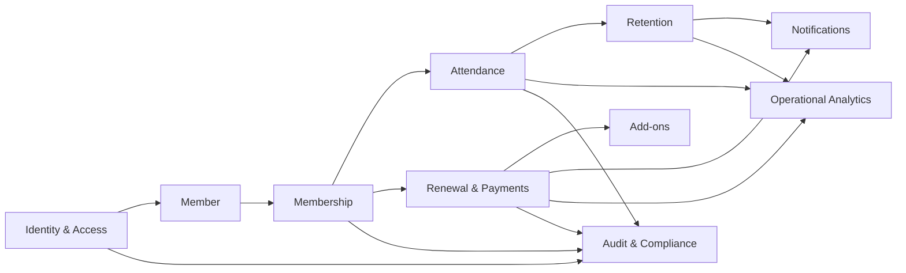

# GymPulse Project Overview

## Document Control

- Status: `Confirmed foundation / evolving product definition`
- Owner: Product Architecture
- Audience: Product, Design, Engineering, QA, Security, DevOps, Operations
- Scope: Project-level understanding before implementation
- Supersedes: high-level overview portions of `../00-product-blueprint.md`

## 1. Purpose

This document establishes the current shared understanding of GymPulse before deeper architecture or implementation decisions are made. It separates source-backed requirements, GymPulse extensions, assumptions, unresolved questions, and future capabilities so later documents do not silently turn ideas into requirements.

GymPulse documentation is intended to be the Single Source of Truth for implementation and operations. Source code must implement approved requirements and ADRs, not undocumented assumptions.

## 2. Current Understanding of the Project

### 2.1 Confirmed product foundation

GymPulse begins as a gym operations and member-retention product focused on the operational loop:

```text
Attendance
  -> inactivity detection
  -> staff follow-up
  -> member return or disposition
  -> membership renewal
  -> verified payment
  -> relevant add-on delivery
  -> measurable outcome
```

The product is not currently defined as a generic consumer fitness super-app. Phase 1 value comes from helping a gym see attendance, identify disengagement early, create a reliable staff action queue, collect renewals correctly, and track whether interventions worked.

### 2.2 Confirmed initial users

Phase 1 centers on:

- `Member`
- `Owner / Manager`
- `Front Desk Staff`

A complete `Trainer` application is not required for the initial retention MVP. Trainer-related functionality may appear only where needed for PT allocation, availability, or future expansion.

### 2.3 Confirmed core capabilities

Current source-backed Phase 1 capabilities include:

- member records,
- membership plans and membership lifecycle,
- QR attendance,
- assisted staff check-in,
- attendance history,
- inactivity/no-show rules,
- red-list/action queue,
- follow-up outcomes and next actions,
- member return resolution,
- fair attendance goal/streak behavior,
- renewal reminder windows,
- renewal order and payment state,
- verified payment before membership extension,
- receipts where supported,
- PT, diet/nutrition service, and product add-ons,
- owner operational dashboard,
- daily owner summary,
- transactional notifications,
- consent separation,
- auditability,
- data-quality alerts,
- pilot measurement.

### 2.4 GymPulse product extensions

The existing GymPulse planning expands beyond the original single-gym blueprint with a proposed path toward:

- standalone commercial SaaS,
- explicit tenant hierarchy,
- organizations, gyms, and branches,
- lead CRM,
- trainer operations,
- class booking,
- workouts and exercise programming,
- nutrition tracking,
- health and progress tracking,
- human coaching,
- multi-branch management,
- SaaS subscriptions,
- AI-assisted analytics and coaching.

These extensions are not automatically Phase 1 requirements. Each requires explicit product requirements before implementation.

### 2.5 Repository state

At the start of this documentation restructuring, the repository contains project documentation only. No production application code, infrastructure code, database migrations, or deployment configuration is yet authoritative.

This is intentional. The documentation phase is being used to remove ambiguity before repository scaffolding and implementation.

## 3. Known Requirements

The following requirements are sufficiently established to drive deeper specification.

### 3.1 Operational integrity

- Attendance must be attributable to a valid member and branch context.
- Assisted attendance must retain staff actor and reason.
- Duplicate attendance must be handled deliberately rather than accidentally creating multiple visits.
- Financial state must not be inferred from a client-side payment initiation event.
- Provider-confirmed online payment is the source of truth for online payment success.
- Critical side effects must be idempotent.
- Attendance corrections, payment reversals, and follow-up history must remain auditable.

### 3.2 Retention workflow

- The inactivity threshold must be configurable.
- Frozen/paused, expired, and cancelled memberships must not enter the standard active-member no-show workflow.
- A member should not receive duplicate active no-show cases for the same rule context.
- Staff must be able to record contact outcome and next action.
- A valid return visit must be capable of resolving the relevant open case without deleting its history.

### 3.3 Renewal workflow

- Renewal reminders occur in configurable stages before expiry.
- Renewal choices must show commercial terms and final payable amount.
- Renewal selection, payment, and membership extension are separate concepts.
- Membership must extend only after an authoritative successful payment or a separately authorized offline-payment flow.
- Duplicate provider callbacks must not extend membership twice.

### 3.4 Member trust

- Paid add-ons must not be pre-selected.
- Motivation/streak behavior must not unfairly punish normal rest patterns or approved pauses.
- Transactional/service communication and marketing consent must be modeled separately.
- Health, nutrition, transformation, or income outcomes must not be guaranteed by the product.

### 3.5 Owner usability

- The owner experience prioritizes actionable lists over decorative dashboards.
- The system must expose members requiring contact, renewals due, payment exceptions, returns after follow-up, and pending add-on fulfillment/usage.
- Core metrics must reconcile to canonical operational records.

## 4. Assumptions

The following are working assumptions, not approved universal business rules.

| ID | Assumption | Status | Validation Required |
|---|---|---|---|
| A-001 | Initial pilot is a local Indian gym or fitness studio. | `Assumed` | Pilot selection |
| A-002 | A `10 day` inactivity threshold is a useful sample default. | `Assumed` | Gym owner policy |
| A-003 | `INR` is the initial commercial currency. | `Assumed` | Pilot scope |
| A-004 | WhatsApp and phone are important staff/member communication channels. | `Assumed` | Pilot workflow |
| A-005 | One organization may initially have one gym and one branch even if the future data model supports more. | `Proposed` | Architecture review |
| A-006 | Phase 1 should minimize repeated member actions beyond check-in and renewal. | `Proposed` | Product validation |
| A-007 | Advanced workout, nutrition tracking, health data, coaching, and AI features are later phases. | `Proposed` | Product roadmap approval |
| A-008 | Gym-local timezone controls business dates and scheduled workflows. | `Proposed` | Architecture approval |

Canonical assumption tracking is in `assumptions.md`.

## 5. Missing Information and Decisions Required

The project must not fabricate the following information.

### 5.1 Pilot business policy

- exact pilot gym and member count,
- current attendance method,
- exact no-show threshold,
- new-member behavior before first attendance,
- allowed pause/freeze reasons,
- who can approve a freeze,
- whether freeze extends membership expiry,
- renewal extension-date calculation,
- refund/cancellation policy,
- permitted offline payment methods,
- legal receipt/invoice requirements,
- exact staff roles and approval limits,
- member communication consent process.

### 5.2 Product boundaries

The following require explicit product decisions before they become requirements:

- whether GymPulse is gym-operations-first only or also a direct-to-consumer fitness app,
- whether members receive full workout programming in the first commercial release,
- whether nutrition is meal logging, meal planning, dietitian service delivery, AI recommendation, or some combination,
- what health data is collected and why,
- whether human coaching is a marketplace, gym-trainer workflow, or both,
- whether AI is primarily analytics, member coaching, trainer assistance, or all three,
- which country/region privacy and health-data obligations apply at launch.

### 5.3 Provider and platform decisions

Not yet considered final without ADRs:

- authentication provider,
- database hosting provider,
- job runner,
- cache/Redis requirement,
- payment provider,
- WhatsApp/messaging provider,
- email provider,
- push provider,
- analytics provider,
- observability provider,
- object storage provider,
- web/mobile hosting platform,
- AI model/provider strategy.

## 6. Proposed System Boundaries

### 6.1 Core Phase 1 bounded contexts

The system should initially be decomposed conceptually into these business boundaries:



These are domain boundaries first, not separate microservices.

### 6.2 Future business boundaries

The following are future or proposed domains that should remain independently specifiable:

- Workout
- Exercise Library
- Training Programs
- Nutrition
- Meals
- Health Metrics
- Progress
- Human Coaching
- AI Coach
- SaaS Subscription
- Cross-tenant Platform Administration

### 6.3 External system boundary

GymPulse is expected to integrate with external systems rather than own their underlying regulated functionality:

- payment processors,
- WhatsApp/SMS/email/push providers,
- object storage,
- analytics/observability systems,
- optional biometric/attendance hardware,
- future wearable/health platforms,
- AI model providers.

External provider status must be translated into canonical GymPulse domain state at controlled integration boundaries.

## 7. Proposed Documentation Tree

The canonical documentation tree is defined in `../README.md`. It separates:

- overview,
- product,
- architecture,
- applications,
- backend,
- database,
- API,
- domains,
- AI,
- security,
- infrastructure,
- observability,
- testing,
- engineering,
- operations,
- roadmap,
- ADRs.

Additional core business domains `memberships`, `attendance`, `retention`, and `payments` are included because they are fundamental to GymPulse Phase 1.

## 8. Recommended Documentation Creation Order

The documentation work should proceed as follows:

### Phase A: Foundation

1. Project overview
2. Vision
3. Goals
4. Scope
5. Glossary
6. Assumptions/open decisions

### Phase B: Product definition

1. Product requirements
2. Personas
3. User roles and permission expectations
4. User journeys
5. Feature catalog
6. Functional requirements
7. Non-functional requirements
8. Success metrics

### Phase C: Architecture

1. Architecture principles
2. C4 System Context
3. C4 Container Architecture
4. Component Architecture
5. Data flows and sequences
6. Technology stack proposal
7. ADRs for each major commitment

### Phase D: Domains, data, and interfaces

1. Phase 1 domain documents
2. Future domain skeletons only after product requirements exist
3. Database architecture
4. API architecture
5. Events/background jobs

### Phase E: Cross-cutting architecture

1. AI
2. Security and privacy
3. Infrastructure and DevOps
4. Observability
5. Testing
6. Engineering standards
7. Operations/runbooks
8. Roadmap

### Phase F: Consistency audit

Before implementation begins, validate:

- requirement IDs are unique,
- status labels are consistent,
- identifiers and data types agree across docs,
- state machines agree across domain/API/database docs,
- authentication and authorization descriptions agree,
- ADRs match implementation recommendations,
- every MVP capability has acceptance criteria and test coverage intent,
- unresolved business rules remain explicitly unresolved.

## 9. Documentation-to-Implementation Gate

Repository scaffolding may begin after product boundaries and high-level architecture are stable, but production feature implementation should not begin for a domain until the following exist:

1. approved scope,
2. functional requirements,
3. non-functional requirements that apply,
4. domain model and business rules,
5. API/data interface expectations,
6. authorization expectations,
7. failure-state requirements,
8. observability expectations,
9. testing acceptance criteria,
10. relevant ADRs for major technical choices.

## 10. Related Documents

- `../README.md`
- `vision.md`
- `goals.md`
- `scope.md`
- `glossary.md`
- `assumptions.md`
- `../01-product/product-requirements.md`
- legacy source: `../00-product-blueprint.md`
- legacy source: `../01-product-requirements.md`
- legacy open decisions: `../16-open-decisions.md`
