# GymPulse User Journeys

## Document Control

- Status: `Draft v1.0`
- Scope: Phase 1 end-to-end product journeys
- Audience: Product, UX, Frontend, Backend, QA, Operations
- Migration source: `../03-user-flows.md`

## 1. Purpose

Define the end-to-end journeys GymPulse must support across member, staff, owner, automation, and payment-provider interactions.

These journeys are product contracts. Detailed API payloads and database transitions belong in later technical documents.

## 2. Journey Conventions

- Client screens do not decide authorization, payment truth, membership eligibility, or final business state.
- Critical mutations must tolerate retries without duplicate effects.
- Sensitive staff actions must be attributable.
- Scheduled work uses gym-local business time where relevant.
- Every journey must define success, blocked, error, and retry behavior.

## 3. Journey JRN-001: Member Entry and Home

### Goal

A member opens GymPulse and understands their current operational state immediately.

### Entry conditions

- member account/link exists,
- authentication or verified lookup mechanism is available.

### Happy path

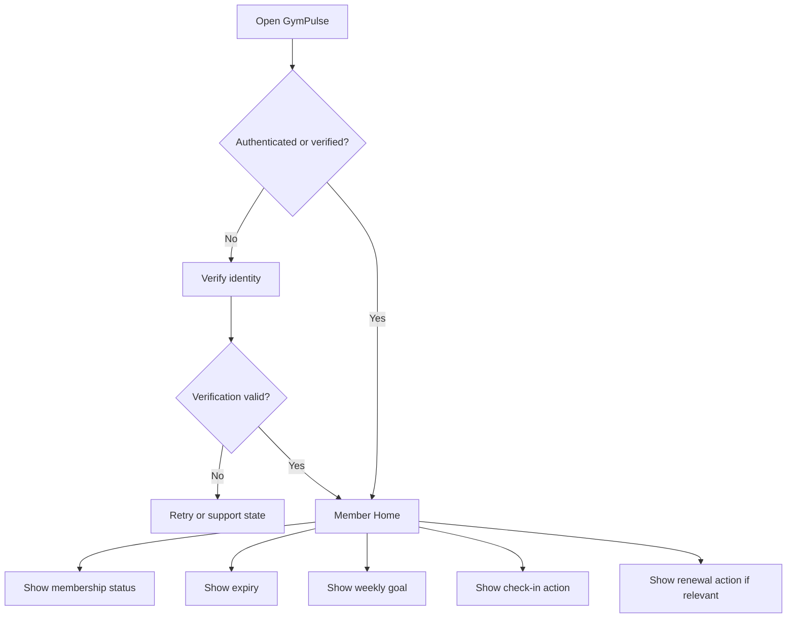

### Home priority

1. membership state,
2. exact expiry,
3. weekly attendance progress,
4. check-in,
5. renewal when relevant,
6. purchased/add-on service state when relevant.

### Acceptance signals

- user can distinguish `Active`, `Frozen`, `Expired`, and other supported states,
- exact expiry is visible,
- inaccessible actions explain why they are unavailable.

## 4. Journey JRN-002: QR Check-in

### Goal

Record one valid attendance event with minimal friction.

### Preconditions

- member identity established,
- QR/session token available,
- membership eligible,
- branch allowed.

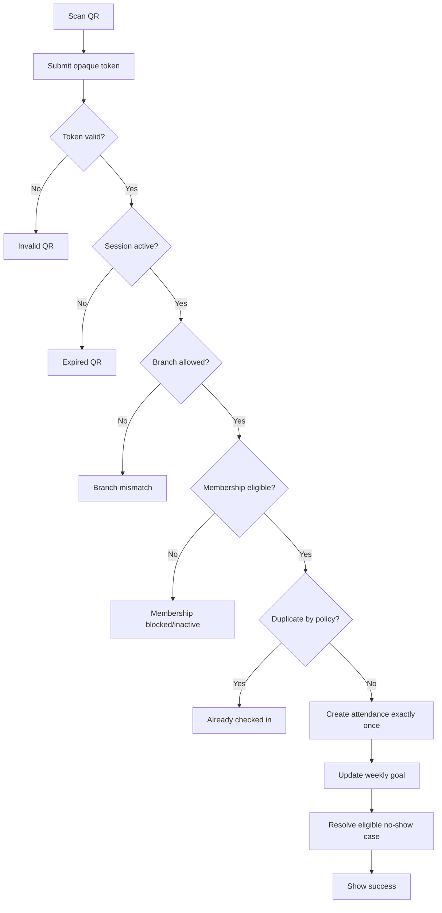

### Required result

- attendance reference,
- server timestamp,
- branch,
- current weekly-goal state.

### Retry behavior

A retry of the same successful logical request must return the canonical result rather than create another attendance record.

### Related requirements

- `FR-ATTENDANCE-001` through `FR-ATTENDANCE-006`
- `NFR-RELIABILITY-001`

## 5. Journey JRN-003: Assisted Check-in

### Actor

Front Desk Staff or another explicitly authorized staff role.

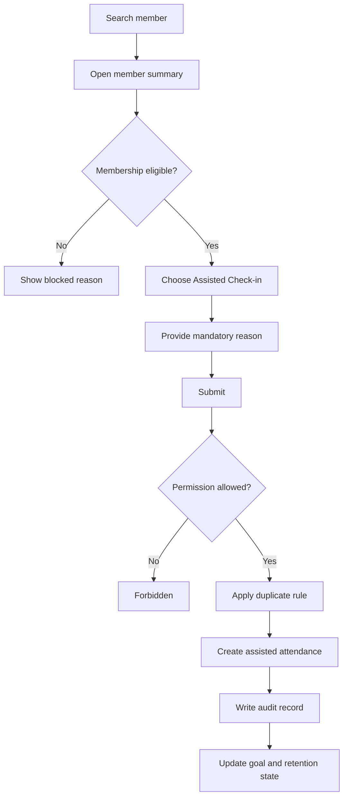

### Business rules

- actor is mandatory,
- reason is mandatory,
- source is `assisted`,
- standard eligibility and duplicate protections still apply unless a separately approved override policy exists.

## 6. Journey JRN-004: Daily No-show Detection

### Actor

Background automation.

### Goal

Create one actionable retention case when an eligible member crosses the configured inactivity threshold.

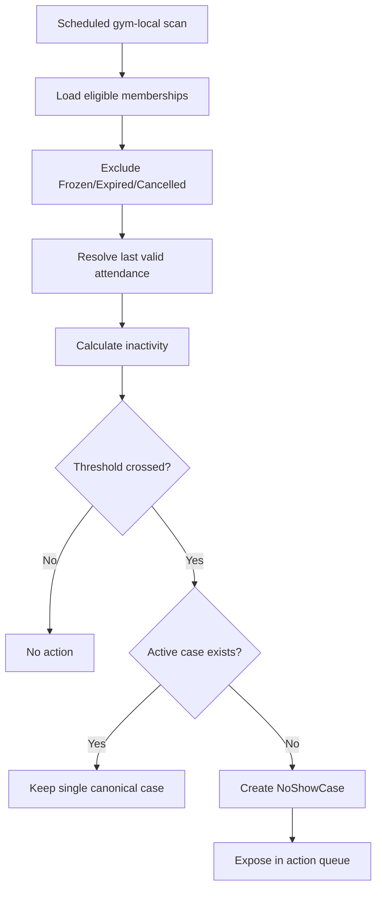

### Failure rules

- rerunning the same scan must not create duplicate active cases,
- a failed tenant scan must be observable and retryable,
- one tenant failure must not leak or mix another tenant's data.

## 7. Journey JRN-005: Staff Follow-up on At-risk Member

### Goal

Turn a red-list entry into a recorded intervention and next action.

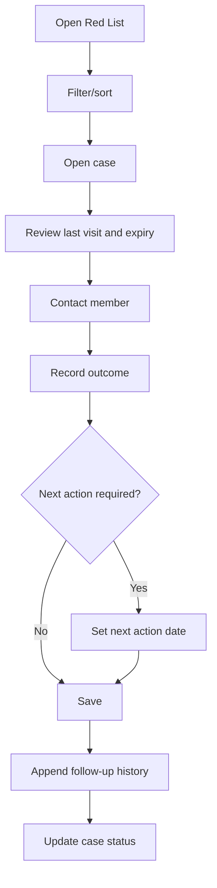

### Initial outcomes

- `WillReturn`
- `Injured`
- `Travelling`
- `TimingIssue`
- `Unhappy`
- `NoResponse`
- `Cancelled`

### Important behavior

Past follow-up history remains visible. Corrections must not silently erase prior contact records.

## 8. Journey JRN-006: Member Returns After Follow-up

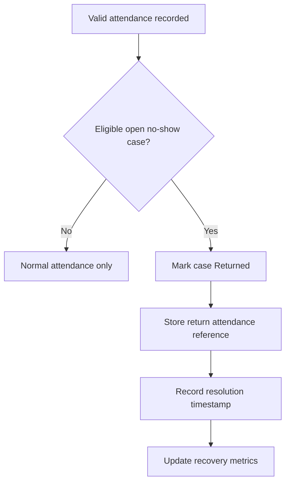

The system must preserve original risk/follow-up history.

## 9. Journey JRN-007: Approved Pause While At Risk

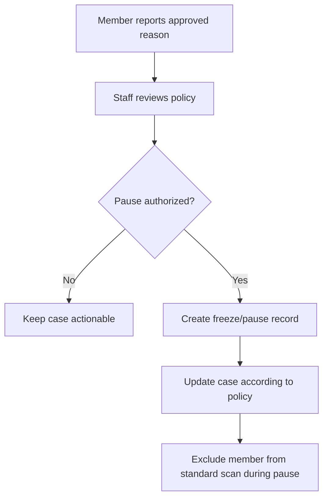

Whether the pause extends expiry is an open business policy and must not be assumed globally.

## 10. Journey JRN-008: Renewal Reminder

### Actor

Background automation.

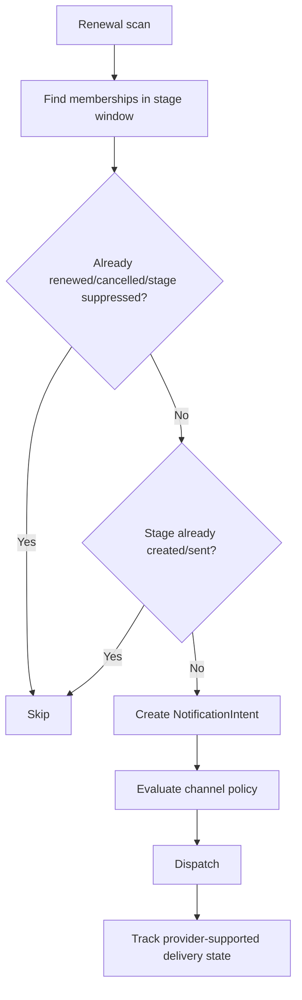

Typical configurable stages:

- D-14 optional,
- D-7 primary,
- D-3 reminder,
- D0 expiry-day,
- optional post-expiry service follow-up.

## 11. Journey JRN-009: Member Renewal Purchase

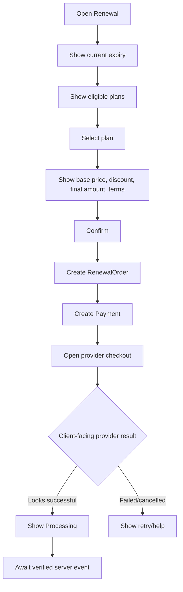

Client-side payment success is never sufficient to extend membership.

## 12. Journey JRN-010: Verified Payment Applies Renewal

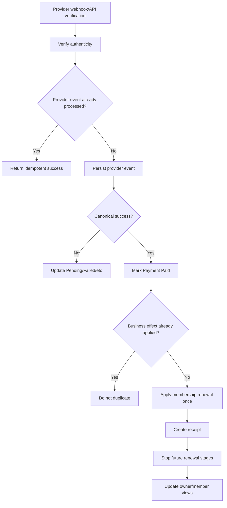

### Invariants

- no double extension,
- no duplicate effective receipt,
- provider event history retained,
- financial history remains auditable.

## 13. Journey JRN-011: Failed Payment Recovery

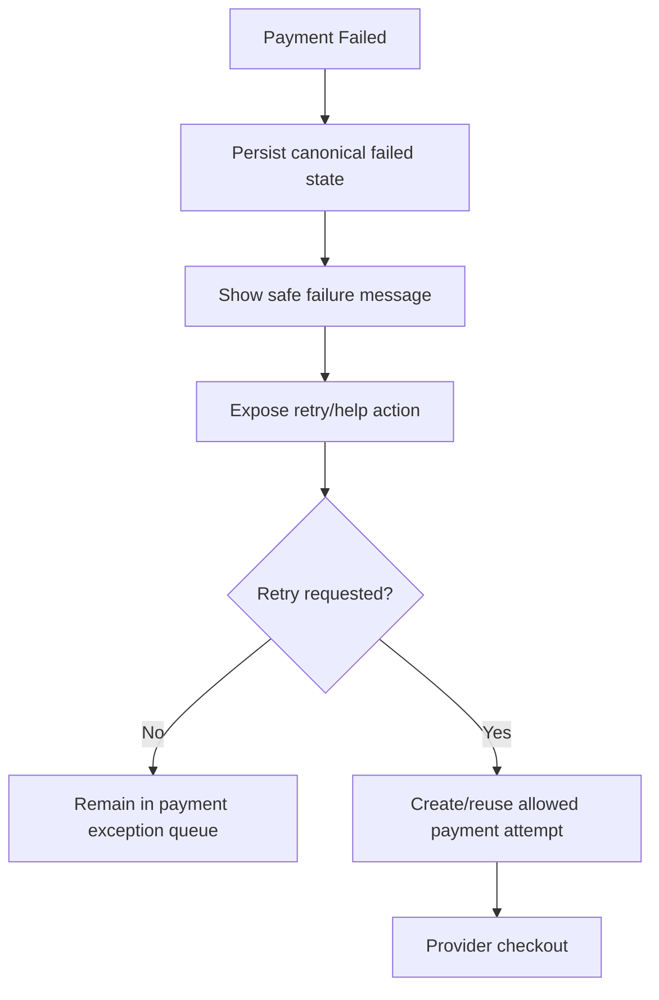

A failed payment must remain distinct from `member did not respond`.

## 14. Journey JRN-012: Refund or Reversal

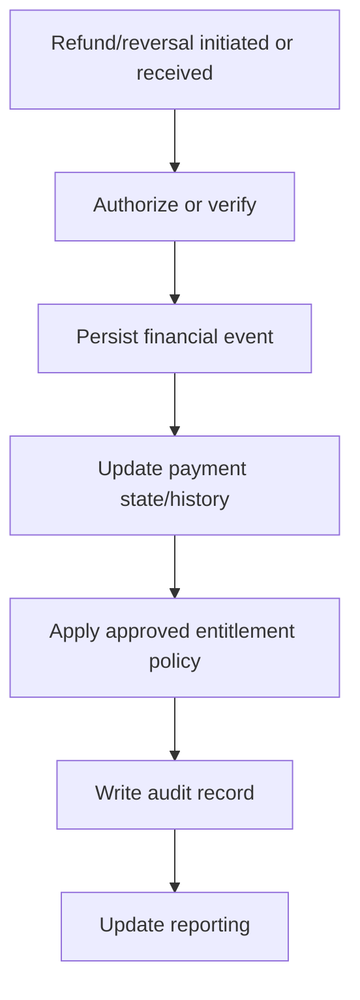

The effect of a refund on active membership is a business policy decision and must be explicit before production.

## 15. Journey JRN-013: Add-on Purchase and Fulfillment

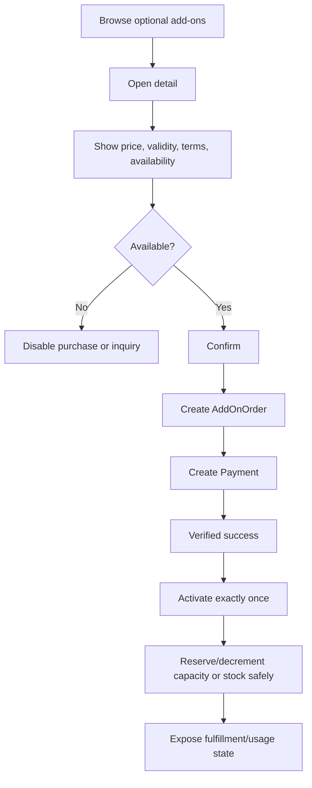

Add-ons are never pre-selected.

## 16. Journey JRN-014: Owner Daily Operations

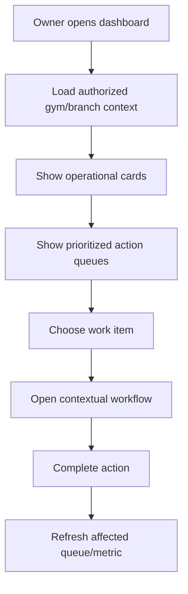

Recommended priority order:

1. overdue follow-up,
2. new no-show cases,
3. renewals due,
4. payment exceptions,
5. add-on fulfillment,
6. data-quality issues.

## 17. Journey JRN-015: Member Import for Pilot

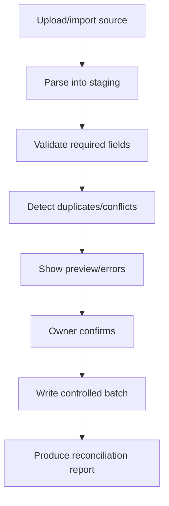

Missing expiry or membership state must not be silently fabricated.

## 18. Journey JRN-016: Communication Preference Change

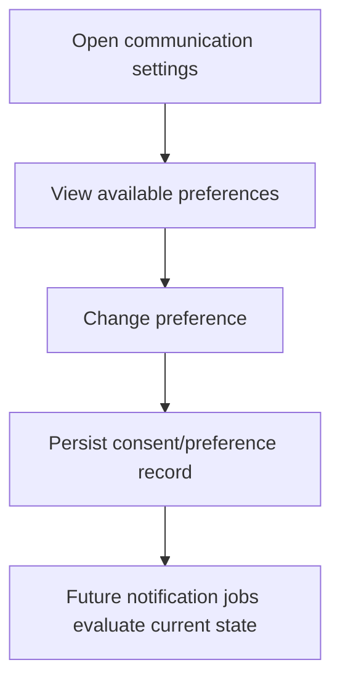

Marketing and service/transactional communication must remain separate concepts.

## 19. Cross-Journey Error Recovery

### Network timeout after mutation

Retry using the same logical idempotency key when the operation supports it.

### Stale client state

Server rejects invalid state transition and returns canonical state or conflict information.

### Provider webhook replay

Provider event deduplication plus business-effect uniqueness prevents duplicate effects.

### Job retry

Use deterministic business keys and database constraints rather than only in-memory locks.

## 20. Journey Completion Checklist

A journey is not implementation-ready until it defines:

- entry condition,
- actor,
- permissions,
- happy path,
- loading state,
- empty state where relevant,
- validation failure,
- authorization failure,
- business-rule rejection,
- network failure,
- retry behavior,
- duplicate/replay behavior,
- audit behavior for sensitive actions,
- observable success metric.

## 21. Related Documents

- `personas.md`
- `user-roles.md`
- `functional-requirements.md`
- `success-metrics.md`
- `../04-backend/background-jobs.md` (future)
- `../06-api/endpoints.md` (future)
