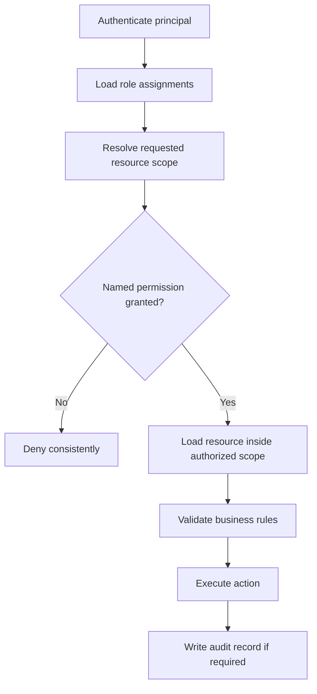

# GymPulse User Roles

## Document Control

- Status: `Draft v1.0`
- Scope: Product-facing roles, scopes, and permission model
- Audience: Product, Backend, Frontend, Security, QA
- Migration source: `../02-user-roles-permissions.md`

## 1. Purpose

Define GymPulse roles, authorization scopes, named capabilities, sensitive-action controls, and the Phase 1 permission baseline.

This document describes product authorization semantics. Authentication implementation belongs in `../06-api/authentication.md` and `../09-security/authentication.md` once those documents are created.

## 2. Authorization Principles

### AUTH-PRIN-001 Server-side enforcement

UI visibility is never an authorization boundary. Every protected read or mutation must be authorized on the server.

### AUTH-PRIN-002 Capability-based permissions

Code should check named capabilities, not scatter role-name checks across controllers and screens.

Preferred:

```ts
requirePermission(principal, "attendance.checkin.assisted", scope)
```

Avoid:

```ts
if (user.role === "owner") {
  // privileged action
}
```

### AUTH-PRIN-003 Scoped assignments

A user may hold one or more role assignments, each with an explicit scope.

```text
Platform
  -> Organization
      -> Gym
          -> Branch
```

### AUTH-PRIN-004 Least privilege

Roles expose only the capabilities required for their jobs.

### AUTH-PRIN-005 Sensitive-action auditability

High-impact mutations require actor attribution and audit context.

## 3. Role Assignment Model

Conceptual model:

```text
User
  -> RoleAssignment
      -> Role
      -> ScopeType
      -> ScopeId
      -> PermissionSet
```

Example:

```json
{
  "role": "front_desk",
  "scopeType": "branch",
  "scopeId": "branch_123"
}
```

One user may later hold different assignments across multiple branches or gyms.

## 4. Phase 1 Roles

## ROLE-MEMBER Member

**Scope:** `Self`

Primary capabilities:

- view own profile,
- view own membership,
- view own attendance,
- perform own QR check-in,
- view own weekly goal,
- view own renewal options,
- create own approved payment attempt,
- view own payment state and receipt,
- view available add-ons,
- manage own supported communication preferences.

Explicitly denied:

- viewing another member,
- manually changing attendance,
- changing membership dates,
- marking payment as paid,
- reading internal follow-up notes,
- changing gym configuration,
- accessing owner analytics.

## ROLE-FRONT-DESK Front Desk Staff

**Default scope:** `Branch`

Primary capabilities:

- search members,
- view membership eligibility,
- view attendance history,
- create assisted attendance with mandatory reason,
- record authorized follow-up outcomes,
- inspect renewal/payment state relevant to member service,
- share an existing receipt,
- perform specific membership actions if explicitly granted.

Restricted by default:

- plan pricing changes,
- tenant settings,
- role management,
- refunds,
- arbitrary cross-branch access,
- unrestricted exports.

## ROLE-OWNER Owner

**Default scope:** `Gym`

Primary capabilities:

- manage members,
- manage plans,
- manage membership state,
- manage approved freezes,
- configure no-show threshold,
- configure renewal windows,
- manage add-ons,
- review operational KPIs,
- review authorized audit history,
- manage delegated staff access,
- inspect payment and refund state,
- export authorized operational data.

Owner status does not remove the need for explicit permissions on especially sensitive operations.

## ROLE-MANAGER Manager

**Status:** `Confirmed role, exact permission profile open`

Manager is a delegated operational role, not necessarily equivalent to Owner.

Likely capabilities:

- daily operational dashboard,
- member management,
- no-show assignment/follow-up,
- membership operations,
- renewal/payment exception review.

Potentially restricted capabilities:

- price changes,
- refunds,
- role management,
- bulk export,
- tenant-level settings.

The final pilot permission set must be approved rather than inferred.

## 5. Future Roles

- `Trainer`
- `SalesStaff`
- `BranchManager`
- `OrganizationAdmin`
- `Finance`
- `PlatformSupport`
- `PlatformAdmin`

Future roles must be added through explicit capability matrices rather than broad wildcard access.

## 6. Permission Naming Convention

Use dot-separated capability identifiers.

```text
member.read
member.create
member.update
member.export
membership.read
membership.create
membership.update
membership.freeze
membership.cancel
plan.read
plan.manage
attendance.read
attendance.checkin.self
attendance.checkin.assisted
attendance.correct
retention.case.read
retention.case.assign
followup.create
followup.correct
renewal.read
renewal.manage
payment.read
payment.create
payment.record_offline
payment.refund
receipt.read
addon.read
addon.manage
analytics.read
settings.manage
roles.manage
audit.read
export.create
```

Capabilities should be stable identifiers even if UI labels change.

## 7. Scope Semantics

Supported conceptual scopes:

- `Self`
- `Branch`
- `Gym`
- `Organization`
- `Platform`

Authorization must evaluate both capability and resource scope.

A user with `member.read` for Branch A does not automatically gain `member.read` for Branch B.

## 8. Phase 1 Permission Matrix

Legend:

- `Self`: own records only
- `Branch`: authorized branch
- `Gym`: authorized gym
- `Conditional`: explicit capability/policy required
- `No`: denied by default

| Capability | Member | Front Desk | Owner | Manager |
| --- | --- | --- | --- | --- |
| View member profile | Self | Branch | Gym | Gym/Branch |
| Create member | No | Conditional | Gym | Conditional |
| Edit member | Limited Self | Conditional | Gym | Conditional |
| View membership | Self | Branch | Gym | Gym/Branch |
| Create membership | No | Conditional | Gym | Conditional |
| Change membership dates | No | Conditional | Conditional | Conditional |
| Freeze membership | No | Conditional | Conditional | Conditional |
| View attendance | Self | Branch | Gym | Gym/Branch |
| QR self check-in | Self | No | No | No |
| Assisted check-in | No | Branch | Conditional | Conditional |
| Correct attendance | No | Conditional | Conditional | Conditional |
| View no-show queue | No | Branch | Gym | Gym/Branch |
| Record follow-up | No | Branch | Gym | Gym/Branch |
| Assign case | No | Conditional | Gym | Conditional |
| Manage plans | No | No | Conditional | Conditional |
| View renewal | Self | Branch | Gym | Gym/Branch |
| Create online payment | Self | Conditional | Conditional | Conditional |
| Mark online payment paid | No | No | No | No |
| Record offline payment | No | Conditional | Conditional | Conditional |
| View payment | Self | Branch | Gym | Gym/Branch |
| Refund | No | No | Conditional | Conditional |
| Manage add-ons | No | No | Gym | Conditional |
| View owner KPIs | No | No | Gym | Conditional |
| Manage settings | No | No | Conditional | Conditional |
| Manage roles | No | No | Conditional | No/Conditional |
| View audit | No | No | Conditional | Conditional |
| Export data | No | No | Conditional | Conditional |

## 9. Sensitive Actions

The following actions require stronger authorization and audit requirements:

- membership backdating,
- expiry override,
- attendance correction,
- offline payment recording,
- refund/reversal,
- plan price changes,
- stock adjustment,
- role/permission changes,
- retention threshold changes,
- renewal schedule changes,
- bulk import,
- bulk export.

Recommended audit fields:

```text
actor_id
tenant_id
gym_id
branch_id
permission
resource_type
resource_id
action
reason
before_summary
after_summary
request_id
created_at
```

## 10. Tenant Isolation Rules

### RULE-AUTH-001 Explicit tenant scope

Every tenant-owned operation must resolve organization/gym/branch scope from authenticated context and resource relationships.

### RULE-AUTH-002 Client scope is untrusted

Client-provided tenant identifiers may be routing hints but must be independently verified.

### RULE-AUTH-003 Background jobs carry scope

Jobs must execute with explicit tenant context and must not query unscoped global data accidentally.

### RULE-AUTH-004 Storage is scoped

Protected object-storage paths must include tenant ownership and use authorized access mechanisms.

### RULE-AUTH-005 Unauthorized existence is not leaked

APIs should avoid revealing protected resource existence through inconsistent errors.

## 11. Member Data Visibility Classes

### Member-visible

- own profile,
- own membership,
- own attendance,
- own renewal offers,
- own payment state,
- own receipts,
- own purchased add-ons.

### Staff-only

- internal follow-up notes,
- no-show case state,
- operational reason codes,
- internal assignee information.

### Restricted

- role assignments,
- audit log,
- cross-member data,
- tenant finance analytics,
- platform support tooling.

## 12. Authorization Request Flow



## 13. Failure Behavior

Expected API semantics:

- `401 UNAUTHENTICATED`
- `403 FORBIDDEN`
- `404 NOT_FOUND` when existence should not be disclosed

Errors must not expose:

- other tenant IDs,
- hidden role assignments,
- private member data,
- database internals.

## 14. Testing Requirements

Authorization test suite must include:

- member cannot read another member,
- front desk cannot access unauthorized branch,
- manually calling a hidden UI endpoint still enforces permission,
- revoked role cannot perform future protected action,
- malformed background job scope cannot cross tenant boundary,
- export respects scope,
- audit access requires named permission,
- payment success cannot be forged by staff/client role.

## 15. Open Decisions

- member authentication method,
- final Owner vs Manager permission split,
- attendance correction authority,
- offline payment authority,
- refund approval model,
- support impersonation/elevation policy,
- cross-branch member portability.

## 16. Related Documents

- `personas.md`
- `functional-requirements.md`
- `user-journeys.md`
- `../09-security/authorization.md` (future)
- `../00-overview/assumptions.md`
- `../16-open-decisions.md` (legacy decision register until migrated)
