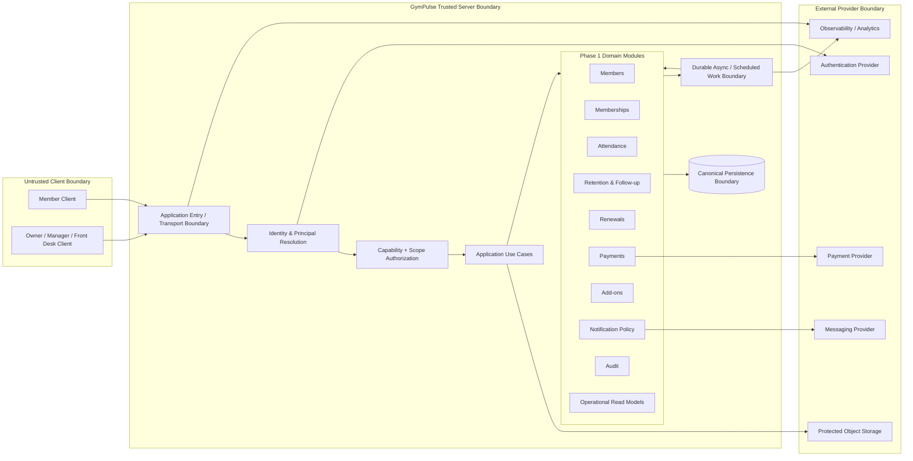

# GymPulse Architecture Overview

## Document Control

- Document Maturity: `Draft`
- Scope Status: `In Scope` for Phase 1 architecture
- Audience: Product Architecture, Backend, Frontend, Mobile, Security, DevOps, QA, Operations
- Canonical Decision Register: `../00-overview/assumptions.md`
- Architecture Principles: `architecture-principles.md`

## 1. Purpose

Define the technology-neutral high-level architecture for GymPulse Phase 1.

This document explains:

- the system boundary,
- architecture drivers,
- major logical responsibilities,
- domain ownership,
- trust boundaries,
- synchronous and asynchronous interaction patterns,
- consistency expectations,
- failure-isolation rules,
- observability expectations,
- unresolved architecture decisions that later documents and ADRs must respect.

It does **not** select frameworks, database providers, hosting platforms, job runners, payment providers, messaging providers, or deployment products.

## 2. Architecture Position

GymPulse Phase 1 is an operations and retention platform centered on this business loop:

```text
Attendance
  -> inactivity/risk detection
  -> staff follow-up
  -> member return/outcome
  -> renewal
  -> verified payment
  -> optional add-on activation/fulfillment
  -> measurable operational outcome
```

The architecture must optimize first for:

1. tenant isolation,
2. authorization correctness,
3. attendance and financial integrity,
4. replay-safe/idempotent effects,
5. auditable operational mutations,
6. gym-local business-time correctness,
7. operational failure visibility,
8. simple Phase 1 delivery without premature distributed infrastructure.

Future workout, advanced nutrition, health, coaching, multi-branch product workflows, and AI capabilities remain outside the active Phase 1 architecture unless separately promoted through product requirements.

## 3. Primary Architecture Drivers

### 3.1 Security and tenancy

Primary drivers:

- `FR-AUTHZ-001` tenant-scoped authorization,
- `FR-AUTHZ-002` named capability enforcement,
- `FR-AUTHZ-003` self-only member access,
- `FR-CROSS-003` explicit tenant context,
- `NFR-SECURITY-001` tenant isolation,
- `NFR-SECURITY-002` least privilege,
- `NFR-SECURITY-003` server-side authorization,
- `NFR-SCALABILITY-001` explicit multi-tenant ownership.

Architectural implication:

Every trusted server-side operation must resolve authenticated identity, authorized tenant/resource scope, and named capabilities before protected business logic or data access executes.

### 3.2 Canonical business truth

Primary drivers:

- `FR-CROSS-001`,
- `FR-MEMBERSHIP-004`,
- `FR-PAYMENT-002`,
- `NFR-RELIABILITY-005`.

Architectural implication:

Clients render and request state. They do not become authoritative for membership entitlement, attendance validity, payment success, authorization, no-show state, or financial effects.

### 3.3 Reliability and replay safety

Primary drivers:

- `FR-ATTENDANCE-006`,
- `FR-RETENTION-005`,
- `FR-PAYMENT-005`,
- `FR-PAYMENT-006`,
- `FR-PAYMENT-007`,
- `FR-NOTIFICATION-002`,
- `FR-CROSS-002`,
- `NFR-RELIABILITY-001`,
- `NFR-RELIABILITY-002`,
- `NFR-RELIABILITY-003`,
- `NFR-RELIABILITY-004`.

Architectural implication:

Critical requests, provider callbacks, scheduled jobs, and asynchronous continuations require durable replay protection and concurrency-safe invariants.

### 3.4 Auditability and historical integrity

Primary drivers:

- `FR-AUDIT-001`,
- `FR-AUDIT-003`,
- `FR-ATTENDANCE-010`,
- `FR-ATTENDANCE-011`,
- `FR-PAYMENT-009`,
- `NFR-SECURITY-009`,
- `NFR-DATA-004`.

Architectural implication:

Sensitive changes must remain attributable and reconstructable. Corrections and reversals are modeled as controlled state/history changes rather than silent destructive replacement.

### 3.5 Time correctness

Primary drivers:

- `FR-CROSS-004`,
- `NFR-RELIABILITY-006`,
- `NFR-DATA-003`,
- `NFR-TESTABILITY-005`.

Architectural implication:

Canonical event timestamps use UTC. Gym-local timezone controls day/week boundaries, no-show calculations, renewal windows, daily summaries, and other calendar-based rules.

### 3.6 Operational simplicity

Primary drivers:

- `NFR-SCALABILITY-002`,
- `NFR-SCALABILITY-004`,
- `NFR-SCALABILITY-005`,
- `NFR-MAINTAINABILITY-001`,
- `NFR-TESTABILITY-001`.

Architectural implication:

Phase 1 should use explicit logical modules and stable boundaries without assuming one deployable service per business domain.

`D-ARCH-005` is `DECIDED` via accepted `ADR-0001`; this overview now treats the Phase 1 modular-monolith direction as canonical while preserving separately governed deployment/service-extraction decisions.

## 4. High-Level Logical Architecture



This diagram shows logical responsibilities and trust boundaries only. It is **not** a deployment diagram and does not decide `D-ARCH-006`, `D-ARCH-007`, `D-ARCH-009`, or provider choices.

## 5. Trust Boundaries

## 5.1 Client boundary

Member and staff clients are untrusted with respect to canonical business truth.

Clients may provide:

- user input,
- routing identifiers,
- QR token/session input,
- idempotency keys,
- pagination/filter intent,
- provider checkout return context.

Clients must not be trusted to provide final truth for:

- tenant authorization,
- resource ownership,
- membership eligibility,
- payment success,
- final payable amount,
- staff identity,
- provider webhook authenticity,
- server timestamps,
- sensitive state transitions.

Relevant principles:

- `ARCH-PRIN-001`,
- `ARCH-PRIN-002`,
- `ARCH-PRIN-004`,
- `ARCH-PRIN-016`.

## 5.2 Trusted application boundary

The trusted application boundary owns:

1. principal resolution,
2. tenant/resource scope resolution,
3. capability authorization,
4. input validation,
5. application orchestration,
6. domain-rule execution,
7. transaction ownership,
8. canonical persistence,
9. durable effect scheduling,
10. audit/event production,
11. safe response contracts.

This boundary may later be deployed in one or more runtimes, but deployment shape does not change its responsibilities.

## 5.3 Provider boundary

Authentication, payment, messaging, storage, observability, and analytics systems are external dependencies.

Provider-specific data must be translated through controlled adapters or integration boundaries.

For security-sensitive provider callbacks, authenticity must be verified before canonical state can change.

Relevant requirements:

- `FR-PAYMENT-003`,
- `NFR-SECURITY-008`,
- `NFR-MAINTAINABILITY-003`,
- `NFR-TESTABILITY-002`.

## 6. Logical Layers and Dependency Direction

The architecture should preserve this dependency direction conceptually:

```text
Client/UI
  -> Transport / Application Entry
  -> Application Use Cases
  -> Domain Rules / Domain Ports
  -> Persistence / Provider Adapters
```

Cross-cutting concerns such as authorization, audit, observability, idempotency, and tenant scope apply at defined boundaries rather than being implemented ad hoc inside screens.

### 6.1 Presentation/client responsibilities

Own:

- rendering,
- navigation,
- form state,
- local interaction,
- accessibility behavior,
- request invocation,
- presentation formatting.

Do not own:

- entitlement rules,
- payment truth,
- tenant authorization,
- no-show calculation,
- final pricing authority,
- provider verification.

### 6.2 Transport/application-entry responsibilities

Own:

- request decoding,
- request/correlation identifier,
- authentication handoff,
- principal creation,
- tenant/resource-scope resolution,
- authorization invocation,
- boundary validation,
- stable error/response translation.

This boundary may be HTTP initially, but `D-ARCH-003` remains `PROPOSED` and no transport technology is accepted here.

### 6.3 Application-use-case responsibilities

Own orchestration of one business operation such as:

- check in member,
- create assisted attendance,
- record follow-up,
- create renewal order,
- apply verified payment event,
- activate add-on,
- create notification intent,
- generate an owner operational read model.

Application use cases coordinate domain owners and transactional resources but should not duplicate domain invariants.

### 6.4 Domain responsibilities

Domain modules own business rules and state transitions.

A domain may expose commands, queries, policies, or ports without implying a separate service or network boundary.

### 6.5 Infrastructure responsibilities

Infrastructure adapters implement persistence, external providers, scheduled execution, storage, and telemetry mechanisms selected later through canonical decisions/ADRs.

Domain/application code should not depend directly on provider payload shapes where an internal contract is appropriate.

## 7. Phase 1 Domain Ownership

The following are logical ownership boundaries, not microservices.

| Domain | Primary owned truth | Representative responsibilities |
|---|---|---|
| Identity & Access | GymPulse principal and authorization context | identity mapping, assignments, capability/scope evaluation |
| Members | member business record | profile, contact identity link, administrative member-record state |
| Memberships | entitlement period and membership lifecycle | plan relation, start/expiry, freeze, cancellation, eligibility |
| Attendance | canonical visit/check-in records | QR/assisted check-in, duplicate protection, correction history |
| Retention | no-show cases and follow-up history | inactivity case creation, assignment, follow-up, return resolution |
| Renewals | renewal commercial selection/order | eligibility window, selected terms, renewal-order lifecycle |
| Payments | payment and provider-event truth | verification, canonical payment state, effect dedupe, reconciliation |
| Add-ons | purchased add-on entitlement/fulfillment state | activation, session/stock constraints, usage/fulfillment |
| Notifications | business notification intent and policy state | stage dedupe, preference/policy evaluation, delivery tracking |
| Audit | sensitive mutation history | actor/system attribution and reconstructable change context |
| Operational Reporting | derived read models only | action queues, KPIs, dashboard summaries from canonical records |

### 7.1 Member vs Membership ambiguity

`D-DATA-007` remains unresolved.

The architecture currently treats entitlement truth as belonging to `Membership`, because attendance and renewal eligibility already depend on membership state under:

- `FR-MEMBERSHIP-002`,
- `FR-MEMBERSHIP-004`,
- `FR-MEMBERSHIP-006`,
- `FR-RETENTION-003`.

However, `FR-MEMBER-004` still defines overlapping `Paused`, `Expired`, and `Cancelled` values on `Member.status`.

Therefore:

- no architecture component may infer entitlement from `Member.status` alone,
- final domain/schema state machines must wait for `D-DATA-007`,
- this overview does not revise `FR-MEMBER-004`.

## 8. Canonical and Derived State

### Canonical state

Examples:

- membership lifecycle,
- attendance records,
- no-show cases,
- follow-up history,
- renewal orders,
- payment/provider-event/effect state,
- add-on orders and usage/fulfillment,
- notification intent/delivery state where observed,
- audit history.

Canonical state is server-side system-of-record data.

### Derived state

Examples:

- absent-day count,
- 7-day active member count,
- dashboard totals,
- renewal pipeline summaries,
- recovery metrics,
- weekly goal summaries if computed,
- read-model projections.

Derived state may be cached/materialized later, but it does not become an independent write authority.

### External state

Provider state remains external until authenticated/verified and translated into the appropriate GymPulse canonical state.

## 9. Synchronous Interaction Model

Synchronous handling is appropriate where a user needs an immediate authoritative result and the operation can finish safely within one request boundary.

Typical examples:

- member/staff lookup,
- membership eligibility read,
- QR check-in command,
- assisted check-in command,
- follow-up creation,
- renewal-order creation,
- payment checkout initialization,
- operational query reads.

Canonical synchronous request shape:

```text
request
  -> authenticate/resolve principal
  -> resolve tenant/resource scope
  -> authorize capability
  -> validate input
  -> execute application use case
  -> apply domain rules
  -> transaction / canonical write
  -> persist audit/durable continuation when required
  -> return canonical result
```

External network calls should not unnecessarily hold correctness-critical transactions open.

## 10. Asynchronous and Scheduled Interaction Model

Asynchronous work is appropriate for retryable, provider-bound, scheduled, or non-interactive effects.

Phase 1 examples include:

- daily no-show scans,
- renewal-stage scans,
- payment reconciliation,
- notification dispatch,
- notification delivery callbacks,
- owner daily summaries,
- data-quality scans,
- selected post-commit analytics/observability effects.

Required properties:

- explicit tenant context,
- deterministic business key or equivalent dedupe identity,
- replay safety,
- visible execution/failure state,
- bounded retry classification,
- stale-business-condition recheck where necessary,
- correlation with the originating operation where practical.

The exact background-job technology remains open under `D-ARCH-007`.

## 11. Transaction and Consistency Boundaries

### 11.1 Single-system atomicity

Where correctness requires multiple internal writes to succeed together, use an atomic transaction or equivalent durable database capability.

Examples:

- attendance creation plus idempotency record,
- no-show active-case uniqueness,
- canonical payment-state change plus payment-effect claim,
- add-on usage preventing negative balance,
- sensitive state change plus required audit record when policy requires atomic attribution.

### 11.2 Cross-system consistency

External providers cannot participate in a normal local database transaction.

Therefore provider workflows must use explicit state machines, verification, durable references, retries, and reconciliation.

Example payment flow:

```text
create internal payment
  -> initiate external checkout
  -> receive/verify provider evidence
  -> record provider event uniquely
  -> update canonical payment state
  -> claim business effect exactly once
  -> commit
  -> continue secondary notifications/analytics asynchronously
```

### 11.3 Async continuation durability

If losing a post-commit effect would violate a requirement, the continuation must be durably represented before the originating operation is considered complete enough to forget it.

This may later be implemented through an outbox, durable job system, or equivalent mechanism. This document does not choose the technology.

## 12. Failure Isolation

Failures should be isolated according to business criticality.

### Must not corrupt canonical state

- analytics provider outage,
- messaging provider outage,
- observability provider outage,
- delayed payment callback,
- failed owner-summary delivery.

### Must fail closed or remain unresolved

- failed authorization,
- unverifiable payment webhook,
- ambiguous/mismatched payment evidence,
- invalid membership eligibility,
- invalid tenant/resource scope.

### Must be recoverable/reconcilable

- pending payment after provider/network interruption,
- failed scheduled job,
- notification provider timeout,
- partial data import issues,
- data-quality inconsistencies.

Relevant principles:

- `ARCH-PRIN-011`,
- `ARCH-PRIN-013`,
- `ARCH-PRIN-014`.

## 13. Authorization Architecture Boundary

The architecture separates:

```text
Authentication Provider / Identity Proof
  -> GymPulse Principal Resolution
  -> Role/Capability Assignment Resolution
  -> Tenant/Resource Scope Resolution
  -> Named Capability Check
  -> Domain Business Rule
```

This preserves the distinction between authentication and authorization.

`D-ARCH-004`, `D-SEC-002`, and `D-ARCH-015` remain unresolved/proposed according to the canonical register.

## 14. Persistence Boundary

The architecture requires a canonical persistence capability that supports:

- durable transactional state,
- relational/integrity constraints where the chosen model supports them,
- concurrency-safe uniqueness for critical invariants,
- queryability for operational queues,
- historical reconstruction,
- backup/restore capability before production,
- tenant-aware access patterns,
- auditable schema evolution.

`D-ARCH-002` is `DECIDED` via accepted `ADR-0004`; PostgreSQL is the canonical transactional database engine. Managed provider, exact version, data-access tooling, RLS, recovery topology, and final schema remain separately governed.

The detailed schema in legacy `../06-database-schema.md` remains migration input and must not be treated as final canonical schema.

## 15. Integration Boundaries

### Authentication

External identity proof is translated into a GymPulse principal and authorization context.

### Payments

Provider checkout/webhook/status semantics are translated into canonical Payment and Provider Event concepts. Provider evidence cannot directly grant membership/add-on value without GymPulse validation and idempotent effect handling.

### Messaging

Business notification intent remains separate from provider delivery. Current eligibility/preferences should be rechecked before dispatch when stale queued work could produce an incorrect message.

### Object storage

Protected files must remain tenant-scoped and privately authorized by default. Exact provider and path/signing model remain open.

### Observability and analytics

Telemetry receives only the safe context necessary for diagnosis/measurement. Client analytics cannot become attendance, payment, or revenue truth.

## 16. Read Architecture

Operational reads should favor bounded, indexed, purpose-specific queries/read models rather than loading large tenant datasets into clients.

Examples:

- member search,
- red-list/no-show queue,
- renewal pipeline,
- payment exception queue,
- owner dashboard,
- add-on fulfillment queue,
- data-quality issue queue.

Relevant requirements:

- `NFR-PERFORMANCE-002`,
- `NFR-PERFORMANCE-003`,
- `NFR-PERFORMANCE-004`,
- `FR-DASHBOARD-003`,
- `FR-DASHBOARD-004`.

Read models may join several domains, but they must not become alternate write owners for those domains.

## 17. Observability Model

Every production-critical flow should be traceable using stable operational identifiers where practical:

```text
request / correlation ID
principal or system actor context
safe tenant/gym/branch context
resource/business ID
job ID
provider event/reference
result/error code
attempt/retry context
```

Telemetry must minimize secrets and unnecessary PII.

Critical diagnostics include:

- payment verification/effect failures,
- stuck pending payments,
- background-job failure,
- no-show scan failure,
- notification dispatch failure,
- tenant authorization failures,
- data-quality issues.

## 18. Security Architecture Baseline

The high-level architecture assumes the following mandatory controls regardless of technology choice:

- server-side authorization,
- explicit tenant/resource scope,
- least privilege,
- secret isolation from clients,
- verified security-sensitive provider callbacks,
- private protected storage,
- audited sensitive mutations,
- safe error/log handling,
- production/staging credential separation,
- negative tenant-isolation tests.

Detailed security architecture will be documented later under `docs/09-security/`.

Legacy `../12-security-audit.md` remains migration input.

## 19. Deployment Neutrality

This overview intentionally separates **logical architecture** from **runtime deployment topology**.

The following remain open or proposed:

- `D-ARCH-001` repository strategy,
- `D-ARCH-005` modular-monolith decision,
- `D-ARCH-006` API deployment boundary,
- `D-ARCH-007` background-job technology,
- `D-ARCH-009` hosting platform,
- `D-ARCH-012` Owner/Staff web framework,
- `D-ARCH-013` Member client/framework strategy,
- `D-ARCH-014` managed backend responsibilities.

Therefore this document does not assume:

- one process,
- one serverless application,
- a separate API service,
- one worker process,
- one vendor platform,
- one client framework.

Those questions are refined by later C4/runtime documents and ADRs.

## 20. Architecture Invariants

The following must remain true through later design choices unless the underlying requirement is explicitly changed:

1. protected data cannot cross unauthorized tenant/resource scope,
2. client state cannot establish canonical financial or entitlement truth,
3. payment initiation/client success cannot grant membership value,
4. replay/retry cannot duplicate critical business effects,
5. sensitive changes remain attributable and reconstructable,
6. membership/attendance/payment state has one canonical owner,
7. scheduled business-time logic uses configured gym timezone,
8. provider failure cannot silently corrupt canonical state,
9. provider-specific payloads do not become the core domain model,
10. asynchronous critical work is observable and retry-safe,
11. operational metrics derive from canonical business records,
12. future AI cannot override deterministic authorization/payment/membership/attendance truth.

## 21. Open Decisions Affecting the Next Architecture Steps

### P0 / highest-impact

- `D-ARCH-001` repository strategy,
- `D-ARCH-002` canonical database engine,
- `D-ARCH-003` primary API contract architecture,
- `D-ARCH-004` authentication/session architecture,
- `D-ARCH-012` Owner/Staff web framework,
- `D-ARCH-014` managed backend responsibilities,
- `D-ARCH-015` authorization implementation boundary,
- `D-SEC-001` launch jurisdiction/privacy obligations,
- `D-SEC-002` member authentication method,
- `D-SEC-008` data-layer tenant isolation when applicable.

### P1 architecture/runtime

- `D-ARCH-005` modular monolith,
- `D-ARCH-006` API deployment boundary,
- `D-ARCH-007` background jobs,
- `D-ARCH-009` hosting,
- `D-ARCH-010` object storage,
- `D-ARCH-011` package manager,
- `D-ARCH-013` member delivery/framework strategy,
- `D-PROVIDER-001` payment provider,
- `D-PROVIDER-002` messaging provider,
- `D-PROVIDER-006` observability provider,
- `D-DATA-007` Member vs Membership state ownership.

These decisions constrain implementation but do not prevent the next logical C4 documentation step from being drafted technology-neutrally.

## 22. Traceability Summary

| Architecture Area | Primary Requirement Families | Principles |
|---|---|---|
| Tenancy and authorization | `FR-IDENTITY-*`, `FR-AUTHZ-*`, `FR-CROSS-003`, `NFR-SECURITY-*` | `ARCH-PRIN-001..003`, `016` |
| Canonical business state | `FR-MEMBERSHIP-*`, `FR-CROSS-001`, `NFR-RELIABILITY-005` | `ARCH-PRIN-004`, `009` |
| Attendance integrity | `FR-ATTENDANCE-*`, `FR-CROSS-002` | `ARCH-PRIN-004`, `006`, `007`, `010` |
| Retention workflow | `FR-RETENTION-*`, `FR-FOLLOWUP-*`, `FR-RETURN-*` | `ARCH-PRIN-006`, `007`, `009`, `010` |
| Payment integrity | `FR-PAYMENT-*`, `NFR-RELIABILITY-*` | `ARCH-PRIN-005`, `006`, `010`, `012`, `013` |
| Async workflows | `FR-NOTIFICATION-*`, `NFR-AVAILABILITY-*`, `NFR-SCALABILITY-004` | `ARCH-PRIN-011..014` |
| Privacy/data lifecycle | `FR-CONSENT-*`, `NFR-PRIVACY-*`, `NFR-DATA-*` | `ARCH-PRIN-007`, `015`, `016` |
| Architecture evolution | `NFR-MAINTAINABILITY-*`, `NFR-SCALABILITY-*` | `ARCH-PRIN-017..019` |

Requirement-family wildcards/ranges in this summary refer only to IDs already present in canonical requirement documents.

## 23. Architecture Overview Gate

This overview is valid only while the following checks remain true:

- no future feature is promoted into Phase 1,
- no provider/framework/hosting/database decision is treated as Accepted without decision governance,
- `D-DATA-007` remains explicit until state ownership is resolved,
- trust boundaries preserve server-side authorization and canonical business truth,
- logical domain boundaries are not interpreted as mandatory microservices,
- asynchronous work does not become an excuse for weaker idempotency or failure visibility,
- legacy architecture/schema/API documents remain migration inputs rather than overriding structured canonical docs.

If these checks pass, the next bounded architecture task is:

```text
system-context.md
```

The System Context document should define GymPulse, human actors, external systems, system responsibilities, trust relationships, and C4 Level 1 boundaries without selecting unresolved technology choices.

## 24. Related Documents

- `../README.md`
- `../00-overview/project-overview.md`
- `../00-overview/scope.md`
- `../00-overview/assumptions.md`
- `../01-product/user-roles.md`
- `../01-product/user-journeys.md`
- `../01-product/functional-requirements.md`
- `../01-product/non-functional-requirements.md`
- `architecture-principles.md`
- `../adr/README.md`
- legacy migration input: `../05-system-architecture.md`
- legacy migration input: `../06-database-schema.md`
- legacy migration input: `../08-automations.md`
- legacy migration input: `../12-security-audit.md`
