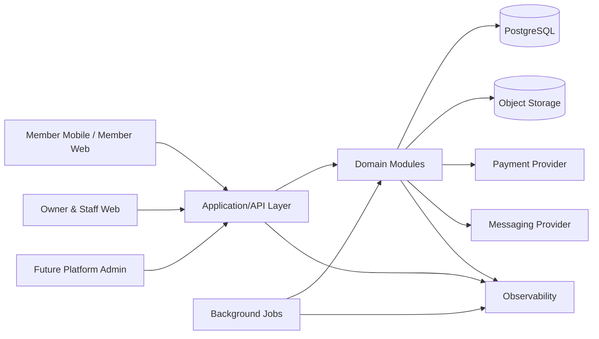
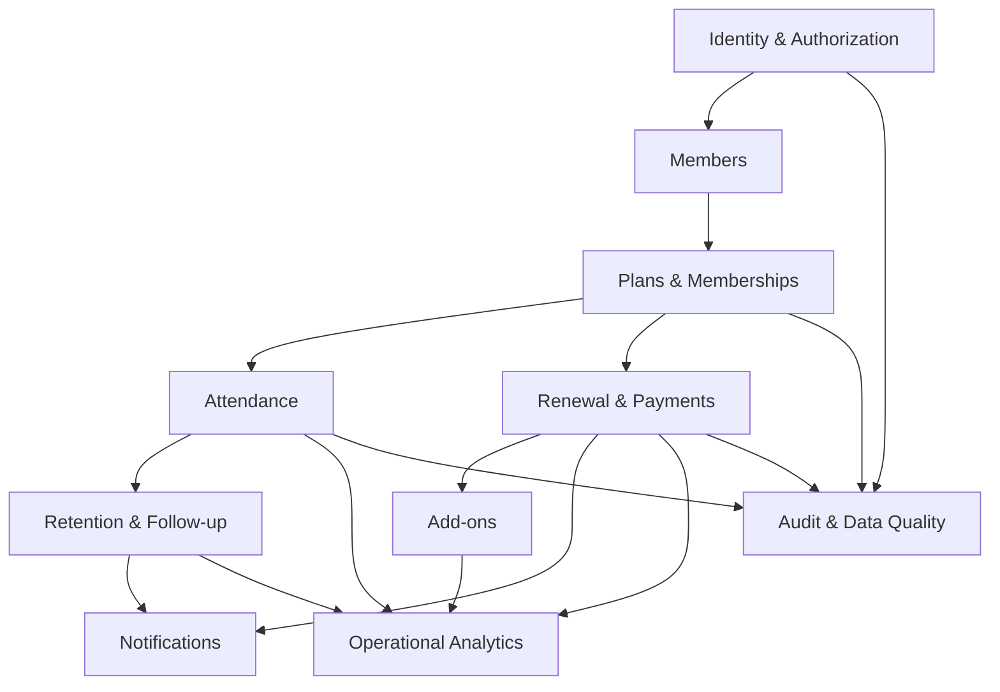
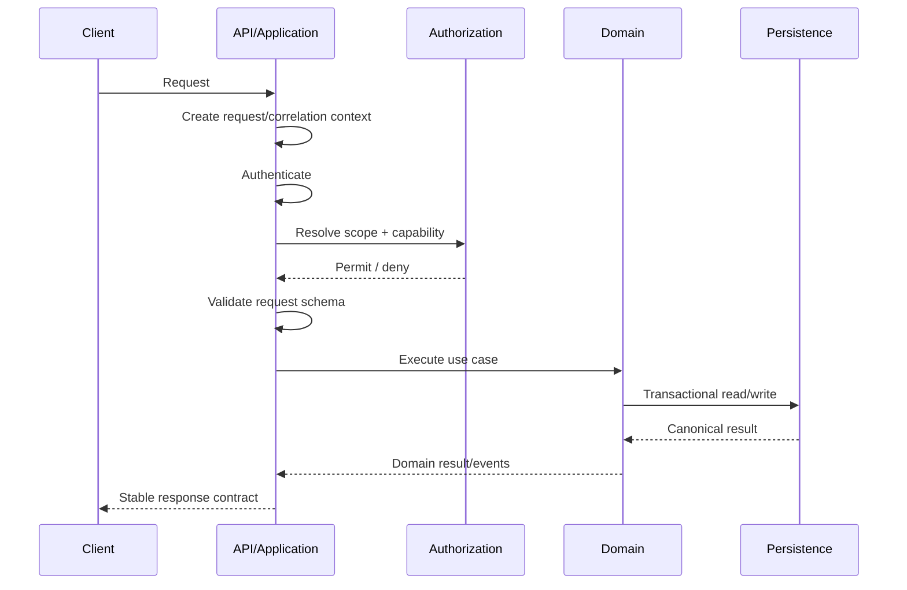
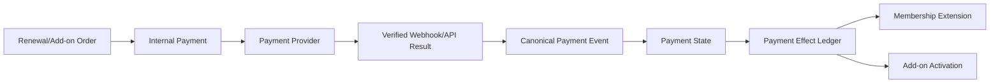
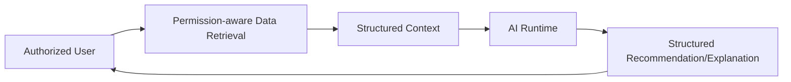

# GymPulse Architecture Overview

## Document Control

- Status: `Draft v1.0`
- Scope: Phase 1 Operations MVP and evolution path
- Audience: Engineering, Architecture, Security, DevOps, QA, Product
- Decision posture: major technology choices remain `Proposed` or `Assumed` until accepted by ADR

## 1. Purpose

Describe the target technical shape of GymPulse, the boundaries between applications and domain logic, the high-level data and integration model, and the intended evolution path from a focused pilot to a broader platform.

This document does not silently finalize open provider or hosting decisions.

## 2. Architecture Goals

GymPulse architecture must optimize for:

1. tenant isolation,
2. correctness of business state transitions,
3. retry-safe attendance/payment/automation flows,
4. fast product iteration during the pilot,
5. shared contracts across web, mobile, API, and jobs,
6. clear domain ownership,
7. auditable sensitive operations,
8. operational observability,
9. future multi-branch and AI expansion without forcing Phase 1 complexity.

## 3. Selected Architecture Shape

**Proposed architecture:** modular monolith with multiple application entry points and one canonical relational system of record.



The diagram shows logical responsibilities. It does not require every box to be a separate deployable service in Phase 1.

## 4. Architectural Style

### 4.1 Modular monolith

Phase 1 should keep transactional business logic in a single coherent application/domain codebase with explicit module boundaries.

Benefits:

- simpler transactional consistency,
- easier pilot deployment,
- lower operational overhead,
- easier cross-domain debugging,
- straightforward integration testing.

Tradeoff:

- strong code boundaries must be enforced intentionally because deployment boundaries do not enforce them automatically.

### 4.2 Client/server separation

Web and mobile clients own interaction, navigation, and presentation. Server-side modules own business truth and authorization.

### 4.3 Relational system of record

PostgreSQL is the proposed canonical data store because GymPulse data has strong relationships and transaction-sensitive invariants across memberships, attendance, payments, follow-ups, and audit records.

The choice remains `Assumed` until ADR acceptance (`D-058`).

## 5. Logical Layers

```text
Presentation
  -> Application / API
      -> Domain
          -> Persistence / Integrations
```

### Presentation layer

Responsibilities:

- screens and navigation,
- form and interaction state,
- local validation for user experience,
- request orchestration,
- display formatting,
- offline UI state where explicitly supported.

Must not own canonical authorization or financial/entitlement decisions.

### Application/API layer

Responsibilities:

- authenticate principal,
- establish request/correlation context,
- resolve tenant/branch scope,
- validate boundary input,
- enforce capability authorization,
- invoke domain use cases,
- define transaction boundaries,
- map results to stable API contracts.

### Domain layer

Responsibilities:

- membership state and eligibility,
- attendance rules,
- duplicate/check-in policy,
- no-show case rules,
- follow-up lifecycle,
- renewal calculations,
- payment effects,
- add-on activation/usage,
- notification decision logic,
- business events.

### Persistence and integration layer

Responsibilities:

- repositories and database constraints,
- payment adapter,
- messaging adapter,
- object storage adapter,
- analytics/telemetry adapter,
- future external integrations.

## 6. Phase 1 Domain Map



This map represents logical dependencies, not unrestricted direct database access between modules.

## 7. Tenant Model

The canonical hierarchy is:

```text
Platform
  -> Organization
      -> Gym
          -> Branch
```

Phase 1 may operate with one Organization, one Gym, and one Branch, but records and authorization should not erase this hierarchy.

### Tenant context concept

```ts
type TenantContext = {
  organizationId: string;
  gymId: string;
  branchIds: string[];
};
```

Exact implementation may differ, but equivalent scope must exist for protected operations.

## 8. Identity and Authorization Architecture

Authentication provider is not yet selected (`D-049`, `D-050`).

Logical separation:

```text
External Auth Identity
        |
        v
Application User -------- RoleAssignment -------- Permission/Scope
        |
        +------ MemberAuthLink ------ Member
```

Authentication proves identity. Authorization decides what that identity can do in a tenant scope.

RLS, if used, is defense in depth and does not replace capability authorization.

## 9. Core Request Lifecycle



For sensitive actions, audit/event recording is part of the use-case execution contract.

## 10. Persistence Architecture

PostgreSQL should contain canonical business records.

Core rules:

- opaque identifiers,
- explicit tenant keys,
- UTC event timestamps,
- explicit gym timezone,
- integer minor-unit money,
- constraints for race-sensitive uniqueness,
- append-only or reconstructable histories for material changes,
- transactional application of critical state transitions.

Detailed table design belongs in `../05-database/` and will migrate from legacy `../06-database-schema.md`.

## 11. Event Model

Phase 1 does not require event sourcing.

Use domain events to decouple secondary behavior where useful while relational records remain canonical.

Examples:

```text
attendance.created
retention.case_opened
retention.member_returned
renewal.order_created
payment.succeeded
payment.failed
addon.activated
notification.intent_created
```

Events should have stable IDs and tenant context. Critical consistency-sensitive effects may remain inside one database transaction until operational evidence justifies asynchronous separation.

## 12. Background Processing

Background work includes:

- no-show scans,
- renewal reminder scans,
- notification delivery,
- daily owner summaries,
- payment reconciliation retries,
- data-quality scans,
- future PT reminders.

The job runner is an open decision (`D-061`).

Required characteristics:

- scheduled execution,
- retries,
- job visibility,
- deterministic deduplication,
- explicit tenant context,
- environment isolation.

## 13. Payment Architecture

The payment provider is open (`D-030`).

Logical flow:



A unique applied business effect prevents repeated provider callbacks from extending or activating twice.

## 14. Notification Architecture

Separate business decision from provider delivery:

```text
Business trigger
  -> NotificationIntent
  -> preference/policy evaluation
  -> channel selection
  -> provider dispatch
  -> delivery state
```

The provider remains open (`D-038`).

## 15. Object Storage

Object storage may be required for receipts, exports, and later progress photos/documents.

Requirements:

- tenant-scoped paths,
- private-by-default sensitive objects,
- short-lived signed access where needed,
- no secrets embedded in object names,
- retention/deletion policy aligned with data classification.

Provider is open (`D-063`).

## 16. Observability Architecture

Minimum telemetry must cover:

- API request failures,
- job failures/retries,
- payment webhook verification and processing failures,
- notification failures,
- stuck payment states,
- no-show scan failures,
- data-quality alerts,
- client crashes/errors.

Exact providers remain open (`D-065`, `D-066`).

## 17. Deployment Topology Options

Two viable Phase 1 deployment shapes remain under consideration.

### Option A: Next.js/server application first

```text
Next.js Web + Server/API
        |
   Domain Packages
        |
   PostgreSQL + Jobs
```

Benefits: fewer deployments and simpler pilot operations.

Risk: server/domain code must remain separable from framework route handlers.

### Option B: Separate API runtime from day one

```text
Next.js Web ----> TypeScript API
Expo Mobile ----> TypeScript API
                       |
                    Domain
                       |
                  PostgreSQL
```

Benefits: clearer runtime boundary and mobile reuse.

Cost: more deployment and local-development complexity.

This decision is tracked by `D-060` and must be captured in ADR-0003.

## 18. Scalability Evolution

### Stage A: Pilot

- modular monolith,
- relational database,
- durable jobs,
- provider adapters,
- basic observability.

### Stage B: Commercial multi-tenant product

- stronger tenant administration,
- horizontal stateless API scaling,
- dedicated worker scaling,
- caching only where measured,
- expanded audit/privacy controls,
- multi-branch reporting.

### Stage C: Specialized extraction

Possible future candidates, only with evidence:

- high-volume messaging,
- integration gateway,
- analytics pipeline,
- AI orchestration runtime.

## 19. Failure and Consistency Strategy

### Synchronous transactional flows

Prefer a single database transaction for state that must change together, such as canonical attendance plus dedupe state.

### Asynchronous side effects

Notifications and non-critical analytics may be scheduled after canonical state is committed.

### Retries

Every retryable mutation must define a durable dedupe/idempotency strategy.

### Provider uncertainty

When provider status is uncertain, expose `Pending`/reconciliation state rather than guessing success.

## 20. Future AI Boundary

AI remains future scope.



AI cannot directly become canonical payment, entitlement, attendance, authorization, or medical truth.

## 21. Major Open Decisions

The architecture cannot be called production-final until the following are resolved or deliberately deferred:

- `D-049` staff auth provider,
- `D-050` member authentication method,
- `D-059` managed backend,
- `D-060` API deployment model,
- `D-061` job runner,
- `D-064` hosting,
- `D-065` observability providers,
- `D-030` payment provider,
- `D-038` messaging provider,
- `D-068` RLS strategy,
- `D-069` membership renewal representation.

## 22. Alternatives Considered

### Microservices from Phase 1

Rejected as default because operational cost and distributed consistency complexity are not justified by current evidence.

### Client-heavy business logic

Rejected because it weakens authorization, consistency, auditability, and multi-client behavior.

### Generic document/no-SQL-first persistence

Not recommended for canonical Phase 1 state because critical workflows are relational and transaction-sensitive.

## 23. Related Documents

- `architecture-principles.md`
- `system-context.md`
- `container-architecture.md`
- `component-architecture.md`
- `data-flow.md`
- `technology-stack.md`
- `../01-product/functional-requirements.md`
- `../01-product/non-functional-requirements.md`
- `../16-open-decisions.md`
- `../adr/README.md`
