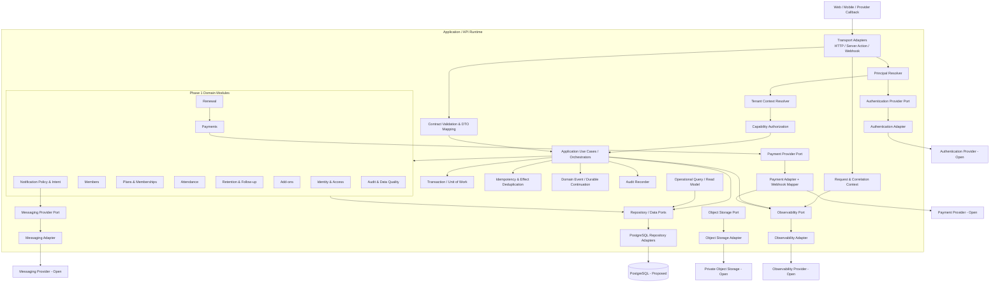
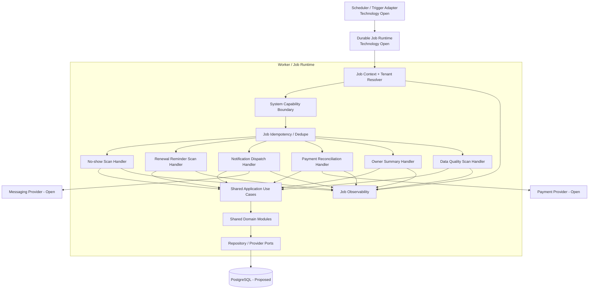
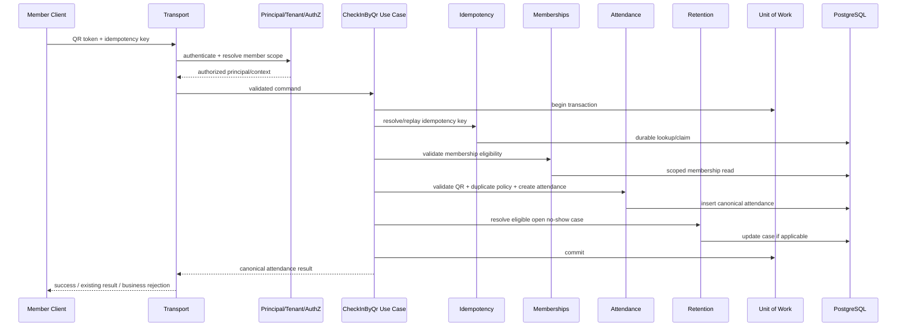
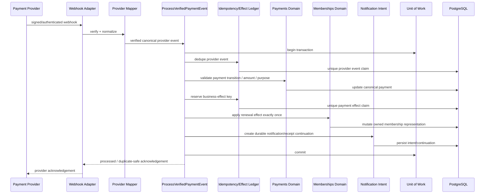

# GymPulse Component Architecture

## Document Control

- Status: `Draft v1.0`
- Model: `C4 Level 3-style Component Architecture`
- Scope: Phase 1 Operations MVP trusted Application/API and Worker boundaries
- Audience: Architecture, Backend, Frontend, Mobile, DevOps, Security, QA
- Parent documents: `architecture-overview.md`, `system-context.md`, `container-architecture.md`, `architecture-principles.md`
- Decision posture: component boundaries are implementation guidance; open providers, runtimes, deployment topology, and managed-platform choices remain unresolved until the relevant decision/ADR is accepted

## 1. Purpose

Define how the trusted GymPulse Application/API and Worker logical containers are decomposed into implementation-oriented source-code components.

This document makes business-rule ownership, dependency direction, authorization enforcement, transaction boundaries, idempotency, provider boundaries, failure behavior, observability, and test seams explicit without turning every component or domain into a separately deployed service.

The component model must preserve these architectural principles:

- `AP-001` Modular Monolith Before Microservices
- `AP-002` Server Owns Business Truth
- `AP-003` Explicit Domain Boundaries
- `AP-004` Multi-Tenant Scope Is a First-Class Invariant
- `AP-005` Authorization Uses Capabilities
- `AP-006` Idempotency for Critical Business Effects
- `AP-007` Database Constraints Protect Invariants
- `AP-009` Provider Integrations Are Adapters
- `AP-010` Background Work Is Durable and Observable
- `AP-013` Stable Contracts at Boundaries

## 2. Requirement Drivers

The component architecture primarily satisfies:

### Identity and authorization

- `FR-IDENTITY-001` Staff authentication
- `FR-IDENTITY-003` Member identity verification
- `FR-AUTHZ-001` Tenant-scoped authorization
- `FR-AUTHZ-002` Named capability enforcement
- `FR-AUTHZ-003` Self-only member access
- `FR-AUTHZ-004` Sensitive action attribution

### Membership and attendance

- `FR-MEMBERSHIP-004` Server-side eligibility
- `FR-MEMBERSHIP-006` Freeze exclusion from no-show
- `FR-ATTENDANCE-002` QR validation
- `FR-ATTENDANCE-003` Exactly one canonical attendance record
- `FR-ATTENDANCE-006` Retry safety
- `FR-ATTENDANCE-008` Assisted check-in actor/reason
- `FR-ATTENDANCE-010` Auditable correction

### Retention, renewal, and payments

- `FR-RETENTION-003` No-show exclusions
- `FR-RETENTION-005` Single active no-show case
- `FR-FOLLOWUP-001` Append follow-up
- `FR-RETURN-001` Return resolution
- `FR-RENEWAL-004` Renewal-order separation
- `FR-RENEWAL-006` No extension on payment initiation
- `FR-PAYMENT-002` Provider-verified payment truth
- `FR-PAYMENT-003` Webhook authenticity
- `FR-PAYMENT-005` Duplicate callback safety
- `FR-PAYMENT-006` Exactly-once membership effect
- `FR-PAYMENT-007` Exactly-once add-on effect

### Notifications, audit, and operations

- `FR-NOTIFICATION-002` Notification deduplication
- `FR-NOTIFICATION-004` Renewal suppression
- `FR-AUDIT-001` Sensitive action log
- `FR-AUDIT-003` Audit integrity
- `FR-DATA-QUALITY-001` Operational inconsistency detection
- `FR-DASHBOARD-003` Action queues
- `FR-CROSS-001` Server truth
- `FR-CROSS-002` Idempotent critical effects
- `FR-CROSS-003` Explicit tenant context
- `FR-CROSS-004` Gym-local timezone correctness

### Quality attributes

- `NFR-SECURITY-001` Tenant isolation
- `NFR-SECURITY-003` Server-side authorization
- `NFR-SECURITY-008` Webhook verification
- `NFR-RELIABILITY-001` Idempotent critical mutations
- `NFR-RELIABILITY-002` Payment exactly-once effect
- `NFR-RELIABILITY-004` Database-enforced invariants
- `NFR-AVAILABILITY-003` Job failure visibility
- `NFR-PERFORMANCE-005` Provider latency separation
- `NFR-SCALABILITY-002` Modular boundaries
- `NFR-SCALABILITY-004` Queueable asynchronous work
- `NFR-OBSERVABILITY-004` Payment diagnostics
- `NFR-OBSERVABILITY-005` Job diagnostics
- `NFR-MAINTAINABILITY-001` Shared domain rules
- `NFR-MAINTAINABILITY-003` Provider abstraction
- `NFR-TESTABILITY-001` Deterministic domain tests

## 3. Component Model Principles

### 3.1 Components are code boundaries, not services

A component in this document is a cohesive source-code/application boundary with one primary responsibility and explicit dependencies.

A component does not imply:

- a separate deployable service,
- a network hop,
- a separate database,
- a separate repository,
- a separate team.

Phase 1 components should normally execute inside the Application/API runtime or Worker runtime defined in `container-architecture.md`.

### 3.2 Dependency direction

Preferred dependency direction:

```text
Transport / Job Adapter
        ↓
Application Use Case
        ↓
Domain Module
        ↓
Port / Repository Interface
        ↑
Infrastructure Adapter implements port
```

Cross-cutting components such as authorization, request context, transaction management, idempotency, audit, and observability are invoked through explicit application contracts rather than hidden global behavior.

### 3.3 Domain ownership is stricter than database visibility

A shared relational database does not grant every module write access to every table.

Rules:

1. each canonical entity/table group has one owning domain module,
2. other modules use the owner's application/domain interface for state-changing effects,
3. cross-domain read models may perform read-only joins when required for operational screens,
4. a read model MUST NOT become a second writable source of truth,
5. provider adapters MUST NOT write domain tables directly,
6. route handlers and job handlers MUST NOT bypass domain/application state transitions through ad-hoc SQL.

## 4. C4 Level 3: Application/API Component Diagram



The diagram shows logical dependencies. Exact package layout is defined later in engineering documentation and remains subject to `D-ARCH-001`.

## 5. Entry and Boundary Components

## 5.1 Transport Adapters

### Responsibility

Accept external requests and translate them into trusted application commands/queries.

Examples:

- JSON HTTP route handlers,
- server-side web actions if the selected deployment topology supports them,
- payment webhook endpoints,
- messaging delivery callback endpoints,
- controlled import endpoints.

### Must do

- create/request correlation context,
- invoke authentication or provider verification as applicable,
- invoke runtime request validation,
- pass only validated DTOs to application use cases,
- map application errors into stable transport errors,
- preserve idempotency keys where the contract supports them.

### Must not do

- calculate membership eligibility,
- decide payment success,
- update tables directly,
- trust client-provided tenant scope,
- contain provider-specific business rules beyond verification/mapping at the adapter boundary.

### Decision dependencies

- primary API style: `D-ARCH-003` Proposed
- API deployment topology: `D-ARCH-006` Open

## 5.2 Request and Correlation Context

Creates safe request metadata such as:

```text
requestId
correlationId
requestStartedAt
client/application version where available
network/transport metadata where privacy-safe
```

The context is propagated to:

- structured logs,
- audit records,
- provider calls where useful,
- durable async continuations,
- error monitoring.

It MUST NOT become a general container for raw secrets or arbitrary PII.

## 5.3 Principal Resolver

### Responsibility

Convert verified authentication evidence into a GymPulse application principal.

Conceptual outputs:

```ts
type Principal =
  | {
      kind: "staff";
      userId: string;
      authSubject: string;
    }
  | {
      kind: "member";
      memberId: string;
      authSubject: string;
    }
  | {
      kind: "system";
      systemActor: string;
    };
```

The exact representation is implementation-specific.

### Rules

- provider identity is not tenant authorization,
- a member principal is not allowed to substitute arbitrary `memberId`,
- disabled/revoked identity state must be honored according to the selected authentication/session architecture,
- provider secrets stay inside the authentication adapter.

### Open decisions

- authentication/session strategy: `D-ARCH-004`
- member authentication method: `D-SEC-002`
- managed backend responsibilities: `D-ARCH-013`

## 5.4 Tenant Context Resolver

### Responsibility

Resolve the maximum tenant/gym/branch scope available to the principal for the current operation.

Conceptual context:

```ts
type TenantContext = {
  organizationId: string;
  gymId: string;
  branchIds: string[];
};
```

### Rules

- caller-supplied tenant/branch identifiers are requests, not authority,
- staff scope derives from active role assignments,
- member scope derives from the member/tenant relationship,
- worker jobs carry explicit tenant scope and must validate that scope before processing,
- cross-tenant guessed resource IDs must not escape the resolver/repository authorization model.

Database RLS may reinforce this boundary if selected, but does not replace application authorization. RLS strategy remains `D-SEC-008` Open.

## 5.5 Capability Authorization

### Responsibility

Answer whether the resolved principal may perform a named operation within the resolved scope and resource context.

Preferred shape:

```text
requireCapability(principal, tenantContext, "attendance.checkin.assisted")
requireCapability(principal, tenantContext, "membership.freeze")
requireCapability(principal, tenantContext, "payment.refund")
```

### Enforcement points

Authorization is applied:

1. before protected application use cases execute,
2. before sensitive data is returned,
3. again at resource scope when object ownership/scope matters,
4. for system jobs using explicitly scoped system authority,
5. for platform-support operations if introduced later.

A hidden UI control is never authorization.

## 5.6 Contract Validation and DTO Mapping

### Responsibility

Validate untrusted input at trust boundaries and map internal results into stable external DTOs.

Validation covers:

- identifiers,
- enum values,
- money/date shape,
- string lengths,
- pagination/filter bounds,
- job payloads,
- provider payload normalization after authenticity verification.

Business validation remains in domain/application components.

TypeScript static types alone do not validate network/provider data.

## 6. Application Use-Case Layer

The application layer coordinates one user/system intent across domain modules and infrastructure ports.

Examples:

```text
CreateMember
CreateMembership
FreezeMembership
CheckInByQr
CreateAssistedAttendance
CorrectAttendance
RecordFollowUp
CreateRenewalOrder
InitiatePayment
ProcessVerifiedPaymentEvent
CreateAddOnOrder
ConsumePtSession
CreateNotificationIntent
GenerateOwnerSummary
ImportMembers
```

### Responsibilities

- establish transaction boundaries,
- orchestrate multiple domain modules without merging their ownership,
- apply authorization context,
- coordinate durable idempotency,
- ensure required audit recording,
- persist durable continuation/event state when needed,
- return application result DTOs.

### Rule

Application orchestration may coordinate multiple domains in one process and one database transaction. That does not create permission for one domain module to directly mutate another domain's tables.

## 7. Phase 1 Domain Components

## 7.1 Identity and Access Domain

Owns application-level identity linkage and authorization model concepts, including:

- application users,
- member-auth linkage,
- role assignments,
- permissions/capability bundles,
- active assignment interpretation.

Does not own authentication-provider credentials or provider session implementation.

Primary requirements:

- `FR-IDENTITY-*`
- `FR-AUTHZ-*`
- `NFR-SECURITY-001..004`

## 7.2 Members Domain

Owns:

- canonical member profile,
- member status,
- tenant/gym/primary-branch relationship,
- member search semantics at domain level,
- approved member operational metadata.

Must not become an unrestricted medical-record store.

Primary requirements:

- `FR-MEMBER-*`
- `FR-IMPORT-*` for validated member creation/import effects

## 7.3 Plans and Memberships Domain

Owns:

- plans and commercial configuration,
- membership lifecycle,
- membership eligibility,
- freeze representation,
- entitlement-sensitive membership state,
- commercial snapshots related to membership context.

This module is authoritative for whether a membership is currently eligible for attendance or renewal-sensitive behavior.

Open rules that MUST remain policy-driven rather than hard-coded:

- freeze expiry effect: `D-BIZ-007`
- renewal effective date: `D-BIZ-010`
- renewal representation: `D-DATA-007`

## 7.4 Attendance Domain

Owns:

- QR session validation semantics,
- canonical attendance creation,
- assisted attendance creation,
- duplicate attendance policy enforcement,
- attendance source,
- correction/void semantics,
- weekly attendance-goal progression where implemented as attendance-owned derived state.

Attendance may ask Memberships whether the member is eligible, but MUST NOT rewrite membership state.

Critical invariants:

- exactly one logical attendance effect per idempotent check-in,
- duplicate protection enforced transactionally where needed,
- assisted attendance requires staff actor + reason,
- correction preserves history.

## 7.5 Retention and Follow-up Domain

Owns:

- no-show rules,
- no-show cases,
- assignment/next action state,
- follow-up history,
- return resolution,
- retention workflow state.

It may read attendance and membership state through approved ports/query interfaces.

It MUST NOT create or correct attendance.

Critical invariant:

- one active case for the same member/rule context, reinforced by database uniqueness where practical.

## 7.6 Renewal Domain

Owns:

- renewal eligibility window evaluation,
- renewal offer/order creation,
- commercial snapshot for renewal order,
- reminder-cycle/stage semantics,
- renewal business status before payment effect.

Renewal order creation MUST NOT extend membership.

Renewal coordinates with Payments for checkout/payment state and with Memberships only after verified payment effect is being applied.

## 7.7 Payments Domain

Owns:

- internal payment record,
- canonical payment state machine,
- provider reference association,
- provider event history,
- reconciliation semantics,
- payment-effect deduplication ledger,
- refund/reversal history where enabled.

Payments MUST NOT trust a client success callback as canonical success.

Provider-specific webhook shape belongs to the payment adapter/webhook mapper, not the Payments domain.

Critical invariant:

```text
verified provider event
  + canonical payment transition
  + unique business effect key
  = effect applied at most once
```

## 7.8 Add-ons Domain

Owns:

- add-on catalogue,
- add-on order,
- purchased commercial snapshot,
- PT/session entitlement or simple usage balance,
- product fulfillment/stock state where enabled.

Critical rules:

- add-ons are never implicitly purchased,
- usage/stock cannot become negative through normal workflows,
- payment-required activation occurs only after valid payment effect.

## 7.9 Notifications Domain

Owns business notification intent and policy, not provider transport mechanics.

Owns:

- notification intent type,
- recipient/channel eligibility,
- preference/consent evaluation,
- renewal-stage suppression,
- deterministic notification dedupe key,
- canonical notification state that GymPulse can actually observe.

The worker delivery adapter owns provider dispatch.

The Notification domain MUST re-check current eligibility immediately before send when stale queued work could otherwise send an invalid reminder.

## 7.10 Audit and Data Quality Domain

Owns:

- audit-event schema and persistence contract,
- auditable action taxonomy,
- data-quality issue identity/state,
- deterministic issue keys,
- safe before/after summaries where required.

For security-critical actions defined as auditable, audit persistence is part of successful mutation semantics rather than optional analytics.

## 8. Transaction and Unit-of-Work Component

### Responsibility

Provide one explicit transactional boundary for correctness-sensitive use cases.

Conceptual interface:

```ts
await unitOfWork.run(async (tx) => {
  // repositories/ports bound to tx
});
```

Exact database library/API remains an implementation choice.

### Required transaction examples

#### QR attendance

Where practical, one transaction should protect:

```text
idempotency/dedupe check
+ membership eligibility snapshot/read
+ canonical attendance insert
+ duplicate constraint
+ retention return resolution if performed synchronously
+ audit record for assisted/correction flows
+ durable post-commit event/intent state when required
```

#### Payment success

One transaction should protect the canonical business effect path as far as practical:

```text
provider event dedupe
+ payment transition
+ payment effect key reservation/application
+ membership or add-on domain effect
+ receipt metadata if synchronous
+ durable notification/event continuation
```

External message delivery and other remote side effects SHOULD occur after commit.

### Provider latency rule

Do not hold a database transaction open while waiting on avoidable remote provider latency.

Examples:

- create payment provider checkout before/after a short internal transaction according to adapter design,
- notification provider send happens outside the canonical business transaction,
- reconciliation provider fetch occurs before entering the canonical state-transition transaction where practical.

## 9. Repository and Data-Access Ports

Repository interfaces expose domain-focused operations rather than generic unrestricted table access.

Examples:

```text
MemberRepository
MembershipRepository
AttendanceRepository
RetentionCaseRepository
RenewalOrderRepository
PaymentRepository
PaymentEventRepository
PaymentEffectRepository
AddOnRepository
NotificationRepository
AuditRepository
DataQualityRepository
```

### Rules

- repositories require tenant context for tenant-owned data,
- mutation methods belong to the owning domain repository,
- cross-domain services do not receive a raw database client as an escape hatch,
- race-sensitive operations use database constraints and transactional semantics,
- provider/raw JSON fields are minimized and safely stored where required for reconciliation,
- financial/audit history is not casually hard-deleted.

PostgreSQL remains Proposed under `D-ARCH-002`; RLS remains Open under `D-SEC-008`.

## 10. Idempotency and Effect Deduplication

GymPulse uses layered idempotency rather than one universal in-memory lock.

### Layer 1: request idempotency

For retryable client mutations, an opaque idempotency key may identify one logical request.

Examples:

```text
attendance-checkin:{tenant}:{clientKey}
renewal-order:{tenant}:{clientKey}
payment-initiation:{tenant}:{clientKey}
```

The exact persisted key format is internal.

### Layer 2: domain uniqueness

Database constraints protect invariants such as:

- one active no-show case per rule context,
- duplicate attendance according to the configured policy,
- unique notification stage/cycle key.

### Layer 3: provider-event idempotency

Payment provider events require a unique provider event identity such as:

```text
(provider, providerEventId)
```

### Layer 4: business-effect idempotency

A provider may send multiple distinct events representing the same successful payment. Therefore business effects require a separate unique effect identity, for example:

```text
payment:{paymentId}:membership-renewal:{renewalOrderId}
```

or equivalent stable key.

### Rule

A retry-safe transport handler alone is insufficient. Permanent data integrity must be backed by durable state/constraints.

## 11. Provider Integration Components

## 11.1 Authentication Provider Adapter

Implements authentication/session-provider operations required by the Principal Resolver.

Provider selection remains Open under `D-ARCH-004` and `D-ARCH-013`.

No auth provider is authorized to decide GymPulse tenant permissions.

## 11.2 Payment Adapter and Webhook Mapper

The payment integration boundary has two responsibilities.

### Outbound adapter

- create checkout/payment attempt,
- query/reconcile provider payment status,
- initiate refund if supported and authorized,
- expose only provider-safe client checkout fields.

### Inbound webhook mapper

```text
raw request
  -> verify provider authenticity
  -> parse provider payload
  -> map to canonical PaymentProviderEvent
  -> pass verified event to ProcessVerifiedPaymentEvent use case
```

The mapper does not directly extend a membership or activate an add-on.

Payment provider selection remains `D-PROVIDER-001` Open.

## 11.3 Messaging Adapter

Implements transport delivery for an already-approved notification intent.

Responsibilities:

- template/channel provider mapping,
- provider request,
- provider message/reference storage result,
- provider callback normalization,
- retryable vs permanent failure classification where provider semantics allow.

The messaging adapter does not decide whether a member should receive the message.

Messaging provider remains `D-PROVIDER-002` Open and launch channels remain `D-PROD-011` Open.

## 11.4 Object Storage Adapter

Provides private object operations for receipts, exports, and later protected media.

Provider remains `D-ARCH-010` Open.

Business state must not depend on public object URLs or provider-specific object keys.

## 11.5 Observability Adapter

Provides logs/errors/metrics/traces according to the selected platform while enforcing data minimization.

Provider remains `D-PROVIDER-006` Open.

Observability delivery must not be in the critical transaction path for normal business mutations.

## 12. Domain Events and Durable Continuation

Phase 1 does not require event sourcing or a distributed event broker.

Domain/application events are useful for secondary behavior such as:

```text
attendance.created
retention.member_returned
renewal.order_created
payment.succeeded
payment.failed
addon.activated
notification.intent_created
```

### Durability rule

When losing an async continuation would violate a product requirement, the continuation must be recorded durably before the canonical transaction is considered complete.

Acceptable implementation patterns include:

- database outbox,
- transactional job enqueue supported by the selected runtime,
- another equivalent durable pattern.

The exact mechanism depends on `D-ARCH-007` and future implementation/ADR work.

### Non-critical events

Best-effort product analytics may be emitted after commit and must never be the canonical source for attendance, payment, membership, or revenue truth.

## 13. Audit Recorder

The Audit Recorder is an application cross-cutting component backed by the Audit domain/repository.

### Inputs

```text
actor/principal
tenant context
action
resource type/id
reason where required
safe before/after summary where relevant
request/correlation ID
timestamp
```

### Required behavior

For critical auditable mutations such as assisted attendance, attendance correction, membership freeze/status change, permission change, financial intervention, refund/reversal, and configuration change:

- actor attribution is mandatory,
- audit records are immutable through normal tenant workflows,
- audit payloads avoid secrets and unnecessary sensitive fields,
- failure to create required audit history SHOULD fail the sensitive mutation rather than silently complete without traceability.

## 14. Operational Query / Read-Model Component

Operational screens need views spanning multiple domains.

Examples:

- owner dashboard,
- member 360 summary,
- no-show queue,
- renewal pipeline,
- payment exception queue,
- data-quality queue.

The query component may use optimized read-only joins/projections across canonical tables.

### Rules

- tenant/branch authorization is applied before data exposure,
- result sets are paginated/bounded,
- operational indexes support status/date/next-action/expiry filters,
- read DTOs do not become mutation commands,
- dashboard metrics remain traceable to canonical records,
- a separate analytics database is not required for Phase 1.

## 15. C4 Level 3: Worker Component Diagram



Worker handlers reuse the same application/domain contracts as interactive execution where the business effect is the same. A worker does not implement a second copy of renewal/payment/retention rules.

## 16. Worker Components

## 16.1 Scheduler / Trigger Adapter

Determines when a gym-local scheduled job should be enqueued.

It must respect configured gym timezone rather than server timezone.

The job runner/scheduler technology remains `D-ARCH-007` Open.

## 16.2 Job Context and Tenant Resolver

Every job execution resolves:

```text
jobId
jobType
organizationId
gymId
branchId where applicable
correlationId
attempt
scheduledFor
```

A global worker may process many tenants, but one job's tenant context must never leak into another job.

## 16.3 System Capability Boundary

System jobs do not bypass authorization concepts merely because no human is logged in.

Each job type receives a narrow system capability such as:

```text
retention.scan
renewal.scan
notification.dispatch
payment.reconcile
data-quality.scan
```

This makes privileged system effects explicit and auditable.

## 16.4 No-show Scan Handler

Coordinates the Retention use case for eligible members.

Inputs come from:

- active membership eligibility,
- freeze/pause exclusions,
- last valid attendance,
- configured no-show rule,
- new-member reference-date policy when decided.

Idempotency:

- deterministic scan/case key,
- unique active-case invariant.

One corrupt member record SHOULD be diagnosable without necessarily blocking all other tenant candidates.

## 16.5 Renewal Reminder Scan Handler

Evaluates configured renewal windows and creates eligible notification intents.

Dedupe identity must include the renewal cycle and reminder stage so retries do not duplicate the same business-stage message.

It must suppress completed/cancelled/ineligible renewal stages.

## 16.6 Notification Dispatch Handler

Immediately before provider send, re-check:

- current notification eligibility,
- current member preference/consent policy,
- business condition still active,
- dedupe state,
- recipient/channel validity.

Only transient failures are blindly retryable. Permanent provider rejection, opt-out, invalid recipient, or invalid template requires explicit failure state.

## 16.7 Payment Reconciliation Handler

Finds payment records that remain non-terminal beyond a configured threshold and have sufficient provider reference for reconciliation.

Flow:

```text
load candidate
  -> provider adapter status fetch
  -> normalize verified result
  -> reuse ProcessVerifiedPaymentEvent / canonical payment transition path
```

Reconciliation MUST NOT implement a second independent payment-success state machine.

## 16.8 Owner Summary Handler

Builds a gym-local operational summary from read models/canonical records and creates one deduplicated notification intent per business date/recipient/channel.

## 16.9 Data Quality Scan Handler

Detects deterministic inconsistencies such as:

- invalid membership dates,
- missing expiry,
- assisted attendance missing required context,
- paid online payment lacking expected provider reference,
- successful payment missing expected effect,
- negative session/stock balance,
- stale renewal notification after completed renewal.

Issue records use deterministic keys so repeated scans update the same unresolved issue rather than producing alert floods.

## 17. Critical Sequence: QR Check-in



Failure rules:

- invalid/expired QR returns a business rejection and no attendance,
- membership ineligible returns no attendance,
- replay of the same successful logical request returns the existing canonical result where practical,
- database uniqueness prevents race duplicates,
- analytics/notification failure after commit does not invalidate valid attendance.

## 18. Critical Sequence: Verified Renewal Payment



Rules:

- failed authenticity verification never reaches canonical payment mutation,
- provider event dedupe and business-effect dedupe are separate protections,
- Memberships owns membership mutation even though Payments coordinates the verified effect,
- external notification send occurs after canonical commit,
- membership renewal representation remains open under `D-DATA-007`.

## 19. Cross-Domain Write Matrix

| Owning domain | Owns canonical mutation of | Other domains may |
|---|---|---|
| Identity & Access | users, auth links, role assignments, permissions | request authorization decisions through defined interfaces |
| Members | member profile/status | read in-scope member identity/summary |
| Memberships | plans, memberships, freezes, entitlement state | request eligibility or defined membership command |
| Attendance | QR sessions, attendance, corrections | read valid attendance through approved queries |
| Retention | no-show rules/cases, follow-ups, return resolution | request case resolution through Retention interface |
| Renewal | renewal orders/stages | read membership/plan and request payment initiation |
| Payments | payments, provider events, effects, refunds | invoke target-domain business effect through application orchestration |
| Add-ons | add-on catalog/orders/usage/fulfillment | request activation/usage through Add-ons interface |
| Notifications | intents/preferences-visible policy state/delivery state | request notification intent, not provider send directly |
| Audit & Data Quality | audit records/issues | append required audit / report deterministic issue |

Direct write access across these ownership lines requires an explicit architecture review and should normally be rejected.

## 20. Synchronous vs Asynchronous Component Interaction

| Interaction | Default | Reason |
|---|---|---|
| authentication/principal resolution | synchronous | request cannot continue without identity decision |
| tenant/capability authorization | synchronous | required before protected data/action |
| QR check-in | synchronous canonical transaction | user requires definitive attendance result |
| assisted check-in | synchronous canonical transaction | staff requires definitive result + audit |
| follow-up recording | synchronous | operational action visible immediately |
| renewal order creation | synchronous | required before checkout |
| provider checkout creation | synchronous orchestration | initiated by member/staff |
| payment webhook verification/canonical transition | synchronous or durable continuation with provider-safe acknowledgement | correctness and provider timeout constraints both matter |
| no-show scan | scheduled asynchronous | batch/time-driven |
| renewal reminder scan | scheduled asynchronous | batch/time-driven |
| notification provider delivery | asynchronous preferred | isolates provider latency/retry |
| payment reconciliation | asynchronous | recovery flow |
| owner summary | scheduled asynchronous | time-driven aggregation |
| data-quality scan | scheduled asynchronous | non-interactive |
| product analytics | asynchronous/best effort | non-canonical |

Changing a correctness-critical synchronous interaction to asynchronous processing requires explicit architecture review of consistency and recovery semantics.

## 21. Failure Propagation Rules

### Boundary/validation failure

Return a stable client-safe validation error. Do not enter domain mutation.

### Authentication/authorization failure

Return unauthenticated/forbidden semantics without leaking cross-tenant resource existence unnecessarily.

### Domain business rejection

Return a stable business error such as membership ineligible, duplicate attendance, case closed, insufficient balance, or invalid state transition.

### Database conflict

Translate expected uniqueness/concurrency conflicts into a deterministic domain/application outcome where possible. Unexpected failures are recorded in centralized diagnostics.

### Provider outage

- payment checkout/status: expose unavailable/pending/reconciliation state; never invent success,
- messaging: retain notification intent for retry/diagnosis,
- analytics/observability: do not roll back canonical business state,
- object storage: do not corrupt payment/membership state if receipt/export file generation fails.

### Job failure

Mark execution failed with tenant/correlation context, classify retryability, and surface it operationally. Retry must be safe.

### Partial failure after database commit

Use durable continuation or reconciliation rather than rolling back already committed canonical truth through compensating guesses.

## 22. Security Considerations

### Trust boundaries

- web/mobile input is untrusted,
- provider callback input is untrusted until verified,
- client tenant identifiers are untrusted,
- job payloads require schema and tenant validation,
- database/provider credentials exist only in trusted runtime/infrastructure adapters.

### Sensitive data

- raw card/UPI credentials never enter domain persistence,
- auth tokens/secrets are not logged,
- provider raw payload retention is minimized,
- follow-up free text and future health data are excluded from generic telemetry,
- read models expose fields according to caller capability and audience.

### Tenant isolation

Tenant scope must be preserved in:

- application commands/queries,
- repository queries,
- jobs,
- object paths,
- audit records,
- durable events/continuations.

Application authorization remains mandatory even if RLS is adopted under `D-SEC-008`.

## 23. Performance Considerations

- interactive application components should remain stateless where practical,
- operational queries use bounded pagination and tenant/status/date indexes,
- avoid N+1 reads in dashboard/member summary queries,
- avoid external provider latency inside database transactions,
- batch jobs operate in bounded tenant-scoped chunks,
- member APIs return purpose-specific DTOs rather than broad internal records,
- heavy reporting/analytics infrastructure should not be introduced without measured need.

## 24. Scalability Considerations

This component model supports later scaling without requiring Phase 1 service decomposition.

### Application/API

Stateless entry components may be horizontally replicated while sharing canonical persistence and durable job infrastructure.

### Worker

Worker replicas may scale independently according to queue depth/job duration if the selected runner supports safe claiming and retries.

### Database

Scale first through schema/index/query discipline, bounded transactions, and connection management.

### Component extraction

A component/domain may become a separate service only when evidence demonstrates a need such as:

- independent scale,
- strict security isolation,
- external integration volume,
- independent team ownership,
- significantly different availability/deployment requirements.

Service extraction would require an ADR and a new data-ownership/consistency design.

## 25. Observability Hooks

Every critical application/job execution should produce privacy-safe telemetry with:

```text
requestId or jobId
correlationId
operation/useCase
organizationId/gymId/branchId where safe
principal/system actor type
resource IDs where useful
result classification
latency
dedupe outcome
error code/class
provider reference where safe
```

Additional critical diagnostics:

- webhook signature verification failure,
- duplicate provider event,
- duplicate business effect prevented,
- pending payment reconciliation,
- no-show scan counts/failures,
- notification retry/permanent rejection,
- data-quality issues discovered/resolved.

The selected observability provider remains `D-PROVIDER-006` Open.

## 26. Testing Strategy by Component Boundary

### Pure domain tests

Test without UI/provider dependencies:

- membership eligibility,
- freeze/no-show exclusion,
- duplicate attendance policy,
- no-show eligibility/case lifecycle,
- renewal stage policy,
- payment state transitions,
- add-on balance rules,
- notification suppression.

Use injectable clock/business-time abstractions for timezone/date-window logic.

### Application-use-case integration tests

Verify:

- authorization is invoked,
- correct transaction boundary,
- cross-domain orchestration,
- audit requirement,
- idempotency replay behavior,
- durable continuation creation.

### PostgreSQL integration tests

Must use the real selected database behavior for:

- tenant scoping,
- unique active no-show case,
- provider event uniqueness,
- payment effect uniqueness,
- attendance duplicate/race protection,
- balance constraints,
- transaction rollback behavior,
- RLS if selected.

### Provider adapter contract tests

After provider selection, test:

- payment webhook authenticity success/failure,
- provider event normalization,
- duplicate/reordered event handling,
- messaging permanent vs transient errors,
- auth session/token verification,
- object access controls.

### Worker tests

Test:

- duplicate job execution,
- retry after partial failure,
- tenant isolation,
- timezone scheduling,
- stale queued notification,
- one corrupt candidate not corrupting global batch state,
- operator-visible failure metadata.

### End-to-end tests

At minimum:

- QR check-in,
- assisted check-in,
- no-show scan -> follow-up -> return,
- renewal -> verified payment -> exactly one membership effect,
- notification intent -> provider dispatch state,
- negative cross-tenant access.

## 27. Suggested Source-Code Boundaries

If `D-ARCH-001` monorepo direction is accepted, the following is a logical mapping, not yet a final repository scaffold:

```text
packages/
  contracts/        # boundary schemas, DTOs, stable errors
  application/      # use cases/orchestrators
  domain/           # deterministic domain modules
  auth/             # principal, tenant scope, capability policy
  database/         # repository implementations, migrations, UoW
  payments/         # payment provider ports/adapters
  notifications/    # notification policy + provider adapters
  jobs/             # job contracts/handlers/scheduler integration
  audit/            # audit/data-quality contracts
  observability/    # telemetry interfaces/adapters
```

Possible runtime applications remain subject to `D-ARCH-006`:

```text
apps/
  web/
  member-mobile/
  api/       # optional deployable under one topology
  worker/
```

The final repository structure belongs in `docs/13-engineering/repository-structure.md` after architecture/tooling decisions are accepted.

## 28. Alternatives Considered

### 28.1 Microservice per domain

Not selected for Phase 1.

Reasons:

- distributed consistency complexity,
- more network failure modes,
- higher deployment/observability burden,
- current scale does not justify independent services.

### 28.2 Route-handler-to-database architecture

Rejected as the primary pattern.

Reasons:

- bypasses reusable domain rules,
- encourages inconsistent authorization,
- weakens transaction/idempotency discipline,
- makes mobile/web/job behavior diverge.

### 28.3 One generic `GymService`

Rejected.

A single service object with unrestricted access to all tables would hide business ownership and make future domain extraction/testing difficult.

### 28.4 Full CQRS/event sourcing from Phase 1

Not required.

Operational read models are useful, but canonical relational state remains authoritative and event sourcing adds unnecessary complexity without a confirmed requirement.

### 28.5 Direct client database mutation

Not selected for protected business operations.

Even if a managed platform is adopted, critical mutations require trusted server-side authorization, domain rules, idempotency, and audit behavior.

## 29. Tradeoffs

### Shared database vs strict module autonomy

A shared PostgreSQL store simplifies Phase 1 transactions and operations, but module ownership must be enforced through code review, repository boundaries, and tests.

### Cross-domain transaction vs future service extraction

A modular monolith can safely coordinate attendance/retention or payment/membership in one transaction. Future service extraction would require replacing this assumption with explicit messaging/consistency patterns.

### Generic infrastructure abstractions vs provider optimization

Ports/adapters add indirection, but they prevent provider payloads and SDK behavior from becoming domain contracts.

### Durable continuation vs operational simplicity

A database outbox or equivalent mechanism improves reliability for post-commit side effects but adds implementation work. It should be used where lost continuation would violate requirements, not for every analytics event.

### Read-model joins vs domain purity

Read-only operational projections may join multiple domains for efficient owner/staff screens. This is acceptable only if they remain non-authoritative for writes.

## 30. Open Decisions

This document intentionally leaves these unresolved:

- `D-ARCH-001` monorepo final acceptance
- `D-ARCH-002` PostgreSQL final acceptance
- `D-ARCH-003` primary API architecture final acceptance
- `D-ARCH-004` authentication/session strategy
- `D-ARCH-006` API deployment topology
- `D-ARCH-007` durable job runner/scheduler
- `D-ARCH-008` Redis requirement
- `D-ARCH-009` hosting/deployment platform
- `D-ARCH-010` object storage provider
- `D-ARCH-011` owner/staff web framework final acceptance
- `D-ARCH-012` member mobile framework final acceptance
- `D-ARCH-013` managed backend responsibilities
- `D-PROVIDER-001` payment provider
- `D-PROVIDER-002` messaging provider
- `D-PROVIDER-005` product analytics provider
- `D-PROVIDER-006` observability provider
- `D-SEC-002` member authentication method
- `D-SEC-008` RLS strategy
- `D-DATA-007` membership renewal representation
- `D-BIZ-007` freeze expiry effect
- `D-BIZ-008` multiple visits/duplicate attendance policy
- `D-BIZ-010` renewal effective-date policy
- `D-BIZ-012` offline payment policy

None of these become accepted because a component or interface is shown here.

## 31. Future Improvements

When future product requirements become active, extend the same component discipline to:

- Workout Programming,
- Exercise Library,
- Nutrition and Meal Tracking,
- Health Metrics,
- Progress Tracking,
- Human Coaching,
- AI Orchestration,
- SaaS Subscription Billing,
- advanced multi-branch analytics.

AI components must remain permission-aware and cannot replace deterministic authorization, payment, attendance, entitlement, or medical-safety controls.

## 32. Related Documents

- `architecture-principles.md`
- `architecture-overview.md`
- `system-context.md`
- `container-architecture.md`
- `data-flow.md`
- `technology-stack.md`
- `../00-overview/assumptions.md`
- `../01-product/functional-requirements.md`
- `../01-product/non-functional-requirements.md`
- legacy migration sources: `../05-system-architecture.md`, `../06-database-schema.md`, `../07-api-contracts.md`, `../08-automations.md`, `../12-security-audit.md`
- future `../04-backend/`
- future `../05-database/`
- future `../06-api/`
- future `../09-security/`
- future `../12-testing/`
- `../adr/README.md`

## 33. Definition of Component Architecture Complete

This draft is complete when reviewers can answer:

1. where authentication, tenant resolution, and authorization occur,
2. which component owns each Phase 1 business rule,
3. how application orchestration crosses domains without violating write ownership,
4. where transaction boundaries exist,
5. where request/provider/job idempotency is enforced,
6. how payment callbacks become exactly-once membership/add-on effects,
7. how scheduled jobs reuse shared business rules,
8. how provider SDKs remain outside domain models,
9. how read models can join domains without becoming write authorities,
10. how failures propagate and recover,
11. where logs/audit/test seams exist,
12. which decisions remain Open or Proposed.

The next architecture artifact is `data-flow.md`, which will trace concrete Phase 1 flows across these components and data stores without adding new component boundaries unless a documented gap is discovered.
