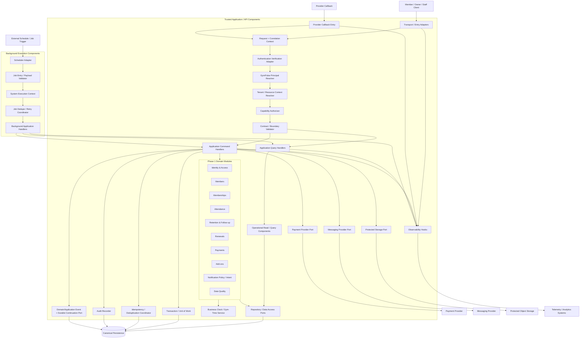
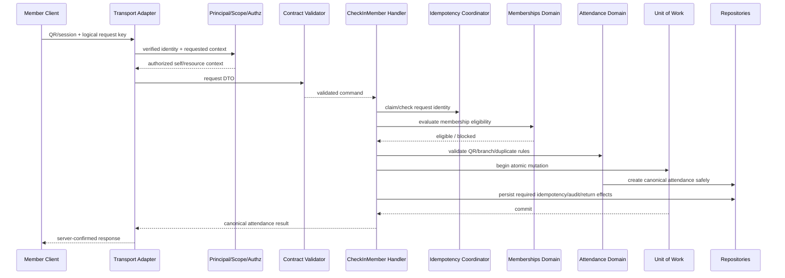
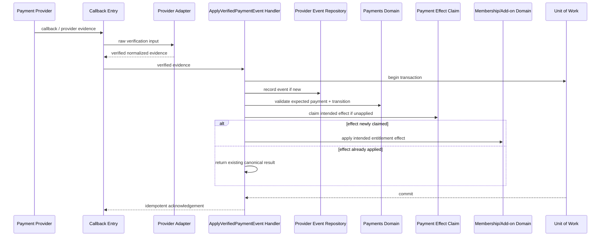
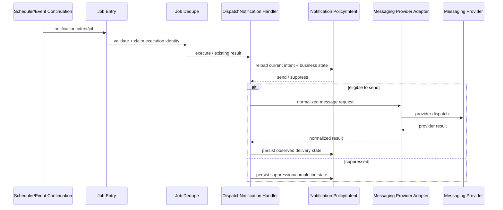

# GymPulse Component Architecture

## Document Control

- Document Maturity: `Draft`
- Scope Status: `In Scope` for Phase 1 architecture
- C4 Level: `Level 3-style component decomposition`
- Audience: Product Architecture, Backend, Frontend, Mobile, Security, DevOps, QA, Operations
- Canonical Decision Register: `../00-overview/assumptions.md`
- Parent Container Model: `container-architecture.md`
- Parent Context: `system-context.md`
- Architecture Overview: `architecture-overview.md`

## 1. Purpose

Define the internal source-code/application components that realize the Trusted Application/API Runtime and Background Execution Runtime described in the C4 Level 2 container architecture.

This document explains:

- application-entry and transport boundaries,
- authentication and GymPulse principal resolution,
- tenant/resource-context resolution,
- named capability authorization,
- request/runtime validation,
- application command/query orchestration,
- Phase 1 domain ownership,
- transaction and unit-of-work ownership,
- repositories and data-access ports,
- idempotency and deduplication responsibilities,
- payment/provider normalization boundaries,
- notification policy and delivery boundaries,
- audit/event responsibilities,
- background scheduler/handler responsibilities,
- operational read/query components,
- observability hooks,
- dependency direction,
- failure propagation,
- testing seams.

This is an implementation-oriented architecture document, but it is not a package/library/framework selection. It does not accept a web framework, API framework, database engine, ORM, job runner, queue, cache, authentication provider, payment provider, messaging provider, hosting platform, or managed backend.

## 2. Architectural Position

The component model follows the current proposed modular-monolith direction while preserving deployment neutrality.

Important decision status:

- `D-ARCH-005` remains `PROPOSED`; this document does not convert modular monolith into an accepted decision.
- `D-ARCH-006` remains `OPEN`; components may run in a web/server runtime or a separate API runtime without changing their ownership rules.
- `D-ARCH-007` remains `OPEN`; background execution technology is not selected.
- `D-ARCH-002` remains `PROPOSED`; the database engine is not accepted here.
- `D-ARCH-015` remains `PROPOSED`; the exact authorization implementation/library remains open even though server-side capability + scope enforcement is mandatory.
- `D-DATA-007` remains `PROPOSED`; Member vs Membership lifecycle-state ownership is not finalized.

The components in this document are source-code/application boundaries, not mandatory processes or microservices.

## 3. Dependency Direction

The default dependency direction is:

```text
Transport / Worker Entry
        ↓
Request / Execution Context
        ↓
Authentication + Principal Resolution
        ↓
Tenant / Resource Scope Resolution
        ↓
Capability Authorization
        ↓
Contract Validation
        ↓
Application Command / Query Handler
        ↓
Domain Module / Domain Policy
        ↓
Ports
   ├── Repository Ports
   ├── Provider Ports
   ├── Audit/Event Ports
   ├── Clock/Time Port
   └── Durable Continuation Port
        ↓
Infrastructure Adapters
```

Domain code must not depend on client frameworks, provider SDK payloads, HTTP request objects, job-runner payloads, or database-driver-specific objects.

Infrastructure may depend inward on application/domain contracts. Domain code must not depend outward on infrastructure implementations.

## 4. C4 Level 3-style Component Diagram



The diagram shows logical component relationships. Actual packaging can combine compatible components while preserving dependency rules and test seams.

## 5. Component Inventory

| Component | Layer | Primary responsibility | Must not own |
|---|---|---|---|
| Transport / Entry Adapters | Interface | Decode request, normalize route/input, produce safe response | Business rules, direct DB writes |
| Provider Callback Entry | Interface | Receive raw callback, preserve verification inputs, route to provider normalization | Trust callback before verification |
| Request + Correlation Context | Interface/Application | Request ID, safe metadata, execution context | Authorization decision itself |
| Authentication Verification Adapter | Integration | Verify selected auth/session evidence | GymPulse capability authorization |
| GymPulse Principal Resolver | Application | Map verified identity to GymPulse principal | Client-supplied role authority |
| Tenant / Resource Context Resolver | Application/Security | Resolve organization/gym/branch/resource ownership | Trust client tenant ID blindly |
| Capability Authorizer | Application/Security | Evaluate named capability + scope | Domain eligibility/state rules |
| Contract / Boundary Validator | Interface/Application | Validate external request/provider/job shape | Final domain invariants |
| Application Command Handlers | Application | Orchestrate state-changing use cases | Provider-specific payload logic |
| Application Query Handlers | Application | Orchestrate authorized reads | Canonical mutation |
| Domain Modules | Domain | Own business rules and state transitions | Framework/provider concerns |
| Transaction / Unit of Work | Application/Infrastructure port | Atomicity for correctness-sensitive internal writes | Cross-provider fake atomicity |
| Idempotency / Deduplication Coordinator | Application | Replay protection and existing-result resolution | Business duplicate policy alone |
| Repository / Data Access Ports | Domain/Application ports | Persistence contracts by domain/use case | Cross-domain business orchestration |
| Operational Read / Query Components | Query | Purpose-specific read models and queues | Alternate write authority |
| Payment Provider Port | Integration port | Internal normalized payment operations | Raw provider objects in domain |
| Messaging Provider Port | Integration port | Internal notification dispatch contract | Notification eligibility/policy |
| Protected Storage Port | Integration port | Authorized file operations | Business metadata ownership |
| Audit Recorder | Cross-cutting application | Append sensitive action attribution/history | Replace domain state history |
| Domain/Application Event + Durable Continuation Port | Application | Record post-commit work/events durably when required | Require a broker by default |
| Business Clock / Gym-Time Service | Domain support | UTC instant + gym-local calendar semantics | Server-machine timezone assumptions |
| Scheduler Adapter | Background interface | Convert schedule trigger to bounded job invocation | Business policy |
| Job Entry / Payload Validator | Background interface | Validate job payload/version/scope | Domain mutation |
| System Execution Context | Background security | Trusted system actor + tenant/gym/job context | Unbounded global authority |
| Job Dedupe / Retry Coordinator | Background | Attempt/retry/dedupe semantics | Blind infinite retry |
| Background Application Handlers | Application | Invoke same application/domain use cases asynchronously | Duplicate worker-specific domain rules |
| Observability Hooks | Cross-cutting | Structured diagnostics/correlation | Canonical business truth |

## 6. Transport / Application Entry Components

### 6.1 Transport / Entry Adapter

Purpose:

- receive a request from Member or Owner/Staff client,
- decode route/path/query/body/headers,
- establish request/correlation identity,
- invoke authentication/principal/scope/authorization/validation pipeline,
- call an application command or query handler,
- map expected errors to stable external error contracts.

The transport adapter should know transport semantics, not membership, attendance, payment, or retention rules.

A controller/route should be thin enough that the same application use case can be invoked from tests, another transport, or a background handler without reproducing business logic.

`D-ARCH-003` remains `PROPOSED`; the exact transport/API style is not accepted here.

### 6.2 Provider Callback Entry

Payment and messaging callbacks enter through a separate trust path.

Required responsibilities:

- receive the raw provider request in a form compatible with authenticity verification,
- capture provider correlation/reference information safely,
- invoke the provider-specific verification/normalization adapter,
- reject unverifiable evidence before canonical mutation,
- pass normalized evidence to application handlers only after verification.

A callback endpoint must not map provider JSON directly into domain entities.

## 7. Request and Execution Context

### 7.1 Request + Correlation Context

A request context carries safe operational metadata such as:

```text
request_id
correlation_id
request_time
client/application type
safe route/action identifier
verified identity reference when available
```

It must not treat a client-supplied tenant or actor identifier as trusted authority.

### 7.2 Background System Execution Context

Jobs execute without a browser session.

A background execution context should include:

```text
job_id
job_type
correlation_id
attempt
system_actor_type
tenant / gym / branch scope as required
scheduled_business_date when relevant
```

The system actor is trusted only for the bounded job type and scope. It is not a general bypass for tenant isolation or domain rules.

## 8. Authentication and Principal Resolution

### 8.1 Authentication Verification Adapter

The selected authentication/session provider is abstracted behind a verification contract.

Conceptual output:

```text
VerifiedIdentityEvidence
  provider_identity_id
  verified_at
  session/authentication context
  assurance/provider metadata required by policy
```

The exact provider and session strategy remain open under `D-ARCH-004` and `D-SEC-002`.

### 8.2 GymPulse Principal Resolver

The Principal Resolver maps verified identity evidence into a GymPulse principal.

Conceptual principal:

```text
Principal
  principal_id
  principal_type
  user/auth-identity link
  role assignments
  scope assignments
  account/session eligibility context
```

`Member` and authenticated `User/AuthIdentity` remain separate concepts according to the current proposed data model direction. Client claims do not establish role or scope.

## 9. Tenant and Resource Context Resolver

Purpose:

Resolve the requested business resource inside the principal's valid organization/gym/branch scope.

Examples:

- member belongs to requested branch/gym,
- membership belongs to the member and tenant,
- no-show case belongs to the authorized gym/branch,
- payment belongs to the intended renewal/add-on and tenant,
- attendance resource belongs to the principal's accessible scope.

The resolver may use repository/query ports, but it must avoid revealing unauthorized resource existence where the API/security policy requires indistinguishable not-found behavior.

`D-SEC-008` may later add database-level defense in depth, but application-level scope resolution remains mandatory.

## 10. Capability Authorization

The Capability Authorizer evaluates:

```text
principal
  + named capability
  + resolved tenant/resource scope
  + assignment policy
  -> allow / deny
```

Examples of named capability families include:

```text
member.read
membership.update
attendance.checkin.self
attendance.checkin.assisted
attendance.correct
followup.create
payment.record_offline
payment.refund
roles.manage
audit.read
export.create
```

The authorizer decides whether the actor may attempt the operation. Domain modules still decide whether the requested business state transition is valid.

Example separation:

```text
Capability Authorizer:
  "Can this actor attempt membership.freeze for this resource?"

Membership Domain:
  "Is this membership currently eligible to enter Frozen state under policy?"
```

## 11. Contract and Boundary Validation

External data is untrusted until validated.

Boundary validation should cover:

- type and shape,
- string length/format,
- enum values,
- identifier format,
- money representation/range,
- date/timestamp syntax,
- file metadata where applicable,
- provider/job payload version/schema.

Domain validation remains separate and owns rules such as:

- membership expiry cannot precede start,
- attendance eligibility,
- no-show eligibility,
- payment amount/reference relationship,
- non-negative PT/session/stock balances,
- allowed state transitions.

## 12. Application Command Handlers

A command handler coordinates one state-changing business use case.

Representative Phase 1 commands:

```text
CreateMember
UpdateMember
CreateMembership
FreezeMembership
CancelMembership
CheckInMember
CreateAssistedAttendance
CorrectAttendance
CreateNoShowCase
RecordFollowUp
ResolveReturn
CreateRenewalOrder
InitializePayment
ApplyVerifiedPaymentEvent
RecordOfflinePayment
ApplyRefundOrReversal
CreateAddOnOrder
ActivateAddOnEntitlement
ConsumePTSession
FulfillProductOrder
CreateNotificationIntent
UpdateCommunicationPreference
ResolveDataQualityIssue
```

Command handler responsibilities:

1. receive already validated/authorized execution context,
2. load required domain state through repository ports,
3. invoke domain rules,
4. coordinate multiple domain owners only when the use case genuinely spans domains,
5. own transaction boundaries for internal atomic changes,
6. claim/check idempotency when required,
7. persist domain changes through their owner repositories,
8. write required audit records,
9. persist durable continuation/events before commit when losing the continuation would violate a requirement,
10. return a canonical result or stable business error.

Command handlers must not contain provider SDK response parsing or UI formatting.

## 13. Application Query Handlers

Query handlers serve authorized purpose-specific reads without becoming write authorities.

Representative queries:

```text
GetMemberHome
SearchMembers
GetMemberOperationalSummary
GetAttendanceHistory
GetNoShowQueue
GetFollowUpTimeline
GetRenewalPipeline
GetPaymentStatus
GetPaymentExceptionQueue
GetOwnerDashboard
GetAddOnFulfillmentQueue
GetDataQualityQueue
GetAuditHistory
```

Query handlers may use optimized read repositories/projections as long as:

- authorization and tenant scope are enforced,
- bounded pagination/filtering is used where needed,
- returned data is purpose-specific,
- derived values can be reconciled to canonical source records,
- query/read models do not expose mutation methods that bypass domain owners.

## 14. Phase 1 Domain Modules

Domain modules define business truth and state transitions. They are logical/source-code boundaries, not separate services.

### 14.1 Identity & Access Domain

Owns:

- GymPulse identity linkage concepts,
- role assignment semantics,
- capability assignment semantics,
- scope assignment semantics,
- account-level access eligibility rules owned by GymPulse.

Does not own external authentication-provider internals.

### 14.2 Members Domain

Owns:

- member business profile,
- contact/reference linkage,
- administrative member-record state once `D-DATA-007` is resolved,
- member-specific communication relationship links where the domain model places them.

Must not independently decide membership entitlement.

### 14.3 Memberships Domain

Owns:

- plan/commercial membership context,
- entitlement period,
- start/expiry,
- freeze records,
- membership lifecycle,
- membership eligibility policies used by attendance/renewal.

`D-DATA-007` remains unresolved. Until it is decided, entitlement-sensitive components must not derive eligibility from `Member.status` alone.

### 14.4 Attendance Domain

Owns:

- QR/assisted attendance validity,
- canonical attendance creation,
- duplicate visit policy enforcement,
- attendance source,
- attendance correction semantics,
- return-attendance linkage triggers/outputs needed by retention.

### 14.5 Retention & Follow-up Domain

Owns:

- inactivity/no-show eligibility policy,
- active no-show case lifecycle,
- follow-up history,
- assignment/next-action state where applicable,
- return resolution while preserving case history.

### 14.6 Renewals Domain

Owns:

- renewal eligibility window,
- offered commercial choice/terms,
- renewal-order lifecycle,
- reminder-stage suppression state as business policy requires.

Renewal selection does not own payment success.

### 14.7 Payments Domain

Owns:

- canonical payment state,
- provider-event relationship,
- verified payment transition rules,
- payment business-effect identity/claim,
- refund/reversal history,
- reconciliation state.

The Payments domain translates verified provider evidence into GymPulse payment truth. It does not trust client success callbacks.

### 14.8 Add-ons Domain

Owns:

- add-on order lifecycle,
- purchased entitlement/fulfillment state,
- PT/session balance rules,
- stock/capacity constraints where enabled,
- non-negative usage/stock invariants.

### 14.9 Notifications Domain

Owns:

- business notification intent,
- template/business-stage key,
- deduplication identity,
- current policy/preference eligibility,
- observed provider-supported delivery state.

It does not own channel-provider transport semantics.

### 14.10 Data Quality Domain/Component

Owns operational detection and lifecycle of material inconsistencies such as:

- missing/invalid membership dates,
- suspicious paid-online state without expected provider reference,
- unapplied payment effect,
- invalid assisted-attendance audit context,
- negative-balance attempts,
- duplicate active-case anomalies.

A data-quality component should surface/track issues rather than silently rewrite financial or audit history.

## 15. Cross-Domain Write Rules

To preserve ownership, components must follow these rules.

### Rule 1: A domain writes its own canonical state

Attendance code should not directly update arbitrary Payment tables. Payment code should not directly rewrite Attendance history.

### Rule 2: Cross-domain workflows are coordinated by an application command handler

Example verified renewal payment:

```text
ApplyVerifiedPaymentEvent handler
  -> Payments Domain validates/records canonical payment transition
  -> Payments Domain claims payment business effect
  -> Memberships Domain applies the intended renewal effect
  -> Renewals Domain marks/completes the relevant renewal relationship
  -> Audit/Event components record required history/continuations
  -> one internal transaction where persistence boundaries allow and correctness requires
```

### Rule 3: Derived read models may join domains but cannot write them

Owner Dashboard may combine attendance, retention, renewal, payment, and add-on records, but it cannot become a second source of truth.

### Rule 4: Workers do not bypass domain ownership

A scheduled no-show worker invokes retention use cases/policies. It must not implement its own SQL-only version of inactivity business rules that diverges from the domain.

## 16. Transaction / Unit of Work Component

The application layer owns transaction boundaries for correctness-sensitive internal mutations.

Examples that normally require one atomic internal unit of work:

- attendance creation + idempotency/effective uniqueness + required audit/return linkage state where atomicity is required,
- active no-show case creation + uniqueness protection,
- payment canonical transition + provider-event uniqueness + payment-effect claim,
- membership renewal effect + effect-claim consistency,
- add-on usage + non-negative balance enforcement,
- sensitive mutation + mandatory audit record where the audit requirement must be atomic with the mutation.

The Unit of Work must not hold a local transaction open across slow external provider calls unless a later detailed design proves that behavior safe and necessary.

Cross-provider consistency uses durable state machines and reconciliation, not distributed transactions by assumption.

## 17. Idempotency and Deduplication Components

Idempotency has two related but different concerns.

### 17.1 Request idempotency

Protects a caller retry of the same logical command.

Conceptual key:

```text
tenant + operation + idempotency_key
```

The result may reference the already-existing canonical resource/effect.

### 17.2 Domain uniqueness / business-effect dedupe

Protects a business invariant even when requests have different transport identifiers.

Examples:

```text
one effective attendance for duplicate-policy window
one active no-show case for member/rule context
one provider event per provider/provider_event_id
one payment business effect per payment/purpose
one notification business stage per membership-or-case/cycle/stage/channel
one owner summary per gym/business-date/recipient/channel
one unresolved data-quality issue per issue-type/resource identity
```

Request idempotency must not replace domain uniqueness, and domain uniqueness must not rely only on process-local locks.

## 18. Repository and Data Access Ports

Repositories are domain/application persistence contracts.

Preferred characteristics:

- tenant/resource scope is explicit in protected operations,
- domain-focused methods rather than unrestricted global table access,
- transaction context can be supplied/propagated by the Unit of Work,
- correctness-sensitive operations expose concurrency-safe methods,
- infrastructure-specific row/ORM objects do not leak as the domain model by default.

Conceptual examples:

```text
MembershipRepository.getEligibleMembershipForMember(...)
AttendanceRepository.createIfNotDuplicate(...)
RetentionRepository.createActiveCaseIfAbsent(...)
PaymentEventRepository.recordProviderEventIfNew(...)
PaymentEffectRepository.claimEffectIfUnapplied(...)
NotificationIntentRepository.createStageIfAbsent(...)
```

Exact repository/query-library/ORM design is a later technology/data decision.

## 19. Operational Read / Query Components

Read components serve high-value operational views:

- member lookup,
- owner dashboard,
- red-list/no-show queue,
- follow-up due queue,
- renewal pipeline,
- payment exception queue,
- add-on fulfillment/usage queue,
- data-quality queue,
- audit history.

Read components may use:

- indexed canonical queries,
- purpose-specific query models,
- materialized/cached views later if justified.

`D-ARCH-008` remains `OPEN`; a cache such as Redis is not introduced merely because read models exist.

## 20. Payment Integration Components

Payment integration is split into stable GymPulse contracts and provider-specific adapters.

### 20.1 Payment Provider Port

Conceptual operations may include:

```text
createCheckout(...)
fetchPaymentStatus(...)
requestRefund(...)        // only if approved/supported
verifyAndNormalizeCallback(rawRequest)
```

### 20.2 Provider-specific Payment Adapter

Owns:

- provider SDK/API calls,
- provider authentication/secrets,
- signature verification mechanism,
- provider status mapping,
- provider error normalization,
- raw payload parsing required for verification,
- provider event/reference extraction.

Produces internal normalized evidence rather than domain mutations.

Conceptual normalized evidence:

```text
VerifiedPaymentEvidence
  provider
  provider_event_id
  provider_payment_reference
  internal_payment_reference
  status
  amount_minor
  currency
  occurred_at / received_at
  authenticity_verified = true
```

The Payments application/domain components decide whether this evidence is valid for the expected payment and whether a business effect may occur.

`D-PROVIDER-001` remains `OPEN`.

## 21. Notification Components

Notification behavior is separated into policy/intent and delivery adapter responsibilities.

### 21.1 Notification Intent / Policy Component

Owns:

- business event/stage eligibility,
- current member/gym preference rules,
- service vs marketing policy separation,
- deterministic business dedupe key,
- template business key,
- suppression after renewal/return/cancellation or other applicable state changes.

### 21.2 Messaging Provider Port and Adapter

Owns:

- provider request translation,
- provider credentials,
- provider-supported delivery-state normalization,
- retryable/permanent provider error classification,
- callback verification where supported.

Provider delivery status cannot establish business facts such as payment success, membership renewal, or member return.

`D-PROVIDER-002` remains `OPEN`.

## 22. Audit Recorder

Sensitive mutations call the Audit Recorder with structured, minimized context.

Conceptual audit input:

```text
actor / system actor
tenant / gym / branch context
action
capability or job type
resource type / resource ID
reason where required
before summary where appropriate
after summary where appropriate
request / correlation ID
timestamp
```

Audit records should be append-oriented and protected from normal tenant editing/deletion.

Audit data must not copy secrets, raw payment credentials, raw auth tokens, or unnecessary sensitive free text.

## 23. Domain/Application Events and Durable Continuations

Internal semantic events can help decouple non-critical or post-commit work, but the existence of events does not require an external broker.

Examples:

```text
AttendanceRecorded
MemberReturned
NoShowCaseOpened
RenewalOrderCreated
PaymentVerified
PaymentEffectApplied
AddOnActivated
NotificationIntentCreated
DataQualityIssueDetected
```

Rules:

- domain/application events are internal semantic contracts, not public integration APIs by default,
- if losing a required post-commit continuation would violate a requirement, its durable representation must be committed with the originating state or through an equivalently safe mechanism,
- `D-ARCH-007` determines the eventual job/outbox/queue implementation,
- `D-ARCH-008` remains open; no broker/cache dependency is assumed.

## 24. Business Clock / Gym-Time Service

Time-dependent rules should depend on a testable time abstraction rather than direct server-machine time.

Responsibilities:

- provide current UTC instant,
- convert to configured gym-local date/time,
- define business date/week boundaries,
- support deterministic tests for renewal stages, no-show thresholds, weekly goals, QR expiry, and summaries.

The component should not hide open policy decisions such as the exact inactivity threshold or renewal windows.

## 25. Background Scheduler and Job Entry

### 25.1 Scheduler Adapter

The scheduler adapter maps a schedule trigger into a bounded job invocation.

It does not decide who qualifies for no-show or renewal.

### 25.2 Job Entry / Payload Validator

Required validation includes:

- job type/version,
- tenant/gym scope,
- business date/time context where applicable,
- referenced resource identifiers,
- dedupe/business key,
- attempt/correlation metadata.

Invalid job payloads fail safely and must not fall back to an unscoped global query.

## 26. Background Application Handlers

Representative handlers:

```text
RunNoShowScan
RunRenewalStageScan
ProcessPaymentEvent
ReconcilePendingPayments
DispatchNotificationIntent
ProcessDeliveryCallback
GenerateOwnerDailySummary
RunDataQualityScan
ProcessImportBatch
```

Handlers should:

1. establish trusted system execution context,
2. validate job scope/payload,
3. claim/check job dedupe identity,
4. reload current canonical state,
5. re-evaluate stale business conditions,
6. call normal application/domain use cases,
7. persist result/failure status,
8. classify retryable vs permanent failures,
9. emit safe telemetry.

They must not copy business rules into worker-only implementations.

## 27. Representative Synchronous Component Flow: QR Check-in



The exact persistence and QR-token implementation is specified later. The component responsibilities and replay/authorization boundaries are required.

## 28. Representative Provider Flow: Verified Payment



A provider adapter never directly extends membership or activates an add-on.

## 29. Representative Async Flow: Notification Dispatch



A delayed job must recheck current state so it does not send a stale no-show or renewal message after the underlying condition has changed.

## 30. Failure Propagation Rules

### Expected business failures

Examples:

- membership ineligible,
- duplicate attendance,
- forbidden capability,
- invalid state transition,
- out-of-stock/non-available add-on,
- already-applied payment effect.

These should produce stable application/domain error/result codes, not generic infrastructure exceptions.

### Infrastructure failures

Examples:

- database unavailable,
- provider timeout,
- job runtime interruption,
- object-storage failure.

Rules:

- correctness-sensitive mutation must not report canonical success before required internal commit,
- provider timeout should preserve an explicit pending/ambiguous/reconciliation path rather than guess success,
- messaging/telemetry failure must not roll back an already-valid canonical attendance/payment state when they are secondary effects,
- retryable background failure remains visible and retryable,
- permanent failure stops blind retry and becomes operationally diagnosable.

### Security failures

- failed authentication/verification: fail closed according to approved session policy,
- capability/scope denial: no domain mutation,
- unverifiable provider callback: no canonical payment effect,
- cross-tenant resource mismatch: deny without leaking protected details.

## 31. Observability Hooks

Observability is attached at boundaries rather than implemented by domain logic as provider-specific calls.

Recommended correlation points:

```text
request_id / correlation_id
job_id
principal/system actor type
tenant / gym / branch safe reference
use_case / query name
resource/business ID
idempotency/business key
provider event/reference where safe
attempt number
result/error code
latency/timing
```

High-value component diagnostics include:

- authorization denials by safe category,
- QR/check-in failure category,
- duplicate/idempotency result,
- payment verification failure,
- payment-effect conflict/already-applied state,
- stuck pending payment/reconciliation attempt,
- no-show scan run/failure,
- notification suppression/failure,
- data-quality issue detection.

Telemetry remains non-authoritative and must minimize secrets/PII.

## 32. Test Seams

The component architecture should enable deterministic tests without full UI execution.

### 32.1 Domain unit tests

Test pure/near-pure rules such as:

- membership eligibility,
- date/expiry transitions,
- duplicate attendance policy,
- no-show eligibility,
- payment transition/effect rules,
- add-on non-negative balance,
- notification suppression,
- gym-local time boundaries.

### 32.2 Application command tests

Test:

- orchestration across domain owners,
- transaction rollback,
- audit requirement,
- idempotent retry,
- durable continuation creation,
- stable business errors.

### 32.3 Authorization tests

Test:

- principal mapping,
- tenant/resource isolation,
- named capabilities,
- member self-only access,
- revoked/invalid assignment behavior,
- background job scope.

### 32.4 Repository/persistence integration tests

Test:

- tenant-scoped reads/writes,
- uniqueness constraints,
- concurrent attendance attempts,
- provider-event uniqueness,
- payment-effect uniqueness,
- active no-show case uniqueness,
- transactional atomicity.

### 32.5 Provider adapter contract tests

Test:

- signature/authenticity verification,
- raw-to-normalized status mapping,
- malformed payload,
- duplicate event,
- timeout/ambiguous response,
- unsupported delivery states,
- sandbox/test-mode behavior.

### 32.6 Background handler tests

Test:

- duplicate job delivery,
- retry after partial/interrupted execution,
- stale state suppression,
- explicit tenant context,
- timezone scheduling,
- permanent vs retryable failure classification.

## 33. Packaging Guidance Without Selecting Repository Strategy

A future codebase should preserve component/domain direction regardless of repository/package tooling.

Conceptual grouping may look like:

```text
application/
  commands/
  queries/
  authorization/
  idempotency/
  transactions/

domain/
  identity/
  members/
  memberships/
  attendance/
  retention/
  renewals/
  payments/
  addons/
  notifications/

ports/
  repositories/
  payments/
  messaging/
  storage/
  events/
  clock/

infrastructure/
  persistence/
  providers/
  jobs/
  telemetry/

interfaces/
  http-or-other-transport/
  provider-callbacks/
  worker-entry/
```

This is a conceptual dependency layout only. `D-ARCH-001`, `D-ARCH-003`, `D-ARCH-006`, and package/tool decisions remain governed separately.

## 34. Security Boundary Summary

The following controls must be present at component level regardless of framework/provider:

- authentication evidence verified before principal resolution,
- tenant/resource context derived and checked server-side,
- named capability authorization before protected use case execution,
- external payloads validated at boundaries,
- provider callbacks verified before canonical mutation,
- secrets confined to infrastructure/server adapters,
- domain state written only through trusted application/domain paths,
- background jobs carry explicit bounded scope,
- audit records created for sensitive mutations,
- logs/errors minimize secrets and protected data,
- client/provider identifiers are not authority by themselves.

## 35. Performance and Scalability Implications

Component boundaries allow later optimization without changing business ownership.

Examples:

- optimize read/query components independently from command rules,
- scale background workers separately if runtime topology allows,
- batch tenant-scoped scheduled scans while preserving dedupe/business keys,
- add materialized views/caches only after measured query need,
- extract provider adapters or domain services later only when justified.

`D-ARCH-008` remains `OPEN`; cache/broker infrastructure is not a default dependency.

## 36. Decisions This Document Must Not Resolve

The following remain canonical decision-register/ADR concerns:

- `D-ARCH-001` repository strategy,
- `D-ARCH-002` database engine,
- `D-ARCH-003` API contract architecture,
- `D-ARCH-004` authentication/session architecture,
- `D-ARCH-005` system decomposition style,
- `D-ARCH-006` API deployment boundary,
- `D-ARCH-007` background-job technology,
- `D-ARCH-008` cache/broker requirement,
- `D-ARCH-009` hosting,
- `D-ARCH-010` object storage,
- `D-ARCH-011` package manager,
- `D-ARCH-012` Owner/Staff framework,
- `D-ARCH-013` Member client delivery/framework,
- `D-ARCH-014` managed backend responsibilities,
- `D-ARCH-015` exact authorization implementation,
- `D-SEC-002` member authentication method,
- `D-SEC-008` data-layer tenant isolation/RLS,
- `D-PROVIDER-001` payment provider,
- `D-PROVIDER-002` messaging provider,
- `D-PROVIDER-005` analytics provider,
- `D-PROVIDER-006` observability provider,
- `D-DATA-007` Member vs Membership state ownership.

## 37. Requirement Traceability Summary

| Component area | Primary requirement drivers |
|---|---|
| Authentication / Principal | `FR-IDENTITY-*`, `NFR-SECURITY-002..004` |
| Tenant / Scope / Capability Authorization | `FR-AUTHZ-*`, `FR-CROSS-003`, `NFR-SECURITY-001..003`, `NFR-TESTABILITY-004` |
| Contract Validation | `FR-CROSS-001`, `NFR-SECURITY-011`, `NFR-MAINTAINABILITY-002` |
| Membership / Attendance Components | `FR-MEMBERSHIP-*`, `FR-ATTENDANCE-*`, `FR-MOTIVATION-*`, `NFR-RELIABILITY-001`, `NFR-DATA-003..004` |
| Retention / Follow-up Components | `FR-RETENTION-*`, `FR-FOLLOWUP-*`, `FR-RETURN-*`, `NFR-RELIABILITY-003..006` |
| Renewal / Payment Components | `FR-RENEWAL-*`, `FR-PAYMENT-*`, `FR-RECEIPT-*`, `NFR-SECURITY-007..008`, `NFR-RELIABILITY-001..002`, `NFR-OBSERVABILITY-004` |
| Add-on Components | `FR-ADDON-*`, `FR-PAYMENT-007`, `NFR-RELIABILITY-004` |
| Notification Components | `FR-NOTIFICATION-*`, `FR-CONSENT-*`, `NFR-AVAILABILITY-002`, `NFR-RELIABILITY-003` |
| Transaction / Idempotency | `FR-CROSS-002`, `FR-ATTENDANCE-006`, `FR-RETENTION-005`, `FR-PAYMENT-005..007`, `NFR-RELIABILITY-001..004` |
| Background Components | `FR-RETENTION-*`, `FR-RENEWAL-*`, `FR-NOTIFICATION-*`, `FR-SUMMARY-*`, `FR-DATA-QUALITY-*`, `NFR-AVAILABILITY-*`, `NFR-OBSERVABILITY-005` |
| Read / Query Components | `FR-DASHBOARD-*`, `FR-MEMBER-005`, `NFR-PERFORMANCE-002..004`, `NFR-SCALABILITY-006` |
| Audit / Observability | `FR-AUDIT-*`, `NFR-SECURITY-009`, `NFR-OBSERVABILITY-*`, `NFR-DATA-004` |

Ranges/wildcards refer only to requirement IDs that already exist in canonical requirement documents.

## 38. Component Architecture Gate

The component model is valid only while these checks remain true:

- the C4 Level 1 and Level 2 boundaries remain consistent,
- clients remain untrusted for canonical business truth,
- authentication and authorization remain distinct responsibilities,
- tenant/resource scope + named capability authorization occurs before protected business execution,
- domain modules retain one-owner semantics for canonical state,
- cross-domain writes are coordinated by application use cases rather than arbitrary direct table mutation,
- workers reuse application/domain rules instead of creating worker-only business logic,
- transactions are owned at application use-case boundaries,
- provider calls are outside local atomic assumptions,
- request idempotency and business-effect uniqueness remain separate protections,
- provider adapters normalize/verify evidence but cannot directly grant business entitlement,
- read models remain non-authoritative for writes,
- background work is bounded, retry-safe, scoped, and observable,
- `D-ARCH-005` and `D-ARCH-006` remain explicit until decided,
- `D-DATA-007` remains visible until Member vs Membership state ownership is resolved,
- no provider/framework/database/job/cache decision is silently accepted,
- Future workout, health, coaching, advanced nutrition, multi-branch product workflows, and AI remain outside Phase 1.

If these checks pass, the next bounded architecture task is:

```text
data-flow.md
```

The data-flow document should trace critical Phase 1 end-to-end flows across actors, components, persistence, providers, transactions, retries, and durable async continuations without selecting unresolved technologies.

## 39. Related Documents

- `../README.md`
- `../00-overview/project-overview.md`
- `../00-overview/scope.md`
- `../00-overview/assumptions.md`
- `../01-product/user-roles.md`
- `../01-product/user-journeys.md`
- `../01-product/functional-requirements.md`
- `../01-product/non-functional-requirements.md`
- `architecture-principles.md`
- `architecture-overview.md`
- `system-context.md`
- `container-architecture.md`
- `../adr/README.md`
- legacy migration input: `../05-system-architecture.md`
- legacy migration input: `../06-database-schema.md`
- legacy migration input: `../07-api-contracts.md`
- legacy migration input: `../08-automations.md`
- legacy migration input: `../09-payments-billing.md`
- legacy migration input: `../10-notifications-whatsapp.md`
- legacy migration input: `../12-security-audit.md`
- legacy migration input: `../13-testing-qa.md`
- legacy migration input: `../15-engineering-workflow.md`
