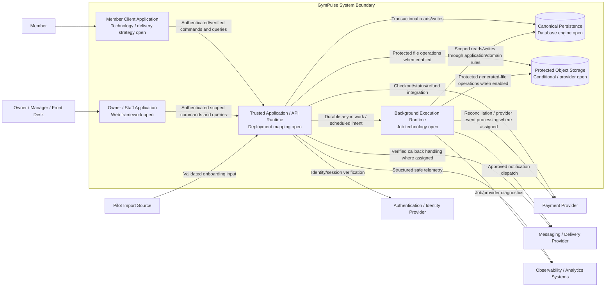
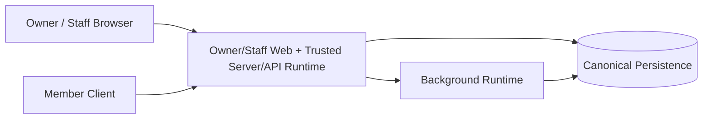
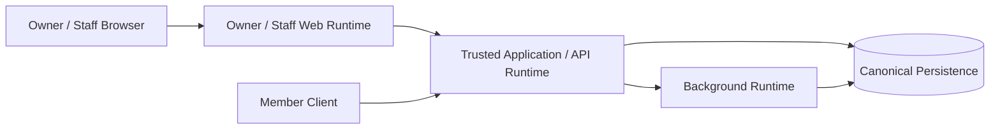

# GymPulse Container Architecture

## Document Control

- Document Maturity: `Draft`
- Scope Status: `In Scope` for Phase 1 architecture
- C4 Level: `Level 2 - Container Architecture`
- Audience: Product Architecture, Backend, Frontend, Mobile, Security, DevOps, QA, Operations
- Canonical Decision Register: `../00-overview/assumptions.md`
- Parent Context: `system-context.md`
- Architecture Overview: `architecture-overview.md`

## 1. Purpose

Define the C4 Level 2 decomposition of GymPulse Phase 1 into client, trusted execution, background execution, persistence, and external integration responsibilities.

This document explains:

- which major runtime/data responsibilities exist inside the GymPulse system boundary,
- what each container owns and must not own,
- how trust changes when data crosses container boundaries,
- where canonical business state lives,
- how interactive and asynchronous work are separated,
- where provider adapters execute,
- how deployment alternatives remain open without weakening architecture boundaries,
- which decisions require ADRs before implementation is treated as final.

This document does **not** select a framework, database engine, hosting platform, managed backend, job runner, queue, cache, authentication provider, payment provider, messaging provider, object-storage provider, analytics provider, or observability provider.

## 2. C4 Container Interpretation

In C4 terminology, a container is an application/runtime or data store that executes or stores a meaningful part of the system.

GymPulse currently has unresolved deployment decisions. Therefore this document distinguishes between:

1. **required container responsibility**: a responsibility that must exist somewhere in the architecture, and
2. **final deployment mapping**: whether two compatible responsibilities are packaged/deployed together or independently.

A container responsibility in this document must not be interpreted as a mandatory microservice, Kubernetes workload, repository, or independently scaled service.

In particular, `D-ARCH-006` remains open. The trusted Application/API responsibility may be hosted with an Owner/Staff web runtime initially or deployed as an independent API runtime, provided the same trust, authorization, domain, transaction, and testing boundaries are preserved.

## 3. Phase 1 Container Responsibilities

The Phase 1 architecture requires the following primary container responsibilities.

| Container responsibility | Type | Trust | Primary responsibility | Canonical business authority |
|---|---|---|---|---|
| Member Client Application | Client application | Untrusted | Member self-service interaction | No |
| Owner/Staff Application | Client/web application | Untrusted for business truth | Owner, Manager, Front Desk workflows | No |
| Trusted Application/API Runtime | Server application | Trusted | Authorization, use cases, domain rules, transactional mutations, authoritative reads | Yes, through canonical persistence |
| Background Execution Runtime | Server worker/runtime | Trusted | Scheduled/retryable business workflows and asynchronous continuations | Yes, only through the same domain/application rules |
| Canonical Persistence | Data store | Protected trusted data boundary | Durable system-of-record state, constraints, transactions, historical records | Yes |
| Protected Object Storage | Supporting data store, conditional | Protected | Receipts/exports or approved protected files | File bytes only; business truth remains in canonical persistence |

External providers remain outside the GymPulse system boundary and are shown separately.

## 4. C4 Level 2 Container Diagram



The arrows show responsibility and data flow, not final network topology.

## 5. Member Client Application

### Purpose

Provide the Phase 1 member-facing experience while treating all security-sensitive and business-critical state as server-authoritative.

### Responsibilities

- member identity/verification UX according to the selected authentication method,
- membership and expiry presentation,
- QR scanning/input capture,
- attendance result/history presentation,
- weekly attendance-goal presentation,
- renewal option selection,
- payment checkout handoff and `Processing`/verification UX,
- canonical payment/receipt status presentation,
- approved add-on browsing and usage/fulfillment presentation,
- supported communication-preference controls,
- loading, blocked, error, retry, accessibility, and offline/poor-network UX where required.

### Must not own

- tenant authorization,
- self-scope authorization,
- membership eligibility,
- QR validity,
- duplicate attendance decision,
- authoritative payable amount,
- canonical payment success,
- membership extension,
- add-on entitlement activation,
- audit attribution truth,
- provider secrets.

### Technology status

`D-ARCH-013` remains `PROPOSED`. Responsive web/PWA versus a native/mobile application framework must be decided from validated delivery needs. This document names the client responsibility only.

## 6. Owner / Staff Application

### Purpose

Provide operational workflows for Owner, Manager, and Front Desk actors.

### Responsibilities

- member search and operational member summary,
- membership/plan workflows permitted to the actor,
- assisted attendance UX,
- retention/no-show action queues,
- follow-up capture and next-action workflow,
- renewal pipeline and payment exception views,
- add-on management/fulfillment views where enabled,
- owner/manager dashboard and drill-down,
- data-quality issue views,
- authorized audit views,
- configuration UX for explicitly permitted settings,
- safe import/reconciliation workflow.

### Must not own

- capability authorization truth,
- branch/gym resource-scope authorization,
- sensitive actor identity supplied by the browser,
- canonical membership/payment/attendance state,
- provider secrets,
- unvalidated direct database access.

### Technology status

`D-ARCH-012` remains `PROPOSED`. A framework recommendation elsewhere in the repository does not become accepted through this document.

## 7. Trusted Application / API Runtime

### Purpose

Act as the trusted interactive application boundary for protected commands and queries.

### Core responsibilities

1. request decoding and boundary validation,
2. request/correlation identifier creation or propagation,
3. authentication/session verification handoff,
4. GymPulse principal resolution,
5. tenant/gym/branch/resource-scope resolution,
6. named capability authorization,
7. application-use-case orchestration,
8. domain-rule execution,
9. transaction ownership for interactive mutations,
10. idempotency enforcement where requests are retryable,
11. canonical persistence through controlled data-access boundaries,
12. audit/event creation where required,
13. durable continuation creation for critical asynchronous follow-up,
14. provider-adapter invocation where interactive provider work is appropriate,
15. safe response/error translation,
16. operational query/read-model serving.

### Business-rule ownership

The runtime may host many logical domain modules, but the modules retain explicit ownership over their state and rules.

Representative Phase 1 modules include:

```text
Identity & Access
Members
Memberships
Attendance
Retention & Follow-up
Renewals
Payments
Add-ons
Notifications
Audit
Operational Reporting / Data Quality
```

These are source-code/domain boundaries, not mandatory network services.

### API contract status

`D-ARCH-003` remains `PROPOSED`. JSON HTTP with typed/runtime-validated contracts is a recommendation, not an accepted decision here.

## 8. API Deployment Boundary Is Explicitly Open

`D-ARCH-006` must remain visible throughout implementation planning.

Two acceptable high-level mappings are currently possible.

### Option A: Web runtime and trusted application/API co-hosted



This option can reduce initial operational complexity if the selected web framework safely supports the required server boundary.

It is valid only if:

- domain logic stays outside UI components,
- server-only secrets and adapters remain server-only,
- authorization is enforced for every protected operation,
- member and staff contracts remain explicit/testable,
- background work is not tied to browser/request lifetime,
- future extraction remains possible without rewriting domain rules.

### Option B: Web UI and trusted API independently deployed



This option may improve runtime independence or scaling/ownership separation but adds deployment, networking, authentication, local-development, and operational complexity.

### Decision rule

Neither mapping is accepted by this document.

The chosen mapping requires explicit decision evidence/ADR under `D-ARCH-006` and must preserve the same logical boundaries in either case.

## 9. Background Execution Runtime

### Purpose

Execute retryable, scheduled, provider-bound, or non-interactive workflows outside interactive client request lifetime.

### Phase 1 workload classes

- daily no-show/inactivity scan,
- valid-attendance post-processing where asynchronous continuation is used,
- renewal-stage scan,
- payment event processing where decoupled from callback receipt,
- pending payment reconciliation,
- notification dispatch,
- provider delivery-event processing where decoupled,
- owner daily summary,
- data-quality scans,
- selected import/background reconciliation operations.

### Required runtime properties

Regardless of technology, background execution must support:

- explicit tenant/gym context,
- deterministic business keys or equivalent durable dedupe identity,
- retries with bounded classification/backoff,
- visible run status/failure diagnostics,
- correlation to business/request identifiers where practical,
- stale-business-condition recheck before external side effects,
- concurrency-safe domain writes,
- no dependence on process-local memory for permanent integrity,
- recovery after worker/runtime interruption.

### Relationship to application/domain rules

Workers must not implement a second version of business rules.

They should invoke the same application/domain policies used by interactive operations or equivalent shared domain contracts.

### Technology status

`D-ARCH-007` remains `OPEN`. The job/scheduler/queue implementation is not selected here.

`D-ARCH-008` also remains `OPEN`; Redis or another cache/broker is not required merely because background work exists.

## 10. Canonical Persistence

### Purpose

Store durable GymPulse system-of-record state and enforce correctness-supporting constraints.

### Required capability

The chosen persistence architecture must support the Phase 1 need for:

- transactional mutations,
- concurrency-safe uniqueness/invariants,
- explicit tenant ownership,
- indexed operational queries,
- auditable migrations/schema evolution,
- reconstructable history,
- payment/provider-event/effect reconciliation,
- backup and restore before production,
- controlled access from trusted server runtimes only unless a separately approved data-access architecture states otherwise.

### Canonical state examples

- member records,
- memberships and freezes,
- attendance and corrections,
- no-show cases and follow-ups,
- renewal orders,
- payments/provider events/business effects/refunds/reversals,
- add-on orders/entitlements/usage/fulfillment,
- notification intent/preferences/delivery observations,
- audit records,
- configuration required by business rules,
- durable data-quality issues,
- durable async/outbox state if that implementation is selected.

### Database status

`D-ARCH-002` remains `PROPOSED`; PostgreSQL is a recommendation but is not accepted by this C4 document.

### Tenant isolation

`D-SEC-008` remains open where data-layer RLS or equivalent defense-in-depth is applicable.

Application authorization remains mandatory even if database-level tenant controls are later adopted.

## 11. Protected Object Storage

### Scope

This container/supporting store is conditional for Phase 1.

Possible approved uses include:

- generated receipt artifacts,
- export files,
- other protected file-backed data explicitly required by a Phase 1 workflow.

### Rules

- business metadata and authorization truth remain in canonical persistence,
- objects are private/protected by default,
- object ownership is tenant-scoped,
- access is mediated by authorized server logic or controlled short-lived access mechanisms,
- client applications do not receive storage-provider administrative credentials,
- object lifecycle and retention follow explicit policy.

`D-ARCH-010` remains `OPEN`.

## 12. Authentication Provider Boundary

The external authentication/identity provider may establish session or identity evidence, but GymPulse owns business authorization.

Container interaction:

```text
Client
  -> selected authentication/session flow
  -> Trusted Application/API Runtime
      -> verify/resolve identity evidence
      -> map to GymPulse principal
      -> load role/capability assignments
      -> resolve tenant/resource scope
      -> authorize business operation
```

Open decisions:

- `D-ARCH-004` authentication/session architecture,
- `D-SEC-002` member verification method,
- `D-SEC-004` session lifecycle policy.

## 13. Payment Provider Boundary

### Interactive responsibilities

The Trusted Application/API Runtime may:

- validate a renewal/add-on order,
- create canonical internal Payment state,
- invoke a provider adapter to initialize checkout,
- return only provider fields safe for the client.

### Callback/reconciliation responsibilities

The trusted server/worker boundary must:

1. verify provider authenticity,
2. normalize provider evidence,
3. deduplicate provider events,
4. validate amount/currency/reference/business relationship,
5. transition canonical Payment state,
6. claim/apply the intended business effect exactly once,
7. preserve reconciliation history,
8. continue non-critical notification/analytics work after canonical commit.

The exact callback-to-worker split is an implementation/runtime detail. The integrity requirements are not optional.

`D-PROVIDER-001` remains `OPEN`.

## 14. Messaging Provider Boundary

GymPulse owns notification business intent and policy; the provider owns channel delivery behavior.

Typical flow:

```text
Application/domain event or schedule
  -> durable NotificationIntent
  -> Background Execution Runtime
  -> recheck current business condition
  -> recheck consent/preference/channel policy
  -> provider adapter
  -> Messaging Provider
  -> verified/provider-supported delivery callback
  -> canonical delivery observation
```

A provider failure must not roll back an already-valid attendance or payment transaction.

`D-PROVIDER-002` remains `OPEN`.

## 15. Telemetry and Analytics Boundaries

Trusted runtimes may emit:

- structured logs,
- errors/exceptions,
- job diagnostics,
- payment diagnostics,
- counters/metrics,
- privacy-minimized product analytics.

Rules:

- no secrets,
- minimize direct identifiers and free text,
- preserve request/job/provider correlation IDs where practical,
- telemetry is never authoritative attendance/payment/membership/revenue truth,
- external analytics failure must not corrupt canonical business state.

Providers remain open under `D-PROVIDER-005` and `D-PROVIDER-006`.

## 16. Import Boundary

Pilot import is handled as an untrusted external data source entering the Trusted Application/API boundary or an explicitly controlled background import workflow.

Required stages:

```text
source
  -> parse/stage
  -> validate
  -> detect duplicate/conflict
  -> preview/reconcile
  -> authorized confirmation
  -> controlled canonical write
  -> reconciliation report
```

Material missing facts such as membership expiry must not be fabricated.

## 17. Synchronous Container Interactions

Use synchronous interaction when the caller needs immediate authoritative feedback and the operation can complete safely within the request budget.

Typical Phase 1 examples:

- member/staff authentication-aware reads,
- member search,
- membership eligibility reads,
- QR check-in,
- assisted check-in,
- follow-up creation,
- renewal-order creation,
- payment checkout initialization,
- configuration reads/approved updates,
- owner action-queue reads.

Critical synchronous path:

```text
Client
  -> Trusted Application/API
  -> principal + scope + capability
  -> validation
  -> application use case
  -> domain rules
  -> transaction / canonical persistence
  -> required audit + durable continuation
  -> canonical response
```

## 18. Asynchronous Container Interactions

Use asynchronous interaction for work that is scheduled, retryable, provider-bound, expensive, or not required to complete before an interactive response.

Typical pattern:

```text
Trusted Application/API
  -> commit canonical state + durable continuation
  -> Background Runtime
  -> reload current scoped business state
  -> execute idempotent use case / provider adapter
  -> persist result/failure
  -> retry/reconcile if classified retryable
```

A durable continuation may be implemented with an outbox, durable job system, or equivalent mechanism after `D-ARCH-007` is decided.

## 19. Container-Level Transaction Boundaries

### Inside one canonical transaction

Where the chosen persistence technology supports it, operations that must succeed/fail together should remain inside one transaction.

Examples:

- attendance + request idempotency/effective uniqueness,
- no-show active-case creation + uniqueness protection,
- payment canonical transition + business-effect claim,
- add-on usage + non-negative balance enforcement,
- required audit attribution for sensitive state mutation where atomicity is required.

### Outside local transaction

External provider calls do not participate in the canonical database transaction.

Use state machines, provider references, durable retries, and reconciliation instead of pretending cross-provider work is atomic.

## 20. Idempotency Locations

Replay protection exists at multiple boundaries.

| Boundary | Example protection |
|---|---|
| Client mutation -> Application/API | tenant + operation + idempotency key / domain uniqueness |
| QR attendance | logical request key + duplicate attendance rule + canonical uniqueness |
| Scheduled no-show scan | deterministic member/rule/cycle identity + active-case uniqueness |
| Provider webhook | provider + provider-event ID uniqueness |
| Payment effect | payment + purpose/effect key uniqueness |
| Notification stage | membership/case/cycle/stage/channel dedupe key |
| Owner summary | gym/business-date/recipient/channel dedupe key |
| Data-quality scan | issue-type/resource deterministic identity |

The exact schema/implementation belongs in later component/data documents, but these protection points must not disappear.

## 21. Authorization Enforcement Points

Authorization must exist before protected business execution in both interactive and asynchronous runtimes.

### Interactive requests

```text
identity/session
  -> GymPulse principal
  -> tenant/gym/branch/resource scope
  -> named capability
  -> resource/business rule
```

### Background jobs

Jobs do not inherit a human browser session.

They must execute as an explicitly trusted system process with:

- explicit tenant/gym context,
- scoped resource identifiers,
- job type/capability semantics,
- correlation/job identity,
- no unbounded global mutation query.

### Provider callbacks

Provider callbacks are authorized through provider authenticity/verification, not a normal end-user session.

After verification they still must satisfy tenant/business relationship validation before mutation.

## 22. Container Data-Access Rules

### Clients

May call authorized application contracts only.

Must not:

- use database service/admin credentials,
- query canonical tables directly as an authorization shortcut,
- receive server-only provider secrets.

### Trusted Application/API

May read/write canonical state through controlled repositories/data-access boundaries and transactions.

### Background Runtime

May access canonical state only with explicit tenant context and the same domain ownership rules as interactive application logic.

### External providers

Do not receive database access.

They receive only the minimum integration data required for the approved interaction.

## 23. Failure and Degradation by Container

| Failure | Required behavior |
|---|---|
| Member/Staff client crash or retry | canonical server state remains safe; retry does not duplicate critical effect |
| Trusted Application/API unavailable | clients fail safely; no local client state is promoted to canonical truth |
| Background runtime delayed | interactive canonical state remains correct; pending work remains visible/recoverable |
| Canonical persistence unavailable | correctness-sensitive writes fail rather than inventing local success |
| Auth provider unavailable | protected authentication-dependent operations fail closed or follow approved session policy |
| Payment provider unavailable | do not mark payment paid; preserve retry/pending/reconciliation state |
| Messaging provider unavailable | retain notification intent/failure for retry/diagnosis; do not roll back business transaction |
| Object storage unavailable | protected file operation fails/degrades without corrupting unrelated canonical state |
| Telemetry provider unavailable | canonical business workflow should continue where safe; local diagnostics may degrade |

## 24. Scalability and Evolution

The container model supports later scaling without requiring Phase 1 microservices.

Possible evolution paths include:

- independently scaling trusted interactive runtime,
- independently scaling worker concurrency,
- read-model optimization for heavy operational queries,
- provider-specific adapter isolation,
- extracting a domain into a separate service only after measured scaling, security, availability, team-ownership, or deployment evidence justifies it.

`D-ARCH-005` remains `PROPOSED`; this document does not formally accept modular monolith architecture even though it preserves that direction.

## 25. Security Controls by Container

### Client applications

- no server secrets,
- no canonical authorization trust,
- secure session/token handling according to selected auth architecture,
- validate for UX but rely on server validation for security.

### Trusted Application/API

- server-side authz,
- explicit tenant/resource scope,
- boundary validation,
- rate/abuse controls where required,
- secret isolation,
- safe errors/logs,
- verified provider callbacks,
- audit for sensitive mutations.

### Background Runtime

- server-only credentials,
- explicit tenant context,
- bounded job payloads,
- idempotency/retry discipline,
- no cross-tenant unscoped mutation,
- operator-visible failures.

### Canonical Persistence

- protected network/credential access,
- least-privilege roles where feasible,
- backup/restore,
- migration discipline,
- data-layer tenant defense in depth if adopted.

### Object Storage

- private by default,
- tenant-scoped object ownership,
- authorized/signed access,
- no public permanent URLs for protected artifacts.

## 26. Observability by Container

### Application/API

Should expose safe structured context such as:

- request/correlation ID,
- route/use case,
- tenant/gym/branch identifiers where safe,
- actor/principal type,
- canonical resource identifier,
- error/result code,
- provider reference/event ID where safe.

### Background Runtime

Should expose:

- job ID/type,
- tenant/gym context,
- scheduled/start/finish time,
- attempt number,
- result/failure code,
- correlation/business key,
- provider dependency state where relevant.

### Persistence/data quality

Operators need enough diagnostics to detect:

- stuck payment effects,
- failed/no-show scans,
- duplicate-effect attempts,
- invalid membership data,
- failed notification stages,
- reconciliation mismatches.

## 27. Test Boundaries

The container architecture creates explicit testing seams.

### Client contract tests

- client cannot rely on hidden UI for authorization,
- schemas/errors are handled deterministically,
- canonical status is refreshed after ambiguous network/provider result.

### Trusted Application/API integration tests

- authentication/principal mapping,
- capability + tenant/resource authorization,
- boundary validation,
- transaction rollback,
- idempotent mutation retry,
- safe provider adapter behavior.

### Background-runtime tests

- duplicate job execution,
- retry after partial failure,
- tenant isolation,
- timezone scheduling,
- stale notification suppression,
- provider outage/recovery.

### Persistence tests

- constraints/uniqueness,
- tenant ownership,
- migration from zero,
- transaction/concurrency behavior,
- backup/restore process before production.

### Provider contract tests

- webhook authenticity,
- normalization,
- duplicate callback,
- timeout/ambiguous response,
- unsupported delivery states,
- sandbox/test-mode behavior.

## 28. Decisions This Document Must Not Resolve

The following remain governed by the canonical decision register and ADR process:

- `D-ARCH-001` repository/monorepo strategy,
- `D-ARCH-002` database engine,
- `D-ARCH-003` API contract architecture,
- `D-ARCH-004` authentication/session architecture,
- `D-ARCH-005` system decomposition style,
- `D-ARCH-006` API deployment boundary,
- `D-ARCH-007` background-job technology,
- `D-ARCH-008` Redis/cache/broker requirement,
- `D-ARCH-009` hosting platform,
- `D-ARCH-010` object storage,
- `D-ARCH-011` package manager,
- `D-ARCH-012` Owner/Staff framework,
- `D-ARCH-013` Member client delivery/framework,
- `D-ARCH-014` managed backend responsibilities,
- `D-ARCH-015` authorization implementation boundary,
- `D-SEC-002` member authentication method,
- `D-SEC-008` data-layer tenant isolation/RLS,
- `D-PROVIDER-001` payment provider,
- `D-PROVIDER-002` messaging provider,
- `D-PROVIDER-005` analytics provider,
- `D-PROVIDER-006` observability provider,
- `D-DATA-007` Member vs Membership state ownership.

## 29. Requirement Traceability Summary

| Container area | Primary requirement families |
|---|---|
| Member Client | `FR-IDENTITY-*`, `FR-AUTHZ-003`, `FR-MEMBERSHIP-*`, `FR-ATTENDANCE-*`, `FR-RENEWAL-*`, `FR-PAYMENT-*`, `FR-ADDON-*`, `FR-CONSENT-*`, `NFR-UX-*` |
| Owner/Staff Application | `FR-MEMBER-*`, `FR-MEMBERSHIP-*`, `FR-ATTENDANCE-*`, `FR-RETENTION-*`, `FR-FOLLOWUP-*`, `FR-DASHBOARD-*`, `FR-AUDIT-*`, `NFR-UX-*` |
| Trusted Application/API | `FR-AUTHZ-*`, `FR-CROSS-*`, `FR-PAYMENT-*`, `NFR-SECURITY-*`, `NFR-RELIABILITY-*`, `NFR-MAINTAINABILITY-*` |
| Background Runtime | `FR-RETENTION-*`, `FR-RENEWAL-*`, `FR-NOTIFICATION-*`, `FR-SUMMARY-*`, `FR-DATA-QUALITY-*`, `NFR-RELIABILITY-003`, `NFR-AVAILABILITY-*`, `NFR-OBSERVABILITY-*` |
| Canonical Persistence | `FR-CROSS-001..003`, `FR-AUDIT-*`, `FR-PAYMENT-004..009`, `NFR-RELIABILITY-004..008`, `NFR-DATA-*`, `NFR-AVAILABILITY-004` |
| Provider boundaries | `FR-PAYMENT-002..009`, `FR-NOTIFICATION-*`, `NFR-SECURITY-004..008`, `NFR-MAINTAINABILITY-003`, `NFR-TESTABILITY-002..003` |

Wildcards/ranges refer only to requirement IDs already defined in canonical requirement documents.

## 30. Container Architecture Gate

The C4 Level 2 model is valid only while these checks remain true:

- the System Context actors/external systems remain consistent,
- client containers remain untrusted for canonical business truth,
- server-side capability + tenant/resource authorization remains mandatory,
- no runtime/framework/provider/database choice is silently accepted,
- `D-ARCH-006` remains explicit until the API deployment mapping is decided,
- workers do not create a second copy of domain rules,
- background work remains retry-safe and observable,
- canonical business state has one protected persistence authority,
- provider callbacks cannot bypass verification/idempotency,
- logical domain boundaries are not interpreted as one-service-per-domain,
- `D-DATA-007` remains visible until Member vs Membership state ownership is resolved,
- Future workout, health, coaching, advanced nutrition, multi-branch product workflows, and AI are not promoted into Phase 1.

If these checks pass, the next bounded architecture task is:

```text
component-architecture.md
```

The component document should decompose the Trusted Application/API and Background Execution responsibilities into source-code/application components while preserving the deployment neutrality and domain ownership established here.

## 31. Related Documents

- `../README.md`
- `../00-overview/project-overview.md`
- `../00-overview/scope.md`
- `../00-overview/assumptions.md`
- `../01-product/user-roles.md`
- `../01-product/user-journeys.md`
- `../01-product/functional-requirements.md`
- `../01-product/non-functional-requirements.md`
- `architecture-principles.md`
- `architecture-overview.md`
- `system-context.md`
- `../adr/README.md`
- legacy migration input: `../05-system-architecture.md`
- legacy migration input: `../06-database-schema.md`
- legacy migration input: `../07-api-contracts.md`
- legacy migration input: `../08-automations.md`
- legacy migration input: `../09-payments-billing.md`
- legacy migration input: `../10-notifications-whatsapp.md`
- legacy migration input: `../12-security-audit.md`
- legacy migration input: `../15-engineering-workflow.md`
