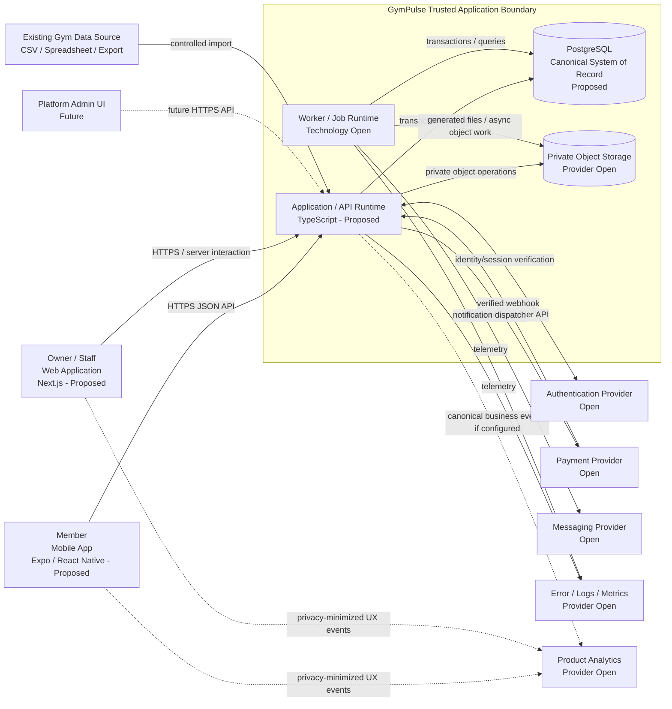
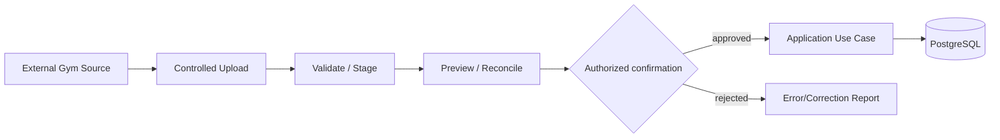
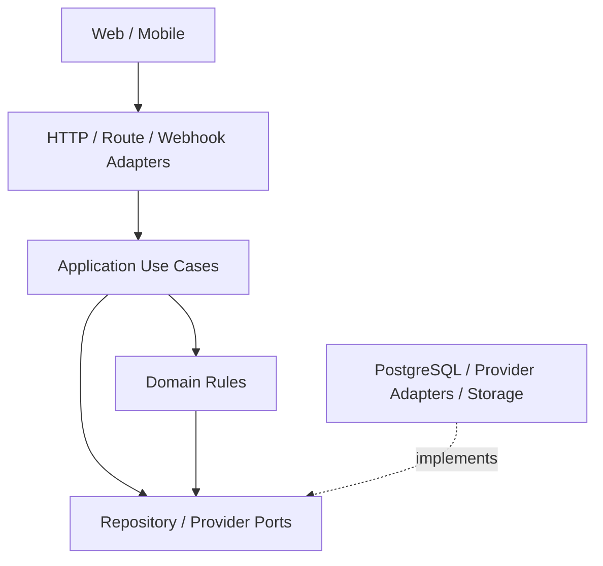
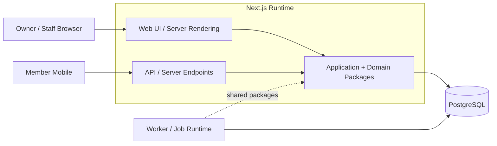
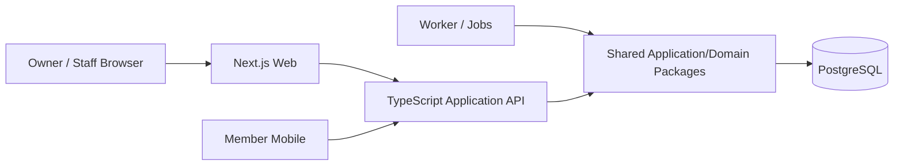

# GymPulse Container Architecture

## Document Control

- Status: `Draft v1.0`
- Model: `C4 Level 2 - Container Architecture`
- Scope: Phase 1 Operations MVP with explicit evolution path
- Audience: Architecture, Backend, Frontend, Mobile, DevOps, Security, QA
- Parent documents: `architecture-overview.md`, `system-context.md`, `architecture-principles.md`
- Decision posture: logical container boundaries are defined here; exact provider/runtime selections remain open until accepted through ADRs

## 1. Purpose

Define the major GymPulse runtime and data containers, their responsibilities, trust boundaries, communication paths, deployment relationships, failure boundaries, and scaling implications.

This document deliberately separates **logical containers** from **mandatory deployable services**. GymPulse Phase 1 should preserve clean runtime boundaries without prematurely decomposing the product into microservices.

The central architectural rule is:

> Web, mobile, jobs, and external providers may have separate runtime concerns, but deterministic business rules must remain centralized in trusted application/domain code rather than duplicated across clients.

## 2. Requirement Drivers

The container design exists primarily to satisfy:

- `FR-IDENTITY-001` staff authentication
- `FR-IDENTITY-003` verified member identity
- `FR-AUTHZ-001` tenant-scoped authorization
- `FR-AUTHZ-002` named capability enforcement
- `FR-MEMBERSHIP-004` server-side eligibility
- `FR-ATTENDANCE-002` complete QR validation
- `FR-ATTENDANCE-003` exactly one canonical attendance record
- `FR-ATTENDANCE-006` retry safety
- `FR-RETENTION-005` single active no-show case
- `FR-RENEWAL-*` renewal workflow requirements
- `FR-PAYMENT-*` payment verification/idempotency requirements
- `NFR-SECURITY-001` tenant isolation
- `NFR-SECURITY-003` server-side authorization
- `NFR-SECURITY-004` secret protection
- `NFR-SECURITY-008` webhook verification
- `NFR-RELIABILITY-001` idempotent critical mutations
- `NFR-RELIABILITY-002` payment exactly-once effect
- `NFR-AVAILABILITY-003` job failure visibility
- `NFR-PERFORMANCE-003` bounded operational queues
- `NFR-SCALABILITY-002` modular boundaries
- `NFR-SCALABILITY-003` horizontal evolution
- `NFR-SCALABILITY-004` queueable asynchronous work
- `NFR-OBSERVABILITY-003` centralized error visibility

## 3. Container Definition

In this document, a **container** is a separately meaningful executable application, data store, client application, or external platform dependency in the C4 sense.

A container does not automatically imply:

- a separate repository,
- a separate team,
- a separate network service,
- a separate Kubernetes workload,
- a microservice.

For example, the Application/API responsibilities may initially execute inside the same deployable runtime as the Owner/Staff Web application while still remaining a separate logical boundary in code.

## 4. C4 Level 2 Container Diagram



Dashed edges are future, conditional, or non-canonical analytics paths.

## 5. Runtime Responsibility Summary

| Container | Phase 1 | Trust level | Canonical business authority? | Primary responsibility |
|---|---|---|---|---|
| Owner/Staff Web | Confirmed | Untrusted client boundary | No | Staff and owner interaction |
| Member Mobile | Proposed delivery client | Untrusted client boundary | No | Member self-service/check-in |
| Application/API Runtime | Required logical boundary | Trusted server | Yes, through domain services | Authentication context, authorization, validation, use cases, transactions |
| Worker/Job Runtime | Required logical capability | Trusted server | Yes for authorized scheduled effects | Scheduled/retryable background operations |
| PostgreSQL | Proposed | Protected data boundary | Canonical persistence | Transactional system of record |
| Object Storage | Conditional/Open provider | Protected external data boundary | No for business state | Files, receipts, exports, later media |
| Authentication Provider | Open | External provider | Identity proof only | Authentication/session primitives |
| Payment Provider | Open | External provider | Provider payment truth for online payment | Payment processing and verifiable results |
| Messaging Provider | Open | External provider | Delivery transport only | WhatsApp/SMS/email delivery |
| Observability | Open | External operational platform | No | Diagnostics, error/log/metric visibility |
| Product Analytics | Open/optional | External analytics platform | No | UX/product usage analysis |

## 6. Container C-01: Owner / Staff Web Application

### Status

`Proposed technology: Next.js + TypeScript`, tracked by `D-ARCH-011`.

### Primary users

- Owner / Manager
- Front Desk Staff
- future Branch Manager / Finance / Organization Admin with scoped capabilities

### Responsibilities

The web application owns:

- authenticated user interface,
- navigation and route-level presentation,
- member search UX,
- membership management UX,
- assisted check-in UX,
- no-show/red-list queues,
- follow-up workflows,
- renewal/payment exception views,
- add-on management views,
- owner dashboard,
- tenant/branch selector where authorization allows it,
- local form validation for user experience,
- loading/empty/error/retry presentation.

### Must not own

The web application must not independently decide:

- tenant authorization,
- membership eligibility,
- payment success,
- valid attendance,
- renewal effective date,
- no-show eligibility,
- final stock/session balance,
- permission truth.

### Communication

Preferred logical interaction:

```text
Browser/UI
  -> Application/API contract
  -> trusted application/domain use case
```

If Option A deployment is selected, server-side Next.js execution may invoke application/domain packages in-process. This does not permit browser/client code to bypass the application boundary.

### Security boundary

- browser state is untrusted,
- route protection improves UX but is not sufficient authorization,
- tenant IDs from URLs/forms are verified server-side,
- secrets must never enter the browser bundle,
- sensitive exports should require fresh authorization and auditable issuance.

### Scaling behavior

The web presentation layer should be horizontally stateless where practical. User/business truth must not depend on process-local memory.

## 7. Container C-02: Member Mobile Application

### Status

`Proposed technology: Expo / React Native + TypeScript`, tracked by `D-ARCH-012`.

A member web experience may coexist later, but Phase 1 architecture must support a mobile client without moving business logic into the client.

### Responsibilities

- member authentication/verification UX,
- membership status and expiry presentation,
- QR scanner interaction,
- attendance history,
- weekly goal/streak display,
- renewal offer presentation,
- payment checkout handoff,
- payment processing/pending/result presentation,
- receipt access,
- optional add-on catalogue/purchase UX,
- communication preference UX,
- safe client retry behavior.

### QR handling

The mobile client may read an opaque QR token, but validity is decided by the Application/API runtime.

The client must not decode a token and locally decide that attendance is valid.

### Payment handling

A provider SDK/client return value may improve UX, but the mobile client must show a non-final state until GymPulse receives/verifies canonical payment success according to provider strategy.

### Offline behavior

Offline attendance is not assumed (`D-PROD-010`).

If offline behavior is added later:

- local records are pending intents, not canonical attendance,
- sync requires server validation,
- idempotency identifiers must survive retries,
- UI must distinguish queued from confirmed attendance.

### Security

- mobile storage of auth material follows selected provider secure-storage guidance,
- no payment provider secrets in app bundle,
- no internal authorization policy embedded as trusted logic,
- error telemetry must avoid leaking raw PII or tokens.

## 8. Container C-03: Application / API Runtime

### Status

`Required logical boundary`.

Exact deployment form is Open under `D-ARCH-006`.

### Responsibilities

This runtime is the primary trusted application boundary for interactive requests and provider callbacks.

It owns:

1. request/correlation context,
2. authentication integration,
3. principal resolution,
4. tenant/gym/branch scope resolution,
5. capability authorization,
6. request schema validation,
7. application use-case orchestration,
8. domain rule execution,
9. database transaction boundaries,
10. idempotency handling,
11. audit/event emission,
12. stable response DTOs,
13. provider webhook entry/verification,
14. signed/private file access orchestration,
15. canonical operational API contracts.

### Logical internal dependency direction

```text
Transport / Route Handler
        ↓
Application Use Case
        ↓
Domain Module
        ↓
Repository / Provider Port
        ↓
Infrastructure Adapter
```

A route handler must not directly manipulate tables to bypass domain state transitions.

### Domain modules hosted by the runtime

Phase 1 includes at least:

```text
Identity / Authorization
Members
Plans / Memberships
Attendance
Retention / Follow-up
Renewals
Payments
Add-ons
Notifications - decision/intent side
Operational Analytics queries
Audit / Data Quality
```

### Synchronous interactions

Use synchronous processing for operations where the user requires an immediate canonical result and where consistency is naturally transactional, including:

- member search/read,
- membership changes,
- QR validation/check-in,
- assisted check-in,
- follow-up recording,
- renewal-order creation,
- payment-initiation orchestration,
- protected dashboard queries.

### Webhook processing

Payment/provider webhook entry should:

```text
receive raw request
  -> verify authenticity
  -> map provider event
  -> persist/dedupe provider event
  -> execute canonical payment handler
  -> apply business effect exactly once
  -> enqueue/record secondary side effects
  -> acknowledge provider
```

The exact balance between synchronous webhook processing and durable job continuation may depend on selected provider/runtime, but business-effect idempotency is mandatory.

### Failure boundary

An API failure must not leave partially applied multi-record state when a single transaction can preserve correctness.

If an external provider is unavailable, the API should surface an explicit retryable/unavailable/pending state rather than inventing success.

## 9. Container C-04: Worker / Job Runtime

### Status

`Required logical capability; technology Open`, tracked by `D-ARCH-007`.

The worker may initially share the same source code/packages and even infrastructure account as the Application/API runtime, but scheduled/retryable work should have an explicit operational boundary.

### Responsibilities

Phase 1 worker workloads include:

- daily no-show scans,
- renewal eligibility/reminder scans,
- notification dispatch,
- daily owner summaries,
- payment reconciliation retries,
- data-quality scans,
- import/background processing if needed,
- future PT reminders.

### Job envelope

A durable job should conceptually contain:

```ts
type JobEnvelope<T> = {
  jobId: string;
  type: string;
  tenantContext: {
    organizationId: string;
    gymId: string;
    branchId?: string;
  };
  correlationId: string;
  dedupeKey?: string;
  payload: T;
  scheduledFor?: string;
};
```

Exact schema will be defined in backend/job documentation.

### Reliability requirements

- retries must be safe,
- tenant context is explicit,
- dedupe strategy is durable,
- failed runs are visible,
- job execution is not dependent on an open browser/mobile client,
- provider timeouts do not cause silent message/payment-state loss,
- environment is explicit to prevent staging jobs from affecting production.

### Scaling

The worker should be independently scalable from interactive requests if load eventually requires it.

Example future scale separation:

```text
API replicas: scale by request latency/concurrency
Worker replicas: scale by queue depth/job duration
```

No Phase 1 requirement mandates large-scale worker infrastructure; observability and retry correctness are more important than throughput optimization.

## 10. Container C-05: PostgreSQL

### Status

`Proposed / Assumed`, tracked by `D-ARCH-002`, final acceptance requires ADR.

### Responsibility

PostgreSQL is the proposed canonical relational system of record for Phase 1.

It stores canonical state such as:

- organizations/gyms/branches,
- application users and role assignments,
- members,
- plans/memberships/freezes,
- QR sessions,
- attendance/corrections,
- weekly goals,
- no-show cases,
- follow-ups,
- renewal orders,
- payments/provider events/effects,
- receipts metadata,
- add-ons/orders/usage,
- notification intents/status,
- settings,
- audit records,
- data-quality findings.

### Data ownership rule

The database is shared infrastructure for the modular monolith, but tables/entities have **domain ownership**.

A module must not casually update another module's tables simply because the database is shared.

Example:

```text
Attendance module owns canonical attendance mutation.
Retention module may read attendance through approved query/repository contracts.
Payment handler must invoke membership effect logic rather than manually changing expiry through arbitrary SQL.
```

### Constraint responsibilities

The database should reinforce race-sensitive invariants with constraints/indexes where practical, including:

- provider event uniqueness,
- payment effect uniqueness,
- one active no-show case per rule context,
- valid relationships,
- valid date constraints,
- tenant-safe indexes,
- non-negative balance protection where the selected representation allows it.

### Security

- database credentials remain server-side,
- direct client database access is not assumed,
- if a managed platform exposes client DB access, RLS strategy becomes P0 (`D-SEC-008`),
- backups/restore must exist before production.

## 11. Container C-06: Private Object Storage

### Status

`Conditional / provider Open`, tracked by `D-ARCH-010`.

### Intended content

Phase 1 may require:

- generated receipt files,
- import reports,
- exports,
- possibly member avatars.

Future scope may add:

- progress photos,
- documents,
- coaching attachments.

### Rules

- protected objects private by default,
- tenant-scoped object keys,
- signed/authorized access,
- short-lived links for sensitive files,
- file metadata may be canonical in PostgreSQL while binary objects live in storage,
- storage failure must not corrupt financial/membership state,
- malware/content validation policy will be defined when arbitrary user uploads enter scope.

Example object namespace:

```text
organizations/{organizationId}/gyms/{gymId}/receipts/{receiptId}.pdf
```

Do not include secrets or unnecessary PII in object keys.

## 12. External Container E-01: Authentication Provider

### Status

Open: `D-ARCH-004`, `D-SEC-002`, related managed-platform decision `D-ARCH-013`.

### Provider responsibilities

Depending on selected product:

- identity verification,
- password/passwordless/OTP support,
- session/token issuance,
- token refresh/expiry,
- account recovery,
- revocation primitives.

### GymPulse responsibilities

GymPulse retains responsibility for:

- application user/member mapping,
- tenant association,
- role assignment,
- capability authorization,
- support/admin boundaries,
- domain access policy.

Authentication success does not grant tenant authorization automatically.

### Failure behavior

Provider outage should not be hidden. Existing-session behavior depends on selected session architecture and must be documented after auth selection.

## 13. External Container E-02: Payment Provider

### Status

Open: `D-PROVIDER-001`.

### Provider responsibilities

- checkout/payment attempt,
- supported payment methods,
- payment processing,
- verifiable webhook/API status,
- provider transaction/event IDs,
- refund/reversal capability where enabled.

### GymPulse responsibilities

- renewal/add-on order,
- internal payment record,
- payment-purpose association,
- webhook verification,
- canonical status mapping,
- provider-event dedupe,
- payment-effect ledger,
- exactly-once membership/add-on effect,
- reconciliation and exception visibility.

### Data boundary

GymPulse must not store raw card or raw UPI credentials.

### Failure boundary

A payment-provider timeout must produce `Pending`, `Failed`, or explicitly unknown/reconciliation-required behavior according to verified information. It must never cause optimistic membership extension.

## 14. External Container E-03: Messaging Provider

### Status

Open: `D-PROVIDER-002`, initial channels `D-PROD-011`.

### Transport responsibilities

Potentially:

- WhatsApp delivery,
- SMS delivery,
- email delivery,
- provider message IDs,
- delivery/read status where actually supported.

### GymPulse responsibilities

- notification business intent,
- consent/preference policy,
- template/stage identity,
- deterministic dedupe,
- channel selection policy,
- retry policy,
- canonical notification status,
- conversion attribution where justified.

### Failure behavior

Provider failure must leave an actionable/retryable notification record. Messaging failure must not roll back already valid attendance or payment state.

## 15. External Container E-04: Observability Platform

### Status

Open: `D-PROVIDER-006`.

### Data sent

Only operationally necessary telemetry such as:

- request ID,
- job ID,
- safe tenant/gym reference,
- resource ID where appropriate,
- error class/code,
- latency/timing,
- provider event reference where safe.

### Prohibited/limited telemetry

Avoid:

- auth tokens,
- webhook secrets,
- raw provider payloads unless securely redacted and explicitly justified,
- member free-text notes,
- raw phone/email where not required,
- health data in generic logs.

### Dependency criticality

Observability failure must not block core business transactions unless a deliberate compliance control requires otherwise.

## 16. External Container E-05: Product Analytics Platform

### Status

Optional/Open: `D-PROVIDER-005`.

### Purpose

Analyze behavior such as:

- screen views,
- QR scan initiation,
- renewal option views,
- add-on views,
- interaction funnels.

### Non-authority rule

Product analytics must never become the source of truth for:

- revenue,
- successful payment,
- valid attendance,
- membership state,
- no-show recovery.

Canonical business metrics derive from server/system-of-record records.

## 17. Existing Gym Data Import Boundary

### Status

Conditional Phase 1.

Potential sources:

- CSV,
- spreadsheet export,
- biometric export,
- another gym software export.

### Import interaction



Import must not silently fabricate expiry, membership state, tenant ownership, or payment truth.

## 18. Synchronous vs Asynchronous Interaction Matrix

| Interaction | Default mode | Reason |
|---|---|---|
| Member/staff read APIs | Synchronous | Immediate user response |
| QR check-in | Synchronous canonical mutation | Member requires definitive server result |
| Assisted check-in | Synchronous canonical mutation | Staff requires explicit success/failure |
| Follow-up recording | Synchronous mutation | User-facing operational record |
| Renewal-order creation | Synchronous mutation | Required before checkout |
| Payment provider checkout creation | Synchronous provider orchestration | User initiates payment |
| Payment webhook | Synchronous verification + durable canonical processing | Provider acknowledgement and state integrity |
| No-show scan | Asynchronous scheduled | Batch/time-based work |
| Renewal reminder scan | Asynchronous scheduled | Batch/time-based work |
| Notification delivery | Asynchronous preferred | External latency/retry isolation |
| Daily owner summary | Asynchronous scheduled | Time-based aggregation |
| Data-quality scan | Asynchronous scheduled | Non-interactive workload |
| Product analytics | Asynchronous/best-effort | Must not block canonical workflows |
| Receipt file rendering | Synchronous metadata, async file generation allowed | File creation should not corrupt payment effect |

Specific implementation may evolve, but changing canonical consistency semantics requires architecture review.

## 19. Data Ownership and Access Boundaries

### Canonical ownership

```text
Identity/AuthZ        -> application users, roles, permissions/scopes
Member                -> member identity/profile
Membership            -> plans, memberships, freezes, entitlement policy
Attendance            -> QR sessions, attendance, corrections
Retention             -> no-show cases, follow-ups, return resolution
Renewal/Payments      -> renewal orders, payments, provider events, effects, receipts metadata
Add-ons               -> catalogue, orders, usage/fulfillment balances
Notifications         -> intent, preference evaluation, dispatch state
Audit/Data Quality    -> audit events, operational findings
```

### Shared read does not imply shared write ownership

A dashboard may compose data from multiple domains, but it should not create a second writable copy of canonical domain state.

### Reporting

Phase 1 operational dashboards may query canonical relational data through application/read-model queries. A separate data warehouse is not required.

## 20. Dependency Direction

Preferred dependency direction:



Infrastructure code may depend on domain/application interfaces. Domain rules must not depend directly on Next.js, Expo, a payment SDK, or a specific database client API.

## 21. Trust Boundaries

### Boundary TB-01: Client to trusted application

Untrusted inputs include:

- resource IDs,
- tenant/branch IDs,
- QR tokens,
- form data,
- claimed payment/client states,
- pagination/filter values.

Controls:

- authentication,
- boundary validation,
- server-side scope resolution,
- named capability checks,
- rate/abuse controls where needed,
- idempotency on critical mutations.

### Boundary TB-02: Application to protected data

Controls:

- server-only database credentials,
- tenant-scoped repository behavior,
- database constraints,
- optional RLS defense in depth,
- migrations and least-privilege DB access.

### Boundary TB-03: External provider callbacks

Controls:

- verify signature/authenticity,
- preserve provider event identifier,
- canonical payload mapping,
- replay/idempotency protection,
- safe diagnostics.

### Boundary TB-04: Application to third-party telemetry

Controls:

- data minimization,
- redaction,
- privacy-safe event schema,
- no credentials/secrets,
- canonical workflows do not depend on analytics delivery.

## 22. Deployment Topology Decision D-ARCH-006

`D-ARCH-006` remains Open. Two Phase 1 deployment forms are architecturally acceptable if they preserve the boundaries above.

## 22.1 Option A: Next.js Web + Server/API Initially



### Benefits

- fewer deployable applications,
- simpler pilot operations,
- lower environment/configuration overhead,
- fast end-to-end iteration,
- simpler local development.

### Risks

- framework route handlers may become business-logic dumping grounds,
- server-rendering and API concerns may become coupled,
- mobile API needs can be treated as secondary unless contracts are designed intentionally,
- web-runtime scaling characteristics may influence API scaling unnecessarily.

### Required safeguards

If Option A is selected:

- domain/application code lives in framework-independent packages/modules,
- API contracts remain explicit,
- mobile calls stable server endpoints rather than web-internal actions not suitable for mobile,
- background jobs do not depend on browser/server-render lifecycle,
- extracting a standalone API later should not require rewriting domain logic.

## 22.2 Option B: Separate TypeScript API Runtime



### Benefits

- explicit client/API boundary from day one,
- web and mobile are equal consumers,
- API scaling/deployment can evolve independently,
- clearer runtime ownership for webhooks and external integrations.

### Costs

- additional deployment,
- more local-development orchestration,
- more environment/configuration management,
- potentially more latency/hops for server-rendered web flows,
- more CI/CD surface before pilot scale proves a need.

### Required safeguards

If Option B is selected:

- avoid duplicating application logic between API and worker,
- use shared domain/application packages,
- define internal service authentication only if actual separate protected network calls require it,
- maintain one canonical transaction boundary for consistency-sensitive operations.

## 22.3 Selection criteria

ADR-0003 should evaluate Option A vs Option B using:

1. mobile release timing,
2. deployment platform constraints,
3. team familiarity,
4. local-development complexity,
5. webhook/runtime requirements,
6. job-runner integration,
7. expected scaling profile,
8. observability/operations burden,
9. ability to preserve framework-independent domain boundaries.

No selection is made in this document.

## 23. Deployment Units vs Source Packages

A recommended source-code shape can be more granular than deployment units.

Conceptual monorepo:

```text
apps/
  web/
  member-mobile/
  api/                 # may be omitted as a deployable app under Option A
  worker/

packages/
  domain/
  application/
  contracts/
  database/
  auth/
  payments/
  notifications/
  audit/
  analytics/
  config/
  observability/
```

The final repository structure is documented later in `13-engineering/repository-structure.md` and requires monorepo ADR acceptance.

## 24. Failure Boundaries and Degradation

### Web application failure

Impact:

- owner/staff UI unavailable,
- canonical background processing may continue if API/worker remain available under deployment topology.

Mitigation:

- health checks,
- error monitoring,
- stateless restart/deployability.

### Member mobile failure

Impact limited to member client session. It must not corrupt canonical state.

### Application/API failure

Impact:

- interactive operations unavailable,
- provider callbacks may retry depending on provider,
- worker jobs may continue if independently deployed.

Controls:

- health monitoring,
- provider webhook retry/reconciliation,
- idempotent requests,
- safe database transactions.

### Worker failure

Impact:

- delayed no-show scans,
- delayed notifications,
- delayed summaries/reconciliation.

It must not silently lose work.

Controls:

- visible failed jobs,
- retry,
- dedupe,
- operational alerting.

### PostgreSQL failure

Core system is degraded/unavailable because canonical state cannot be safely mutated without the system of record.

Controls:

- managed durability where selected,
- backups,
- restore procedures,
- connection handling,
- clear maintenance/unavailable behavior.

### Payment provider failure

- checkout/payment status unavailable,
- membership must not be optimistically extended,
- existing non-payment operations should continue where possible.

### Messaging provider failure

- notification delivery delayed/failed,
- canonical business state remains valid,
- retry/diagnostic state retained.

### Object storage failure

- receipt/export binary generation/download may fail,
- payment and membership canonical state remains preserved.

### Analytics/observability failure

- analytics must not block product flows,
- loss of observability is operationally serious and should alert where detectable,
- canonical records must remain unaffected.

## 25. Security Considerations

### Authentication

Only selected auth provider proves identity. GymPulse maps that identity to application principals.

### Authorization

Application/API runtime enforces capability + scope before resource exposure or mutation.

### Tenant isolation

Tenant scope propagates across:

- API requests,
- database queries,
- jobs,
- storage paths,
- audit records,
- canonical events.

### Secret management

Only trusted runtime containers receive:

- database credentials,
- payment secrets,
- messaging credentials,
- signing keys,
- storage credentials,
- webhook secrets.

Client applications receive only intentionally public configuration.

### Provider callbacks

Provider webhooks enter through narrowly scoped endpoints and are verified before canonical state mutation.

### Data minimization

External observability/analytics receive only necessary information.

### Future health data

When health/nutrition/progress domains become active, this container model must be revisited for stronger data-classification, access, retention, and possibly runtime-isolation requirements.

## 26. Performance Considerations

### Interactive paths

Keep the following free from unnecessary provider calls:

- member profile reads,
- attendance validation after QR token is obtained,
- staff member search,
- no-show queue reads.

### Database usage

- server-side filters,
- pagination,
- tenant/status/date indexes,
- avoid loading unbounded collections,
- avoid provider latency inside long DB transactions.

### Worker workloads

Batch jobs should be chunked/bounded by tenant and data volume rather than one unbounded global transaction.

### Mobile payloads

Return purpose-specific DTOs; do not send owner/staff data to member clients and hide it locally.

## 27. Scalability Considerations

Phase 1 scalability strategy is **horizontal evolution without premature distribution**.

### Application/API

Design stateless request handling so multiple replicas can share PostgreSQL and durable job infrastructure later.

### Worker

Use claim/lease/queue semantics from the selected runner to allow multiple workers without duplicate business effects.

### PostgreSQL

Scale first through:

- correct indexes,
- query optimization,
- connection management,
- bounded queries,
- appropriate managed sizing.

Do not add read replicas/sharding before measured need.

### Storage/providers

Provider-specific rate limits and quotas must be incorporated after provider selection.

### Domain extraction

A domain may become a separate service only after evidence of a real scaling/security/ownership requirement. Shared database access must not be casually preserved if such extraction occurs.

## 28. Observability by Container

### Web

- browser errors,
- server-render errors where applicable,
- route performance,
- failed API interactions.

### Mobile

- crashes,
- network failures,
- QR scanner failures,
- app-version context.

### Application/API

- request count/latency/errors,
- auth/authz denials,
- idempotency conflict/dedupe events,
- webhook verification/processing,
- DB/provider dependency timing.

### Worker

- job start/success/failure,
- retries,
- duration,
- tenant context,
- queue depth/age where supported,
- dedupe outcome.

### PostgreSQL

- connection saturation,
- slow queries,
- transaction failures,
- backup/restore health through infrastructure tooling.

### External providers

- provider call latency,
- error/timeout rates,
- webhook delivery/verification failures,
- messaging delivery failures.

## 29. Testing Boundaries

### Client contract tests

Web/mobile tests verify request/response behavior against stable contracts but must not reimplement domain truth.

### Application integration tests

Must cover:

- authentication context,
- tenant scoping,
- capability authorization,
- domain use cases,
- transaction behavior,
- idempotency,
- provider adapter mapping.

### Worker tests

Must cover:

- retry,
- dedupe,
- tenant isolation,
- scheduling/business-time behavior,
- partial provider failure.

### Database integration tests

Must verify race-sensitive constraints such as active-case uniqueness and processed payment-event/effect uniqueness.

### Provider contract tests

Adapters should be tested using provider sandbox/fixtures after selection, including webhook signature failure and replay.

### End-to-end tests

High-value E2E flows should cross real container boundaries in staging:

- member QR check-in,
- assisted check-in,
- no-show scan -> queue -> follow-up -> return,
- renewal -> payment verification -> one membership effect,
- notification intent -> dispatch status.

## 30. Alternatives Considered

### A. Microservices per domain in Phase 1

Not selected as the baseline.

Why:

- additional network failure modes,
- more distributed transactions,
- more deployment/monitoring overhead,
- higher local-development burden,
- current scale does not justify it.

### B. Browser/mobile direct database access for most operations

Not selected as the default business architecture.

Why:

- complex capability/business authorization,
- payment and attendance integrity require trusted orchestration,
- client access increases data-exposure risk,
- harder to centralize idempotency and audit behavior.

A managed database platform may still be used, but protected mutations should pass through trusted server-side domain logic.

### C. Client-only scheduled work

Rejected.

Background operations must not rely on a user keeping an app open.

### D. Separate analytics database from day one

Deferred.

Phase 1 owner metrics can be served from bounded, indexed canonical relational queries. Introduce dedicated analytics infrastructure only with measured workload or reporting requirements.

## 31. Tradeoffs

### Simplicity vs deployment isolation

Option A favors operational simplicity; Option B favors explicit runtime separation.

### Shared relational store vs module autonomy

A shared PostgreSQL database simplifies Phase 1 transactions but requires strong module ownership discipline.

### Provider abstractions vs provider-specific optimization

Adapters add some initial indirection but prevent payment/messaging SDK concepts from becoming business-domain contracts.

### Async isolation vs immediate consistency

Moving everything to jobs would increase complexity. Keep correctness-critical state changes synchronous/transactional where practical; move retryable secondary work asynchronous.

## 32. Open Decisions

This document intentionally leaves the following unresolved:

- `D-PROVIDER-001` payment provider
- `D-PROVIDER-002` messaging provider
- `D-ARCH-004` authentication/session strategy
- `D-SEC-002` member authentication method
- `D-ARCH-001` monorepo final acceptance
- `D-ARCH-011` owner/staff web framework final acceptance
- `D-ARCH-012` member mobile framework final acceptance
- `D-ARCH-002` PostgreSQL final acceptance
- `D-ARCH-013` managed backend selection
- `D-ARCH-006` API deployment model
- `D-ARCH-007` job runner
- `D-ARCH-008` Redis requirement
- `D-ARCH-010` object storage
- `D-ARCH-009` hosting
- `D-PROVIDER-006` observability provider
- `D-PROVIDER-005` product analytics provider
- `D-SEC-008` RLS strategy

No provider/runtime option above should be interpreted as accepted merely because it appears in a diagram.

## 33. Future Improvements

When validated by product/operational evidence, future container evolution may include:

- platform admin application,
- dedicated integration gateway,
- high-volume notification worker/service,
- analytics warehouse/pipeline,
- AI orchestration runtime,
- health-data-specific protected services/storage,
- specialized media processing,
- multi-region deployment if business requirements justify it.

Each extraction should receive its own architecture decision and migration plan.

## 34. Related Documents

- `architecture-principles.md`
- `architecture-overview.md`
- `system-context.md`
- `component-architecture.md`
- `data-flow.md`
- `technology-stack.md`
- `../01-product/functional-requirements.md`
- `../01-product/non-functional-requirements.md`
- `../00-overview/assumptions.md`
- `../adr/README.md`

## 35. Definition of Container Architecture Complete

This C4 Level 2 draft is complete when reviewers can answer:

1. which clients exist,
2. where trusted business logic executes,
3. where canonical data lives,
4. which work is interactive vs background,
5. what external providers are trusted for,
6. how tenant/security boundaries are enforced conceptually,
7. how failures degrade without inventing business truth,
8. how containers can scale independently later,
9. which deployment decisions remain open.

The next architecture artifact is `component-architecture.md`, which decomposes the trusted Application/API and Worker boundaries into internal application/domain components without introducing premature service boundaries.