# GymPulse Architecture Data Flows

## Document Control

- Status: `Draft v1.0`
- Scope: Phase 1 Operations MVP end-to-end data movement
- Audience: Architecture, Backend, Frontend, Mobile, Security, DevOps, QA, Operations
- Parent documents: `architecture-overview.md`, `system-context.md`, `container-architecture.md`, `component-architecture.md`
- Decision posture: this document reuses existing logical components and leaves open provider/runtime choices unresolved

## 1. Purpose

Define how data moves through GymPulse across users, clients, trusted Application/API components, domain modules, PostgreSQL, background workers, and external providers.

The goal is to make trust boundaries, canonical sources, authorization checkpoints, transactions, idempotency, asynchronous continuation, failure handling, reconciliation, audit, and observability explicit for the most important Phase 1 workflows.

This document does not introduce a new deployable service architecture. It uses the C4 boundaries already defined in the current architecture set.

## 2. Data-Flow Rules

All Phase 1 flows follow these rules.

1. Client input is untrusted until authenticated, scoped, validated, and authorized.
2. Authentication proves identity; GymPulse authorization determines tenant/resource access.
3. Canonical attendance, membership, payment, retention, notification, and audit state is persisted through trusted server-side domain/application code.
4. Client success screens and client analytics events are never canonical payment or attendance truth.
5. External provider payloads are verified and normalized before entering domain logic.
6. Critical retryable effects use durable idempotency/deduplication rather than process-local locks only.
7. Cross-domain reads may use approved query/read-model paths; cross-domain writes use the owning domain/application interface.
8. Remote provider latency should not unnecessarily hold database transactions open.
9. If losing asynchronous work would violate a product requirement, a durable continuation must be persisted before the originating transaction is considered complete.
10. Scheduled business-time decisions use the configured gym timezone; event timestamps are stored in UTC.

Relevant quality requirements include `NFR-SECURITY-001`, `NFR-SECURITY-003`, `NFR-RELIABILITY-001`, `NFR-RELIABILITY-002`, `NFR-RELIABILITY-006`, `NFR-OBSERVABILITY-004`, and `NFR-OBSERVABILITY-005`.

## 3. Canonical, Derived, and External Data

| Data class | Canonical authority | Notes |
|---|---|---|
| Application identity linkage | GymPulse Identity/Access domain | Auth provider proves external identity only |
| Tenant/role/capability assignments | GymPulse Identity/Access domain | Never inferred from client-supplied tenant IDs |
| Member profile | Members domain | Tenant-scoped canonical record |
| Membership state/eligibility | Plans & Memberships domain | Provider/client cannot override |
| Attendance | Attendance domain | Server-confirmed canonical records only |
| No-show/follow-up state | Retention domain | Derived from canonical membership/attendance plus persisted workflow state |
| Renewal order | Renewal domain | Separate from payment record |
| Payment truth | Payments domain based on verified provider evidence | Provider is authoritative only for provider-side payment facts |
| Membership/add-on payment effect | Owning GymPulse domain + durable effect key | Must apply at most once |
| Notification intent/policy | Notifications domain | Provider owns transport result only |
| Delivery status | GymPulse normalized provider-supported state | Unsupported delivery states are not fabricated |
| Dashboard/action queues | Operational read model over canonical records | Derived, not independently writable |
| Product analytics | Non-canonical analytics system | Must not drive canonical revenue/attendance truth |
| Audit records | Audit domain | Required operational history, not analytics |

## 4. Trust-Boundary Overview

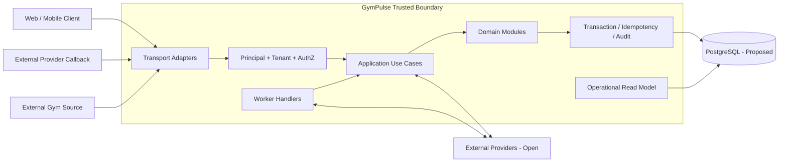

The database choice remains Proposed under `D-ARCH-002`; RLS remains Open under `D-SEC-008`. Application-layer tenant authorization remains mandatory regardless.

## 5. Flow DF-001: Authentication to Principal and Tenant Authorization

### Requirements

- `FR-IDENTITY-001`
- `FR-IDENTITY-002`
- `FR-IDENTITY-003`
- `FR-AUTHZ-001`
- `FR-AUTHZ-002`
- `FR-AUTHZ-003`
- `NFR-SECURITY-001`
- `NFR-SECURITY-003`

### Flow

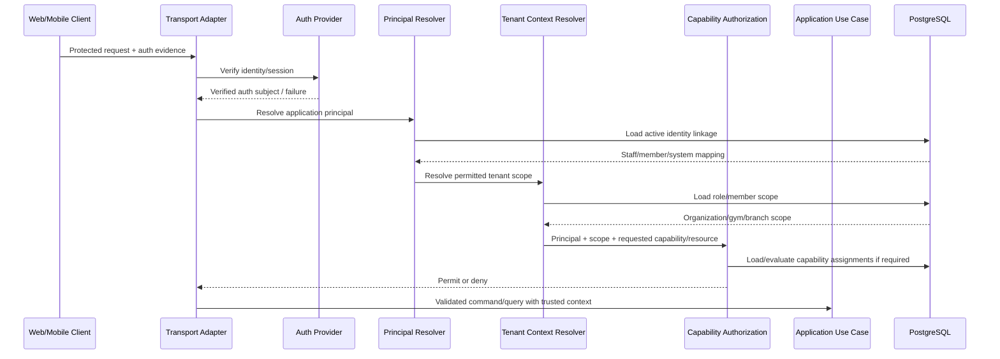

### Canonical data

GymPulse stores application user/member links, role assignments, capabilities/scopes, and active assignment state. The external auth provider does not own tenant authorization.

### Security checkpoints

- invalid/expired authentication fails before protected use-case execution,
- caller-supplied `organizationId`, `gymId`, `branchId`, or `memberId` never become authority by themselves,
- member self-service scope resolves to the authenticated member relationship,
- resource-level authorization is rechecked for protected object access.

### Failure behavior

Auth provider outage behavior depends on the selected session strategy under `D-ARCH-004`. The system must not invent a valid identity if verification cannot be established according to that strategy.

Member verification method remains Open under `D-SEC-002`.

## 6. Flow DF-002: Member QR Check-in

### Requirements

- `FR-MEMBERSHIP-004`
- `FR-ATTENDANCE-001` through `FR-ATTENDANCE-006`
- `FR-RETURN-001`
- `FR-CROSS-002`
- `NFR-RELIABILITY-001`
- `NFR-PERFORMANCE-001`

### Flow

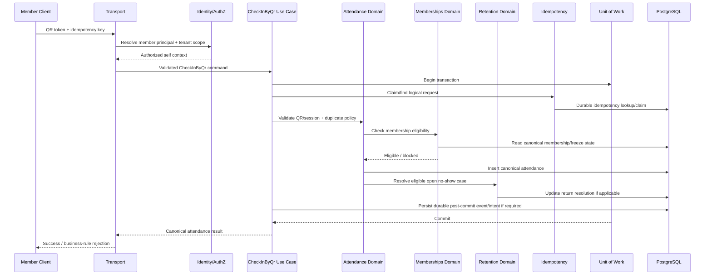

### Transaction boundary

Where practical, one transaction protects the idempotency claim, canonical attendance insert, duplicate constraint, and synchronous retention return resolution.

### Idempotency

A retry using the same logical request key returns or resolves to the existing canonical attendance result. Domain-level uniqueness still protects policy duplicates even when the client uses a different request key.

### Failure behavior

- invalid/expired QR: reject without attendance write,
- ineligible membership: reject without attendance write,
- duplicate by policy: return duplicate/already-checked-in behavior,
- timeout after commit: retry must resolve to the existing canonical record,
- analytics failure after commit does not invalidate attendance.

Offline attendance remains Open under `D-PROD-010`; no offline canonical creation is assumed.

## 7. Flow DF-003: Assisted Staff Check-in

### Requirements

- `FR-ATTENDANCE-007`
- `FR-ATTENDANCE-008`
- `FR-AUTHZ-002`
- `FR-AUTHZ-004`
- `FR-AUDIT-001`
- `FR-AUDIT-003`

### Flow

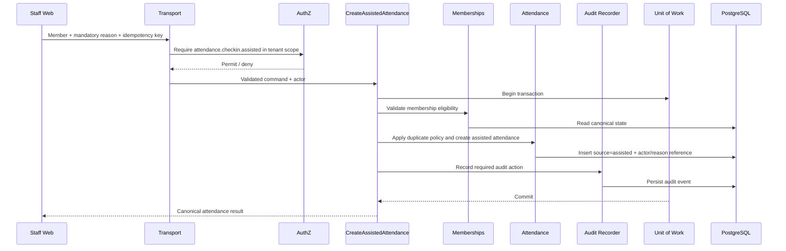

### Audit rule

Because assisted attendance is a sensitive staff mutation, required audit persistence is part of successful mutation semantics. The flow should not complete silently if the mandatory audit record cannot be persisted.

### Failure behavior

Authorization failure, missing reason, inactive membership, and duplicate-policy rejection produce no canonical attendance mutation.

## 8. Flow DF-004: Scheduled No-show Scan to Red List

### Requirements

- `FR-MEMBERSHIP-006`
- `FR-RETENTION-001` through `FR-RETENTION-006`
- `FR-CROSS-004`
- `NFR-RELIABILITY-003`
- `NFR-AVAILABILITY-003`

### Flow

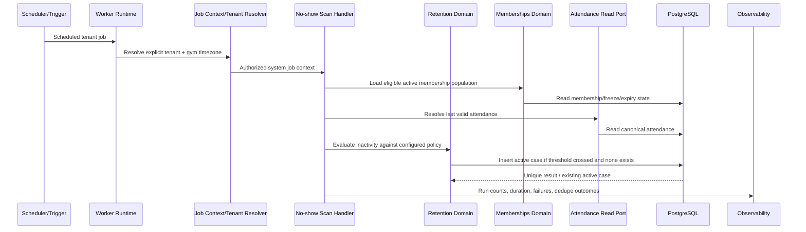

### Business time

The scheduler may execute using infrastructure UTC, but business-day calculations use the gym's configured timezone. Stored event timestamps remain UTC.

### Idempotency

The same scan can be rerun safely because one active no-show case per member/rule context is protected by durable uniqueness or equivalent domain invariant.

### Failure isolation

Process tenants in bounded units. A failure for one tenant must be retryable and observable without mixing or corrupting another tenant's state.

Job-runner technology remains Open under `D-ARCH-007`.

## 9. Flow DF-005: Follow-up Recording and Return Resolution

### Requirements

- `FR-FOLLOWUP-001` through `FR-FOLLOWUP-006`
- `FR-RETURN-001`
- `FR-RETURN-002`
- `FR-AUDIT-001`

### Follow-up write

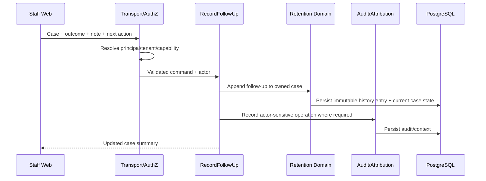

### Return resolution

A later valid attendance is owned by Attendance. After attendance succeeds, the application orchestration may invoke Retention to resolve an eligible open case using the attendance reference. Retention does not create attendance itself.

### Canonical linkage

The resolved case retains its original risk/follow-up history plus resolution timestamp/type and the return attendance reference where applicable.

### Failure behavior

A follow-up append failure must not erase prior history. A stale case update should return current canonical state/conflict information rather than overwrite unrelated newer work silently.

## 10. Flow DF-006: Renewal Window Evaluation to Reminder Intent

### Requirements

- `FR-RENEWAL-001`
- `FR-RENEWAL-002`
- `FR-RENEWAL-007`
- `FR-NOTIFICATION-002`
- `FR-NOTIFICATION-004`
- `NFR-RELIABILITY-003`

### Flow

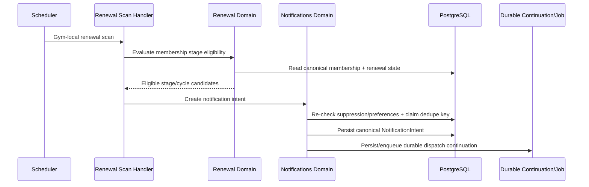

### Dedupe identity

The exact key format is internal, but it must uniquely represent the intended business stage/cycle/recipient so a retry does not create duplicate stage messages.

### Current-state rule

Even after intent creation, the delivery flow re-checks current eligibility before dispatch where queued work may have become stale because of renewal, cancellation, or preference change.

## 11. Flow DF-007: Renewal Order to Payment Checkout Initiation

### Requirements

- `FR-RENEWAL-003` through `FR-RENEWAL-006`
- `FR-PAYMENT-001`
- `FR-CROSS-001`

### Flow

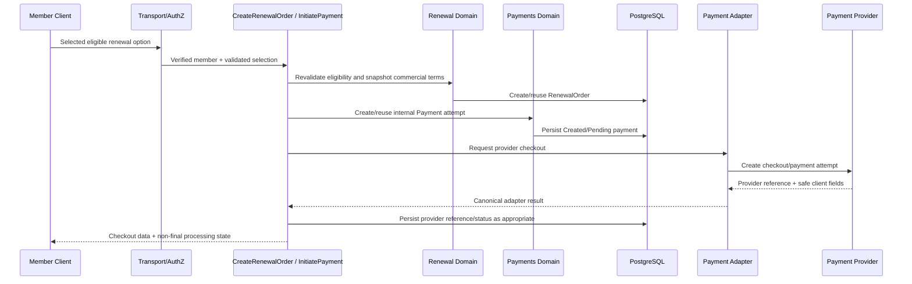

### Transaction/provider boundary

Do not hold a long database transaction open across avoidable provider network latency. Internal order/payment creation and provider-call result persistence may use short transactions around the remote call according to implementation design.

### Critical rule

Neither renewal-order creation nor payment initiation extends membership. The payment provider remains Open under `D-PROVIDER-001`.

## 12. Flow DF-008: Verified Payment to Exactly-once Business Effect

### Requirements

- `FR-PAYMENT-002` through `FR-PAYMENT-007`
- `FR-RECEIPT-002`
- `NFR-SECURITY-008`
- `NFR-RELIABILITY-002`
- `NFR-OBSERVABILITY-004`

### Flow

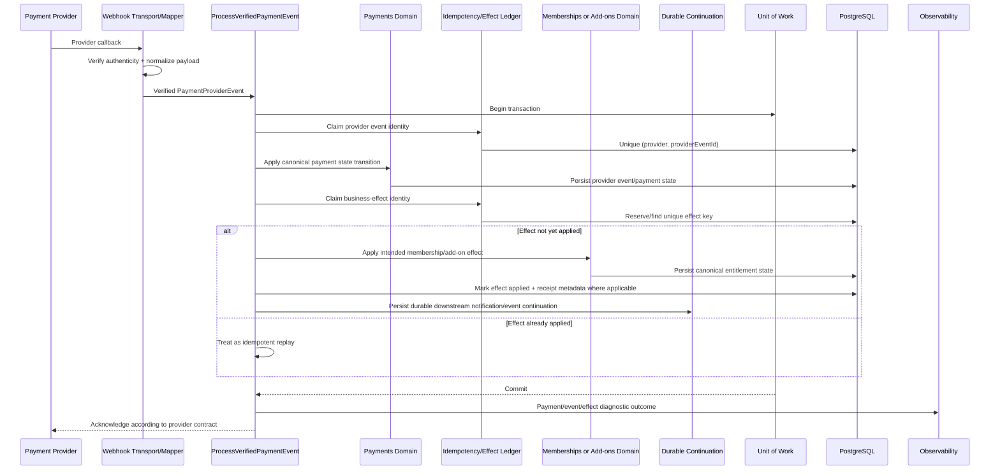

### Two separate idempotency layers

1. Provider-event uniqueness prevents processing the same callback identity repeatedly.
2. Business-effect uniqueness prevents multiple distinct provider success events from extending/activating the same intended purchase more than once.

### Failure and reconciliation

- invalid signature/authenticity: reject and record safe diagnostic data,
- duplicate provider event: return idempotent acknowledgement without duplicate effect,
- provider success but transaction failure: provider may retry; durable uniqueness makes retry safe,
- uncertain provider state: payment remains `Pending`/reconciliation-required instead of inventing success,
- downstream notification failure after commit does not roll back a valid payment effect.

Membership renewal representation remains Open under `D-DATA-007`, but whichever model is selected must preserve exactly-once effect and historical reconciliation.

## 13. Flow DF-009: Notification Intent to Provider Delivery State

### Requirements

- `FR-NOTIFICATION-001` through `FR-NOTIFICATION-004`
- `FR-CONSENT-001`
- `FR-CONSENT-002`
- `NFR-AVAILABILITY-002`

### Flow

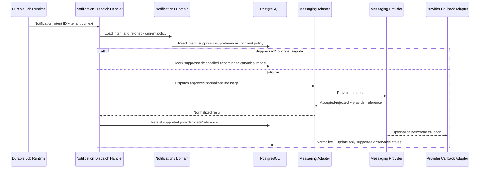

### Authority split

Notifications domain decides whether a message should be sent. The messaging provider only transports the message and reports the delivery states it actually supports.

### Failure behavior

Provider failure leaves retryable/actionable notification state. It does not roll back the already-valid attendance, renewal, or payment transaction that created the intent.

Messaging provider and launch channels remain Open under `D-PROVIDER-002` and `D-PROD-011`.

## 14. Flow DF-010: Controlled Import to Canonical Records

### Requirements

- `FR-IMPORT-001`
- `FR-IMPORT-002`
- `NFR-RELIABILITY-005`
- `NFR-SECURITY-009`

### Flow

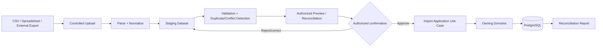

### Canonical-write rule

Staging data is not canonical. Only authorized application/domain use cases write approved member, membership, plan, or related records.

### Missing-data rule

Import does not silently invent expiry dates, payment truth, membership status, tenant ownership, or other material facts. Unresolved rows remain errors/blocked items for reconciliation.

### Idempotency

Import batches should retain a stable batch/source-row identity so a retry can distinguish already-applied rows from unapplied rows.

## 15. Flow DF-011: Owner Dashboard and Action-Queue Read Model

### Requirements

- `FR-DASHBOARD-001` through `FR-DASHBOARD-004`
- `FR-SUMMARY-001`
- `NFR-PERFORMANCE-003`
- `NFR-PERFORMANCE-004`

### Flow

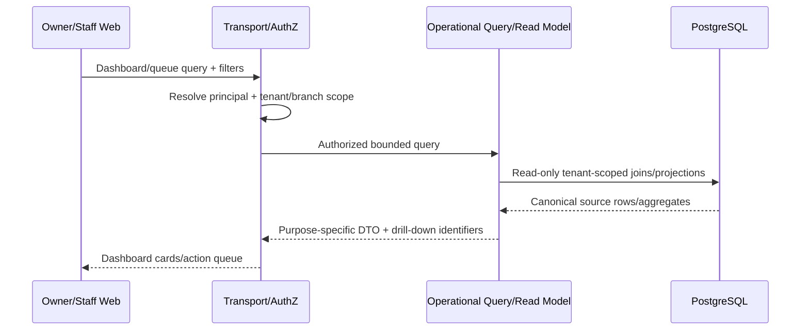

### Rules

- queries are tenant/branch scoped,
- filters and pagination are bounded,
- read models may join multiple domains but do not write canonical state,
- metrics must be traceable to canonical records,
- product analytics events are not used as financial or attendance truth,
- gym-local date filters use the configured gym timezone.

A separate analytics warehouse is not required for Phase 1.

## 16. Flow DF-012: Data-quality Scan to Issue Lifecycle

### Requirements

- `FR-DATA-QUALITY-001`
- `FR-DATA-QUALITY-002`
- `FR-AUDIT-001`
- `NFR-AVAILABILITY-003`

### Flow

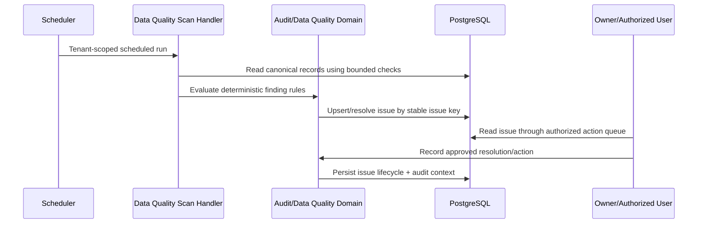

### Example checks

- missing membership expiry,
- invalid membership date range,
- paid online payment without expected provider reference,
- attendance correction without required reason,
- negative session/stock state where such balance exists,
- other deterministic integrity conditions defined by owning domains.

### Idempotency

The same unresolved problem should normally map to one stable issue key instead of creating a new duplicate issue on every scan.

## 17. Cross-Flow Transaction Matrix

| Flow | Canonical transaction boundary | Remote provider inside transaction? | Durable continuation needed? |
|---|---|---:|---:|
| Authentication/authorization | Mostly reads; provider verification outside DB transaction | Auth verification may be remote/provider-specific | No for ordinary request |
| QR check-in | Idempotency + attendance + critical related state | No | Yes if required downstream effect must not be lost |
| Assisted check-in | Attendance + required audit + related critical state | No | Conditional |
| No-show scan | Per bounded tenant/batch/case mutation | No | Conditional for notifications |
| Follow-up | Follow-up append + case state + required audit | No | Usually no |
| Renewal reminder intent | Stage/dedupe + intent creation | No | Yes for dispatch |
| Checkout initiation | Short internal transactions around provider call | Payment provider call outside long TX | No extension until verified result |
| Payment webhook | Event + payment transition + effect + durable continuation | No remote call required for already-verified webhook | Yes for downstream notification/event |
| Notification dispatch | Notification state updates | Messaging call outside canonical originating TX | Job itself is durable |
| Import | Bounded import batch/row transactions | No | Optional for large batches |
| Dashboard query | Read-only | No | No |
| Data-quality scan | Per finding/bounded batch | No | No unless alert dispatch required |

## 18. Idempotency and Dedupe Matrix

| Flow | Durable identity/invariant |
|---|---|
| QR check-in | Client request idempotency key + attendance duplicate policy constraint |
| Assisted check-in | Request key where supported + duplicate policy + actor/reason |
| No-show scan | One active case per member/rule context |
| Renewal reminder | Stage/cycle/recipient dedupe key |
| Renewal order | Stable logical order/request key where retryable |
| Payment provider event | Unique `(provider, providerEventId)` or equivalent |
| Payment business effect | Unique effect key independent of provider event identity |
| Add-on activation | Unique purchase/effect identity |
| Notification dispatch | Intent/stage identity + provider dispatch state |
| Import | Batch ID + source-row identity |
| Data-quality scan | Stable finding/issue key |

Exact key formats are implementation details and belong in later backend/database/API documentation.

## 19. Authorization Checkpoints

Authorization is required before:

- protected member/staff reads,
- assisted attendance,
- attendance correction,
- membership/freeze state changes,
- follow-up mutation,
- renewal/order operations outside member self-scope,
- offline/financial staff intervention if enabled,
- refunds/reversals,
- data export/import confirmation,
- role/permission changes,
- sensitive settings/configuration changes,
- data-quality issue resolution where action mutates state.

System jobs use explicit scoped system authority rather than bypassing authorization completely.

## 20. Audit and Observability Points

### Audit

Required or expected for sensitive state-changing actions such as:

- assisted attendance,
- attendance correction,
- membership freeze/status changes,
- permission changes,
- staff financial interventions,
- refunds/reversals,
- configuration changes,
- import approval when operationally material.

### Observability

Every interactive or async flow should preserve safe correlation dimensions such as:

```text
requestId / correlationId
jobId
tenant/gym/branch reference where safe
resource/business object ID
provider event/reference where safe
idempotency/dedupe outcome
error class/code
latency/duration
```

Do not log secrets, auth tokens, raw payment credentials, sensitive free-text notes, or unnecessary PII.

Observability provider remains Open under `D-PROVIDER-006`.

## 21. Failure and Reconciliation Principles

### Network timeout after canonical commit

Client or provider retry resolves through durable idempotency instead of creating a duplicate effect.

### Database conflict

A uniqueness/constraint conflict is mapped to an idempotent existing result or explicit business conflict, not a blind retry loop.

### External provider timeout

Canonical state stays `Pending`, `Failed`, or explicitly reconciliation-required based on known facts. Success is never guessed.

### Worker crash

Durable job/continuation remains retryable and visible. Business effects must still be protected by domain-level idempotency because jobs may execute more than once.

### Messaging outage

Notification intent remains diagnosable/retryable; original canonical business state remains valid.

### Observability outage

Core business transactions continue where observability is non-critical, but loss of telemetry should itself become an operational concern when detectable.

## 22. Scalability Implications

- Interactive flows should remain stateless at the application-runtime level where practical.
- Worker jobs should be partitionable by tenant and bounded batch size.
- Operational reads require tenant/status/date/next-action/expiry indexes rather than unbounded client-side filtering.
- Provider rate limits are handled in adapters/workers after provider selection.
- Cross-domain business invariants remain in the modular monolith until measured scale or isolation needs justify service extraction.
- A future service split must preserve the canonical ownership and idempotency semantics described here.

## 23. Open Decisions Affecting Data Flows

The following remain unresolved and are intentionally abstract in this document:

- `D-ARCH-004` authentication/session strategy,
- `D-SEC-002` member authentication method,
- `D-ARCH-006` API deployment topology,
- `D-ARCH-007` background job runner,
- `D-ARCH-013` managed backend responsibilities,
- `D-PROVIDER-001` payment provider,
- `D-PROVIDER-002` messaging provider,
- `D-PROD-011` initial communication channels,
- `D-ARCH-010` object storage provider,
- `D-PROVIDER-006` observability provider,
- `D-SEC-008` RLS strategy,
- `D-DATA-007` membership renewal representation,
- `D-PROD-010` offline attendance requirement,
- business-policy decisions such as `D-BIZ-007` freeze expiry effect and `D-BIZ-010` renewal effective date.

No option is accepted merely because a flow mentions the corresponding boundary.

## 24. Testing Implications

The following high-value tests should derive directly from these flows:

- cross-tenant object-ID guessing is denied,
- member cannot read another member's protected data,
- QR retry after timeout creates one attendance record,
- assisted check-in without capability/reason is rejected,
- repeated no-show scans create one active case,
- return attendance resolves the correct eligible case without deleting history,
- renewal stage retry creates one intent,
- client payment success does not extend membership,
- duplicate provider webhook does not duplicate payment effect,
- multiple success-like provider events do not duplicate membership/add-on effect,
- notification retry does not duplicate business-stage intent,
- preference/renewal changes suppress stale queued reminders,
- import retry does not duplicate already-applied rows,
- dashboard totals reconcile to canonical rows,
- repeated data-quality scan does not create duplicate unresolved findings,
- scheduled flow boundaries are correct across gym timezone day changes.

Detailed test-case IDs belong in `docs/12-testing/` when that phase begins.

## 25. Alternatives Considered

### Direct client-to-database mutations

Not selected as the default for protected Phase 1 workflows because tenant authorization, auditability, idempotency, payment integrity, and cross-domain orchestration require trusted server-side control.

### Asynchronous processing for every state change

Not selected. Correctness-sensitive state that naturally belongs in one transaction stays synchronous/transactional. Asynchronous work is used for scheduled, retryable, provider-latency, and secondary effects.

### Event sourcing as canonical state model

Not required for Phase 1. Relational canonical records plus domain events/durable continuation provide sufficient traceability without introducing event-sourcing complexity.

### Analytics system as operational source of truth

Rejected. Product analytics may support UX/funnel analysis but cannot become canonical attendance, payment, membership, or revenue truth.

## 26. Related Documents

- `architecture-principles.md`
- `architecture-overview.md`
- `system-context.md`
- `container-architecture.md`
- `component-architecture.md`
- `technology-stack.md`
- `../00-overview/assumptions.md`
- `../01-product/user-journeys.md`
- `../01-product/functional-requirements.md`
- `../01-product/non-functional-requirements.md`
- future `../04-backend/background-jobs.md`
- future `../05-database/schema-design.md`
- future `../06-api/endpoints.md`
- future `../09-security/threat-model.md`
- future `../12-testing/integration-testing.md`

## 27. Definition of Data-Flow Architecture Complete

This draft is complete when reviewers can determine, for every critical Phase 1 flow:

1. where untrusted data enters,
2. where identity, tenant scope, and capability authorization are resolved,
3. which domain owns each mutation,
4. which data is canonical versus derived/external,
5. where the database transaction begins and ends,
6. which retry/idempotency invariant prevents duplicate effects,
7. where asynchronous continuation becomes durable,
8. how provider failure or uncertainty is represented,
9. how audit and observability are preserved,
10. which decisions remain Open.
