# GymPulse Architecture Data Flows

## Document Control

- Document Maturity: `Draft`
- Scope Status: `In Scope` for Phase 1 architecture
- Architecture View: `End-to-end data and control flows`
- Audience: Product Architecture, Backend, Frontend, Mobile, Security, DevOps, QA, Operations
- Canonical Decision Register: `../00-overview/assumptions.md`
- Parent Component Model: `component-architecture.md`
- Parent Container Model: `container-architecture.md`
- Parent Context: `system-context.md`

## 1. Purpose

Define how critical GymPulse Phase 1 information and control move across actors, clients, trusted application components, background execution, canonical persistence, and external providers.

This document makes transaction boundaries, trust transitions, idempotency/deduplication points, retry/reconciliation behavior, audit responsibilities, observability, and gym-local time semantics explicit for the flows that determine Phase 1 correctness.

It does **not** select a web framework, API framework, database engine, ORM, job runner, queue, cache, authentication provider, payment provider, messaging provider, object-storage provider, hosting platform, or managed backend.

## 2. Data-Flow Invariants

Every flow in this document preserves the following invariants.

1. Client input is untrusted until authenticated/verified, authorized, validated, and checked against current canonical state.
2. Authentication and GymPulse business authorization are separate responsibilities.
3. Tenant/gym/branch/resource context is explicit and server-validated.
4. Canonical membership, attendance, retention, payment, notification, audit, and related operational state is server-side.
5. Read models, dashboards, telemetry, and client state are derived/non-authoritative for mutations.
6. Critical mutations are retry-safe and protected by durable business uniqueness where required.
7. Request idempotency, provider-event deduplication, job deduplication, and business-effect uniqueness are different protections.
8. External provider calls are not treated as participating in a local database transaction.
9. Sensitive mutations remain attributable and auditable.
10. Gym-local timezone controls business dates/windows; event timestamps are canonical UTC instants.
11. Background work reuses application/domain rules and does not create a second implementation of business logic.
12. Provider-specific payloads are verified/normalized before they reach domain decision logic.
13. Failure of secondary messaging/analytics/telemetry does not invalidate already-correct canonical business state.
14. `D-DATA-007` remains unresolved; entitlement must not be inferred from `Member.status` alone.

## 3. Flow Notation

### Trust zones

```text
[U] Untrusted human/client/provider/import input
[T] Trusted GymPulse application/worker execution
[C] Canonical persistence
[E] External provider/system
[D] Derived/read-model/telemetry data
```

### Interaction types

```text
SYNC   caller needs an immediate authoritative response
ASYNC  retryable/scheduled/provider-bound continuation
TX     local atomic transaction boundary
VERIFY authenticity or identity verification boundary
AUTHZ  tenant/resource/capability authorization boundary
IDEM   request/job/provider/business-effect dedupe boundary
AUDIT  attributable sensitive-change record
OBS    structured operational telemetry/correlation
```

## 4. Cross-Flow Execution Context

Interactive requests should establish a bounded execution context before protected business logic runs.

```text
request
  -> request/correlation ID
  -> authentication evidence verification
  -> GymPulse principal resolution
  -> tenant/gym/branch/resource scope resolution
  -> named capability authorization
  -> contract validation
  -> application command/query
```

Background jobs establish a different trusted context.

```text
job trigger
  -> job ID / correlation ID
  -> job type/version validation
  -> explicit tenant/gym scope
  -> deterministic business/dedupe key
  -> trusted system-actor context
  -> current-state reload
  -> application command/query
```

Provider callbacks establish trust through provider verification, not through a human session.

```text
raw provider callback
  -> preserve verification inputs
  -> verify authenticity
  -> normalize provider evidence
  -> resolve internal business relationship + tenant scope
  -> process canonical state transition
```

## 5. Canonical, Derived, and External Data

### Canonical data

Includes approved Phase 1 system-of-record state such as:

- member business records,
- memberships/freezes,
- attendance and corrections,
- no-show cases/follow-ups/return linkage,
- renewal orders,
- payments/provider events/effect records/refunds/reversals,
- add-on orders/entitlements/usage/fulfillment,
- notification intent/preferences/provider-supported delivery observations,
- sensitive audit history,
- operational configuration,
- durable data-quality issue state,
- durable async continuation state where the selected implementation requires it.

### Derived data

Includes:

- dashboard aggregates,
- absent-day counts,
- action queues,
- renewal pipeline summaries,
- recovery metrics,
- business-health metrics,
- caches/materialized views if introduced later.

Derived data may be recomputed from canonical state and must not become an alternate write authority.

### External state

Authentication, payment, messaging, storage, and telemetry providers own their own external state. GymPulse records only the verified/normalized subset required by approved workflows.

## 6. Flow 1: Authentication + Tenant/Resource Authorization

### Goal

Allow a Member, Owner, Manager, or Front Desk actor to reach protected GymPulse behavior only through verified identity plus GymPulse-owned scope/capability authorization.

### Primary requirements

- `FR-IDENTITY-001..003`
- `FR-AUTHZ-001..004`
- `FR-CROSS-003`
- `NFR-SECURITY-001..003`
- `NFR-TESTABILITY-004`

### Flow

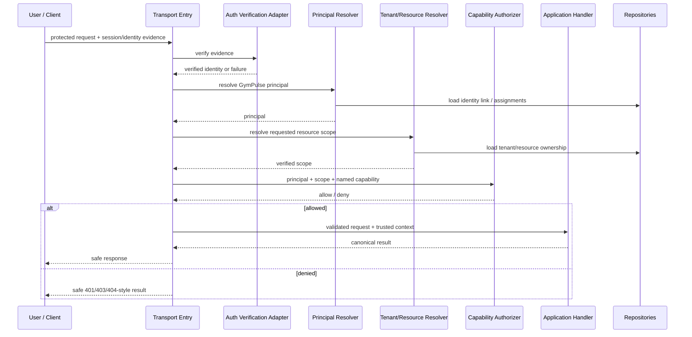

### Trust transitions

- Raw mobile number, email, client role name, tenant ID, or resource ID is not authorization proof.
- Authentication provider evidence proves only what the selected provider/session contract guarantees.
- GymPulse resolves capability and resource scope server-side.

### Failure behavior

- Failed identity verification: fail closed according to the approved session policy.
- Missing/revoked role assignment: deny future protected operations.
- Cross-tenant mismatch: deny without leaking unnecessary protected resource detail.

### Observability

Capture request/correlation ID, safe principal type, safe tenant/scope identifiers, authorization result category, and route/use-case name without logging raw tokens or secrets.

### Open decisions preserved

- `D-ARCH-004` authentication/session architecture: `OPEN`
- `D-SEC-002` member authentication method: `OPEN`
- `D-ARCH-015` authorization implementation boundary: `PROPOSED`
- `D-SEC-008` data-layer tenant isolation/RLS: `OPEN` when applicable

## 7. Flow 2: QR Check-in

### Goal

Create exactly one valid canonical attendance record for one logical member check-in.

### Primary requirements

- `FR-ATTENDANCE-001..006`
- `FR-MEMBERSHIP-004`
- `FR-RETURN-001..002`
- `FR-CROSS-001..004`
- `NFR-RELIABILITY-001,004..007`
- `NFR-PERFORMANCE-001`

### Flow

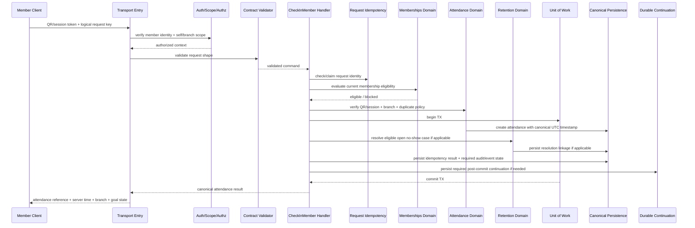

### Transaction boundary

The correctness-sensitive transaction should contain the writes that must succeed/fail together, including the canonical attendance effect and durable replay protection. If return-case resolution is required to be atomic with attendance, it belongs in the same transaction; otherwise it must use an explicitly durable post-commit continuation.

### Idempotency

Use both:

- request/logical-operation idempotency, and
- attendance domain duplicate/uniqueness rules.

A request key must not be the only protection against duplicate attendance.

### Retry behavior

A network timeout after successful commit can be retried with the same logical key. The retry returns or identifies the existing canonical attendance result rather than creating another visit.

### D-DATA-007 effect

Attendance eligibility uses the relevant canonical `Membership` eligibility rules. `Member.status` alone must not establish entitlement while `D-DATA-007` is unresolved.

## 8. Flow 3: Assisted Attendance

### Goal

Allow explicitly authorized staff to create attendance when QR self-service cannot be used, without bypassing normal eligibility, duplicate, actor, reason, or audit requirements.

### Primary requirements

- `FR-ATTENDANCE-007..011`
- `FR-AUTHZ-002,004`
- `FR-AUDIT-001..003`
- `NFR-SECURITY-009`
- `NFR-DATA-004`

### Flow

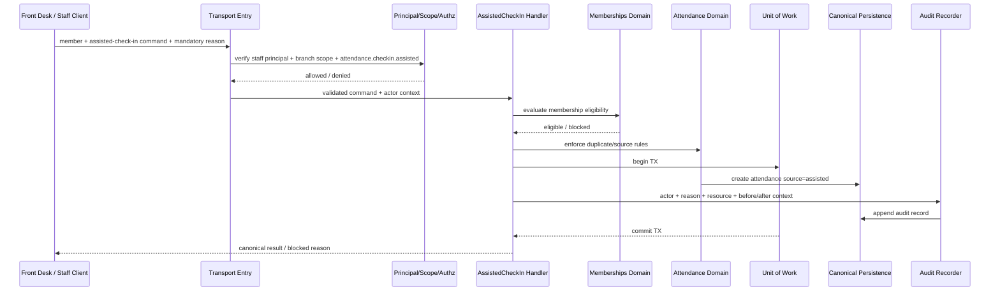

### Authorization and audit

- Staff actor identity is server-resolved.
- `reason` is mandatory.
- Standard eligibility and duplicate protections remain active unless a separately approved override policy exists.
- Material correction uses a separate auditable correction path, not silent deletion/replacement.

## 9. Flow 4: Daily No-show / Inactivity Scan

### Goal

Create one actionable retention case for each eligible member/rule context that has crossed the configured inactivity threshold.

### Primary requirements

- `FR-RETENTION-001..007`
- `FR-MEMBERSHIP-006`
- `FR-CROSS-002..004`
- `NFR-RELIABILITY-003,004,006`
- `NFR-AVAILABILITY-003`
- `NFR-OBSERVABILITY-005`

### Flow

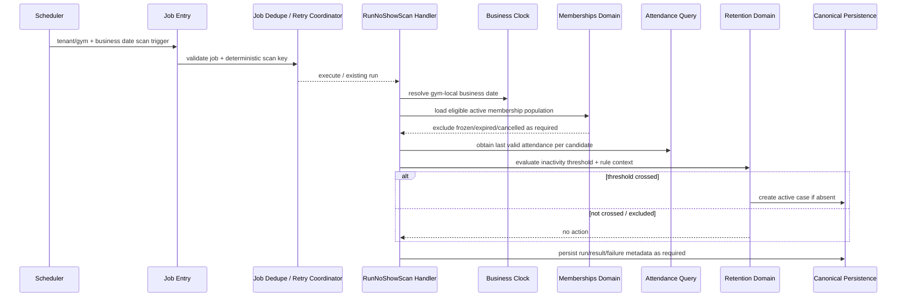

### Job scope

The job payload must carry explicit tenant/gym context. A malformed/missing scope must fail rather than falling back to an unbounded global mutation scan.

### Idempotency

At least two protections exist:

- job/run-level dedupe for the scheduled execution, and
- domain uniqueness for one active no-show case per member/rule context.

### Retry/recovery

A tenant scan failure is observable and retryable. Retry re-evaluates current canonical state and must not create duplicate active cases.

### Time semantics

Inactivity calculations use gym-local business-day semantics derived from canonical UTC timestamps.

## 10. Flow 5: Staff Follow-up + Member Return Resolution

### Goal

Preserve an append-oriented intervention history and resolve an eligible open no-show case when canonical return attendance occurs.

### Primary requirements

- `FR-FOLLOWUP-001..006`
- `FR-RETURN-001..002`
- `FR-AUDIT-001..003`
- `NFR-DATA-004`

### Follow-up recording

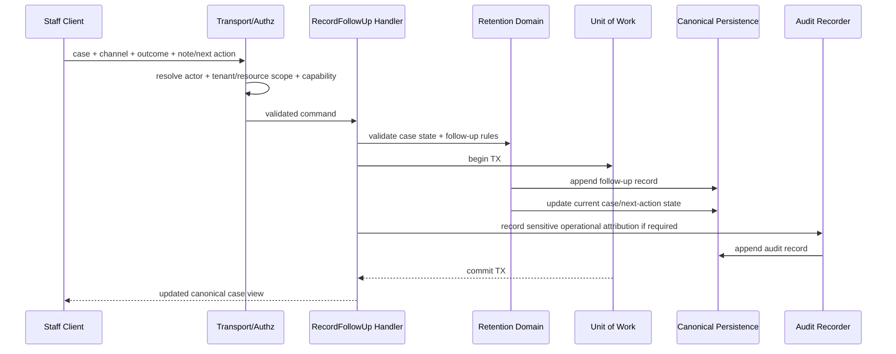

### Return resolution

```text
valid canonical attendance
  -> find eligible open no-show case in same tenant/member context
  -> resolve case as Returned according to current retention policy
  -> store return attendance reference + resolution timestamp
  -> preserve original case and follow-up history
  -> derived recovery metrics update from canonical records
```

### Historical integrity

Later contact attempts or case resolution must not erase previous follow-up history.

## 11. Flow 6: Renewal-Stage Reminder Scan

### Goal

Create at most one eligible business-stage notification intent for a membership entering an enabled renewal window.

### Primary requirements

- `FR-RENEWAL-001,002,007`
- `FR-NOTIFICATION-001,002,004`
- `FR-CONSENT-001,002`
- `FR-CROSS-002,004`
- `NFR-RELIABILITY-003,006`

### Flow

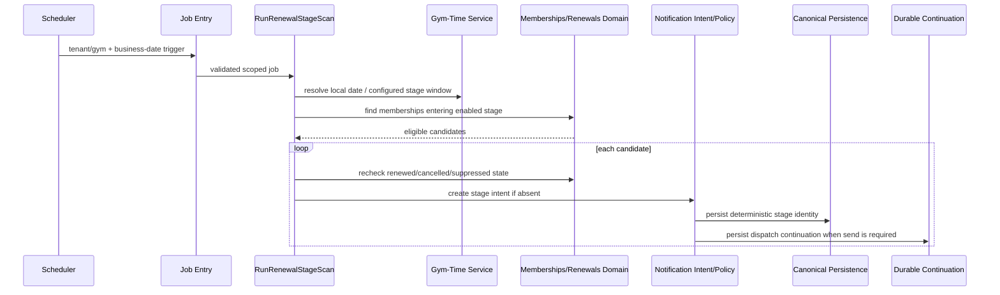

### Dedupe identity

A stage should have a deterministic identity such as membership/renewal-cycle/stage/channel or an equivalent domain key.

### Stale-state rule

Dispatch occurs later only after current renewal/cancellation/preferences are rechecked. Creating an intent does not guarantee a message must still be sent.

## 12. Flow 7: Renewal Order + Payment Checkout Initialization

### Goal

Create a canonical renewal commercial record and internal payment attempt without granting membership extension before verified payment success.

### Primary requirements

- `FR-RENEWAL-003..006`
- `FR-PAYMENT-001,002,008`
- `NFR-PERFORMANCE-005`
- `NFR-SECURITY-007`

### Flow

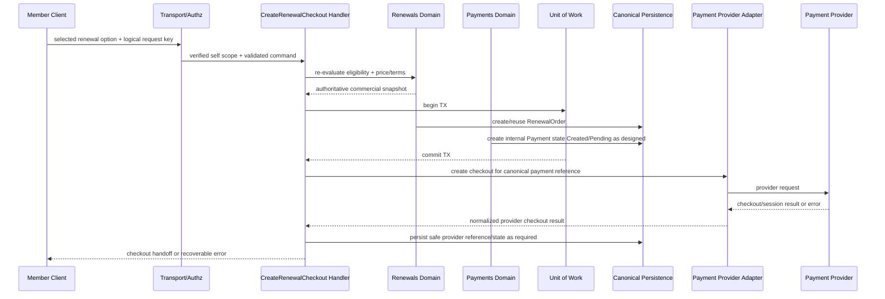

### Transaction boundary

Do not keep a long correctness-critical database transaction open across remote provider latency.

### Client success semantics

A successful checkout handoff or client-facing provider success result does **not** extend the membership. The member experience should remain `Processing`/pending until canonical verified success exists.

### Ambiguous provider response

If the provider request outcome is unknown after timeout, keep an explicit pending/reconciliation path. Do not guess that payment succeeded or failed.

## 13. Flow 8: Verified Payment Webhook + Exactly-Once Entitlement Effect

### Goal

Convert authentic provider evidence into one canonical payment transition and exactly one intended membership/add-on business effect.

### Primary requirements

- `FR-PAYMENT-002..009`
- `FR-RENEWAL-006,007`
- `FR-RECEIPT-001,002`
- `FR-CROSS-002`
- `NFR-SECURITY-008`
- `NFR-RELIABILITY-001,002,004,008`
- `NFR-OBSERVABILITY-004`

### Flow

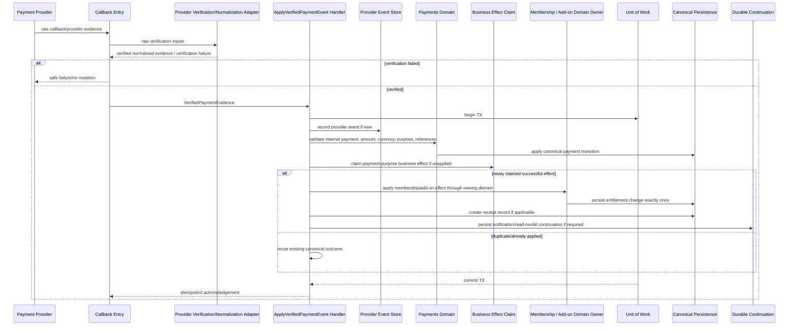

### Separate dedupe layers

1. **Provider-event dedupe**: provider + provider-event identity.
2. **Payment canonical transition rules**: legal state transition and expected business relationship.
3. **Business-effect uniqueness**: payment + purpose/effect identity.

Duplicate callback protection alone is insufficient because different provider events may describe the same effective successful payment.

### Failure handling

- Verification failure: no canonical payment mutation.
- Amount/currency/reference mismatch: remain unresolved/exception; do not grant value.
- Database failure before commit: provider may retry; replay protections make retry safe.
- Effect already applied: acknowledge idempotently without a second entitlement change.
- Secondary messaging/analytics failure after commit: retry separately; do not roll back paid state/entitlement.

### Reconciliation

Stuck/pending/ambiguous payment states must remain inspectable and reconcilable using retained provider references and event history rather than destructive manual repair.

## 14. Flow 9: Notification Dispatch + Delivery Callback

### Goal

Deliver an eligible notification intent once per business stage while separating GymPulse business policy from provider delivery behavior.

### Primary requirements

- `FR-NOTIFICATION-001..004`
- `FR-CONSENT-001,002`
- `NFR-AVAILABILITY-002`
- `NFR-RELIABILITY-003`
- `NFR-MAINTAINABILITY-003`

### Dispatch flow

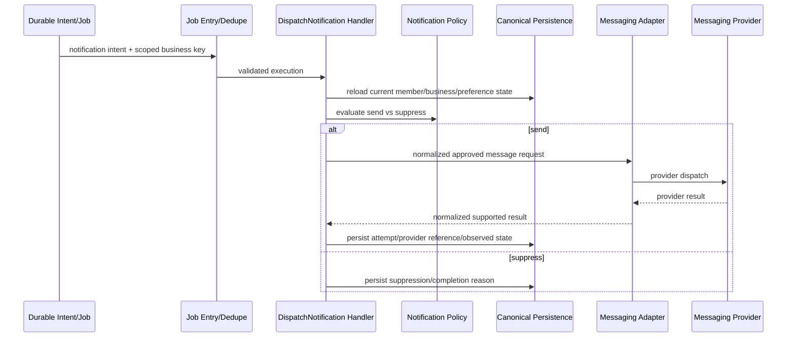

### Delivery callback

```text
provider callback
  -> verify provider-supported authenticity if available/required
  -> normalize only supported delivery states
  -> resolve notification attempt/reference
  -> update observed delivery state idempotently
  -> never infer payment success, renewal, or member return from delivery status
```

### Failure behavior

Provider outage leaves the intent/attempt visible for retry/diagnosis. Blind infinite retry is not allowed for permanent provider errors.

## 15. Flow 10: Pilot Member Import

### Goal

Convert external onboarding data into canonical tenant-scoped records only after validation, conflict review, and authorized confirmation.

### Primary requirements

- `FR-IMPORT-001,002`
- `FR-MEMBER-001..003`
- `NFR-SECURITY-001`
- `NFR-DATA-004`

### Flow

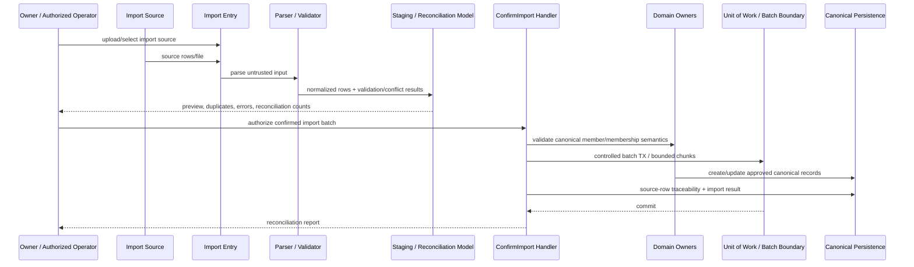

### Rules

- Missing expiry, membership status, or other material business facts are not guessed.
- Duplicate/conflict handling is visible before or during controlled confirmation.
- Every canonical record receives explicit tenant/gym/branch ownership as applicable.
- Large imports may be chunked/backgrounded later, but the same validation/authorization/domain rules must survive.

## 16. Flow 11: Owner Dashboard / Operational Read Model Query

### Goal

Return authorized, bounded, traceable operational summaries and queues derived from canonical records.

### Primary requirements

- `FR-DASHBOARD-001..004`
- `FR-MEMBER-005`
- `NFR-PERFORMANCE-002..004`
- `NFR-SCALABILITY-006`

### Flow

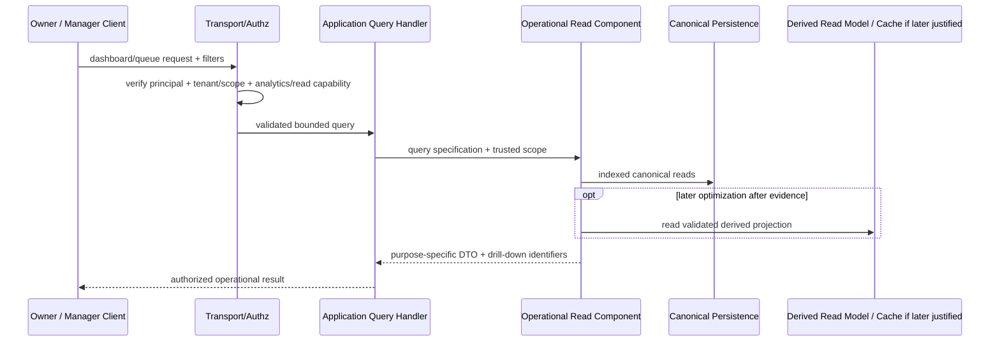

### Read-authority rule

Dashboard/read components may join several domain datasets but cannot mutate those domain states directly.

### Performance rules

- bounded/paginated result sets,
- tenant/branch-aware indexes,
- no normal full-table export-to-client approach,
- important metrics traceable to underlying canonical records.

### Cache decision

`D-ARCH-008` remains `OPEN`; no cache is required merely because dashboards exist.

## 17. Flow 12: Data-Quality Scan + Resolution

### Goal

Detect material operational inconsistencies, expose them to authorized staff, and record controlled resolution without silently hiding or deleting evidence.

### Primary requirements

- `FR-DATA-QUALITY-001,002`
- `FR-AUDIT-001..003`
- `NFR-RELIABILITY-003`
- `NFR-OBSERVABILITY-006`

### Detection flow

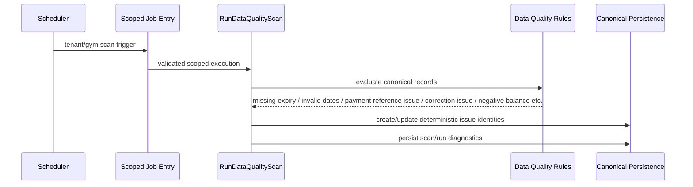

### Resolution flow

```text
authorized operator opens issue
  -> server resolves tenant/resource scope + required capability
  -> operator performs the owning-domain corrective action
  -> owning domain validates and persists correction/compensation
  -> audit record captures actor/reason/context where required
  -> data-quality issue is re-evaluated
  -> issue becomes resolved only when canonical inconsistency no longer exists
```

### Rule

The data-quality component identifies problems. It does not bypass domain ownership by editing arbitrary tables directly.

## 18. Cross-Flow Transaction Rules

### Keep inside one local transaction when correctness requires atomicity

Examples:

- canonical attendance + durable request replay result,
- assisted attendance + mandatory audit attribution when policy requires atomic evidence,
- one active no-show case creation + uniqueness claim,
- canonical payment transition + payment-effect claim + required entitlement mutation,
- add-on usage + non-negative balance enforcement,
- sensitive configuration/state mutation + required audit record.

### Keep external calls outside long transactions

Examples:

- payment checkout creation,
- payment provider status query,
- messaging dispatch,
- object-storage upload/download,
- telemetry emission.

Use durable state, references, retries, and reconciliation around external calls instead of cross-system atomic assumptions.

## 19. Cross-Flow Idempotency Matrix

| Flow boundary | Stable replay/dedupe concept | Canonical protection intent |
|---|---|---|
| Interactive mutation | tenant + operation + logical idempotency key | Return/reuse one canonical logical result |
| QR attendance | logical request key + attendance duplicate/domain key | One intended attendance effect |
| Assisted attendance | request key + attendance duplicate/domain key | One intended assisted attendance effect |
| No-show scan | tenant/gym/business-date/rule run key | Retry one scan safely |
| No-show case | member + rule context + active-state uniqueness | One active case for same context |
| Renewal stage | membership/renewal cycle + stage + channel | One business-stage intent |
| Provider webhook | provider + provider-event identity | Process one provider event once |
| Payment effect | payment + effect purpose | Apply one entitlement/business effect once |
| Notification dispatch | intent/stage + provider attempt/business key | Avoid duplicate stage message |
| Owner summary | gym + business date + recipient/channel | Avoid duplicate daily summary |
| Data-quality issue | issue type + canonical resource/business key | One current issue identity |
| Import batch | import source/batch identity + row traceability | Reconcile retry without duplicate canonical rows |

No single idempotency mechanism replaces the others.

## 20. Retry Classification

### Retryable examples

- transient database/network interruption where no committed result is known,
- temporary payment/messaging provider timeout,
- worker interruption,
- provider rate-limit/temporary outage,
- transient object-storage failure.

### Usually permanent until data/action changes

- invalid contract payload,
- failed capability authorization,
- cross-tenant mismatch,
- invalid membership state transition,
- malformed or unverifiable provider callback,
- amount/currency/business-reference mismatch,
- unsupported notification channel/configuration,
- missing required import business facts.

Permanent failures should stop blind retry and become visible for operational resolution.

## 21. Reconciliation Patterns

Reconciliation is required when a distributed workflow cannot determine final state synchronously.

### Payments

```text
pending/ambiguous Payment
  -> load retained provider references
  -> query/consume provider evidence through adapter
  -> verify/normalize
  -> apply canonical transition/effect using same dedupe rules
  -> record reconciliation attempt/result
```

### Notifications

```text
intent/attempt without final supported provider result
  -> classify retryable vs unknown vs permanent
  -> retry where policy allows
  -> record provider-supported observed state only
```

### Imports

```text
source count
  -> validated/staged count
  -> confirmed canonical write count
  -> skipped/conflict/error count
  -> reconciliation report
```

Reconciliation never deletes financial/audit/history evidence merely to make reports look clean.

## 22. Audit Boundaries

Sensitive flows should record, where applicable:

```text
actor or trusted system actor
tenant/gym/branch context
capability or job type
action
resource type / ID
reason
before/after summary where appropriate
request/correlation/job ID
UTC timestamp
```

Minimum high-value audit paths include:

- assisted attendance,
- attendance correction,
- membership state/freeze changes,
- role/permission changes,
- retention/renewal configuration changes,
- authorized offline financial interventions if enabled,
- refund/reversal actions,
- controlled import confirmation,
- data-quality corrective mutations where sensitive.

## 23. Observability and Correlation

A critical flow should preserve safe identifiers across synchronous and asynchronous boundaries where practical.

Recommended fields:

```text
request_id / correlation_id
job_id
use_case / query / job type
safe tenant/gym/branch reference
principal or system actor type
canonical business/resource ID
idempotency/business key
provider event/reference where safe
attempt number
result/error code
latency/timing
```

High-priority operational diagnostics:

- authentication/authorization failure category,
- QR/check-in rejection or dedupe outcome,
- no-show scan run/failure,
- follow-up/return linkage failure,
- renewal-stage suppression/dedupe,
- payment verification mismatch,
- duplicate provider event,
- payment-effect already applied/conflict,
- stuck pending payment/reconciliation attempts,
- notification dispatch/suppression/provider failure,
- import validation/reconciliation failures,
- dashboard/query degradation,
- data-quality issue counts and unresolved age.

Telemetry is not canonical business state and must minimize secrets/PII.

## 24. Gym-Local Time Rules

The Business Clock/Gym-Time component supplies deterministic timezone behavior for:

- no-show inactivity days,
- renewal-stage windows,
- daily owner summaries,
- weekly attendance goal boundaries,
- dashboard `today` metrics,
- business-date-based dedupe keys,
- scheduled data-quality or reconciliation windows when calendar-based.

Canonical event timestamps remain UTC. Server machine timezone must not define business-day semantics.

## 25. Security and Privacy Boundaries

Across all flows:

- server-side authorization is mandatory,
- clients never receive database admin/provider secrets,
- provider credentials/signing secrets remain in trusted infrastructure adapters,
- raw payment credentials are not stored by GymPulse,
- provider callbacks are verified before canonical mutation,
- resource existence should not be leaked unnecessarily across authorization failures,
- exports/imports remain explicitly tenant-scoped,
- logs and telemetry avoid secrets and unnecessary member/contact/free-text data,
- protected files remain private and tenant-authorized if object storage is enabled.

`D-SEC-008` may add data-layer tenant defense in depth, but it does not replace application capability authorization.

## 26. Deployment Neutrality

These data flows are independent of the final `D-ARCH-006` API deployment decision.

Both mappings must preserve the same flow semantics:

```text
A. Owner/Staff web server runtime co-hosts trusted Application/API components
B. Owner/Staff UI and trusted Application/API are independently deployed
```

Likewise, `D-ARCH-007` remains open. A durable background flow may later use a managed job system, database-backed jobs/outbox, queue-backed workers, or another accepted mechanism, but retry, dedupe, tenant scope, and failure visibility remain required.

## 27. D-DATA-007 Impact Across Flows

Until Member vs Membership state ownership is formally resolved:

- attendance eligibility is determined from relevant Membership state/rules, not `Member.status` alone,
- no-show eligibility must not duplicate pause/expiry truth across Member and Membership,
- renewal eligibility must use canonical membership entitlement/commercial state,
- dashboard counts must document whether they refer to member-record status or active membership entitlement,
- imports must not silently map one source status into both Member and Membership lifecycle state,
- data-quality rules should detect contradictory status combinations rather than normalizing them silently.

This document does not revise `FR-MEMBER-004`.

## 28. Failure-Propagation Summary

| Failure | Canonical behavior |
|---|---|
| Client network retry | Reuse/detect canonical result; do not duplicate critical mutation |
| Invalid authentication | Fail closed under selected session policy |
| Capability/scope denial | No protected domain mutation |
| Database unavailable | Do not report committed canonical success for required writes |
| Worker delayed/retried | Canonical state remains valid; work stays visible/recoverable |
| Payment provider unavailable | Payment remains non-paid/pending/exception as justified; reconcile later |
| Invalid payment callback | No canonical paid/effect transition |
| Messaging provider unavailable | Retain intent/attempt for retry/diagnosis; do not roll back business state |
| Telemetry provider unavailable | Canonical workflow continues where safe |
| Import row invalid | Reject/quarantine row with visible error; do not fabricate missing facts |
| Derived dashboard stale | Refresh/recompute from canonical state; never mutate canonical truth from dashboard cache |

## 29. Test Scenarios Derived From Data Flows

### Authentication/authorization

- member cannot access another member,
- front desk cannot cross unauthorized branch,
- hidden UI action still fails server-side,
- revoked role fails future protected action.

### Attendance

- duplicate client retry creates one attendance,
- concurrent attendance attempts preserve duplicate policy,
- QR branch mismatch fails,
- assisted check-in requires actor and reason,
- valid return attendance resolves only eligible open case.

### Jobs

- duplicate no-show scan does not create duplicate active case,
- job with missing/invalid tenant scope fails safely,
- delayed renewal reminder rechecks current renewal state,
- timezone boundaries are deterministic.

### Payments

- forged/invalid callback applies no effect,
- duplicate provider event is idempotent,
- two distinct success events for same payment still apply one entitlement effect,
- timeout/pending state reconciles without destructive repair,
- client success never extends membership.

### Notifications

- duplicate job delivery produces one business-stage message,
- current preference/suppression state is rechecked,
- unsupported provider delivery states are not fabricated.

### Imports/data quality/read models

- missing expiry is not invented,
- duplicate import rows reconcile safely,
- dashboard metrics drill down to canonical records,
- data-quality resolution uses owning domain mutation rather than direct issue-table cleanup.

## 30. Decisions This Document Must Not Resolve

The following remain governed by the canonical decision register and ADR process:

- `D-ARCH-001` repository strategy,
- `D-ARCH-002` database engine,
- `D-ARCH-003` API contract architecture,
- `D-ARCH-004` authentication/session architecture,
- `D-ARCH-005` system decomposition style,
- `D-ARCH-006` API deployment boundary,
- `D-ARCH-007` background-job technology,
- `D-ARCH-008` cache/broker requirement,
- `D-ARCH-009` hosting,
- `D-ARCH-010` object storage,
- `D-ARCH-012` Owner/Staff framework,
- `D-ARCH-013` Member client delivery/framework,
- `D-ARCH-014` managed backend responsibilities,
- `D-ARCH-015` exact authorization implementation,
- `D-SEC-002` member authentication method,
- `D-SEC-008` data-layer tenant isolation/RLS,
- `D-PROVIDER-001` payment provider,
- `D-PROVIDER-002` messaging provider,
- `D-PROVIDER-005` analytics provider,
- `D-PROVIDER-006` observability provider,
- `D-DATA-007` Member vs Membership state ownership.

## 31. Requirement Traceability Summary

| Flow | Primary requirement drivers |
|---|---|
| Authentication + authorization | `FR-IDENTITY-*`, `FR-AUTHZ-*`, `FR-CROSS-003`, `NFR-SECURITY-001..003` |
| QR check-in | `FR-ATTENDANCE-001..006`, `FR-MEMBERSHIP-004`, `FR-RETURN-*`, `NFR-RELIABILITY-001,004..007` |
| Assisted attendance | `FR-ATTENDANCE-007..011`, `FR-AUTHZ-004`, `FR-AUDIT-*`, `NFR-SECURITY-009` |
| No-show scan | `FR-RETENTION-*`, `FR-MEMBERSHIP-006`, `NFR-RELIABILITY-003..006`, `NFR-OBSERVABILITY-005` |
| Follow-up + return | `FR-FOLLOWUP-*`, `FR-RETURN-*`, `NFR-DATA-004` |
| Renewal reminder | `FR-RENEWAL-001,002,007`, `FR-NOTIFICATION-*`, `FR-CONSENT-*`, `NFR-RELIABILITY-003,006` |
| Renewal checkout | `FR-RENEWAL-003..006`, `FR-PAYMENT-001,002,008`, `NFR-PERFORMANCE-005` |
| Verified payment effect | `FR-PAYMENT-002..009`, `FR-RECEIPT-*`, `NFR-SECURITY-008`, `NFR-RELIABILITY-001,002,008`, `NFR-OBSERVABILITY-004` |
| Notification dispatch | `FR-NOTIFICATION-*`, `FR-CONSENT-*`, `NFR-AVAILABILITY-002`, `NFR-MAINTAINABILITY-003` |
| Pilot import | `FR-IMPORT-*`, `FR-MEMBER-*`, `NFR-SECURITY-001`, `NFR-DATA-004` |
| Dashboard/read model | `FR-DASHBOARD-*`, `FR-MEMBER-005`, `NFR-PERFORMANCE-002..004`, `NFR-SCALABILITY-006` |
| Data-quality lifecycle | `FR-DATA-QUALITY-*`, `FR-AUDIT-*`, `NFR-RELIABILITY-003`, `NFR-OBSERVABILITY-006` |

Wildcards/ranges refer only to requirement IDs already defined in canonical requirement documents.

## 32. Data-Flow Architecture Gate

The data-flow model is valid only while these checks remain true:

- C4 Level 1, Level 2, and component boundaries remain consistent,
- every protected interactive flow establishes verified identity/principal, tenant/resource scope, and capability before protected execution,
- background flows carry explicit tenant/gym scope and deterministic execution identity,
- provider callbacks cross authenticity verification before canonical mutation,
- request/job/provider/business-effect dedupe remain distinct where needed,
- local transactions never pretend to include external provider systems,
- domain owners control canonical state mutations,
- read models/data-quality components do not become alternate write authorities,
- critical async continuation is durable when losing it would violate a requirement,
- gym-local business time is explicit and testable,
- audit and observability are designed into sensitive/critical flows,
- `D-ARCH-006`, `D-ARCH-007`, `D-SEC-008`, and `D-DATA-007` remain explicit until decided,
- no provider/framework/database/job/cache/hosting technology is silently accepted,
- Future workout, advanced nutrition, health, coaching, multi-branch product workflows, and AI remain outside Phase 1.

If these checks pass, the next bounded architecture task is:

```text
technology-stack.md
```

That document should evaluate candidate technologies against the existing architecture/requirements and canonical decision register without converting recommendations into Accepted decisions.

## 33. Related Documents

- `../README.md`
- `../00-overview/assumptions.md`
- `../01-product/user-roles.md`
- `../01-product/user-journeys.md`
- `../01-product/functional-requirements.md`
- `../01-product/non-functional-requirements.md`
- `architecture-principles.md`
- `architecture-overview.md`
- `system-context.md`
- `container-architecture.md`
- `component-architecture.md`
- `../adr/README.md`
- legacy migration input: `../07-api-contracts.md`
- legacy migration input: `../08-automations.md`
- legacy migration input: `../09-payments-billing.md`
- legacy migration input: `../10-notifications-whatsapp.md`
- legacy migration input: `../12-security-audit.md`
- legacy migration input: `../13-testing-qa.md`
