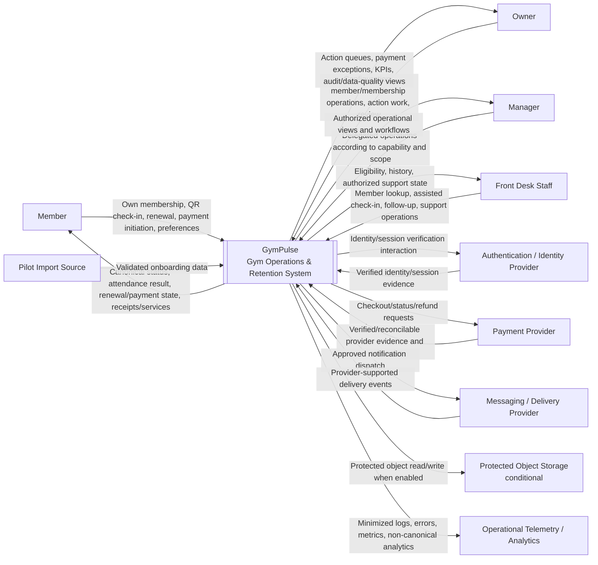

# GymPulse System Context

## Document Control

- Document Maturity: `Draft`
- Scope Status: `In Scope` for Phase 1 architecture
- C4 Level: `Level 1 - System Context`
- Audience: Product Architecture, Product, Backend, Frontend, Mobile, Security, DevOps, QA, Operations
- Canonical Decision Register: `../00-overview/assumptions.md`
- Architecture Overview: `architecture-overview.md`

## 1. Purpose

Define GymPulse as a black-box software system within its Phase 1 operating environment.

This document identifies:

- the Phase 1 human actors,
- external systems and supporting dependencies,
- GymPulse responsibilities,
- information exchanged across system boundaries,
- trust relationships,
- authoritative-state boundaries,
- expected failure/degradation behavior,
- important open decisions that later architecture documents must preserve.

This is a C4 Level 1 context document. It intentionally does **not** describe internal containers, runtime processes, databases, frameworks, queues, or deployment topology.

## 2. System in Scope

### GymPulse

GymPulse is the Phase 1 gym operations and member-retention system responsible for turning member activity and membership state into reliable daily operational workflows.

The primary business loop is:

```text
attendance
  -> inactivity/risk detection
  -> staff follow-up
  -> member return/outcome
  -> renewal
  -> verified payment
  -> optional add-on activation/fulfillment
  -> measurable operational outcome
```

The system is multi-tenant-aware from the data and authorization boundary even when an initial pilot uses one organization, one gym, and one branch.

## 3. Phase 1 System Responsibilities

GymPulse is responsible for the following Phase 1 business capabilities:

- authenticated/verified access to protected workflows,
- tenant/gym/branch-scoped authorization,
- member records and operational member lookup,
- membership plans and membership lifecycle,
- QR attendance and assisted check-in,
- attendance history and correction auditability,
- weekly attendance-goal state,
- inactivity/no-show detection,
- retention action queues,
- follow-up history, outcomes, next actions, and return resolution,
- renewal eligibility, reminders, offers, and renewal orders,
- canonical payment state and verified payment effects,
- receipts where applicable,
- optional Phase 1 add-on purchase and fulfillment/usage state,
- communication intent, preferences, deduplication, and provider-supported delivery state,
- sensitive-action audit history,
- operational data-quality issues,
- owner/manager operational read models and KPIs,
- gym-local scheduled business workflows.

These responsibilities derive from the current Phase 1 product and functional requirements. They do not authorize future workout, health, coaching, or AI capabilities.

## 4. What GymPulse Does Not Own

GymPulse does not become the source of truth for the underlying regulated or provider-owned capabilities of external systems.

It does not own:

- raw card credentials,
- raw UPI credentials or PINs,
- bank/payment-network settlement systems,
- external authentication provider internals,
- telecom/WhatsApp/SMS/email transport networks,
- provider-generated delivery evidence that the provider does not actually expose,
- operating-system credential stores,
- external analytics-provider internals,
- future wearable/medical-source truth.

Provider facts affect GymPulse canonical state only after the required verification and translation rules are satisfied.

## 5. Human Actors

## 5.1 Member

**Phase 1 status:** Confirmed

The Member uses GymPulse primarily to:

- verify/access their own protected experience,
- view their own membership and expiry,
- perform QR check-in,
- review attendance/weekly goal,
- review renewal options,
- initiate payment through an approved provider flow,
- inspect canonical payment/receipt state,
- browse/use approved optional add-ons,
- manage supported communication preferences.

Trust boundary:

- the member client is not trusted to establish membership eligibility, payment success, payable amount, tenant authorization, or server timestamps,
- member access is self-scoped unless another explicitly authorized workflow exists.

Primary requirement families:

- `FR-IDENTITY-*`
- `FR-AUTHZ-*`
- `FR-MEMBERSHIP-*`
- `FR-ATTENDANCE-*`
- `FR-MOTIVATION-*`
- `FR-RENEWAL-*`
- `FR-PAYMENT-*`
- `FR-ADDON-*`
- `FR-CONSENT-*`

## 5.2 Owner

**Phase 1 status:** Confirmed

The Owner uses GymPulse to:

- manage members, plans, memberships, and selected gym policies,
- review attendance and retention risk,
- ensure follow-up work occurs,
- review renewal and payment exceptions,
- manage Phase 1 add-ons,
- inspect operational KPIs and action queues,
- review sensitive audit history when authorized,
- manage delegated staff access where permitted,
- inspect data-quality issues,
- export authorized data where supported.

Trust boundary:

- Owner is a privileged business actor but is not automatically exempt from named capability checks, scope rules, audit, or business invariants.

## 5.3 Manager

**Phase 1 status:** Confirmed role variant; exact authority remains unresolved

The Manager may perform delegated operational work such as:

- daily operations review,
- retention assignment/follow-up,
- membership operations,
- renewal/payment exception review,
- staff workflow supervision.

Trust boundary:

- the title `Manager` does not imply unrestricted Owner authority,
- price changes, refunds, role management, exports, and tenant-level settings remain permission-policy questions.

The exact Owner/Manager split is a product/authorization decision and must not be invented by architecture.

## 5.4 Front Desk Staff

**Phase 1 status:** Confirmed

Front Desk Staff uses GymPulse to:

- search in-scope members,
- inspect membership eligibility,
- perform authorized assisted check-in with mandatory reason,
- inspect attendance/membership history needed for member service,
- record authorized retention follow-up,
- inspect payment/receipt state relevant to support,
- perform only explicitly delegated membership/payment operations.

Trust boundary:

- staff identity is server-resolved,
- assisted attendance cannot bypass authorization and eligibility silently,
- sensitive actions remain attributable and auditable.

## 6. Future Human Actors Excluded From Phase 1 Context

The following actors exist as future product possibilities but are not promoted into active Phase 1 system behavior by this document:

- Trainer / Coach application user,
- Sales Staff,
- Branch Manager as a separate product role,
- Organization Administrator,
- Finance / Accountant role,
- Platform Support,
- Platform Administrator.

A trainer/user reference may exist where needed for a Phase 1 PT/add-on relationship, but a full trainer application is outside the active system context.

## 7. External Systems and Supporting Dependencies

## 7.1 Authentication / Identity Provider

**Decision status:** Provider and session architecture unresolved under `D-ARCH-004`; member verification unresolved under `D-SEC-002`.

Expected relationship:

- establish or verify an external identity/session signal,
- support expiry/revocation semantics required by the chosen architecture,
- provide trusted identity evidence to GymPulse.

GymPulse remains responsible for:

- mapping provider identity to GymPulse identity/member concepts,
- resolving tenant/resource scope,
- resolving named capabilities,
- applying business authorization.

An authentication-provider claim alone is not unrestricted GymPulse business authorization.

## 7.2 Payment Provider

**Decision status:** Open under `D-PROVIDER-001`.

Expected relationship:

GymPulse sends provider-appropriate checkout/refund/status requests and receives provider status evidence or callbacks.

GymPulse must:

- verify security-sensitive provider evidence,
- validate expected payment relationship, amount, currency, and provider references where supported,
- retain reconciliation references,
- deduplicate provider events,
- apply the intended membership/add-on business effect exactly once.

A provider client-side success screen does not establish canonical payment success.

## 7.3 Messaging / Delivery Provider

**Decision status:** Open under `D-PROVIDER-002` and related channel decisions.

Expected relationship:

GymPulse supplies approved notification intent/template data for configured channels and may receive delivery callbacks/status where supported.

GymPulse remains responsible for:

- business-stage deduplication,
- current eligibility recheck,
- communication preference/policy enforcement,
- template business identity,
- deciding whether a message should be sent.

The provider is responsible for channel delivery semantics. GymPulse must not fabricate unsupported delivery states.

## 7.4 Protected Object Storage

**Decision status:** Open under `D-ARCH-010`.

This is a conditional supporting dependency for protected artifacts such as generated receipts/exports or later approved file-backed capabilities.

If used, GymPulse remains responsible for:

- tenant ownership,
- authorization to obtain access,
- metadata/business linkage,
- lifecycle policy.

The storage system must not be treated as a public authorization bypass for protected member/business data.

## 7.5 Operational Telemetry Systems

**Decision status:** Provider open under `D-PROVIDER-006`; product analytics provider open under `D-PROVIDER-005`.

Potential external destinations include error monitoring, logging/metrics, and non-canonical product analytics.

GymPulse must minimize secrets and unnecessary PII before telemetry leaves the trusted application boundary.

Telemetry systems are never the canonical source of truth for:

- attendance,
- membership entitlement,
- payment success,
- revenue,
- follow-up completion.

## 7.6 Pilot Import Source

**Phase 1 relationship:** Controlled onboarding input, not an ongoing trusted system of record.

A pilot gym may provide structured source material such as a spreadsheet/export containing member, plan, membership, or related onboarding data.

GymPulse must:

- validate imported data,
- detect conflicts/duplicates,
- preserve source-row traceability where required,
- require explicit tenant/branch assignment,
- produce reconciliation counts,
- avoid fabricating missing material facts such as expiry or membership state.

## 8. C4 Level 1 Context Diagram



The diagram describes system relationships, not network topology. It does not decide web/mobile frameworks, API placement, database engine, job runtime, hosting, or provider products.

## 9. Actor-to-System Relationship Matrix

| Actor | Sends to GymPulse | Receives from GymPulse | Authorization boundary |
|---|---|---|---|
| Member | QR/check-in request, renewal choice, payment initiation, preferences | own membership, attendance result/history, renewal/payment state, approved add-ons | Self scope |
| Owner | configuration and privileged operations | gym-scoped operational queues, KPIs, payment/audit/data-quality views | Gym scope plus named capabilities |
| Manager | delegated operational commands | authorized gym/branch operational state | Exact profile open; named capabilities required |
| Front Desk Staff | lookup, assisted attendance, follow-up/support commands | branch/in-scope member service information | Typically Branch scope plus named capabilities |

No actor establishes final authorization merely by supplying a tenant, gym, branch, member, membership, or payment identifier.

## 10. External-System Relationship Matrix

| External system | GymPulse sends | GymPulse accepts/receives | Authority retained by GymPulse |
|---|---|---|---|
| Authentication / Identity Provider | verification/session interaction | verified identity/session evidence | principal mapping, tenant/resource scope, capability authorization |
| Payment Provider | checkout/status/refund requests | signed/verified payment evidence and provider references | canonical payment transition and business effect |
| Messaging / Delivery Provider | approved message/template dispatch | provider-supported delivery result/callback | notification eligibility, dedupe, preference/policy, business conversion truth |
| Protected Object Storage | authorized object operations | object metadata/data | tenant ownership, access authorization, business linkage |
| Operational Telemetry / Analytics | minimized telemetry/events | diagnostic/provider status where applicable | all canonical business state |
| Pilot Import Source | source records/file | onboarding data only after validation | canonical imported records after reconciliation/approval |

## 11. High-Level Information Flows

## 11.1 Member check-in

```text
Member
  -> GymPulse: verified member context + QR/session input
  -> GymPulse: validate scope, membership eligibility, QR/session, duplicate rule
  -> GymPulse: create one canonical attendance effect
  -> GymPulse: update/derive goal and applicable retention return state
  -> Member: server-confirmed result
```

External payment or messaging systems are not required for a normal attendance transaction.

## 11.2 Assisted attendance

```text
Front Desk Staff
  -> GymPulse: member + assisted action + reason
  -> GymPulse: authenticate staff, authorize capability/scope, validate eligibility/duplicate rule
  -> GymPulse: create canonical attendance + required audit context
  -> Front Desk Staff: canonical success or blocked reason
```

## 11.3 Retention follow-up

```text
GymPulse scheduled business logic
  -> identifies eligible inactivity case
  -> Owner/Manager/Front Desk receives action queue
  -> authorized staff contacts member outside or through an approved channel
  -> staff records outcome/next action in GymPulse
  -> later valid attendance may resolve case while retaining history
```

A phone conversation or WhatsApp exchange that is not recorded in GymPulse does not automatically become canonical follow-up history.

## 11.4 Renewal and verified payment

```text
Member
  -> GymPulse: select eligible renewal terms
  -> GymPulse: create renewal order and internal payment context
  -> Payment Provider: checkout interaction
  -> Member: provider client experience
  -> Payment Provider -> GymPulse: provider evidence/callback
  -> GymPulse: verify + dedupe + canonicalize payment
  -> GymPulse: apply membership effect exactly once
  -> Member/Owner: canonical updated state
```

The client-facing provider result is advisory until GymPulse has authoritative verified evidence.

## 11.5 Notification delivery

```text
GymPulse business event/schedule
  -> create/reuse notification intent
  -> recheck current business eligibility and preference/policy
  -> Messaging Provider: approved dispatch
  -> Messaging Provider -> GymPulse: supported status callback
  -> GymPulse: update observed delivery state without fabricating unsupported states
```

## 11.6 Owner daily operations

```text
Owner / Manager
  -> GymPulse
  -> authorized operational read models from canonical records
  -> prioritized retention / renewal / payment / fulfillment / data-quality queues
  -> contextual action
  -> canonical state update and audit where required
```

## 12. Trust Model

The context-level trust model follows these rules.

### Human/client inputs

Treat as untrusted until authenticated/verified, authorized, validated, and checked against current business state.

### Authentication provider evidence

Trust only according to the selected provider/session verification contract. Provider identity proves identity/session state, not GymPulse business authorization.

### Payment-provider evidence

Trust only after authenticity verification and business validation. Provider evidence may establish payment facts but cannot bypass GymPulse exactly-once business-effect logic.

### Messaging-provider evidence

Accept only provider-supported delivery evidence. Delivery state does not establish a business conversion such as renewal or member return.

### Import data

Treat as untrusted business input until validated and reconciled. Missing material facts remain errors/open data issues rather than guessed values.

### Telemetry

Treat telemetry as diagnostic/measurement data, never as canonical operational state.

## 13. Canonical State Ownership at the System Boundary

GymPulse is the canonical system of record for its approved Phase 1 operational records, including:

- member business records,
- membership entitlement records,
- canonical attendance,
- no-show cases,
- follow-up history,
- renewal orders,
- internal payment lifecycle and verified provider-event/effect records,
- add-on order/usage/fulfillment records,
- notification intent and observed delivery state,
- audit history,
- operational configuration,
- derived operational read models based on canonical records.

External systems may supply evidence or deliver effects, but they do not directly write arbitrary canonical domain state.

### State-ownership warning

`D-DATA-007` remains unresolved. Until it is decided, entitlement/attendance eligibility must not be inferred from `Member.status` alone because current requirements also define membership lifecycle state separately.

## 14. Tenant and Scope Context

All protected interactions must preserve an authorized scope model conceptually compatible with:

```text
Platform
  -> Organization
      -> Gym
          -> Branch
```

Phase 1 may operate a single gym/branch pilot, but architecture must not use that pilot shape to justify global unscoped data access.

Context rules:

- actor-supplied scope identifiers are routing hints, not authorization proof,
- background/system work carries explicit tenant/gym/branch context where relevant,
- provider callbacks must resolve their target payment/message/resource without trusting arbitrary tenant input,
- imports require explicit destination tenant/branch mapping,
- operational reporting cannot cross tenant scope except through a future explicitly authorized platform capability.

## 15. Time Context

Gym-local time is part of the system context because business behavior depends on it.

GymPulse uses configured gym timezone for:

- daily no-show evaluation,
- renewal-stage windows,
- daily owner summaries,
- weekly attendance goals,
- business-date dashboards and KPIs.

Canonical event timestamps remain UTC-oriented according to current data requirements.

The server host's local timezone is not a valid implicit business clock.

## 16. Failure and Degradation Expectations

## 16.1 Authentication dependency failure

Protected flows should fail safely rather than create unauthenticated privileged access. Existing session behavior depends on the future authentication/session decision.

## 16.2 Payment-provider failure or ambiguity

GymPulse must not mark payment successful or grant entitlement without authoritative evidence. The internal payment may remain `Created`, `Pending`, or another valid canonical state and later reconcile.

## 16.3 Messaging-provider failure

Canonical membership, attendance, payment, or retention state must remain intact. Notification intent/failure remains diagnosable and retryable according to policy.

## 16.4 Telemetry-provider failure

A telemetry outage should not normally roll back a valid attendance/payment/membership business transaction.

## 16.5 Storage-provider failure

Protected artifact access may degrade, but authorization and canonical operational records must remain intact. Exact receipt/export degradation behavior belongs to later application/domain design.

## 16.6 Import-source quality failure

Invalid or incomplete imported rows must be surfaced for correction/reconciliation rather than silently converted into plausible business facts.

## 17. Security and Privacy Boundary

Mandatory context-level controls independent of implementation technology:

- server-side authorization for protected operations,
- explicit tenant/resource scope,
- least privilege,
- self-only member access by default,
- secret/provider credential isolation from clients,
- verification of security-sensitive provider callbacks,
- no raw card/UPI credential storage,
- auditable sensitive mutations,
- private authorization for protected objects,
- minimized PII/secrets in logs and analytics,
- separate service/transactional and marketing communication policy,
- negative tenant-isolation testing.

Launch jurisdiction, retention periods, deletion/export workflow, session policy, and future health-data controls remain open security/privacy decisions.

## 18. Phase 1 Boundary vs Future Systems

This System Context does not include active integrations for:

- wearable/health platforms,
- AI model providers,
- workout-programming systems,
- nutrition-tracking systems,
- coaching marketplaces,
- social/community platforms,
- SaaS subscription billing for GymPulse itself,
- enterprise data warehouses,
- complex multi-branch administration.

If any becomes active scope, product requirements and a revised System Context must be approved before its internal architecture is treated as implementation-ready.

## 19. Open Decisions Affecting Context Relationships

The following decisions may change implementation or exact external-system relationships without changing the core Phase 1 business boundary:

- `D-ARCH-004` authentication/session architecture,
- `D-SEC-002` member authentication/verification method,
- `D-ARCH-014` managed backend responsibilities,
- `D-ARCH-015` authorization implementation boundary,
- `D-SEC-008` data-layer tenant isolation/RLS where applicable,
- `D-PROVIDER-001` payment provider,
- `D-PROVIDER-002` messaging provider,
- `D-ARCH-010` protected object storage,
- `D-PROVIDER-005` product analytics provider,
- `D-PROVIDER-006` observability provider,
- `D-DATA-007` Member vs Membership state ownership.

The following mainly affect later container/runtime design rather than the C4 Level 1 business context:

- `D-ARCH-001` repository strategy,
- `D-ARCH-002` database engine,
- `D-ARCH-003` API contract architecture,
- `D-ARCH-005` modular-monolith style,
- `D-ARCH-006` API deployment boundary,
- `D-ARCH-007` background-job technology,
- `D-ARCH-008` Redis/cache requirement,
- `D-ARCH-009` hosting,
- `D-ARCH-011` package manager,
- `D-ARCH-012` Owner/Staff web framework,
- `D-ARCH-013` Member client/framework strategy.

No decision above is accepted by this System Context document.

## 20. Requirement Traceability

| Context relationship | Primary requirement drivers |
|---|---|
| Member -> GymPulse self-service | `FR-IDENTITY-003`, `FR-AUTHZ-003`, `FR-MEMBERSHIP-*`, `FR-ATTENDANCE-*`, `FR-RENEWAL-*`, `FR-PAYMENT-*` |
| Owner/Manager -> GymPulse operations | `FR-AUTHZ-*`, `FR-PLAN-*`, `FR-MEMBERSHIP-*`, `FR-RETENTION-*`, `FR-DASHBOARD-*`, `FR-AUDIT-*` |
| Front Desk -> GymPulse assisted operations | `FR-MEMBER-005`, `FR-ATTENDANCE-007..010`, `FR-FOLLOWUP-*`, `FR-AUTHZ-*` |
| GymPulse <-> Authentication Provider | `FR-IDENTITY-001..003`, `NFR-SECURITY-002..004` |
| GymPulse <-> Payment Provider | `FR-PAYMENT-002..009`, `NFR-SECURITY-007..008`, `NFR-RELIABILITY-002`, `NFR-OBSERVABILITY-004` |
| GymPulse <-> Messaging Provider | `FR-NOTIFICATION-*`, `FR-CONSENT-*`, `NFR-AVAILABILITY-002`, `NFR-MAINTAINABILITY-003` |
| GymPulse -> Operational Telemetry | `NFR-OBSERVABILITY-*`, `NFR-PRIVACY-004`, `NFR-SECURITY-011` |
| Pilot Import Source -> GymPulse | `FR-IMPORT-001..002`, `FR-CROSS-003`, `NFR-DATA-004` |
| All protected relationships | `NFR-SECURITY-001..011`, `FR-CROSS-001..004` |

Ranges/wildcards refer only to requirement IDs already present in the canonical requirement documents.

## 21. C4 System Context Gate

The System Context is consistent only while all of the following remain true:

- GymPulse remains the only active system in scope for deterministic Phase 1 operational truth,
- Member, Owner, Manager, and Front Desk are the active Phase 1 human actors,
- future Trainer/Coach, platform, AI, workout, health, and multi-branch product actors are not silently promoted,
- client/provider input is not treated as unverified canonical business truth,
- authentication remains separate from GymPulse authorization,
- payment provider evidence cannot bypass verification/idempotency,
- tenant scope remains explicit even for a single-gym pilot,
- external integration failure does not silently corrupt canonical operational state,
- `D-DATA-007` remains explicit until Member vs Membership state ownership is resolved,
- no technology/provider decision is accepted by the diagram or relationship descriptions.

If these checks pass, the next bounded architecture task is:

```text
container-architecture.md
```

The C4 Container document should decompose GymPulse into deployable/logical runtime containers while preserving this context boundary and keeping unresolved runtime/provider decisions explicit.

## 22. Related Documents

- `../README.md`
- `../00-overview/project-overview.md`
- `../00-overview/scope.md`
- `../00-overview/assumptions.md`
- `../01-product/personas.md`
- `../01-product/user-roles.md`
- `../01-product/user-journeys.md`
- `../01-product/functional-requirements.md`
- `../01-product/non-functional-requirements.md`
- `architecture-principles.md`
- `architecture-overview.md`
- `../adr/README.md`
- legacy migration input: `../05-system-architecture.md`
- legacy migration input: `../07-api-contracts.md`
- legacy migration input: `../08-automations.md`
- legacy migration input: `../09-payments-billing.md`
- legacy migration input: `../10-notifications-whatsapp.md`
- legacy migration input: `../12-security-audit.md`
