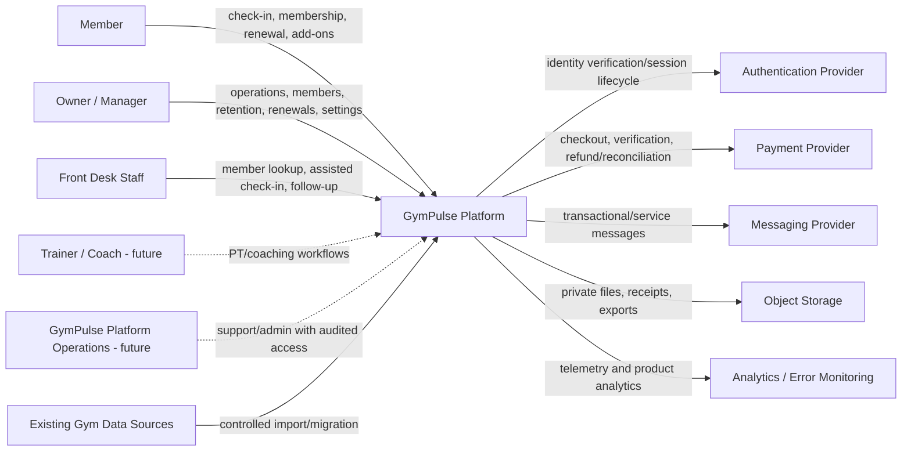
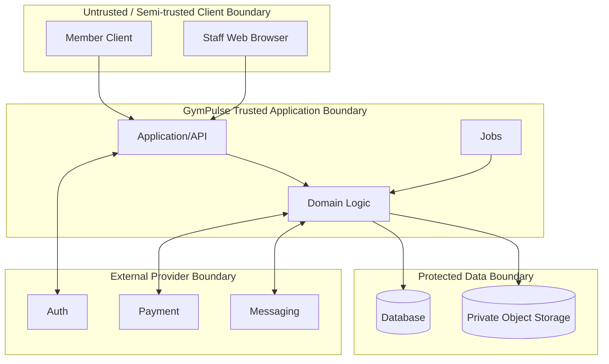

# GymPulse System Context

## Document Control

- Status: `Draft v1.0`
- Model: C4 Level 1
- Scope: GymPulse as a software system and its external actors/systems

## 1. Purpose

Define who interacts with GymPulse, which external systems GymPulse depends on, and the trust boundaries around the platform.

This document intentionally avoids container/framework details. Those belong in `container-architecture.md`.

## 2. System Context



Dashed relationships represent future or conditional scope.

## 3. Primary Human Actors

### 3.1 Member

**Phase:** Confirmed Phase 1.

Uses GymPulse to:

- verify/access own account,
- view membership and expiry,
- perform QR check-in,
- view attendance and weekly goal,
- review renewal options,
- initiate payment,
- inspect payment/receipt state,
- browse optional add-ons,
- manage applicable communication preferences.

Trust boundary:

- member input is untrusted,
- a member cannot self-declare payment success, membership eligibility, tenant scope, or attendance validity.

### 3.2 Owner / Manager

**Phase:** Confirmed Phase 1.

Uses GymPulse to:

- operate members/memberships/plans,
- review red-list/no-show cases,
- assign/perform follow-up,
- inspect renewal pipeline and payment exceptions,
- manage configured add-ons,
- review operational KPIs,
- manage selected settings and staff capabilities.

Sensitive mutations require capability checks and audit attribution.

### 3.3 Front Desk Staff

**Phase:** Confirmed Phase 1.

Uses GymPulse to:

- search in-scope members,
- verify membership eligibility,
- perform assisted check-in when authorized,
- record follow-up outcome,
- inspect relevant payment/receipt state,
- perform other explicitly permitted operational tasks.

Front-desk access must be narrower than owner/manager access by default.

### 3.4 Trainer / Coach

**Phase:** Future / partial reference in Phase 1.

Potential responsibilities:

- assigned clients,
- PT sessions,
- package utilization,
- training notes,
- workout programs.

Trainer access must not implicitly include broad financial or tenant-administration data.

### 3.5 GymPulse Platform Operations

**Phase:** Future commercial multi-tenant operation.

Potential responsibilities:

- tenant onboarding,
- service diagnostics,
- incident response,
- support tooling.

Support access must be explicit, scoped, reasoned, time-bounded where possible, and audited. Platform staff must not rely on an unrestricted tenant backdoor.

## 4. External System Boundaries

### 4.1 Authentication Provider

**Status:** Open selection (`D-ARCH-004`, `D-SEC-002`).

Responsibilities may include:

- staff identity authentication,
- member OTP/passwordless verification,
- session/token issuance,
- session revocation/expiry,
- provider-level account protection.

GymPulse remains responsible for tenant authorization and domain permissions even if authentication is managed externally.

### 4.2 Payment Provider

**Status:** Open selection (`D-PROVIDER-001`).

Responsibilities:

- approved online payment methods,
- checkout/payment attempt,
- signed/authenticated webhook or verifiable result,
- refund/reversal APIs if enabled,
- provider reconciliation references.

GymPulse responsibilities:

- internal payment/order records,
- webhook verification,
- canonical state mapping,
- idempotent business effects,
- receipt/application state,
- owner exception workflow.

### 4.3 Messaging Provider

**Status:** Open selection (`D-PROVIDER-002`).

Potential channels:

- WhatsApp,
- SMS,
- email,
- future push notifications.

GymPulse owns notification policy, intent, deduplication, preference evaluation, and canonical delivery tracking. Provider capabilities determine which delivery states can actually be observed.

### 4.4 Object Storage

**Status:** Open selection (`D-ARCH-010`).

Potential data:

- generated receipts,
- exports,
- future member documents,
- future progress photos.

Protected files must not be public-by-default.

### 4.5 Analytics and Error Monitoring

**Status:** Open selection (`D-PROVIDER-006`, `D-PROVIDER-005`).

Uses:

- application errors,
- client crashes,
- request/job diagnostics,
- product usage events,
- operational failure visibility.

Canonical payment, attendance, membership, and revenue truth must not come from client analytics.

### 4.6 Existing Gym Data Sources

**Status:** Conditional for pilot.

Possible sources:

- spreadsheet,
- register transformed to CSV,
- biometric export,
- another app export.

Import must use validation and staging rather than treating external data as automatically trustworthy.

## 5. Trust Boundaries



Rules:

- all client identifiers and state claims are validated,
- provider callbacks are authenticated/verified,
- secrets remain in trusted server/provider boundaries,
- authorization is evaluated before protected resource exposure,
- cross-tenant data access is denied even if a valid object ID is guessed.

## 6. Context-Level Data Categories

### Identity data

Examples:

- user ID,
- member ID,
- contact identifier,
- role assignment.

### Operational membership data

- plans,
- membership dates/state,
- freeze state,
- renewal context.

### Attendance and retention data

- attendance timestamps,
- no-show cases,
- follow-up outcomes,
- next actions.

### Financial data

- renewal/add-on orders,
- payment status,
- provider references,
- receipt metadata.

Raw card or UPI credentials are outside the GymPulse data boundary and must not be stored.

### Future health/fitness data

- measurements,
- progress data,
- workout/nutrition/coaching information.

These require separate privacy/security requirements before entering active scope.

## 7. Context-Level Key Flows

### Attendance

```text
Member -> GymPulse -> validate identity/tenant/membership/QR -> canonical attendance
```

### Retention

```text
Scheduled GymPulse process -> canonical attendance/membership data -> no-show case -> staff action
```

### Renewal/payment

```text
Member -> GymPulse order -> Payment Provider -> verified result -> GymPulse payment effect -> membership
```

### Notification

```text
GymPulse business event -> policy/preferences -> Messaging Provider -> delivery state
```

### Import

```text
Existing Gym Source -> staged validation -> owner review/reconciliation -> GymPulse canonical records
```

## 8. Security Considerations

At context level, the primary threats include:

- account takeover,
- tenant boundary bypass,
- forged payment callback,
- QR replay,
- privilege escalation,
- PII leakage through logs/analytics,
- insecure exported files,
- untrusted import data,
- unrestricted support/admin access.

Detailed threat modeling belongs in `../09-security/threat-model.md`.

## 9. Availability Dependencies

GymPulse should degrade explicitly when external providers are unavailable.

Examples:

- auth provider outage may block new logins while existing valid sessions may continue according to architecture,
- payment outage should show unavailable/pending state rather than fake success,
- messaging outage should retain notification intent for retry,
- analytics outage must not block core attendance/payment workflows,
- object storage failure should not corrupt canonical payment/membership state.

## 10. Open Questions

- final authentication provider and member auth method,
- payment provider,
- messaging provider and channels,
- whether pilot import source is CSV/spreadsheet/other,
- whether object storage is required in first pilot release,
- final jurisdiction/privacy obligations,
- whether any biometric integration exists in Phase 1.

## 11. Related Documents

- `architecture-overview.md`
- `container-architecture.md`
- `data-flow.md`
- `../01-product/personas.md`
- `../01-product/user-roles.md`
- `../01-product/user-journeys.md`
- `../00-overview/assumptions.md`
