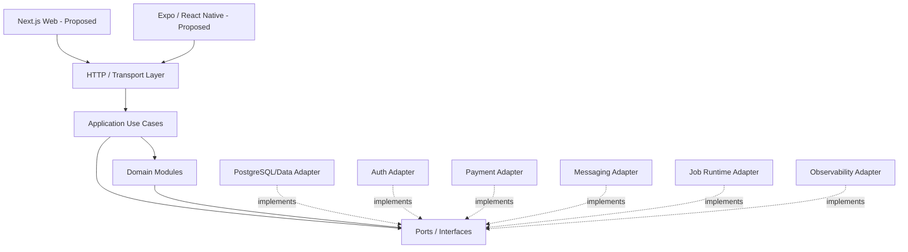

# GymPulse Technology Stack Evaluation

## Document Control

- Status: `Draft v1.0`
- Scope: Phase 1 Operations MVP implementation technology evaluation
- Audience: Architecture, Backend, Frontend, Mobile, DevOps, Security, QA, Engineering Leads
- Parent documents: `architecture-principles.md`, `architecture-overview.md`, `container-architecture.md`, `component-architecture.md`, `data-flow.md`
- Canonical decision register: `../00-overview/assumptions.md`
- Decision posture: this document evaluates and recommends technologies; it does not make an Open/Proposed decision Accepted without the required decision/ADR process

## 1. Purpose

Define the technology capabilities GymPulse needs to implement the documented Phase 1 architecture, evaluate practical technology options, record the recommended direction where current evidence supports one, and make the tradeoffs and unresolved decisions explicit.

This document is intentionally different from an ADR:

- an ADR records an accepted or explicitly proposed architecture decision in a durable decision format,
- this document provides the technical comparison and implementation context used to make those decisions,
- a recommendation here remains `Proposed`, `Assumed`, or `Open` according to `../00-overview/assumptions.md`.

The legacy `../05-system-architecture.md` and `../15-engineering-workflow.md` contain useful migration input, but their older `Accepted recommendations` wording is not authoritative when it conflicts with the canonical decision register.

## 2. Architecture Constraints the Stack Must Satisfy

The technology stack must preserve the architecture already documented rather than forcing a different product architecture.

Required characteristics:

1. Type-safe implementation across primary application boundaries where practical.
2. One modular-monolith domain/application model before microservice extraction.
3. Stable contracts for Owner/Staff Web, Member Mobile, API, workers, and provider callbacks.
4. Explicit tenant/gym/branch context on protected data and jobs.
5. Server-side capability authorization.
6. Transaction-safe membership, attendance, payment, and retention workflows.
7. Durable idempotency for retried requests, jobs, and provider events.
8. PostgreSQL-compatible relational constraints if `D-ARCH-002` is accepted.
9. Durable background work with retries and failure visibility.
10. Provider adapters for auth, payments, messaging, storage, analytics, and observability.
11. Private secret boundaries and no service credentials in client bundles.
12. Production diagnostics for API, webhook, job, and mobile/web failures.
13. Local/staging/prod separation and repeatable migrations.
14. No mandatory Redis, broker, Kubernetes, or microservices without measured need.

Primary related requirements include:

- `FR-AUTHZ-001`, `FR-AUTHZ-002`
- `FR-ATTENDANCE-003`, `FR-ATTENDANCE-006`
- `FR-RETENTION-005`
- `FR-PAYMENT-002`, `FR-PAYMENT-005`, `FR-PAYMENT-006`
- `FR-NOTIFICATION-002`
- `FR-AUDIT-001`, `FR-AUDIT-003`
- `NFR-SECURITY-001..011`
- `NFR-RELIABILITY-001..008`
- `NFR-SCALABILITY-001..006`
- `NFR-OBSERVABILITY-001..007`
- `NFR-MAINTAINABILITY-001..006`
- `NFR-TESTABILITY-001..005`

## 3. Technology Decision Summary

| Area | Current status | Recommended / evaluated direction | Canonical decision |
|---|---|---|---|
| Architecture style | Proposed | Modular monolith before microservices | `D-ARCH-005` |
| Primary application language | Proposed architecture direction | TypeScript for web/mobile/server/shared contracts | no dedicated canonical ID yet |
| Monorepo | Proposed | Turborepo-style TypeScript monorepo | `D-ARCH-001` |
| Package manager | Assumed | pnpm | `D-ARCH-014` |
| Owner/Staff Web | Proposed | Next.js + TypeScript | `D-ARCH-011` |
| Member Mobile | Proposed | Expo / React Native + TypeScript | `D-ARCH-012` |
| API contract style | Proposed | JSON HTTP API + runtime-validated typed contracts | `D-ARCH-003` |
| API deployment | Open | Option A: web/server runtime first; Option B: separate TypeScript API | `D-ARCH-006` |
| Canonical database | Proposed | PostgreSQL | `D-ARCH-002` |
| Data access / migrations | Open implementation choice | SQL-aware typed data layer + committed migrations | register decision if material |
| Managed backend | Open | Evaluate Supabase-like managed PostgreSQL/Auth/Storage platform vs independent services | `D-ARCH-013` |
| Authentication/session | Open | Provider-neutral auth adapter; web + mobile support required | `D-ARCH-004`, `D-SEC-002` |
| RLS | Open | Defense in depth where client-accessible managed DB patterns exist | `D-SEC-008` |
| Background jobs | Open | Durable managed job/scheduler or queue-backed worker | `D-ARCH-007` |
| Redis | Open | Do not require for Phase 1 without concrete need | `D-ARCH-008` |
| Payments | Open | Provider adapter; India-friendly provider evaluated after pilot requirements | `D-PROVIDER-001` |
| Messaging | Open | Provider adapter with WhatsApp-first capability if confirmed | `D-PROVIDER-002`, `D-PROD-011` |
| Object storage | Open | Private S3-compatible or managed storage | `D-ARCH-010` |
| Hosting | Open | Managed platform favoring low operational burden | `D-ARCH-009` |
| Observability | Open | Centralized error monitoring + structured logs + operational metrics | `D-PROVIDER-006` |
| Product analytics | Open | Privacy-minimized event analytics, non-canonical | `D-PROVIDER-005` |

## 4. Primary Application Language and Runtime

### Problem being solved

GymPulse needs shared contracts and business-rule implementation across:

- Owner/Staff Web,
- Member Mobile,
- Application/API runtime,
- Worker runtime,
- provider adapters,
- validation schemas,
- test utilities.

### Current status

`Proposed architecture direction`.

The current architecture consistently assumes TypeScript as the primary application language, but the canonical decision register does not yet give the language its own decision ID.

### Recommended direction

Use **TypeScript in strict mode** for primary application code.

Recommended responsibilities:

```text
TypeScript
  -> web application
  -> member mobile application
  -> application/use-case layer
  -> domain modules
  -> API contracts
  -> provider adapters
  -> worker handlers
  -> shared test utilities
```

### Why

- one type system across web/mobile/server reduces contract drift,
- aligns with proposed Next.js and Expo directions,
- supports shared runtime schemas and DTOs,
- supports modular package boundaries,
- reduces context switching for a small initial engineering team.

### Important limitation

TypeScript types do not validate runtime input. HTTP bodies, webhooks, environment variables, import rows, and job payloads remain `unknown` until validated by runtime schemas.

### Alternatives considered

**Separate backend language such as Go/Java/Kotlin:** strong server/runtime properties but increases language/tooling surface and weakens direct contract sharing for the initial team.

**JavaScript without strict TypeScript:** lower initial friction but weaker refactoring and boundary safety for a product with payment, authorization, and tenant-scoping invariants.

### Decision follow-up

If TypeScript becomes a formally governed cross-project commitment independent of framework ADRs, add a canonical decision ID and ADR rather than treating this document alone as acceptance.

## 5. Monorepo Strategy

### Status

`Proposed`, `D-ARCH-001`.

### Recommended direction

Use a monorepo with workspace-aware dependency boundaries and task orchestration. Turborepo remains the leading candidate because the current application set is TypeScript-heavy and needs shared packages.

Conceptual source structure:

```text
apps/
  web/
  member-mobile/
  api/                 # only if D-ARCH-006 selects separate API deployment
  worker/              # deployable shape depends on D-ARCH-007

packages/
  application/
  domain/
  contracts/
  auth/
  database/
  payments/
  notifications/
  jobs/
  audit/
  analytics/
  observability/
  config/
  ui/

docs/
.ai/
```

The exact package names remain engineering design, but dependency boundaries from `component-architecture.md` must be preserved.

### Why a monorepo fits GymPulse

- web and mobile consume the same contract definitions,
- API and worker reuse domain/application logic,
- schema/migration changes can be reviewed with affected application changes,
- documentation can evolve with code in one PR,
- affected-package CI can reduce build time later.

### Alternatives

**Multiple repositories:** stronger repository-level isolation but creates versioning/release coordination overhead before teams are large enough to benefit.

**Single application repository with no workspace boundaries:** simpler initially but encourages application/domain/provider code to collapse into framework directories.

### Tradeoff

A monorepo does not automatically enforce architecture. Package dependency rules and code review must prevent UI/provider/database layers from importing domain-inappropriate modules.

### Planned ADR

`ADR-0001-use-monorepo.md`.

## 6. Package Manager

### Status

`Assumed`, `D-ARCH-014`.

### Recommended direction

Use **pnpm** if the monorepo decision is accepted.

### Why

- workspace support,
- efficient dependency storage,
- deterministic lockfile workflows,
- common fit with TypeScript/Turborepo repositories.

### Alternatives

- npm workspaces,
- Yarn workspaces.

### Selection criteria

- CI/tooling compatibility,
- workspace behavior,
- team familiarity,
- dependency-resolution predictability,
- hosting/build-platform support.

The package manager can be finalized in the monorepo/tooling ADR if a separate ADR is unnecessary.

## 7. Owner / Staff Web Framework

### Status

`Proposed`, `D-ARCH-011`.

### Recommended direction

Use **Next.js + React + TypeScript** for Owner/Manager/Front Desk workflows.

### Why

GymPulse needs:

- responsive operational UI,
- authenticated server-backed pages,
- data-heavy action queues,
- forms/mutations,
- preview environments,
- optional server-side rendering where useful,
- a possible initial in-process Application/API runtime under deployment Option A.

### Architecture constraints

Next.js is a presentation/runtime choice. It MUST NOT own core domain rules.

Rules:

- route handlers/server actions call application use cases,
- browser components do not receive secrets,
- server-side route guards do not replace capability authorization,
- domain/application packages remain framework-independent,
- mobile-compatible HTTP contracts exist wherever Member Mobile needs them.

### Alternatives considered

**React SPA + separate API:** clear client/server separation but creates separate hosting/runtime concern immediately.

**Other full-stack web frameworks:** potentially viable, but current repository architecture and shared TypeScript direction already align most strongly with Next.js.

### Planned decision action

Create an ADR if framework selection is expected to be long-lived/material. Exact framework version is intentionally not pinned in documentation; versions belong in the implementation lockfile and dependency policy.

## 8. Member Mobile Framework

### Status

`Proposed`, `D-ARCH-012`.

### Recommended direction

Use **Expo / React Native + TypeScript** when a native member application is actually brought into the active delivery scope.

### Why

- TypeScript sharing with contracts/domain-safe client types,
- camera/QR capabilities,
- push-notification path later,
- Android/iOS delivery from one primary codebase,
- simpler mobile iteration than two native codebases for Phase 1 scale.

### Scope caution

The architecture supports Member Mobile, but product delivery should not build native complexity earlier than required. If the pilot can validate member workflows through responsive web/PWA, the mobile app can remain a later deliverable without changing server/domain contracts.

### Alternatives

- responsive member web/PWA,
- native Kotlin + Swift,
- Flutter.

### Selection criteria

- required camera/QR UX,
- store-distribution timing,
- offline requirements (`D-PROD-010`),
- push requirements,
- team skill,
- device coverage,
- ability to maintain secure auth/session storage.

## 9. API Contract Style

### Status

`Proposed`, `D-ARCH-003`.

### Recommended direction

Use a **JSON HTTP API with runtime-validated, typed contracts** as the primary cross-client interface.

Example conceptual boundary:

```text
Mobile/Web external request
  -> HTTP transport
  -> runtime schema validation
  -> application use case
  -> domain result
  -> stable response DTO
```

### Requirements

- stable machine-readable error codes,
- bounded pagination/filtering,
- idempotency keys for retry-sensitive mutations,
- correlation/request IDs,
- explicit auth context,
- no raw database rows as public contracts,
- mobile-compatible evolution strategy before wide app release.

### Runtime validation options

A schema library such as Zod or an equivalent TypeScript runtime validation solution is a strong candidate, but exact library selection is an implementation-level decision unless it becomes materially architectural.

### Alternatives

**GraphQL:** useful for broad client-driven query flexibility but adds schema/runtime/tooling complexity that Phase 1 does not currently require.

**tRPC-style client/server coupling:** excellent TypeScript ergonomics in a single ecosystem but may make independently consumable mobile/external HTTP contracts less explicit depending on deployment needs.

**gRPC:** strong typed service contracts but unnecessary complexity for browser/mobile Phase 1 interaction.

### Planned ADR

`ADR-0003-api-architecture.md`.

## 10. API Deployment Topology

### Status

`Open`, `D-ARCH-006`.

Both existing options remain viable.

### Option A: Next.js Web + Server/API initially

```text
Owner/Staff Browser
      -> Next.js runtime
           -> application/domain packages
Member Mobile
      -> stable HTTP endpoints in same server runtime
Worker
      -> shared application/domain packages
```

**Benefits**

- fewer deployables,
- lower pilot operational burden,
- easier local development,
- fast product iteration.

**Risks**

- framework route handlers may absorb business logic,
- API concerns can become coupled to web deployment,
- mobile contracts can be treated as secondary unless explicitly protected.

### Option B: Separate TypeScript API runtime

```text
Next.js Web ----> Application API
Expo Mobile ----> Application API
Worker ---------> shared application/domain code
```

**Benefits**

- clear runtime/API boundary,
- web/mobile are equal API consumers,
- independent API scaling/deployment.

**Costs**

- extra deployment/configuration,
- more local orchestration,
- more CI/CD and secrets surface before scale proves need.

### Recommendation posture

For a small pilot, **Option A is operationally attractive**, but no selection should be made until hosting, mobile timing, auth, webhooks, and job-runner constraints are evaluated together.

The application/domain package boundaries must make later extraction possible under either option.

## 11. PostgreSQL

### Status

`Proposed`, `D-ARCH-002`.

### Recommended direction

Use **PostgreSQL** as the canonical relational system of record.

### Why it matches GymPulse

Core Phase 1 state is strongly relational and transaction-sensitive:

- users/roles/scopes,
- members/plans/memberships/freezes,
- QR sessions/attendance,
- no-show cases/follow-ups,
- renewal orders/payments/effects,
- add-ons/usage,
- notification intent/status,
- audit/data-quality records.

PostgreSQL supports:

- transactions,
- foreign keys,
- unique and partial indexes,
- race-resistant constraints,
- tenant-aware query/index design,
- mature operational tooling.

### Alternatives

**Document database as canonical store:** flexible schema but weaker fit for transaction-heavy relational invariants and reporting joins.

**Multiple databases per domain:** premature operational complexity for the modular-monolith Phase 1 architecture.

### Planned ADR

`ADR-0002-database-selection.md`.

## 12. Data-Access and Migration Approach

### Status

`Open implementation choice` within the proposed PostgreSQL direction.

### Required capabilities

Whatever library is selected must support:

- explicit SQL-compatible migrations,
- transactions / unit of work,
- constraints and indexes without fighting the database,
- tenant-scoped repositories,
- testing against real PostgreSQL behavior,
- safe access to provider/event/audit tables,
- no requirement to expose generated DB models directly to clients.

### Candidate approaches

#### A. Drizzle-style SQL-aware typed data layer

Potential strengths:

- TypeScript-first,
- close visibility into SQL/schema,
- good fit for explicit constraints and RLS-aware work,
- relatively thin abstraction.

Potential costs:

- team must remain comfortable with SQL,
- some higher-level conveniences may require custom repository work.

#### B. Prisma-style ORM

Potential strengths:

- productive schema/client workflow,
- strong developer ergonomics,
- mature TypeScript ecosystem.

Potential costs:

- advanced PostgreSQL/RLS/transaction patterns can require more deliberate escape hatches and operational understanding,
- generated persistence models can be overused as domain/API models if boundaries are weak.

#### C. SQL/query-builder first

Potential strengths:

- maximum PostgreSQL control,
- transparent performance and constraints.

Potential costs:

- more manual typing/mapping,
- higher repository implementation effort.

### Current recommendation

Prefer a **SQL-aware typed approach** that keeps PostgreSQL capabilities visible and commits migrations to source control. Do not select Drizzle, Prisma, or another library in this document without an implementation spike and engineering review.

If the choice materially affects RLS, migrations, testing, or architecture boundaries, add it to the canonical decision register and ADR process.

## 13. Managed Backend Platform

### Status

`Open`, `D-ARCH-013`.

### Evaluated direction

A managed platform such as **Supabase** is a plausible candidate because it can combine managed PostgreSQL, Auth, Storage, and platform tooling. It is not selected by this document.

### Potential advantages

- lower infrastructure setup burden,
- managed PostgreSQL,
- integrated auth/storage options,
- potential RLS support,
- quick pilot environment creation.

### Risks / tradeoffs

- application architecture may become coupled to platform-specific SDKs,
- client-direct database patterns can complicate capability authorization,
- RLS strategy becomes a critical security decision,
- auth/storage/database lifecycle decisions become bundled,
- migration away from provider-specific features may become harder.

### Architecture rule

Even if a managed platform is selected:

- domain/application code remains provider-neutral where practical,
- protected business mutations go through trusted application logic,
- provider auth identity does not grant tenant authorization,
- direct client DB access is not assumed,
- RLS is defense in depth, not a replacement for application capability authorization.

### Planned ADR

`ADR-0005-managed-backend-platform.md`.

## 14. Authentication and Session Technology

### Status

`Open`, `D-ARCH-004`; member method also `D-SEC-002`.

### Required capabilities

The selected authentication strategy must support:

- Owner/Manager/Staff web identities,
- Member Mobile/web identity verification,
- secure session/token lifecycle,
- logout and revocation semantics,
- mobile-safe token/session storage strategy,
- account recovery/verification controls,
- provider subject -> GymPulse principal mapping,
- separation between identity and tenant capability authorization.

### Candidate directions

- managed backend auth integrated with PostgreSQL platform,
- dedicated identity provider,
- framework/server auth solution with external identity services where needed.

No provider should be chosen until the team evaluates:

- OTP/passwordless requirements,
- India phone/SMS reliability/cost if phone auth is used,
- staff vs member login UX,
- mobile session refresh,
- revocation/device management,
- admin/support recovery,
- rate/abuse controls.

### Security rule

A phone number, email address, or provider user ID is an identity attribute. It is not sufficient on its own to authorize access to a member or tenant.

### Planned ADR

`ADR-0004-authentication-strategy.md`.

## 15. PostgreSQL Row Level Security

### Status

`Open`, `D-SEC-008`.

### Recommended posture

Use RLS as **defense in depth** when the selected managed database/client-access model makes it valuable. Do not make RLS the only permission system.

Application capability checks remain authoritative for operations such as:

- assisted attendance,
- membership freeze,
- payment intervention,
- configuration changes,
- cross-branch access.

### Selection implications

RLS should be evaluated together with:

- managed backend (`D-ARCH-013`),
- auth principal representation (`D-ARCH-004`),
- data-access library,
- service-role credentials,
- background workers,
- integration tests.

## 16. Background Job / Scheduler Technology

### Status

`Open`, `D-ARCH-007`.

### Required capabilities

The selected job system must support:

- scheduled gym-local jobs,
- retries,
- durable execution state,
- job IDs/correlation IDs,
- explicit tenant context,
- deterministic dedupe/idempotency,
- failure visibility,
- manual retry/recovery,
- environment separation,
- delayed/scheduled work,
- provider-facing async delivery.

Phase 1 workloads include:

- no-show scans,
- renewal reminder scans,
- notification dispatch,
- payment reconciliation,
- daily owner summary,
- data-quality scans.

### Candidate directions

#### Managed workflow/job service

Examples of this category include Trigger.dev-style managed durable jobs.

Pros:

- low operational burden,
- good developer workflow,
- retries/scheduling/visibility built in.

Cons:

- external platform dependency,
- pricing/runtime constraints,
- provider-specific job semantics.

#### Queue-backed worker

Example category: BullMQ-style worker backed by Redis.

Pros:

- explicit queue semantics,
- mature retry/concurrency patterns,
- operational control.

Cons:

- adds Redis and queue operations,
- more infrastructure than the pilot may need,
- ties `D-ARCH-007` to `D-ARCH-008`.

#### Database-backed job pattern

Pros:

- fewer infrastructure systems,
- transactional coordination can be simpler.

Cons:

- scheduling/visibility/retry tooling may need more custom work,
- careless polling can load the canonical database.

### Current recommendation

Prefer a **durable managed job/scheduler** for the pilot if it meets deployment and observability requirements. Do not add Redis solely because queues are common in larger systems.

### Planned ADR

`ADR-0006-background-job-runner.md`.

## 17. Redis and Cache Posture

### Status

`Open`, `D-ARCH-008`.

### Current recommendation

**Do not require Redis in the Phase 1 baseline** until one or more concrete needs exist.

Possible valid triggers later:

- selected worker technology requires it,
- distributed rate limiting,
- high-value shared cache with measured database load,
- ephemeral coordination/leases that cannot be solved safely otherwise.

### Anti-patterns

Do not use Redis as:

- canonical payment state,
- canonical attendance state,
- the only idempotency record for critical effects,
- a substitute for database uniqueness constraints.

## 18. Payment Provider Technology

### Status

`Open`, `D-PROVIDER-001`.

### Required capabilities

- India-relevant supported payment methods for the pilot,
- server-created checkout/order flow,
- authenticated/verifiable webhooks,
- unique payment/event references,
- sandbox/test environment,
- status reconciliation API,
- refund/reversal capability if product policy enables it,
- documented retry/webhook delivery behavior,
- secure secret management.

### Architecture posture

Provider-specific SDKs and payloads stay inside `PaymentProvider` adapter boundaries.

Canonical flow remains:

```text
Renewal/Add-on Order
  -> internal Payment
  -> provider checkout
  -> verified provider evidence
  -> canonical Payment transition
  -> unique PaymentEffect
  -> membership/add-on effect exactly once
```

### Provider evaluation

A provider such as Razorpay may be evaluated for an India-first pilot, but the repository does not yet contain enough approved business/payment requirements to mark a provider selected.

Selection should consider:

- required methods,
- onboarding/KYC/business eligibility,
- pricing,
- settlement/reconciliation,
- webhook reliability,
- refund support,
- test tooling,
- receipt/invoice responsibilities,
- operational dashboard/support quality.

## 19. Messaging Provider Technology

### Status

`Open`, `D-PROVIDER-002`; enabled launch channels are also Open under `D-PROD-011`.

### Required capabilities

- WhatsApp and/or other confirmed launch channel,
- service/transactional template support,
- provider message IDs,
- delivery callbacks where actually supported,
- sandbox/test strategy,
- opt-out/preference integration,
- throttling/rate-limit visibility,
- retry/error classification.

### Architecture posture

GymPulse owns:

- intent,
- consent/preference policy,
- dedupe key,
- suppression,
- business-stage identity.

The provider owns transport.

### Candidate directions

- direct WhatsApp Business/Cloud API,
- managed messaging provider that wraps WhatsApp/SMS/email,
- multiple providers behind one internal port later if evidence justifies fallback.

Do not build multi-provider routing in Phase 1 unless required by reliability/business constraints.

## 20. Object Storage

### Status

`Open`, `D-ARCH-010`.

### Required capabilities

- private-by-default objects,
- tenant-scoped key structure,
- signed/authorized download access,
- server-side credentials,
- lifecycle/deletion controls,
- environment separation,
- durable storage for receipts/exports if enabled.

### Candidate directions

- storage bundled with selected managed backend,
- S3-compatible managed object storage,
- cloud-provider-native object storage.

### Architecture rule

PostgreSQL should hold canonical file metadata/business association. Object storage holds binary objects; a missing object must not silently alter canonical payment/membership truth.

## 21. Observability and Error Monitoring

### Status

`Open`, `D-PROVIDER-006`.

### Required capabilities

At minimum:

- web/server exception capture,
- mobile crash capture,
- worker/job failures,
- webhook-processing failures,
- release/environment correlation,
- request/job IDs,
- privacy-safe contextual tags,
- alerting for critical failures.

### Recommended architecture

Use a centralized error-monitoring platform plus structured server/job logs. Sentry-like tooling is a strong candidate category, not an accepted provider.

### Operational events that must be diagnosable

- rejected/invalid payment webhook,
- duplicate provider event,
- payment effect already applied,
- stuck pending payment,
- failed notification dispatch,
- no-show scan failure,
- data-quality scan failure,
- tenant authorization denial where safe to log.

### Privacy rule

Do not send secrets, raw auth tokens, payment credentials, full provider payloads, member free-text notes, or future health data into generic telemetry by default.

## 22. Product Analytics

### Status

`Open`, `D-PROVIDER-005`.

### Purpose

Measure product behavior such as:

- screen/flow usage,
- QR scan initiation,
- renewal offer views,
- conversion steps,
- feature adoption.

### Non-authority rule

Product analytics MUST NOT be used as canonical truth for:

- attendance,
- revenue,
- payment success,
- membership state,
- retention recovery.

Those metrics derive from server/system-of-record data.

### Candidate direction

A PostHog-like event analytics platform is a plausible candidate category if privacy, hosting, cost, and event-governance requirements fit. No provider is selected here.

## 23. Testing Stack Requirements

Exact test libraries can be finalized during repository scaffold, but the stack must support distinct test layers.

### Unit/domain tests

Requirements:

- fast deterministic TypeScript tests,
- injectable/testable clock,
- no real provider requirement,
- coverage of attendance, retention, membership, payment-effect, and notification policy rules.

A Vitest-like runner is a strong candidate for TypeScript packages.

### Integration tests

Must run against:

- real PostgreSQL behavior or production-compatible ephemeral database,
- migrations from zero,
- database constraints,
- repository tenant scoping,
- webhook/provider fixtures,
- job retry/dedupe behavior.

### E2E tests

A Playwright-like browser automation stack is a strong candidate for Owner/Staff Web.

Critical E2E coverage includes:

- login/authorization,
- member lookup,
- QR/assisted attendance paths,
- no-show workflow,
- renewal/payment simulated or sandbox flow,
- action queues.

Mobile E2E tooling should be selected only when native mobile becomes active delivery scope.

### Contract tests

Provider adapters should use verified fixtures/sandbox behavior after provider selection.

## 24. Local Development Tooling

The target local developer experience should allow an engineer to reproduce the system without hidden manual state.

Expected eventual commands:

```text
pnpm install
pnpm dev
pnpm lint
pnpm typecheck
pnpm test
pnpm test:integration
pnpm build
```

If a separate API/worker is selected, one workspace command should orchestrate required local processes.

Local development should support:

- local/test PostgreSQL,
- deterministic seed profiles,
- simulated/sandbox payment provider,
- safe messaging fake/sandbox,
- worker execution,
- migration reset from zero,
- no production credentials.

## 25. Configuration and Secret Management

### Required categories

```text
PUBLIC_*               intentionally browser/mobile-safe config
DATABASE_*             server-only
AUTH_*                 server/provider config
PAYMENT_*              server-only provider secrets
MESSAGING_*            server-only provider secrets
STORAGE_*              server-only credentials
OBSERVABILITY_*        server credentials / approved client DSN where appropriate
ANALYTICS_*            approved client/server analytics config
```

### Rules

- typed environment/config validation at process start,
- fail fast on missing production-critical secrets,
- never commit production secrets,
- preview/staging use separate credentials,
- mobile/web bundles contain only intentionally public values,
- webhook secrets and database service credentials remain trusted-server only.

A dedicated secrets manager may be supplied by the selected hosting/platform; exact platform remains `D-ARCH-009` Open.

## 26. Hosting and Deployment Platform

### Status

`Open`, `D-ARCH-009`.

### Required capabilities

- separate staging and production,
- secure environment variables/secrets,
- HTTPS,
- repeatable deploys,
- health/error visibility,
- support for selected web/API topology,
- support for provider webhooks,
- worker/job integration,
- database connectivity and pooling,
- rollback/forward-fix workflow.

### Candidate posture

For Phase 1, prefer managed hosting over self-managed Kubernetes/VM fleets unless a selected technology or compliance requirement demands otherwise.

A Vercel-like platform can be attractive for Next.js Web, but the final decision depends on:

- API topology,
- long-running/runtime restrictions,
- worker choice,
- regions/data requirements,
- webhook behavior,
- database connection strategy,
- pricing.

### Alternatives

- managed application platform,
- cloud-provider serverless/container services,
- self-managed containers/VMs.

### Rejected baseline

Kubernetes is not a Phase 1 requirement.

## 27. Database Connection and Runtime Implications

Deployment/serverless choices must account for PostgreSQL connection behavior.

Requirements:

- bounded connection pool usage,
- provider-compatible pooling if serverless/concurrent runtimes are used,
- transactions remain reliable,
- workers do not exhaust interactive connection capacity,
- database credentials are not exposed to clients.

This must be validated together with `D-ARCH-006`, `D-ARCH-009`, and `D-ARCH-013`.

## 28. CI/CD Implications

The implementation stack should support a baseline pipeline:

```text
install with frozen lockfile
  -> lint
  -> typecheck
  -> unit tests
  -> integration tests
  -> build
  -> migration validation
  -> contract checks
  -> preview/staging deployment where configured
```

Critical shared-package changes should trigger dependent tests.

Examples:

```text
packages/domain change
  -> API/server tests
  -> worker tests
  -> affected web/mobile contract tests
```

The implementation must not depend on undocumented manual database changes.

## 29. Versioning Policy

This architecture documentation intentionally avoids hard-coding exact framework/library versions.

Version rules belong in implementation and engineering policy:

- pin reproducible dependency versions/lockfile,
- use supported runtime releases,
- schedule dependency updates,
- review security advisories,
- test framework upgrades in CI/staging,
- avoid architectural docs becoming stale version catalogs.

When a major version changes behavior or architecture assumptions, create/update an ADR or relevant architecture document.

## 30. Technology Dependency Boundaries

The implementation must preserve these dependency rules.



Rules:

- `Domain` does not import Next.js/Expo/provider SDKs,
- transport does not issue arbitrary SQL,
- payment provider SDK types do not become domain entities,
- worker technology does not own business rules,
- managed backend SDKs are isolated from domain contracts where practical.

## 31. Recommended Phase 1 Stack Baseline

The following is the current **recommended baseline**, not an Accepted stack:

```text
Architecture         Modular monolith
Language             TypeScript
Monorepo              Turborepo-style workspace
Package manager       pnpm
Owner/Staff Web       Next.js + React
Member Mobile         Expo / React Native when native app enters active scope
API                   JSON HTTP + runtime-validated typed contracts
Database              PostgreSQL
Data access           SQL-aware typed repository layer, exact library Open
Managed backend       Evaluate Supabase-like platform; Open
Auth                  Provider/session strategy Open
Jobs                  Durable managed job/scheduler preferred for pilot; Open
Redis                 Not required by default; Open
Payments              Provider adapter; provider Open
Messaging             Provider adapter; provider/channels Open
Object storage        Private managed/S3-compatible; Open
Observability         Centralized error monitoring + structured logs; provider Open
Product analytics     Privacy-minimized events; provider Open
Testing               TypeScript unit/integration + browser E2E; exact libraries implementation choice
Hosting               Managed platform preferred for pilot; provider Open
```

This baseline is useful for implementation planning, but repository scaffold should not describe an Open item as final until its decision state changes.

## 32. Selection Gates Before Repository Scaffold

Not every provider must be final before creating directories, but these decisions materially affect initial implementation and should be resolved or consciously stubbed:

### P0 / early architecture gates

1. `D-ARCH-001` monorepo acceptance.
2. `D-ARCH-002` PostgreSQL acceptance.
3. `D-ARCH-003` API contract architecture.
4. `D-ARCH-004` auth/session architecture, at least enough to define principal boundary.
5. `D-ARCH-011` Owner/Staff Web framework.
6. `D-ARCH-013` managed backend responsibilities because they can affect DB/Auth/Storage/RLS boundaries.

### P1 implementation gates

7. `D-ARCH-006` API deployment topology.
8. `D-ARCH-007` job runner.
9. `D-ARCH-009` hosting.
10. `D-PROVIDER-001` payment provider before real checkout.
11. `D-PROVIDER-002` messaging provider before live delivery.
12. `D-SEC-008` RLS policy before client-accessible managed database patterns are enabled.

### Can remain abstract during early scaffold

- object-storage provider if files are not in first slice,
- product analytics provider,
- Redis,
- mobile framework if native mobile is not part of first pilot slice.

## 33. Technology Spikes Recommended Before ADR Acceptance

Short, evidence-focused spikes are appropriate where documentation alone cannot answer operational questions.

### Spike A: API deployment topology

Prototype:

- protected staff route,
- stable mobile-style HTTP endpoint,
- payment webhook endpoint,
- shared application/domain use case.

Compare Option A vs Option B for deployment/local complexity.

### Spike B: Auth + managed backend

Prototype:

- staff identity,
- member identity link,
- tenant capability lookup,
- logout/revocation,
- worker/service access,
- RLS implications.

### Spike C: PostgreSQL/data layer

Prototype:

- tenant-scoped repository,
- partial uniqueness for active no-show case,
- payment provider-event uniqueness,
- transaction for payment effect,
- migration/reset workflow.

### Spike D: Durable jobs

Prototype:

- scheduled tenant job,
- retry,
- dedupe,
- visible failure,
- notification fake adapter.

These spikes should generate ADR evidence rather than becoming undocumented implementation commitments.

## 34. Security Implications of the Stack

Technology selection must not weaken these controls:

- server-only tenant authorization,
- secure auth/session storage,
- webhook signature verification,
- secret separation,
- database least privilege,
- tenant-scoped repositories/RLS where selected,
- no raw payment credentials,
- privacy-minimized telemetry,
- private object storage,
- auditable sensitive operations,
- dependency/security update process.

A convenient provider SDK is not sufficient reason to bypass application/domain authorization boundaries.

## 35. Operational Implications

The Phase 1 stack should optimize for a small team's ability to operate the product safely.

Prefer:

- managed database/backups,
- managed hosting,
- durable visible jobs,
- provider sandboxes,
- centralized errors,
- simple deployment count,
- reproducible local environment.

Avoid without measured need:

- Kubernetes,
- service mesh,
- many independent microservices,
- distributed event broker,
- Redis as mandatory infrastructure,
- multiple canonical databases.

## 36. Alternatives and Tradeoff Summary

| Decision | Simpler Phase 1 direction | More isolated/complex direction | Key tradeoff |
|---|---|---|---|
| API deployment | Next.js/server runtime | Separate API service | operations simplicity vs runtime separation |
| Jobs | managed job service | Redis queue/self-operated worker | low ops vs control/infrastructure |
| Backend platform | managed integrated platform | independent DB/Auth/Storage services | speed vs coupling/control |
| Data layer | SQL-aware typed layer | heavier ORM | SQL control vs abstraction convenience |
| Member client | responsive web/PWA first | native Expo app immediately | validation speed vs native UX |
| Analytics | server-derived operational metrics only | add product analytics platform | simplicity/privacy vs behavior insight |
| Cache | PostgreSQL/indexing first | Redis cache | fewer systems vs latency/load optimization |

## 37. Open Questions

Technology ADR work must resolve or explicitly defer:

- Does the pilot require native Member Mobile on day one?
- Does auth need phone OTP for members, and through which identity/SMS mechanism?
- Will the managed backend own Auth and Storage as well as PostgreSQL?
- Is direct client database access ever allowed, or is all protected data server-mediated?
- Which RLS responsibilities remain if server mediation is universal?
- Does the job runner need Redis or can a managed/database-backed runner satisfy the pilot?
- Which payment methods are mandatory for the pilot?
- Is WhatsApp the only live messaging channel initially?
- Are receipts generated as files in Phase 1 or only represented as records/UI?
- What jurisdiction/data-residency constraints affect hosting and vendors?

## 38. ADR Plan

The next documentation phase within System Architecture is to create the ADR framework and then evaluate initial major decisions.

Planned initial ADRs from the canonical register:

```text
ADR-0001-use-monorepo.md
ADR-0002-database-selection.md
ADR-0003-api-architecture.md
ADR-0004-authentication-strategy.md
ADR-0005-managed-backend-platform.md
ADR-0006-background-job-runner.md
```

Provider-specific payment, messaging, hosting, observability, and product-analytics ADRs should be created when selection evidence exists.

No ADR is accepted by this document.

## 39. Implementation Readiness Gate

The technology evaluation is sufficient for architecture planning when reviewers can answer:

1. which technologies are recommended versus actually decided,
2. what problem each technology solves,
3. what alternatives remain viable,
4. which choices affect security/tenant boundaries,
5. which choices affect deployment topology,
6. which choices need spikes before ADR acceptance,
7. which dependencies can remain abstract during the first scaffold,
8. which P0/P1 choices must be resolved before real payments/messaging/production rollout.

The repository should not begin production implementation by copying the recommended baseline blindly. The next step is the ADR framework and explicit decision process.

## 40. Related Documents

- `../00-overview/assumptions.md`
- `../01-product/functional-requirements.md`
- `../01-product/non-functional-requirements.md`
- `architecture-principles.md`
- `architecture-overview.md`
- `system-context.md`
- `container-architecture.md`
- `component-architecture.md`
- `data-flow.md`
- future `../adr/README.md`
- legacy migration input: `../05-system-architecture.md`
- legacy migration input: `../15-engineering-workflow.md`
