# GymPulse User Flows

## 1. Purpose

Define the end-to-end operational journeys that Phase 1 must support. These flows are the behavioral contract between product, design, backend, frontend, automations, and QA.

## 2. Flow conventions

- Client screens never decide financial or authorization truth.
- Server validates membership, tenant, QR, payment, and state transitions.
- Retried requests must not duplicate business effects.
- Audit events are written for sensitive staff actions.
- Background automations must be tenant and timezone aware.

## 3. Member entry flow

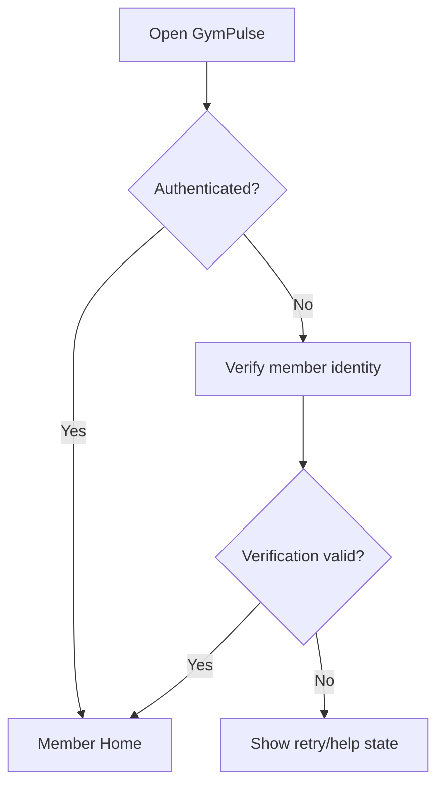

Member Home should prioritize:

1. current membership state,
2. exact expiry date,
3. weekly attendance goal,
4. primary check-in action,
5. renewal action when relevant,
6. next service / add-on action when applicable.

## 4. QR check-in flow

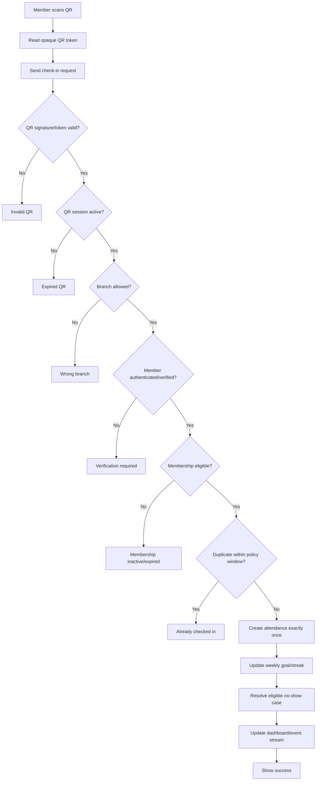

### Successful result

Return:

- attendance ID,
- check-in time,
- branch,
- current weekly goal/streak value,
- optional contextual message.

### Required errors

- invalid QR,
- expired QR,
- branch mismatch,
- inactive membership,
- expired membership,
- duplicate scan,
- authentication required,
- temporary server/network failure.

### Retry behavior

If the client resends the same request after a timeout, the server should return the existing successful attendance result rather than create another attendance record.

## 5. Assisted check-in flow

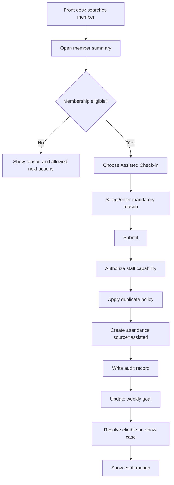

Example reasons:

- member phone unavailable,
- QR camera issue,
- accessibility assistance,
- front-desk operational exception.

The reason list should be configurable later, but free-form context may be allowed with audit safeguards.

## 6. Attendance correction flow

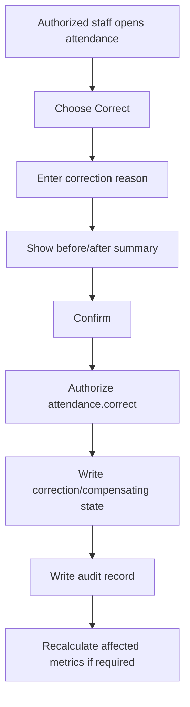

Normal UI must not silently delete historical attendance.

## 7. Daily no-show scan

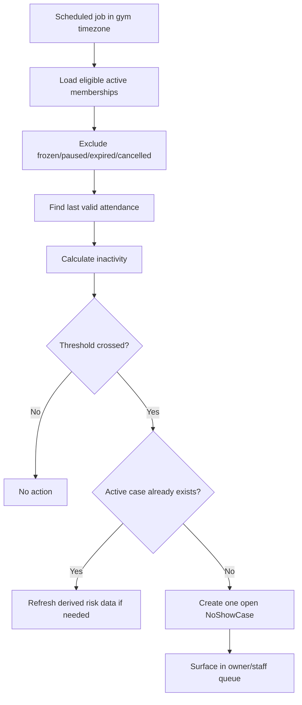

The automation must be safe to rerun without duplicate active cases.

## 8. Owner no-show follow-up flow

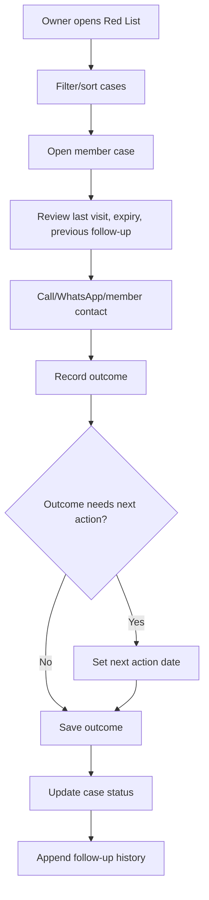

Initial outcomes:

- Will return,
- Injured,
- Travelling,
- Timing issue,
- Unhappy,
- No response,
- Cancelled.

## 9. Return-after-follow-up flow

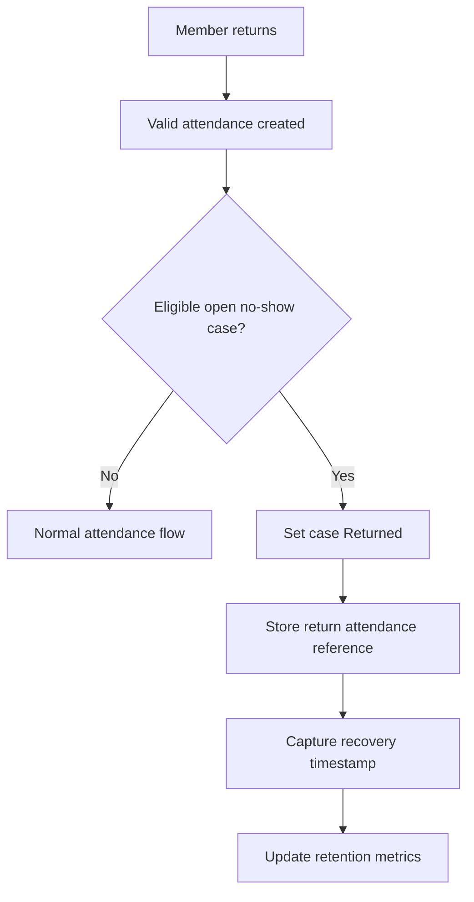

Case history remains available after resolution.

## 10. Approved pause during no-show case

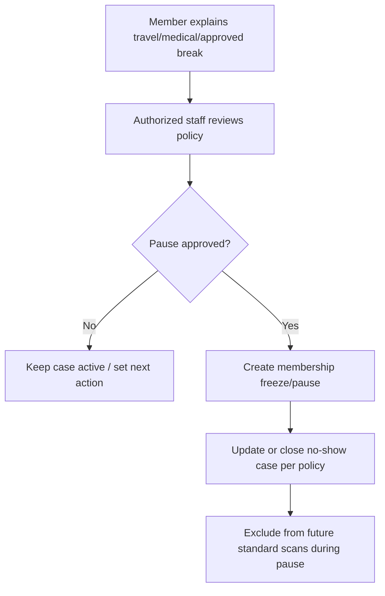

The exact relationship between a pause and membership expiry is a gym policy decision.

## 11. Renewal reminder flow

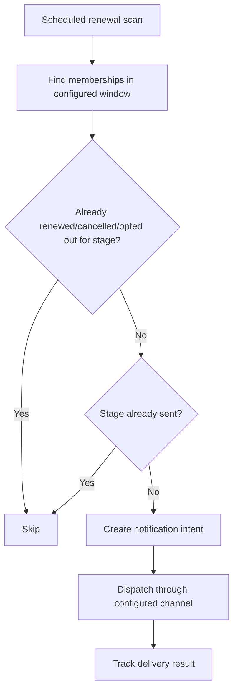

Reminder stages may include 14, 7, 3, 0 days and an approved post-expiry service follow-up.

## 12. Member renewal purchase flow

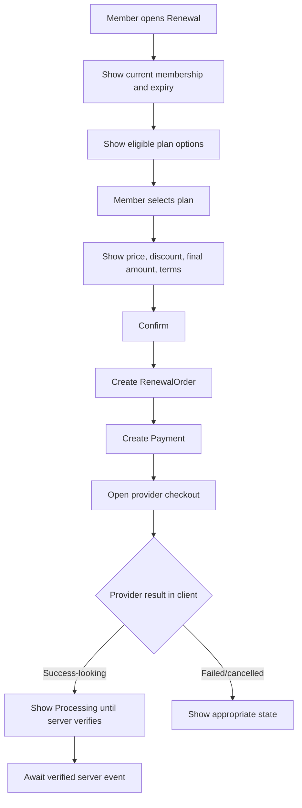

Client success alone must never extend the membership.

## 13. Verified payment flow

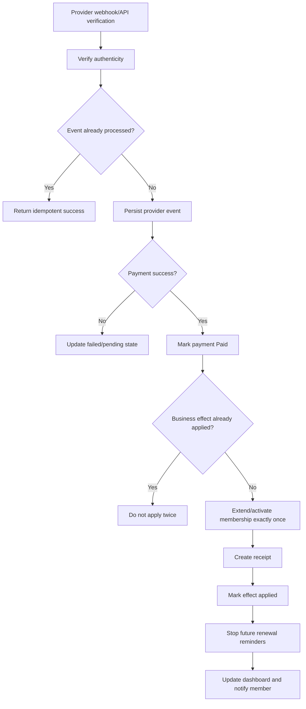

## 14. Failed payment recovery flow

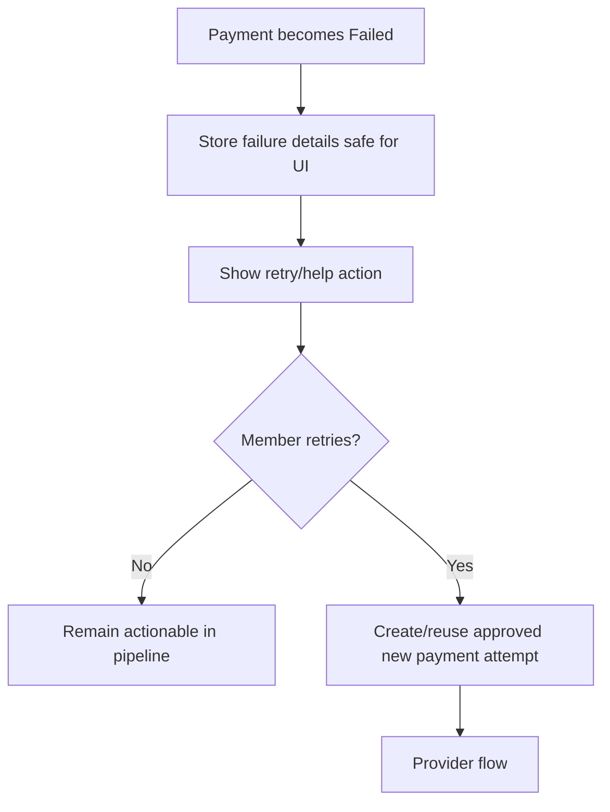

A failed payment is not equivalent to no response and should remain a distinct owner action state.

## 15. Refund/reversal flow

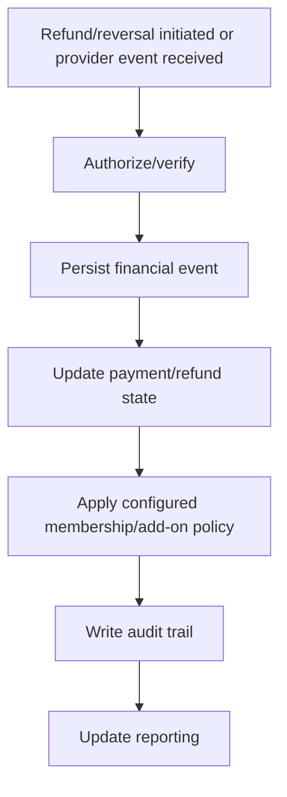

Whether a refund changes membership access immediately is a business policy that must be defined, not assumed.

## 16. Add-on purchase flow

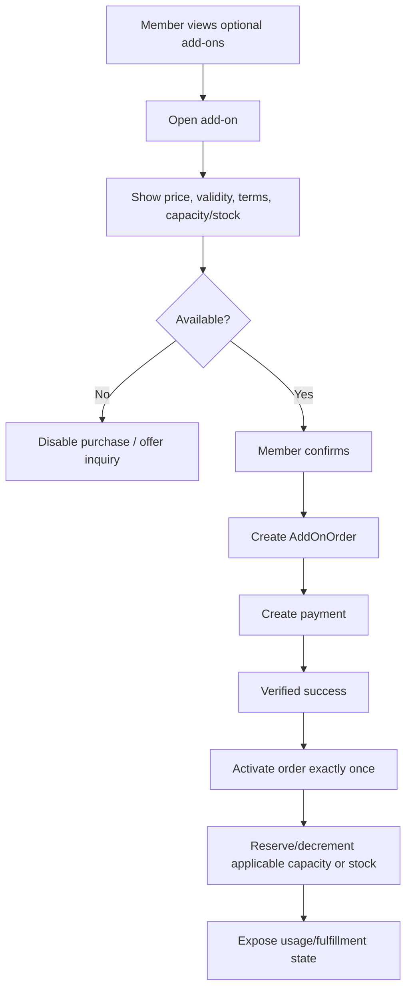

Add-ons must never be pre-selected.

## 17. PT usage flow

Applicable when PT sessions are enabled.

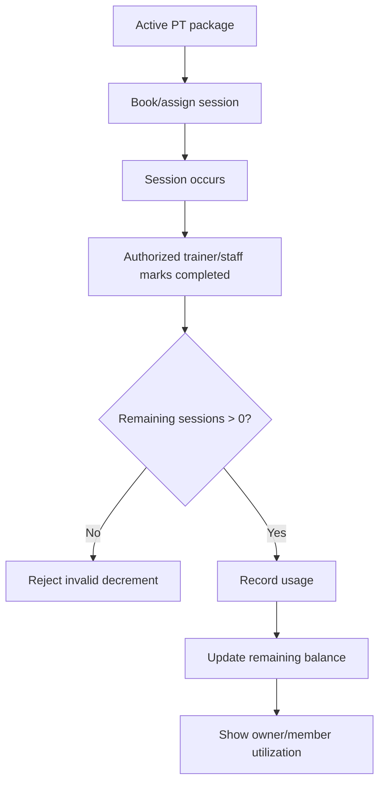

No workflow may produce a negative session balance.

## 18. Owner daily dashboard flow

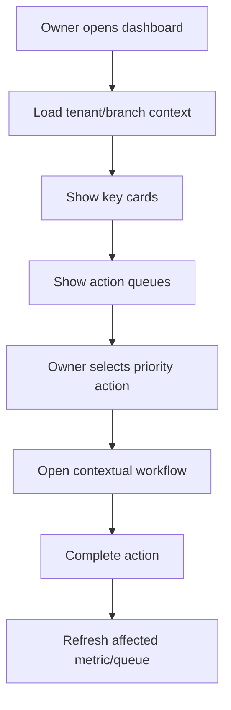

Priority queues:

1. follow-ups due,
2. new no-show cases,
3. renewals due,
4. failed/pending payment exceptions,
5. add-on fulfillment alerts,
6. data-quality issues.

## 19. Member import flow

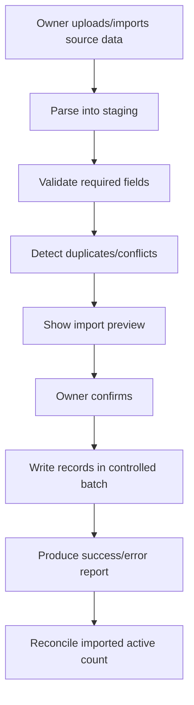

Import should not silently guess missing expiry or membership states.

## 20. Notification preference flow

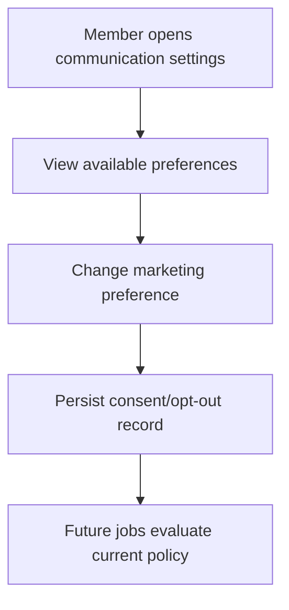

Transactional communication behavior must remain policy-aware and separate from marketing consent.

## 21. Daily owner summary automation

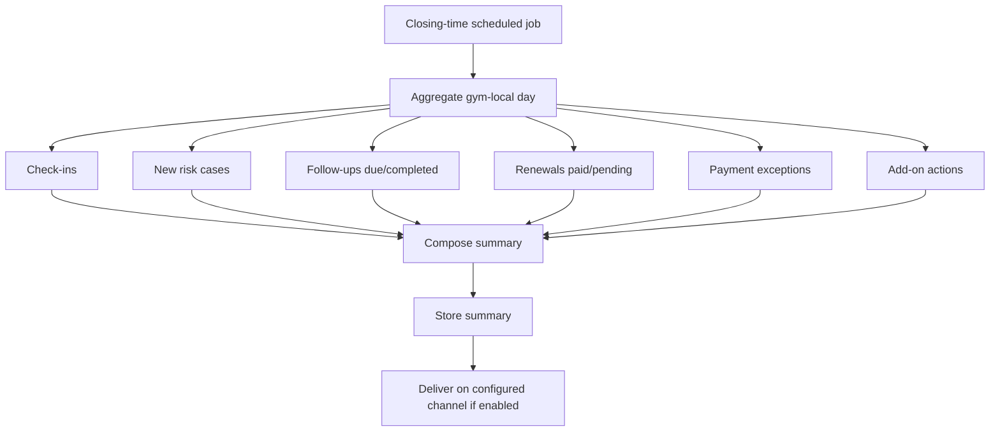

## 22. Error recovery principles

### Network timeout after mutation

Client retries with same idempotency key or request identifier. Server returns existing result if effect already completed.

### Background job retry

Jobs use deterministic business keys and upsert/unique constraints rather than relying only on in-memory locks.

### Provider webhook replay

Provider event ID and business-effect ledger prevent duplicate state transitions.

### Stale client state

Server rejects invalid state transition and returns current canonical resource state.

## 23. Flow acceptance checklist

A user flow is complete only when design and implementation include:

- entry state,
- loading state,
- success state,
- empty state where relevant,
- validation error,
- authorization error,
- business-rule rejection,
- network retry behavior,
- duplicate/replay behavior for mutations,
- audit behavior for sensitive staff actions.
