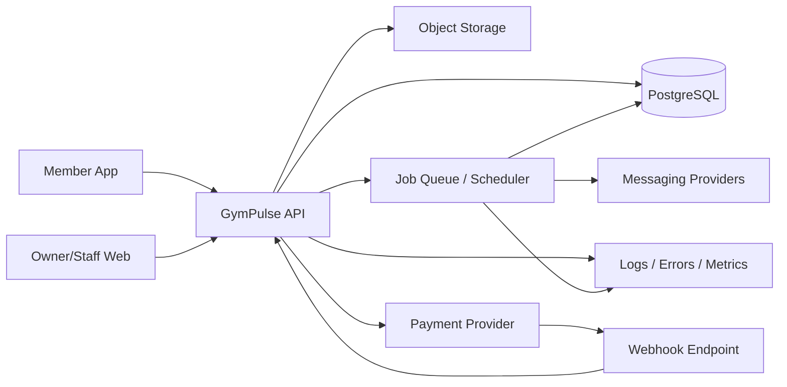

# GymPulse System Architecture

## 1. Purpose

Define the recommended technical architecture for GymPulse Phase 1 while keeping a clean path toward multi-tenant SaaS, mobile apps, multi-branch operations, and later AI features.

This document contains GymPulse architecture decisions, not claims from the source blueprint.

## 2. Architecture goals

The architecture must optimize for:

1. tenant isolation,
2. correct business state transitions,
3. idempotent attendance and payment workflows,
4. fast iteration during pilot,
5. shared TypeScript domain contracts,
6. operational observability,
7. ability to add mobile apps without duplicating business rules,
8. minimal infrastructure complexity before product-market evidence.

## 3. Recommended stack

Recommended baseline:

```text
Monorepo: Turborepo
Language: TypeScript
Owner/Staff Web: Next.js
Member Mobile: Expo / React Native
API: TypeScript service layer exposed through HTTP
Database: PostgreSQL
Managed backend option: Supabase for PostgreSQL/Auth/Storage where appropriate
Background jobs: durable job runner / queue abstraction
Cache / ephemeral coordination: Redis only when justified
Payments: provider abstraction, initial provider selected after pilot-owner confirmation
Messaging: provider abstraction for WhatsApp/SMS/email/push
Object storage: S3-compatible or managed storage
Analytics: product-event and operational-event pipeline
Error monitoring: centralized error reporting
```

No exact framework version is fixed by this document. Versions should be pinned during repository scaffold and maintained through normal dependency policy.

## 4. High-level topology



## 5. Monorepo structure

Recommended initial structure:

```text
apps/
  web/                # owner/staff web and optionally member web
  member-mobile/      # Expo member app
  api/                # API/runtime if deployed separately

packages/
  auth/               # auth helpers and authorization policies
  database/           # schema, migrations, generated types, repositories
  domain/             # domain services, state machines, business rules
  contracts/          # API schemas and shared DTOs
  validation/         # shared input validation
  payments/           # payment provider abstraction
  notifications/      # messaging abstraction/templates
  jobs/               # job definitions and idempotency helpers
  analytics/          # event names and tracking helpers
  audit/              # audit logging helpers
  ui/                 # shared web UI primitives where useful
  config/             # typed config/env handling
  observability/      # logging/error instrumentation

docs/
  ...
```

The final scaffold may combine `api/` with Next.js server routes initially if deployment simplicity is materially better. Business logic must still live outside UI route handlers so it can be moved without rewriting core rules.

## 6. Architectural boundaries

### Presentation layer

Responsibilities:

- screens,
- navigation,
- form state,
- local interaction,
- request orchestration,
- display formatting.

Must not own:

- payment truth,
- tenant authorization,
- membership eligibility,
- no-show business rules,
- final state transitions.

### API / application layer

Responsibilities:

- authenticate principal,
- resolve tenant scope,
- validate input,
- enforce permissions,
- call domain services,
- manage transactions,
- return stable contracts.

### Domain layer

Responsibilities:

- membership eligibility,
- attendance policy,
- no-show policy,
- renewal policy,
- payment effect handling,
- add-on activation,
- notification decision logic,
- state transitions.

### Data layer

Responsibilities:

- persistent records,
- constraints,
- indexes,
- transaction support,
- tenant-scoped repositories,
- database-level defense in depth.

### Integration layer

Responsibilities:

- payment provider,
- messaging provider,
- storage provider,
- analytics provider,
- future biometric integrations.

Provider-specific payloads should be translated into internal canonical events at the integration boundary.

## 7. Request lifecycle

Recommended protected request flow:

```text
HTTP request
  -> request ID / correlation ID
  -> authentication
  -> tenant + branch scope resolution
  -> input validation
  -> named permission check
  -> domain service
  -> database transaction
  -> audit/event emission
  -> response DTO
```

## 8. Authentication architecture

The authentication provider is an implementation choice. Requirements:

- secure session/token handling,
- revocation support,
- member identity mapping,
- staff user identity mapping,
- tenant-safe role lookup,
- ability to support mobile and web clients.

Recommended separation:

```text
AuthIdentity
  -> User
      -> RoleAssignment

AuthIdentity
  -> MemberAuthLink
      -> Member
```

Do not use a mobile number alone as authorization proof without a verification mechanism.

## 9. Authorization architecture

Use capability-based authorization.

Example:

```ts
requirePermission(principal, "attendance.checkin.assisted", scope)
```

Authorization order:

1. authenticate,
2. resolve assignments,
3. resolve requested resource scope,
4. check permission,
5. load/mutate resource within scope.

Avoid distributed role checks like:

```ts
if (user.role === "owner") { ... }
```

across controllers and screens.

## 10. Tenant isolation architecture

### Application-level isolation

Every repository query must receive tenant context.

Example conceptual interface:

```ts
type TenantContext = {
  organizationId: string;
  gymId: string;
  branchIds: string[];
};
```

### Database-level defense

Where Supabase/PostgreSQL RLS is used, row-level policies should reinforce tenant boundaries.

RLS must not be treated as the only business authorization system because permissions can be more nuanced than tenant equality.

### Object storage isolation

Object paths should be scoped:

```text
organizations/{organizationId}/gyms/{gymId}/...
```

Signed URLs should be short-lived for protected content.

## 11. Database architecture

PostgreSQL is the system of record.

Core rules:

- use UUID/ULID-style opaque identifiers,
- store timestamps in UTC,
- store gym timezone separately,
- use integer minor units for money where possible,
- use explicit status values,
- preserve immutable provider event references,
- use database constraints for uniqueness and valid relationships,
- use partial unique constraints for active-case uniqueness where appropriate.

Detailed schema: `06-database-schema.md`.

## 12. Money representation

Avoid floating-point currency math.

Recommended model:

```text
amount_minor: integer/bigint
currency: ISO-style code, e.g. INR
```

Example:

`₹1,299.00 -> 129900 paise`

All discounts, totals, refunds, and reconciliation should use the same representation.

## 13. Time and timezone model

Store event timestamps in UTC.

Store:

- `gym.timezone`,
- UTC timestamps for events,
- local business date only where it is a real domain concept.

Examples of gym-local logic:

- today's dashboard,
- daily no-show scan,
- reminder timing,
- weekly attendance target,
- owner closing summary.

Do not derive gym-local days using server machine timezone.

## 14. Attendance architecture

Attendance creation should run through one domain command regardless of entry source.

Conceptual command:

```ts
type CheckInCommand = {
  memberId: string;
  branchId: string;
  source: "qr" | "assisted";
  qrSessionId?: string;
  staffActorId?: string;
  reason?: string;
  idempotencyKey: string;
};
```

Domain service validates:

- tenant,
- membership,
- QR when source is QR,
- assisted permission when source is assisted,
- duplicate window,
- idempotency.

Then transactionally:

- create attendance,
- record dedupe/idempotency state,
- update derived weekly goal if persisted,
- emit domain event.

No-show resolution can occur in the same transaction or through a guaranteed event consumer with idempotency. Phase 1 should prefer the simpler consistency model.

## 15. QR token architecture

Avoid a permanent public QR whose screenshot works forever.

Recommended QR contains an opaque signed/session token representing:

- branch,
- issued time,
- expiry,
- random/session identifier.

Do not place member or secret data in the QR.

Token validation should occur on server.

Potential strategies:

- short-lived signed token,
- persisted QR session with random token,
- rotating code backed by server session.

Choose the simplest strategy that prevents indefinite screenshot reuse.

## 16. No-show architecture

Daily job processes each tenant in gym timezone.

Recommended query pattern:

1. eligible memberships,
2. last valid attendance,
3. inactivity threshold,
4. existing active case uniqueness.

Database should enforce one active case per member/rule where possible.

Do not rely only on `if not found then insert` without a uniqueness constraint because concurrent jobs can race.

## 17. Renewal architecture

Separate concepts:

```text
Membership
RenewalOffer / selected plan
RenewalOrder
Payment
PaymentEvent
MembershipEffect
Receipt
```

This prevents a UI selection or provider callback from directly mutating membership in an uncontrolled way.

## 18. Payment architecture

Use a provider adapter.

Conceptual interface:

```ts
interface PaymentProvider {
  createCheckout(input: CreateCheckoutInput): Promise<CheckoutResult>;
  verifyWebhook(input: RawWebhook): Promise<VerifiedProviderEvent>;
  fetchPaymentStatus(reference: string): Promise<ProviderPaymentStatus>;
  refund?(input: RefundInput): Promise<RefundResult>;
}
```

Provider webhooks translate into canonical internal events:

```text
payment.succeeded
payment.failed
payment.refunded
payment.reversed
```

Processing must be idempotent using provider event ID and a business-effect uniqueness mechanism.

## 19. Payment effect ledger

Recommended pattern:

```text
PaymentEvent
  -> Payment state update
  -> PaymentEffect
      type = membership_renewal | addon_activation
      sourcePaymentId
      targetId
      appliedAt
```

A unique constraint on the effective business action prevents duplicate extension.

## 20. Background jobs architecture

Job types:

- daily no-show scan,
- renewal reminder scan,
- owner daily summary,
- notification dispatch,
- payment reconciliation retry,
- data-quality scan,
- future scheduled PT reminders.

Requirements:

- retry-safe,
- explicit tenant context,
- observable status,
- deterministic dedupe keys,
- dead-letter/failure visibility or equivalent.

Do not put critical scheduled logic in an unobservable client cron.

## 21. Notification architecture

Separate decision from delivery.

```text
Business trigger
  -> NotificationIntent
  -> Policy/consent check
  -> provider-specific dispatch
  -> delivery update
```

This allows:

- deduplication,
- channel fallback later,
- provider changes,
- delivery analytics,
- compliance controls.

## 22. Event architecture

Phase 1 does not require a full event-sourcing system.

Use domain events for decoupled side effects where useful:

```text
attendance.created
noshow.case_opened
noshow.member_returned
renewal.order_created
payment.succeeded
payment.failed
addon.activated
notification.sent
```

Critical source-of-truth state remains in relational tables.

## 23. API architecture

Recommended external API style: JSON HTTP endpoints with typed contracts.

Rules:

- version public/external contracts when needed,
- validate request input at boundary,
- stable machine-readable error codes,
- `Idempotency-Key` for relevant mutation endpoints,
- correlation ID in responses/logs,
- pagination for lists,
- server-side filtering.

Detailed contracts: `07-api-contracts.md`.

## 24. Analytics architecture

Operational metrics should be computed from canonical business records.

Product analytics events may be emitted separately for behavior such as:

- screen viewed,
- QR scan initiated,
- renewal offer viewed,
- add-on viewed,
- CTA clicked.

Never use client analytics events as source of truth for collected revenue or valid attendance.

## 25. Audit architecture

Audit record should be generated by shared server helper.

Conceptual fields:

```text
tenant_id
branch_id
actor_type
actor_id
action
resource_type
resource_id
reason
before_summary
after_summary
request_id
created_at
```

Audit payloads must avoid secrets and full raw provider payloads.

## 26. Observability

Minimum production observability:

### Logs

- structured JSON logs,
- request ID,
- tenant ID where safe,
- job ID,
- provider event reference where safe.

### Error monitoring

Capture:

- API exceptions,
- mobile/web crashes,
- job failures,
- webhook processing failures.

### Business diagnostics

Dashboards/queries for:

- failed payment webhook count,
- stuck pending payments,
- notification failures,
- no-show job failures,
- data-quality alerts.

## 27. Configuration and secrets

Use typed environment configuration.

Categories:

- public client config,
- server config,
- database secrets,
- provider secrets,
- webhook secrets,
- encryption/signing secrets.

Secrets must not be committed to the repository or exposed to client bundles.

## 28. Deployment environments

Recommended:

```text
local
preview / pull-request
staging
production
```

Staging should have:

- separate database,
- test/sandbox provider credentials,
- non-production messaging behavior,
- seed data.

Production data must never be copied casually into preview environments.

## 29. CI/CD

Baseline pipeline:

```text
install
  -> lint
  -> typecheck
  -> unit tests
  -> integration tests
  -> build
  -> migration validation
  -> preview/staging deployment
```

Production deployment should require:

- protected branch or release process,
- migration review,
- rollback/forward-fix plan,
- release smoke tests.

## 30. Database migrations

Rules:

- migrations are committed,
- production schema is never changed manually without migration/audit process,
- destructive migrations are staged,
- backfills are retry-safe,
- large data rewrites are separate from request-time migrations.

## 31. Backup and restore

Production plan must include:

- automated database backups,
- object storage protection,
- restore procedure,
- restore test,
- recovery ownership.

Do not call backups complete until restore has been verified.

## 32. Scalability approach

Do not prematurely split Phase 1 into microservices.

Recommended evolution:

### Stage A

Modular monolith with clear package boundaries.

### Stage B

Separate API/runtime deployment if client/server scaling requires it.

### Stage C

Extract specialized services only when operational evidence justifies it, for example:

- high-volume notification service,
- analytics pipeline,
- integration gateway.

Business boundaries should exist in code before deployment boundaries exist in infrastructure.

## 33. Future AI architecture

AI features are Phase 5 and should consume curated, permission-aware data.

Potential model:

```text
Authorized user query
  -> permission-aware data retrieval
  -> structured business context
  -> AI inference
  -> explainable recommendation
  -> no automatic destructive action without explicit workflow
```

AI must not become the source of truth for membership, attendance, payment, or medical facts.

## 34. Initial architecture decisions

### Accepted recommendations

- PostgreSQL as canonical relational store.
- TypeScript across primary application code.
- modular monolith before microservices.
- explicit multi-tenant hierarchy from day one.
- payment provider abstraction.
- notification provider abstraction.
- domain services outside UI layer.
- idempotency for critical workflows.
- UTC timestamps plus gym timezone.

### Decisions still open

- exact auth provider,
- whether API deploys separately from Next.js on day one,
- exact job runner,
- Redis requirement,
- payment provider,
- messaging provider,
- analytics provider,
- final hosting platform.

These are tracked in `16-open-decisions.md`.

## 35. Phase 1 architecture quality gate

Implementation is architecturally acceptable only if:

- tenant scope is enforced server-side,
- core business rules are not duplicated across clients,
- payment callbacks are idempotent,
- attendance duplicate protection has a database-safe strategy,
- no-show case uniqueness survives concurrent/retried jobs,
- audit records exist for sensitive mutations,
- jobs are observable and retry-safe,
- provider code is isolated behind adapters,
- production secrets stay server-side,
- staging and production data are separated.
