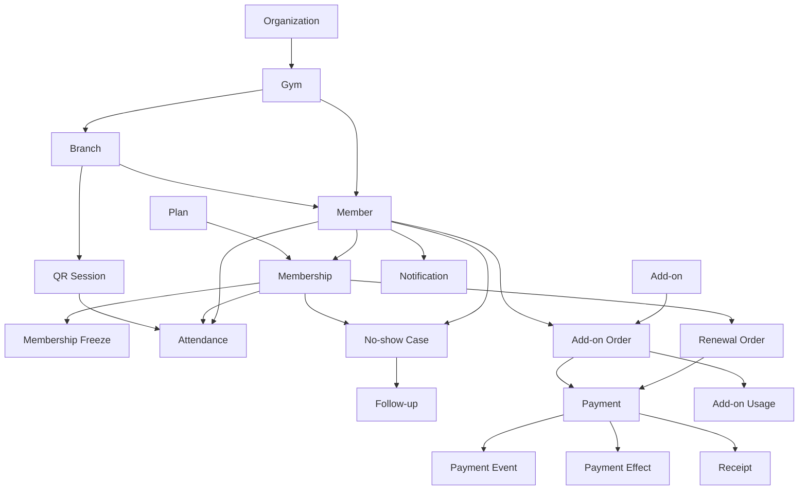

# GymPulse Database Schema

## 1. Purpose

Define the Phase 1 relational data model for GymPulse, including tenant boundaries, major entities, state values, constraints, indexes, and integrity rules.

This is a logical schema. Exact SQL types and migration syntax will be finalized during implementation.

## 2. Database principles

- PostgreSQL is the canonical system of record.
- Every tenant-owned record must be scoped safely.
- Use opaque IDs such as UUIDs.
- Store timestamps in UTC.
- Store gym timezone separately.
- Store money in minor units, not floating point.
- Preserve payment and audit history.
- Use database uniqueness/constraints for idempotency where possible.
- Prefer append-only financial/provider event records.
- Avoid soft-delete by default for financial and audit-critical history.
- Historical commercial snapshots must survive later plan edits.

## 3. Common columns

Most mutable tables should include:

```text
id
created_at
updated_at
```

Tenant-owned operational tables should include direct or safely derivable:

```text
organization_id
gym_id
branch_id (where branch-specific)
```

Use direct tenant columns on high-volume / security-critical records when it simplifies authorization, indexing, and RLS.

## 4. Money fields

Recommended representation:

```text
amount_minor BIGINT
currency VARCHAR(3)
```

For INR:

```text
₹1,000.00 = 100000 minor units
```

Do not use floating-point values for totals, discounts, refunds, or reporting.

## 5. Core enums

Logical enum values are shown below. Implementation may use PostgreSQL enums or constrained text according to migration strategy.

### member_status

```text
active
paused
expired
cancelled
blocked
```

### membership_status

```text
pending
active
frozen
expired
cancelled
```

### attendance_source

```text
qr
assisted
imported
correction
```

`imported` and `correction` should only be enabled if required by migration/correction strategy.

### no_show_case_status

```text
open
contacted
follow_up_due
returned
closed
```

### follow_up_outcome

```text
will_return
injured
travelling
timing_issue
unhappy
no_response
cancelled
```

### payment_status

```text
created
pending
paid
failed
refunded
reversed
```

### add_on_type

```text
personal_training
nutrition
product
```

### add_on_order_status

```text
pending
paid
active
completed
cancelled
refunded
```

### notification_status

```text
scheduled
sent
delivered
failed
clicked
converted
opted_out
```

### notification_category

```text
transactional
service
marketing
```

## 6. Tenant tables

## organizations

Represents the commercial tenant/customer boundary.

Fields:

```text
id
name
slug
status
default_currency
created_at
updated_at
```

Constraints:

- `slug` unique globally if exposed externally,
- status required.

Indexes:

- unique `slug`.

## gyms

Represents a fitness business within an organization.

Fields:

```text
id
organization_id
name
legal_name nullable
phone nullable
email nullable
address_json nullable
timezone
default_currency
status
created_at
updated_at
```

Constraints:

- `organization_id` required,
- `timezone` required.

Indexes:

- `(organization_id, status)`.

## branches

Fields:

```text
id
organization_id
gym_id
name
code nullable
phone nullable
address_json nullable
timezone_override nullable
status
created_at
updated_at
```

Effective timezone:

`branches.timezone_override ?? gyms.timezone`

Constraints:

- gym must belong to organization,
- branch code unique within gym when present.

Indexes:

- `(gym_id, status)`,
- unique `(gym_id, code)` when code is not null.

## 7. Identity and authorization

## users

Operational staff identity linked to authentication provider.

Fields:

```text
id
auth_subject
email nullable
phone nullable
display_name
status
last_login_at nullable
created_at
updated_at
```

Constraints:

- `auth_subject` unique.

Do not treat `users` as a tenant-owned row because one future user may have assignments in multiple scopes. Access is derived through role assignments.

## roles

Fields:

```text
id
key
display_name
description
is_system_role
created_at
```

System role examples:

```text
front_desk
owner
manager
trainer
sales
organization_admin
platform_support
platform_admin
```

## permissions

Fields:

```text
id
key
description
```

Example keys:

```text
member.read
membership.update
attendance.checkin.assisted
attendance.correct
payment.refund
settings.manage
roles.manage
```

## role_permissions

Fields:

```text
role_id
permission_id
```

Primary key:

`(role_id, permission_id)`

## role_assignments

Fields:

```text
id
user_id
role_id
scope_type
organization_id nullable
gym_id nullable
branch_id nullable
starts_at nullable
ends_at nullable
created_by_user_id nullable
created_at
revoked_at nullable
```

Integrity rules:

- scope columns must match `scope_type`,
- assignment must not point to a branch outside selected gym/organization,
- revoked assignment is not active.

Indexes:

- `(user_id, revoked_at)`,
- `(organization_id, user_id)`,
- `(gym_id, user_id)`,
- `(branch_id, user_id)`.

## 8. Members

## members

Canonical member identity.

Fields:

```text
id
organization_id
gym_id
primary_branch_id
external_reference nullable
first_name
last_name nullable
display_name
phone
email nullable
photo_object_key nullable
join_date
status
assigned_trainer_user_id nullable
marketing_consent_status nullable
marketing_consent_at nullable
created_at
updated_at
```

Recommended constraints:

- `phone` uniqueness should be tenant-aware and policy-aware,
- primary branch must belong to member gym,
- assigned trainer must be authorized for the tenant when present.

Potential unique index:

`(gym_id, normalized_phone)`

Do not assume phone uniqueness globally.

Indexes:

- `(gym_id, status)`,
- `(primary_branch_id, status)`,
- `(gym_id, normalized_phone)`,
- text/search index for display name if needed.

## member_auth_links

Maps member to authentication identity if member login is separate from staff `users`.

Fields:

```text
id
member_id
auth_subject
verified_at
created_at
revoked_at nullable
```

Constraints:

- active `auth_subject` unique,
- member may have only allowed active auth links according to policy.

## member_notes

Optional Phase 1 operational notes.

Fields:

```text
id
organization_id
gym_id
member_id
author_user_id
visibility
note
created_at
```

Do not use this table for uncontrolled medical records.

## 9. Plans and memberships

## plans

Fields:

```text
id
organization_id
gym_id
branch_id nullable
name
code nullable
duration_unit
duration_value
base_price_minor
currency
benefits_json nullable
terms_version nullable
is_active
created_at
updated_at
```

Examples:

```text
duration_unit = month
duration_value = 1 | 3 | 6 | 12
```

Constraints:

- base price >= 0,
- duration value > 0,
- currency required.

Indexes:

- `(gym_id, is_active)`,
- `(branch_id, is_active)`.

## memberships

Fields:

```text
id
organization_id
gym_id
branch_id
member_id
plan_id
status
start_at
expires_at
activated_at nullable
cancelled_at nullable
renewal_source nullable
source_membership_id nullable
plan_name_snapshot
price_minor_snapshot
currency
terms_snapshot_json nullable
created_at
updated_at
```

Constraints:

- `expires_at > start_at`,
- price >= 0,
- member/gym/branch relationship valid.

Indexes:

- `(member_id, status)`,
- `(gym_id, status, expires_at)`,
- `(branch_id, status, expires_at)`.

A gym policy is required to decide whether overlapping active memberships are allowed. Default recommendation: prevent accidental overlapping active membership periods for the same member/product context.

## membership_freezes

Fields:

```text
id
organization_id
gym_id
branch_id
membership_id
starts_at
ends_at nullable
reason_code
reason_note nullable
approved_by_user_id
expiry_extension_days nullable
created_at
updated_at
cancelled_at nullable
```

Constraints:

- end after start when present,
- overlapping freeze intervals should be prevented or normalized,
- approval actor required.

Indexes:

- `(membership_id, starts_at, ends_at)`.

## 10. QR and attendance

## qr_sessions

Fields:

```text
id
organization_id
gym_id
branch_id
token_hash
issued_at
expires_at
status
rotation_sequence nullable
created_at
```

Rules:

- store a hash where feasible instead of reusable raw token,
- `expires_at > issued_at`,
- expired/revoked session is invalid.

Indexes:

- unique `token_hash`,
- `(branch_id, expires_at, status)`.

## attendance

Fields:

```text
id
organization_id
gym_id
branch_id
member_id
membership_id
check_in_at
source
qr_session_id nullable
staff_actor_user_id nullable
assisted_reason nullable
idempotency_key nullable
status
created_at
```

Recommended `status` values:

```text
valid
voided
corrected
```

Constraints:

- QR source requires `qr_session_id`,
- assisted source requires `staff_actor_user_id` and reason,
- member and membership tenant context must match.

Indexes:

- `(member_id, check_in_at desc)`,
- `(gym_id, check_in_at desc)`,
- `(branch_id, check_in_at desc)`,
- `(membership_id, check_in_at desc)`.

Idempotency:

- unique `(organization_id, idempotency_key)` when key is present.

Duplicate visit policy may require an additional derived key or transactional lookup based on member/time window.

## attendance_corrections

Fields:

```text
id
organization_id
gym_id
attendance_id
actor_user_id
reason
correction_type
before_json
after_json nullable
created_at
```

This table does not erase original history.

## 11. Weekly goals / streaks

## attendance_goals

Fields:

```text
id
organization_id
gym_id
member_id
rule_type
target_count
week_starts_on
active_from
active_until nullable
created_at
updated_at
```

Phase 1 `rule_type`:

```text
weekly_target
```

Future:

```text
planned_visit_streak
calendar_challenge
```

## attendance_goal_progress

Optional materialized state.

Fields:

```text
id
organization_id
gym_id
member_id
goal_id
period_start
period_end
completed_count
target_count
last_recalculated_at
```

Unique:

`(goal_id, period_start)`

This table can be computed instead of persisted initially if query cost is acceptable.

## 12. No-show and follow-up

## no_show_rules

Fields:

```text
id
organization_id
gym_id
branch_id nullable
name
threshold_days
is_active
effective_from
created_at
updated_at
```

Constraints:

- threshold > 0.

## no_show_cases

Fields:

```text
id
organization_id
gym_id
branch_id
member_id
membership_id
rule_id
threshold_crossed_at
last_valid_attendance_at nullable
status
assignee_user_id nullable
next_action_at nullable
returned_attendance_id nullable
resolved_at nullable
resolution_type nullable
created_at
updated_at
```

Recommended uniqueness:

A partial unique index preventing more than one active case for the same member/rule context, for example active statuses:

```text
open
contacted
follow_up_due
```

Exact SQL should be chosen during implementation.

Indexes:

- `(gym_id, status, next_action_at)`,
- `(branch_id, status, next_action_at)`,
- `(member_id, created_at desc)`,
- `(gym_id, threshold_crossed_at)`.

Absent days should usually be derived from timestamps rather than stored as mutable truth. A cached value may be used for performance if clearly treated as derived.

## follow_ups

Fields:

```text
id
organization_id
gym_id
branch_id
no_show_case_id
member_id
channel
outcome
notes nullable
staff_user_id
contacted_at
next_action_at nullable
created_at
```

Rules:

- append-only history,
- case/member relationship must match,
- staff actor required.

Indexes:

- `(no_show_case_id, contacted_at desc)`,
- `(member_id, contacted_at desc)`,
- `(gym_id, next_action_at)`.

## 13. Renewals

## renewal_orders

Fields:

```text
id
organization_id
gym_id
branch_id
member_id
current_membership_id
selected_plan_id
status
plan_name_snapshot
duration_snapshot_json
base_price_minor
discount_minor
final_amount_minor
currency
terms_snapshot_json nullable
expires_at nullable
created_at
updated_at
```

Suggested status:

```text
created
payment_pending
paid
cancelled
expired
```

Constraints:

- discount >= 0,
- final amount >= 0,
- final amount = validated pricing result, not trusted client input.

Indexes:

- `(member_id, created_at desc)`,
- `(gym_id, status, created_at)`.

## renewal_notification_stages

Optional explicit stage tracking.

Fields:

```text
id
organization_id
gym_id
membership_id
stage_key
scheduled_for
notification_id nullable
status
created_at
updated_at
```

Unique:

`(membership_id, stage_key, renewal_cycle_key)`

Implementation can instead encode this uniqueness directly in `notifications` if simpler.

## 14. Payments

## payments

Fields:

```text
id
organization_id
gym_id
branch_id
member_id
purpose_type
purpose_id
provider
provider_order_reference nullable
provider_payment_reference nullable
method nullable
amount_minor
currency
status
verified_at nullable
failed_at nullable
metadata_json nullable
created_at
updated_at
```

`purpose_type` examples:

```text
renewal
addon
offline_membership
```

Constraints:

- amount >= 0,
- provider references unique per provider where applicable.

Indexes:

- `(gym_id, status, created_at)`,
- `(member_id, created_at desc)`,
- `(provider, provider_payment_reference)`,
- `(purpose_type, purpose_id)`.

## payment_events

Append-only provider/financial event history.

Fields:

```text
id
organization_id
gym_id
payment_id
provider
provider_event_id
event_type
provider_created_at nullable
verified_at
payload_digest nullable
safe_payload_json nullable
processed_at nullable
processing_status
processing_error nullable
created_at
```

Constraints:

- unique `(provider, provider_event_id)`.

Do not store unnecessary sensitive provider payload data.

## payment_effects

Protects business effects from duplicate processing.

Fields:

```text
id
organization_id
gym_id
payment_id
effect_type
target_type
target_id
effect_key
applied_at
created_at
```

Example effect types:

```text
membership_renewal
addon_activation
```

Critical constraint:

- `effect_key` unique.

Example key:

```text
payment:{paymentId}:membership-renewal:{renewalOrderId}
```

## refunds

Fields:

```text
id
organization_id
gym_id
payment_id
provider_refund_reference nullable
amount_minor
currency
status
reason nullable
requested_by_user_id nullable
verified_at nullable
created_at
updated_at
```

Support partial refunds only if product policy explicitly allows them.

## receipts

Fields:

```text
id
organization_id
gym_id
branch_id
member_id
payment_id
receipt_number
amount_minor
currency
issued_at
business_snapshot_json
line_items_json
object_key nullable
created_at
```

Unique:

- `(gym_id, receipt_number)`,
- usually one effective receipt per successful payment purpose unless policy requires otherwise.

## 15. Add-ons

## add_ons

Fields:

```text
id
organization_id
gym_id
branch_id nullable
type
title
description nullable
price_minor
currency
validity_days nullable
session_count nullable
stock_quantity nullable
capacity nullable
terms_json nullable
professional_user_id nullable
is_active
created_at
updated_at
```

Type-specific rules:

### personal_training

- `session_count` usually required,
- `stock_quantity` not applicable.

### nutrition

- validity/service duration may be used,
- professional assignment may be required by business policy.

### product

- stock quantity may be required,
- session count not applicable.

Constraints must be implemented either with validation plus check constraints or normalized subtype tables if complexity grows.

## add_on_orders

Fields:

```text
id
organization_id
gym_id
branch_id
member_id
add_on_id
status
quantity
unit_price_minor
amount_minor
currency
valid_from nullable
valid_until nullable
assigned_user_id nullable
purchased_snapshot_json
created_at
updated_at
```

Indexes:

- `(member_id, created_at desc)`,
- `(gym_id, status, created_at)`,
- `(add_on_id, status)`.

## add_on_usage

For session/service usage.

Fields:

```text
id
organization_id
gym_id
add_on_order_id
member_id
usage_type
quantity_used
performed_by_user_id nullable
occurred_at
notes nullable
created_at
```

Constraint:

Cumulative usage must not exceed purchased entitlement. Enforce through transaction/locking or a safe balance model, not only UI validation.

## inventory_movements

Recommended if product stock is enabled beyond a trivial field.

Fields:

```text
id
organization_id
gym_id
branch_id
add_on_id
movement_type
quantity_delta
reference_type
reference_id
actor_user_id nullable
reason nullable
created_at
```

Stock should be derived/reconciled from movements rather than silently overwriting quantity once inventory becomes meaningful.

## 16. Notifications

## notification_preferences

Fields:

```text
id
organization_id
gym_id
member_id
channel
category
status
source
updated_at
```

Possible status:

```text
allowed
opted_out
unknown
```

Do not infer marketing consent from transactional delivery.

## notifications

Fields:

```text
id
organization_id
gym_id
branch_id nullable
member_id nullable
recipient_user_id nullable
template_key
category
channel
business_object_type nullable
business_object_id nullable
dedupe_key
scheduled_at nullable
sent_at nullable
delivered_at nullable
status
provider_message_reference nullable
failure_code nullable
created_at
updated_at
```

Critical constraint:

- unique `(organization_id, dedupe_key)`.

Indexes:

- `(gym_id, status, scheduled_at)`,
- `(member_id, created_at desc)`,
- `(provider_message_reference)`.

## notification_events

Optional provider event history:

```text
id
notification_id
provider_event_id
status
occurred_at
created_at
```

Unique provider event ID where available.

## 17. Settings

## gym_settings

Fields:

```text
id
organization_id
gym_id
attendance_duplicate_window_minutes
qr_session_duration_seconds
no_show_threshold_days
week_starts_on
weekly_goal_default nullable
renewal_windows_json
post_expiry_followup_enabled
communication_policy_json
receipt_policy_json
created_at
updated_at
```

Settings that materially affect historical interpretation may eventually need versioning/effective dates.

## 18. Audit

## audit_logs

Fields:

```text
id
organization_id
gym_id
branch_id nullable
actor_type
actor_id
action
resource_type
resource_id
reason nullable
before_summary_json nullable
after_summary_json nullable
request_id nullable
ip_metadata nullable
created_at
```

Rules:

- append-only through normal app flow,
- no secrets,
- no raw card/UPI data,
- sensitive fields should be redacted.

Indexes:

- `(gym_id, created_at desc)`,
- `(resource_type, resource_id, created_at desc)`,
- `(actor_id, created_at desc)`.

## 19. Idempotency

## idempotency_keys

Optional shared table if endpoint-level idempotency is centralized.

Fields:

```text
id
organization_id
key
operation
request_hash
response_status
response_body_json nullable
resource_type nullable
resource_id nullable
expires_at
created_at
```

Unique:

`(organization_id, operation, key)`

Payment-provider event idempotency should still use provider event uniqueness directly.

## 20. Data-quality alerts

## data_quality_issues

Fields:

```text
id
organization_id
gym_id
branch_id nullable
issue_type
resource_type
resource_id
severity
status
detected_at
resolved_at nullable
resolved_by_user_id nullable
details_json nullable
created_at
updated_at
```

Possible status:

```text
open
acknowledged
resolved
ignored
```

Examples:

- missing expiry,
- invalid dates,
- payment/provider mismatch,
- negative balance attempt,
- missing correction reason.

## 21. Domain relationships



## 22. Important uniqueness rules

The following must have database-backed protection:

1. provider event processed once,
2. payment business effect applied once,
3. notification business stage deduplicated,
4. endpoint idempotency where supported,
5. one active no-show case per member/rule context,
6. QR token/session identity unique,
7. receipt number unique within gym/required legal scope,
8. staff auth subject unique,
9. member auth subject unique while active.

## 23. Important check constraints

Examples:

- `membership.expires_at > membership.start_at`,
- `freeze.ends_at > freeze.starts_at` when end exists,
- money fields >= 0,
- quantity > 0 for orders,
- session usage quantity > 0,
- no-show threshold > 0,
- QR expiry > issue time,
- discount <= base amount unless approved pricing model permits otherwise.

## 24. Index strategy

Critical Phase 1 access patterns:

### Member search

- gym + normalized phone,
- gym + display name/search vector.

### Attendance

- member + check-in descending,
- branch/gym + check-in date.

### No-show queue

- gym/branch + case status + next action,
- member + case history.

### Renewal pipeline

- gym/branch + membership status + expiry.

### Payments

- gym + status + created date,
- provider reference,
- member + created date.

### Notifications

- status + scheduled time,
- dedupe key,
- member + created date.

Indexes should be verified with query plans once pilot data exists.

## 25. Row-level security guidance

If Supabase/PostgreSQL RLS is enabled:

- tenant tables should require authenticated tenant scope,
- member-facing policies should match authenticated member mapping,
- service/background workers should use controlled service credentials and explicit tenant filters,
- platform-admin/service roles must be isolated from public clients,
- never expose a service-role key to browser/mobile clients.

RLS policy tests are required.

## 26. Deletion policy

### Do not hard-delete through normal product workflows

- payments,
- payment events,
- receipts,
- refunds,
- audit logs,
- follow-ups,
- attendance corrections.

### Prefer status/archive behavior

- plans,
- add-ons,
- users/role assignments,
- members when retention policy requires logical deactivation.

Actual privacy deletion/anonymization policy requires a separate production policy and may need targeted redaction while preserving legally/financially necessary records.

## 27. Import staging

For pilot migration, consider temporary staging tables:

```text
import_batches
import_rows
import_errors
```

This allows:

- validation before commit,
- duplicate detection,
- source row traceability,
- reconciliation.

Do not import directly into canonical tables without validation for non-trivial source files.

## 28. Future schema areas

Deferred tables may include:

- leads,
- trials,
- sales activities,
- classes,
- class bookings,
- trainer availability,
- PT sessions,
- workouts,
- exercises,
- workout logs,
- measurements,
- progress media,
- referrals,
- SaaS subscriptions,
- invoices,
- organization-level analytics snapshots,
- AI conversation / insight records.

These should not be created in Phase 1 merely for speculation unless needed for an accepted roadmap item.

## 29. Migration quality gate

A schema change is acceptable only when:

- tenant scope is understood,
- backfill behavior is defined,
- constraints will not fail existing valid records unexpectedly,
- rollback/forward-fix strategy is known,
- indexes support known access patterns,
- business state transitions remain valid,
- audit/payment history is not destroyed.

## 30. Phase 1 schema acceptance

Before feature implementation is considered production-ready:

- tenant-owned tables cannot be queried cross-tenant through normal credentials,
- duplicate provider events are rejected/idempotent,
- duplicate payment effects are impossible at database level,
- duplicate active no-show cases are protected,
- negative entitlement/stock effects are prevented transactionally,
- payment amount uses integer minor units,
- membership date rules are constrained,
- all critical queues have supporting indexes,
- financial and audit history is retained.
