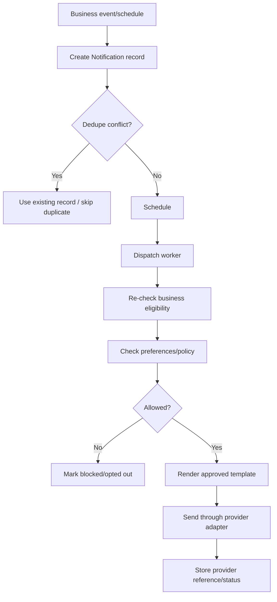

# GymPulse Notifications and WhatsApp

## 1. Purpose

Define how GymPulse creates, deduplicates, sends, tracks, and governs member/staff communications in Phase 1.

The source blueprint emphasizes short, useful, permission-aware service communication. GymPulse keeps that principle and adds a provider-neutral delivery architecture.

## 2. Communication principles

- Service communication should be useful and concise.
- Marketing and transactional/service communication must be separate concepts.
- A background-job retry must not send the same business message twice.
- Current business state is rechecked before dispatch.
- Provider delivery state must not be invented.
- Opt-out/preference state must be enforced by backend workers.
- Templates should avoid medical, transformation, or income guarantees.
- Messaging should support operational workflows, not become spam automation.

## 3. Initial channels

Potential channels:

```text
WhatsApp
SMS
Email
Push notification
In-app notification
```

Phase 1 can launch with a smaller subset. The provider/channel choice is an open decision.

The source context strongly favors phone/WhatsApp for Indian gym operations, so architecture should make WhatsApp easy to enable without hard-coding the entire product around a single provider.

## 4. Communication categories

### Transactional

Direct result of a member transaction/account action.

Examples:

- payment success,
- payment failure,
- receipt availability.

### Service / operational

Supports an existing membership/service relationship.

Examples:

- no-show care message,
- membership renewal reminder,
- PT session reminder.

### Marketing

Promotional communication not required to deliver an existing service.

Examples:

- promotional campaign,
- discount campaign,
- new-product promotion.

Marketing must have separate consent/policy treatment.

## 5. Notification data model

Recommended separation:

```text
NotificationIntent / Notification
NotificationPreference
NotificationEvent
TemplateDefinition
```

A notification record should contain:

- tenant/gym,
- recipient,
- template key,
- category,
- channel,
- related business object,
- dedupe key,
- scheduled time,
- status,
- provider message reference,
- failure code,
- timestamps.

## 6. Template keys

Phase 1:

```text
member.no_show_care
member.renewal_reminder_14d
member.renewal_reminder_7d
member.renewal_reminder_3d
member.renewal_expiry_day
member.renewal_post_expiry
payment.success
payment.failed
owner.daily_summary
```

When PT scheduling is enabled:

```text
pt.session_reminder
```

Template keys are business identifiers and must remain stable even if provider template IDs change.

## 7. Template variables

Examples:

### no-show care

```text
{{name}}
{{last_visit}}
{{support_link}}
```

### renewal reminder

```text
{{name}}
{{plan}}
{{expiry_date}}
{{renewal_link}}
```

### payment success

```text
{{amount}}
{{new_expiry}}
{{receipt_link}}
```

### payment failed

```text
{{payment_link}}
{{support_link}}
```

### weekly goal/streak

If enabled as a notification later:

```text
{{name}}
{{completed}}
{{target}}
{{next_visit}}
```

### PT reminder

```text
{{date}}
{{time}}
{{trainer}}
{{session_link}}
```

## 8. Example source-aligned copy

These are product examples and should be localized/refined during UX/content design.

### No-show care

```text
Hi {{name}}, your last gym check-in was on {{last_visit}}. Is everything okay? If you need help with timing, a pause, or trainer support, reply here: {{support_link}}
```

### Renewal reminder

```text
Hi {{name}}, your {{plan}} membership expires on {{expiry_date}}. Review renewal options and the final payable amount here: {{renewal_link}}
```

### Payment success

```text
Payment of {{amount}} received. Your membership is active until {{new_expiry}}. Receipt: {{receipt_link}}
```

### Payment failed

```text
Your payment was not completed. If an amount appears debited, wait for the provider status update before retrying. Retry: {{payment_link}} | Help: {{support_link}}
```

Copy must not claim success until canonical server state is paid.

## 9. Dedupe strategy

Every scheduled business notification gets a deterministic dedupe key.

Examples:

### Renewal

```text
renewal:{membershipId}:{expiryAt}:{stage}:{channel}
```

### No-show care

```text
noshow:{caseId}:initial-care:{channel}
```

### Owner daily summary

```text
owner-summary:{gymId}:{businessDate}:{recipient}:{channel}
```

Database uniqueness protects against duplicate job execution.

## 10. Dispatch pipeline



## 11. Pre-send business recheck

Before a renewal message is sent, verify:

- membership still matches target cycle,
- renewal not already completed,
- member not cancelled,
- stage still relevant.

Before a no-show message is sent, verify:

- case is still active,
- member has not already returned,
- member has not entered approved pause state.

A queued message must not be sent simply because it was valid when queued hours earlier.

## 12. Preference model

Suggested statuses:

```text
allowed
opted_out
unknown
```

Store preference by:

- member,
- channel,
- category.

Example:

```text
member A
WhatsApp
marketing
opted_out
```

This must not automatically disable required/allowed transactional messages unless the applicable policy says so.

## 13. Consent history

For marketing consent, preserve:

- status,
- source,
- timestamp,
- optional policy/template version.

Avoid a single mutable boolean with no history if consent becomes commercially important.

## 14. WhatsApp provider abstraction

Conceptual adapter:

```ts
interface MessagingProvider {
  sendTemplate(input: SendTemplateInput): Promise<SendResult>;
  verifyWebhook(input: RawWebhook): Promise<VerifiedMessageEvent>;
}
```

Canonical result:

```ts
type SendResult = {
  providerMessageId: string;
  accepted: boolean;
  providerStatus?: string;
};
```

Provider-specific template IDs should live in configuration, not business code.

## 15. Template mapping

Example configuration:

```text
business key: member.renewal_reminder_7d
channel: whatsapp
provider template id: gympulse_renewal_7d_v1
language: en_IN / hi / configured locale
```

If provider approval changes, update mapping without changing domain event names.

## 16. Delivery states

Internal product states:

```text
Scheduled
Sent
Delivered
Failed
Clicked
Converted
OptedOut
```

Not every provider supplies every state.

Rules:

- `Sent` may mean accepted by provider,
- `Delivered` only if provider confirms delivery,
- `Clicked` only if tracked link/event exists,
- `Converted` derives from business outcome, not provider message state.

## 17. Conversion attribution

Examples:

### Renewal conversion

Member receives reminder and later completes renewal within an attribution window.

The metric should define:

- reminder stage,
- attribution window,
- whether multiple messages share credit,
- whether conversion means verified payment only.

### No-show conversion

A care message/contact is followed by valid return attendance.

Operational follow-up history should remain primary for staff-contact attribution.

## 18. Failure handling

### Transient

- timeout,
- rate limit,
- provider unavailable.

Action:

- retry with bounded backoff.

### Permanent

- invalid recipient,
- template rejected,
- recipient blocked channel,
- consent/policy block.

Action:

- mark failed/blocked,
- do not retry blindly,
- surface operator diagnostic where useful.

## 19. Ambiguous timeout

A provider request may time out after the provider accepted it.

Avoid immediate resend when duplicate risk is high.

Preferred recovery:

- use provider idempotency if available,
- query provider state if supported,
- retain message reference when available,
- retry only with provider-safe semantics.

## 20. Link security

Links in messages should avoid long-lived sensitive tokens.

Recommended:

- short-lived authenticated app deep links,
- opaque signed links with expiry where unauthenticated action is allowed,
- server re-validation of member/business state.

Never place raw internal secrets in URLs.

## 21. Member support link

Support action may open:

- WhatsApp conversation,
- in-app support page,
- phone action,
- web support route.

The exact channel is tenant configuration.

## 22. Renewal notification policy

Default sample sequence:

```text
D-14 optional soft heads-up
D-7 main reminder
D-3 reminder
D-0 expiry day
D+3 optional service follow-up
```

Rules:

- one message per stage,
- stop after verified renewal,
- failed payment may get a distinct payment-recovery message,
- avoid stacking marketing content into transactional renewal reminders.

## 23. No-show communication policy

No-show message tone should be supportive, not shaming.

Avoid:

- guilt-based streak loss threats,
- false urgency,
- medical claims,
- guaranteed transformation promises.

Use:

- last visit context,
- support options,
- contact/reply action.

## 24. Owner daily summary

Can be in-app first and optionally delivered through configured messaging.

Contents:

- today's check-ins,
- new risk cases,
- completed/due follow-ups,
- renewals paid/pending,
- failed payments,
- add-on action items.

Owner summary should not contain excessive sensitive member detail on insecure channels.

## 25. Rate limits and frequency controls

Recommended safeguards:

- per-recipient daily cap by category,
- campaign-level rate limit,
- provider rate-limit handling,
- prevent identical template flood from retry loop.

Exact limits are tenant/provider decisions.

## 26. Quiet hours

Support gym-local quiet hours if messaging scope requires it.

Emergency-style delivery is not part of GymPulse Phase 1.

Messages scheduled inside quiet hours should be delayed according to policy, not silently dropped.

## 27. Localization

Templates should support:

- English,
- Hinglish where approved,
- Hindi or other languages later.

Store template business key separately from localized copy.

Do not concatenate translated fragments dynamically when full-template localization is safer.

## 28. Logging and privacy

Application logs should not contain full message bodies by default if they include personal data.

Log:

- notification ID,
- template key,
- provider reference,
- status,
- safe failure code.

Redact:

- full personal message payload when unnecessary,
- secrets,
- provider authentication data.

## 29. Admin/provider diagnostics

Owner/support should be able to distinguish:

- scheduled but not sent,
- provider accepted,
- delivered where confirmed,
- failed,
- blocked by preference,
- business condition no longer valid.

## 30. Marketing campaigns

Marketing campaign builder is out of Phase 1.

If added later, it requires separate:

- audience builder,
- consent enforcement,
- frequency caps,
- campaign analytics,
- unsubscribe/opt-out handling,
- provider template approval process.

Do not overload transactional automation code into a marketing engine prematurely.

## 31. Testing matrix

Mandatory:

- successful send,
- duplicate job does not duplicate message,
- member renews after queue but before send -> reminder skipped,
- member returns before no-show message -> message skipped,
- marketing opt-out blocks marketing,
- transactional/service policy behaves as configured,
- provider timeout,
- provider permanent rejection,
- delivery webhook duplicate,
- invalid delivery webhook,
- quiet-hours delay if enabled,
- tenant A cannot send using Tenant B template/config,
- message link expires/revalidates correctly.

## 32. Release gate

Messaging is pilot-ready when:

- templates are owner-approved,
- category is assigned correctly,
- opt-out/preference is enforced server-side,
- dedupe is database-backed,
- stale reminders are rechecked before dispatch,
- provider failures are visible,
- provider credentials are server-only,
- no medical/revenue guarantees exist in templates,
- test recipients are used before live-member activation.
