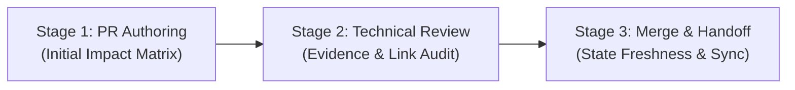

# GymPulse — Documentation Impact Assessment & State Freshness Guide

## Document Control

| Field | Value |
| --- | --- |
| Document maturity | **Draft / Proposed** |
| Scope | Repository-wide documentation impact assessment, decision synchronization, and handoff state freshness |
| Tracking issue | [Issue #37 — Slice B (P1)](https://github.com/im-tnyx/gym-pulse/issues/37) |
| Precedence authority | [Root `AGENTS.md`](../../AGENTS.md), [canonical documentation hierarchy](../README.md), [decision register](../00-overview/assumptions.md), [ADR governance](../adr/README.md) |
| Implementation permission | **Proposed guidance only.** Defines a recommended documentation impact assessment framework for review under Issue #37 (P1). Does not establish a binding or blocking merge gate on its own until formally adopted by the repository owner. Existing governance (AGENTS.md, ADR governance in docs/adr/README.md, canonical precedence in docs/README.md) remains the authoritative standard. |

---

## 1. Purpose & Core Principles

This guide establishes an evidence-based, disciplined procedure for evaluating which documentation assets require updates when preparing, reviewing, or merging pull requests in GymPulse.

### Core Governance Principles

1. **Anti-Churn Negative Invariant:** Do not mechanically edit canonical documents, decision registers, ADRs, or root entry points on every merge. Documentation updates must be grounded in verified, material changes to requirements, architecture, or workflow.
2. **Authority Hierarchy Preserved:** Canonical structured documents (`docs/`) and accepted ADRs outrank working notes (`.ai/`), legacy flat documents, and pull request descriptions. Noncanonical handoff notes cannot establish or alter architectural, security, or product decisions.
3. **Four-Way Change Classification:** Every change must be accurately categorized:
   - **Factual Change:** A verified reality change (e.g., test suite results, tool command syntax, file rename, merged commit SHA). Documented directly with evidence.
   - **Proposed Decision:** A concrete technical or architectural proposal submitted for review. It must remain explicitly labeled `Proposed` or `Draft`. It has no implementation authority.
   - **Accepted Decision:** An authorized human decision owner has formally approved the proposal and recorded explicit approval evidence. Only then may the canonical decision register (`docs/00-overview/assumptions.md`) be updated to `DECIDED` and the ADR to `Accepted`.
   - **Unrelated / Scoped Implementation Change:** A bounded change that does not touch canonical business logic, system boundaries, security invariants, or design foundations (e.g., whitespace corrections, developer workflow documentation). The PR's documentation impact assessment records `N/A` with a concise rationale, and unaffected canonical files remain completely untouched.
4. **Fail-Closed on Incomplete Evidence:** If evidence is missing, test runs did not complete, or ownership is unassigned, document the gap explicitly (`INCOMPLETE_EVIDENCE` or `UNRESOLVED_OWNERSHIP`). Never invent approval to clear a review checklist.

---

## 2. Assessment Lifecycle & Roles

Documentation impact is evaluated across three distinct lifecycle gates:

> [!NOTE]
> Until formally adopted by owner decision, this lifecycle serves as contributor guidance and review practice; it does not alter repository rulesets or introduce automated merge blocks.

### Roles and Responsibilities

- **PR Author / Contributor / AI Agent:**
  - Performs the initial assessment during PR branch preparation.
  - Formulates explicit dispositions (`Update`, `N/A`, or `Follow-up Required`) for every category in the impact matrix.
  - Prepares in-scope document edits within the authorized task boundary.
- **Designated Technical Reviewer (Codex bot / Peer Reviewer):**
  - Audits the PR diff against the impact matrix claims.
  - Verifies that proposed updates are supported by actual evidence and valid links.
  - Confirms that `N/A` rationales are truthful and not avoidance of required updates.
- **Repository Owner (@im-tnyx):**
  - Retains exclusive merge authorization authority for each PR.
  - Validates governance dispositions, unresolved follow-ups, and security boundaries.

---

## 3. How to Assess Canonical Document Impact

Before editing any documentation, evaluate the following criteria:

1. **Does the change alter canonical behavior or requirements?**
   - If yes: Identify the specific structured document in `docs/01-product/`, `docs/02-architecture/`, etc.
   - If no: Mark `N/A` for canonical structured docs.
2. **Does the change decide an open architectural or technical question?**
   - If yes: Verify whether an authorized decision owner has recorded approval evidence. If approved, record `Update` for `docs/00-overview/assumptions.md` and `docs/adr/`. If unapproved, keep register status as `OPEN` or `PROPOSED` and mark `Follow-up Required`.
   - If no: Mark `N/A` for the decision register and ADRs.
3. **Does the change alter brand identity, design tokens, or framework selection?**
   - If yes: Check whether the change is an authorized design decision or a proposal. Root `DESIGN.md` remains a discoverable pointer to `docs/03-applications/design-system.md` and must not be edited unless its pointer target is invalid.
   - If no: Mark `N/A` for `DESIGN.md` and design system.
4. **Does the change materially alter the active agent working context or next action?**
   - If yes: Update `.ai/current-state.md` with concise, dated, source-linked observations and one next bounded action.
   - If no: Keep `.ai/current-state.md` unchanged. Never mutate `.ai/archive/`.

### Rationale Standard for `N/A`

A bare `N/A` is strictly prohibited. Every non-applicable disposition must include a concise, one-sentence rationale explaining why the document category is unaffected by the PR.

### Tracking Separately Governed Follow-Ups

When a PR exposes a necessary canonical update that exceeds the PR's authorized boundary (for example, a code change revealing that an ADR should be authored, or a design experiment requiring brand token approval):
1. Mark the category disposition as **`Follow-up Required`**.
2. Specify the tracking issue URL, designated owner, and dependency.
3. Do not apply the out-of-scope update in the current PR.

---

## 4. Documentation Impact Decision Matrix

Use this matrix during PR preparation, review, and merge handoff. Categories are structured to prevent ambiguous or overlapping dispositions:

| Document Category | Target Path / Scope | Update Trigger | When N/A is Appropriate | Follow-up / Governance Rule |
| :--- | :--- | :--- | :--- | :--- |
| **Canonical Architecture & Product Specs** | `docs/01-product/`, `docs/02-architecture/`, `docs/04-screen-specifications.md`, `docs/05`–`12`, `docs/14`–`15` | Verified, authorized change to product requirements, C4 architecture models, domain models, or operational specs. | PR affects developer workflow, tooling, internal navigation, or noncanonical notes only. | Changes to requirements or architecture must link to approved issue/ADR. |
| **Canonical Decision Register** | `docs/00-overview/assumptions.md` | Formal transition of a canonical decision ID (`D-ARCH-xxx`, `D-SEC-xxx`, etc.) to `DECIDED`, `DEFERRED`, or `PROPOSED`. | PR implements within existing decided parameters or is a docs/tooling task with no governance status changes. | Requires explicit human owner decision evidence. Never promote `PROPOSED` to `DECIDED` without recorded owner approval. |
| **Architectural Decision Records** | `docs/adr/README.md` & `docs/adr/ADR-xxxx-*.md` | Creation of a new ADR, revision of an existing ADR, or formal acceptance/supersession. | PR does not introduce, alter, or decide an architectural decision record. | Acceptance requires an authorized owner, explicit approval evidence, and synchronized register update. Never reuse numbers or reserve speculative ADR numbers. |
| **Engineering Governance & Workflow Guides** | `docs/13-engineering/` | Development workflows, review procedures, documentation impact guidance, or testing policies. | PR does not alter engineering governance or contributor assessment guides. | Changes must be reviewable governance proposals and not bypass repo rulesets. |
| **Design System & UI Proposals** | `docs/03-applications/` | Reviewed change to Phase 1 token roles, accessibility states, screen layouts, or operational density. | Unrelated backend, infrastructure, git workflow, or docs-integrity changes. | Remains `Draft / Proposed`; does not approve brand tokens or client frameworks without human review. |
| **Root Pointer Documents** | `DESIGN.md`, root `README.md` | Discoverable link target moves or canonical design entry point structure changes. | Routine UI, styling, component, or design proposal changes that do not break the root pointer. | Must remain a thin entry point; never add brand tokens, palettes, or framework selections directly to `DESIGN.md`. |
| **Contributor & Agent Workflow Guidance** | `AGENTS.md`, `.ai/workflow.md`, `.github/` | Contributor safety guides, agent workflows, git post-merge guides, or copilot instructions. | PR does not alter contributor guidelines or developer workflow instructions. | Must preserve authority hierarchy and align with current adopted rules. |
| **Active Handoff State** | `.ai/current-state.md` | Material, verified change to active context, blocker, baseline SHA, or next bounded action; or confirmed staleness. | Routine, small PR merge where active context, blocker, and immediate next action remain identical. | Update only with dated, verified observations; keep concise; do not duplicate decision registers. |
| **Historical Archives** | `.ai/archive/` | **Never during routine work.** | All PRs and merges. Archive is strictly immutable. | Historical audit preservation rules govern. Never rewrite or append historical archive files. |

---

## 5. Worked Examples

### Example 1: Documentation Navigation / Entry-Point PR
* **Scenario:** A PR updates `AGENTS.md` and `.ai/workflow.md` to add cross-links to a new contributor guide.
* **Matrix Dispositions:**
  - *Canonical Architecture & Product Specs:* `N/A` — Contributor navigation does not alter product or system architecture specs.
  - *Canonical Decision Register (`assumptions.md`):* `N/A` — No architectural or technical decisions were proposed or decided.
  - *Architectural Decision Records (`docs/adr/`):* `N/A` — No ADRs were created, modified, or transitioned.
  - *Engineering Governance & Workflow Guides (`docs/13-engineering/`):* `N/A` — No engineering governance guides modified.
  - *Design System & UI Proposals (`docs/03-applications/`):* `N/A` — UI specifications and token architectures are untouched.
  - *Root Pointer Documents (`DESIGN.md`, `README.md`):* `N/A` — Design reference entry point remains accurate and unchanged.
  - *Contributor & Agent Workflow Guidance (`AGENTS.md`, `.ai/`):* `Update` — Added discoverable navigation links in `AGENTS.md` and `.ai/workflow.md`.
  - *Active Handoff (`.ai/current-state.md`):* `N/A` — Adding discoverable cross-links does not materially alter active task ownership, blockers, baseline SHA, or the immediate next bounded action (per materiality filter).
  - *Historical Archives (`.ai/archive/`):* `N/A` — Immutable historical audit record; no routine changes permitted.

### Example 2: Proposed ADR Revision or Creation PR (No Acceptance Authorization)
* **Scenario:** A contributor submits a review-only revision to existing proposed architecture record `docs/adr/ADR-0015-background-jobs-scheduler.md` to refine worker concurrency tradeoffs, or drafts a new proposal using a symbolic placeholder (`ADR-XXXX`) until an unused number is allocated from live inventory (noting that `ADR-0001` through `ADR-0026` already exist in the repository backlog).
* **Matrix Dispositions:**
  - *Canonical Architecture & Product Specs:* `N/A` — Proposed ADR content is candidate architecture; canonical structured architecture remains unchanged until an ADR is formally accepted.
  - *Canonical Decision Register (`assumptions.md`):* `Follow-up Required` — Proposing or revising a draft ADR does not automatically authorize editing the canonical decision register or altering decision statuses. Adding or updating a corresponding `PROPOSED` entry in `assumptions.md` requires separate governance authorization by the designated decision owner. Decision status remains unapproved until explicit owner decision evidence is recorded.
  - *Architectural Decision Records (`docs/adr/`):* `Update` — For revisions: update `docs/adr/ADR-0015-background-jobs-scheduler.md`, retaining header `Status: Proposed`. For new proposals: allocate the next strictly unused sequential number per `docs/adr/README.md` (never reusing or speculatively reserving numbers, and never reallocating existing drafted IDs `ADR-0001` through `ADR-0026`).
  - *Engineering Governance & Workflow Guides (`docs/13-engineering/`):* `N/A` — Engineering workflow governance documents are unaffected.
  - *Design System & UI Proposals (`docs/03-applications/`):* `N/A` — Background scheduler architecture is unrelated to UI specifications.
  - *Root Pointer Documents (`DESIGN.md`, `README.md`):* `N/A` — Root entry points remain intact.
  - *Contributor & Agent Workflow Guidance:* `N/A` — Contributor guidelines are unaffected.
  - *Active Handoff (`.ai/current-state.md`):* `N/A` — Revising an ADR within an ongoing assigned task does not alter overall task ownership, baseline SHA, or next bounded action until a formal handoff or review milestone is reached (per materiality filter).
  - *Historical Archives (`.ai/archive/`):* `N/A` — Immutable historical audit record; no routine changes permitted.

### Example 3: UI / Design System Draft Proposal PR
* **Scenario:** A PR refines semantic token roles and high-density staff table layouts in `docs/03-applications/design-system.md`.
* **Matrix Dispositions:**
  - *Canonical Architecture & Product Specs:* `N/A` — Product requirements in `docs/01-product/` remain governing authority.
  - *Canonical Decision Register (`assumptions.md`):* `N/A` — No canonical architectural decision IDs are altered.
  - *Architectural Decision Records (`docs/adr/`):* `N/A` — No ADRs are affected.
  - *Engineering Governance & Workflow Guides (`docs/13-engineering/`):* `N/A` — Unrelated to engineering governance guides.
  - *Design System & UI Proposals (`docs/03-applications/`):* `Update` — Content updated within Phase 1 scope in `docs/03-applications/design-system.md`; remains labeled `Draft / Proposed`.
  - *Root Pointer Documents (`DESIGN.md`, `README.md`):* `N/A` — Root pointer in `DESIGN.md` to `docs/03-applications/design-system.md` is valid and unchanged.
  - *Contributor & Agent Workflow Guidance:* `N/A` — Contributor workflows untouched.
  - *Active Handoff (`.ai/current-state.md`):* `N/A` — Refinements to draft UI tokens within an ongoing design slice do not alter task ownership, baseline SHA, or introduce new blockers (per materiality filter).
  - *Historical Archives (`.ai/archive/`):* `N/A` — Immutable.

### Example 4: Merged PR #38 (Post-Merge Git Synchronization Guide)
* **Scenario:** PR #38 introduced `.github/POST_MERGE_SYNC.md` and minimal pointers in `AGENTS.md`, `.ai/workflow.md`, and `.github/copilot-instructions.md`.
* **Matrix Dispositions:**
  - *Canonical Architecture & Product Specs:* `N/A` — Git worktree synchronization is developer operational workflow, not system/product architecture.
  - *Canonical Decision Register (`assumptions.md`):* `N/A` — No technology stack or architectural governance assumptions were modified.
  - *Architectural Decision Records (`docs/adr/`):* `N/A` — No ADRs introduced or changed.
  - *Engineering Governance & Workflow Guides (`docs/13-engineering/`):* `N/A` — PR #38 introduced developer git tooling/instructions, not a `docs/13` engineering governance policy.
  - *Design System & UI Proposals (`docs/03-applications/`):* `N/A` — Unrelated to design specifications.
  - *Root Pointer Documents (`DESIGN.md`, `README.md`):* `N/A` — Root entry points unchanged.
  - *Contributor & Agent Workflow Guidance (`.github/`, `AGENTS.md`, `.ai/`):* `Update` — Created `.github/POST_MERGE_SYNC.md` and added discoverable navigation pointers.
  - *Active Handoff (`.ai/current-state.md`):* `Update` — Material post-merge handoff: verified merge of PR #38, recorded baseline `636688c`, updated Issue #6 / #22 / #37 statuses, and advanced next bounded action to Issue #37 Slice B (P1).
  - *Historical Archives (`.ai/archive/`):* `N/A` — Historical archive preserved without modification.

---

## 6. `.ai/current-state.md` Freshness Policy

To prevent context drift and stale working state:

1. **Materiality Filter:** Refresh `.ai/current-state.md` only when a verified, material change occurs to:
   - Audited baseline `main` HEAD SHA.
   - Closed or newly opened tracking issues / PRs.
   - Verified active blockers or ownership assignments.
   - The exact next bounded action.
2. **Conciseness Constraint:** Do not paste full diffs, historical logs, decision tables, or long transcripts into `.ai/current-state.md`. Point to primary canonical sources and GitHub issues.
3. **Traceability:** Every updated assertion must include an exact verification timestamp (YYYY-MM-DD) and a clickable relative link or GitHub URL.
4. **Historical Continuity:** Do not delete older historical observations unless replacing them with verified current state; clearly distinguish historical audit baselines from current live observations.
5. **Strict Archive Boundary:** Never edit files in `.ai/archive/`. Archives are immutable snapshots preserved byte-for-byte.
