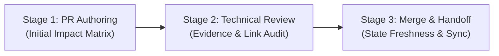

# GymPulse — Documentation Impact Assessment & State Freshness Policy

## Document Control

| Field | Value |
| --- | --- |
| Document maturity | **Draft / Proposed** |
| Scope | Repository-wide documentation impact assessment, decision synchronization, and handoff state freshness |
| Tracking issue | [Issue #37 — Slice B (P1)](https://github.com/im-tnyx/gym-pulse/issues/37) |
| Precedence authority | [Root `AGENTS.md`](../../AGENTS.md), [canonical documentation hierarchy](../README.md), [decision register](../00-overview/assumptions.md), [ADR governance](../adr/README.md) |
| Implementation permission | **Proposal only.** Establishes reviewable governance guidance; does not authorize production changes, automated ruleset modification, or ADR acceptance. |

---

## 1. Purpose & Core Principles

This policy establishes an evidence-based, disciplined process for determining which documentation assets require updates when preparing, reviewing, or merging pull requests in GymPulse.

### Core Governance Principles

1. **Anti-Churn Negative Invariant:** Do not mechanically edit canonical documents, decision registers, ADRs, or root entry points on every merge. Documentation updates must be grounded in verified, material changes to requirements, architecture, or workflow.
2. **Authority Hierarchy Preserved:** Canonical structured documents (`docs/`) and accepted ADRs outrank working notes (`.ai/`), legacy flat documents, and pull request descriptions. Noncanonical handoff notes cannot establish or alter architectural, security, or product decisions.
3. **Four-Way Change Classification:** Every change must be accurately categorized:
   - **Factual Change:** A verified reality change (e.g., test suite results, tool command syntax, file rename, merged commit SHA). Documented directly with evidence.
   - **Proposed Decision:** A concrete technical or architectural proposal submitted for review. It must remain explicitly labeled `Proposed` or `Draft`. It has no implementation authority.
   - **Accepted Decision:** An authorized human decision owner has formally approved the proposal and recorded explicit approval evidence. Only then may the canonical decision register (`docs/00-overview/assumptions.md`) be updated to `DECIDED` and the ADR to `Accepted`.
   - **Unrelated / Scoped Implementation Change:** A bounded change that does not touch canonical business logic, system boundaries, security invariants, or design foundations (e.g., whitespace corrections, developer workflow documentation). Canonical documents must record `N/A`.
4. **Fail-Closed on Incomplete Evidence:** If evidence is missing, test runs did not complete, or ownership is unassigned, document the gap explicitly (`INCOMPLETE_EVIDENCE` or `UNRESOLVED_OWNERSHIP`). Never invent approval to clear a review checklist.

---

## 2. Assessment Lifecycle & Roles

Documentation impact is evaluated across three distinct lifecycle gates:

### Roles and Responsibilities

- **PR Author / Contributor / AI Agent:**
  - Performs the initial assessment during PR branch preparation.
  - Formulates explicit dispositions (`Update`, `N/A`, or `Follow-up Required`) for every category in the impact matrix.
  - Prepares in-scope document edits within the authorized task boundary.
- **Designated Technical Reviewer (Codex bot / Peer Reviewer):**
  - Audits the PR diff against the impact matrix claims.
  - Verifies that proposed updates are supported by actual evidence and valid links.
  - Confirms that `N/A` rationales are truthful and not avoidance of required updates.
- **Repository Owner (@im-tnyx):**
  - Retains exclusive merge authorization authority for each PR.
  - Validates governance dispositions, unresolved follow-ups, and security boundaries.

---

## 3. How to Assess Canonical Document Impact

Before editing any documentation, evaluate the following criteria:

1. **Does the change alter canonical behavior or requirements?**
   - If yes: Identify the specific structured document in `docs/01-product/`, `docs/02-architecture/`, etc.
   - If no: Mark `N/A` for canonical structured docs.
2. **Does the change decide an open architectural or technical question?**
   - If yes: Verify whether an authorized decision owner has recorded approval evidence. If approved, record `Update` for `docs/00-overview/assumptions.md` and `docs/adr/`. If unapproved, keep register status as `OPEN` or `PROPOSED` and mark `Follow-up Required`.
   - If no: Mark `N/A` for the decision register and ADRs.
3. **Does the change alter brand identity, design tokens, or framework selection?**
   - If yes: Check whether the change is an authorized design decision or a proposal. Root `DESIGN.md` remains a discoverable pointer to `docs/03-applications/design-system.md` and must not be edited unless its pointer target is invalid.
   - If no: Mark `N/A` for `DESIGN.md` and design system.
4. **Does the change materially alter the active agent working context or next action?**
   - If yes: Update `.ai/current-state.md` with concise, dated, source-linked observations and one next bounded action.
   - If no: Keep `.ai/current-state.md` unchanged. Never mutate `.ai/archive/`.

### Rationale Standard for `N/A`

A bare `N/A` is strictly prohibited. Every non-applicable disposition must include a concise, one-sentence rationale explaining why the document category is unaffected by the PR.

### Tracking Separately Governed Follow-Ups

When a PR exposes a necessary canonical update that exceeds the PR's authorized boundary (for example, a code change revealing that an ADR should be authored, or a design experiment requiring brand token approval):
1. Mark the category disposition as **`Follow-up Required`**.
2. Specify the tracking issue URL, designated owner, and dependency.
3. Do not apply the out-of-scope update in the current PR.

---

## 4. Documentation Impact Decision Matrix

Use this matrix during PR preparation, review, and merge handoff:

| Document / Category | Target Path | Update Trigger | When N/A is Appropriate | Follow-up / Governance Rule |
| :--- | :--- | :--- | :--- | :--- |
| **Canonical Structured Docs** | `docs/00-overview/` through `docs/15-roadmap/` | Verified, authorized change to requirements, domain behavior, C4 models, data models, or operational specs. | PR affects developer workflow, tooling, internal navigation, or noncanonical notes only. | Changes to requirements or architecture must link to approved issue/ADR. |
| **Decision Register** | `docs/00-overview/assumptions.md` | Formal transition of a canonical decision ID (`D-ARCH-xxx`, `D-SEC-xxx`, etc.) to `DECIDED`, `DEFERRED`, or `PROPOSED`. | PR implements within existing decided parameters or is a docs/tooling task with no governance status changes. | Requires explicit human owner decision evidence. Never promote `PROPOSED` to `DECIDED` without recorded owner approval. |
| **ADR Documents & Index** | `docs/adr/README.md` & `docs/adr/ADR-xxxx-*.md` | Creation of a new ADR, revision of an existing ADR, or formal acceptance/supersession. | PR does not introduce, alter, or decide an architectural decision record. | Acceptance requires an authorized owner, explicit approval evidence, and synchronized register update. |
| **Root Design Pointer** | `DESIGN.md` | Discoverable link target moves or canonical design entry point structure changes. | Routine UI, styling, component, or design proposal changes that do not break the root pointer. | Must remain a thin entry point; never add brand tokens, palettes, or framework selections directly to `DESIGN.md`. |
| **Design System Proposal** | `docs/03-applications/design-system.md` | Reviewed change to Phase 1 token roles, accessibility states, screen layouts, or operational density. | Unrelated backend, infrastructure, git workflow, or docs-integrity changes. | Remains `Draft / Proposed`; does not approve brand tokens or client frameworks without human review. |
| **Active Handoff State** | `.ai/current-state.md` | Material, verified change to active context, blocker, baseline SHA, or next bounded action; or confirmed staleness. | Routine, small PR merge where active context, blocker, and immediate next action remain identical. | Update only with dated, verified observations; keep concise; do not duplicate decision registers. |
| **Handoff Archive** | `.ai/archive/` | **Never during routine work.** | All PRs and merges. Archive is strictly immutable. | Historical audit preservation rules govern. Never rewrite or append historical archive files. |

---

## 5. Worked Examples

### Example 1: Documentation Navigation / Entry-Point PR
* **Scenario:** A PR updates `AGENTS.md` and `.ai/workflow.md` to add links to a new contributor guide.
* **Matrix Dispositions:**
  - *Canonical Structured Docs:* `N/A` — Contributor navigation does not alter product or system architecture specs.
  - *Decision Register (`assumptions.md`):* `N/A` — No architectural or technical decisions were proposed or decided.
  - *ADR Documents (`docs/adr/`):* `N/A` — No ADRs were created, modified, or transitioned.
  - *Root `DESIGN.md`:* `N/A` — Design reference entry point remains accurate and unchanged.
  - *Design System Proposal (`design-system.md`):* `N/A` — UI specifications and token architectures are untouched.
  - *Active Handoff (`.ai/current-state.md`):* `Update` — Record the merged navigation guidance, updated baseline SHA, and the next bounded task.
  - *Handoff Archive (`.ai/archive/`):* `N/A` — Immutable historical audit record; no routine changes permitted.

### Example 2: Proposed ADR PR (No Acceptance Authorization)
* **Scenario:** A contributor submits a draft ADR proposing an Owner/Staff web framework (`ADR-0012`).
* **Matrix Dispositions:**
  - *Canonical Structured Docs:* `N/A` — Proposed ADR is not yet accepted; canonical architecture remains unchanged.
  - *Decision Register (`assumptions.md`):* `Update` — Register status remains `PROPOSED` with link to draft ADR PR; candidate direction noted, not decided.
  - *ADR Documents (`docs/adr/`):* `Update` — Add `ADR-0012` with header `Status: Proposed`; add entry to `docs/adr/README.md`.
  - *Root `DESIGN.md`:* `N/A` — Framework selection is proposed, not approved; `DESIGN.md` pointers remain intact.
  - *Design System Proposal (`design-system.md`):* `Follow-up Required` — Link `ADR-0012` dependency as Proposed; component framework binding deferred until ADR acceptance.
  - *Active Handoff (`.ai/current-state.md`):* `Update` — Note proposal under review, recording that independent human review and owner acceptance remain outstanding.
  - *Handoff Archive (`.ai/archive/`):* `N/A` — Immutable.

### Example 3: UI / Design System Draft Proposal PR
* **Scenario:** A PR refines semantic token roles and high-density staff table layouts in `docs/03-applications/design-system.md`.
* **Matrix Dispositions:**
  - *Canonical Structured Docs:* `N/A` — Requirements in `docs/01-product/` remain the governing authority.
  - *Decision Register (`assumptions.md`):* `N/A` — No canonical architectural decision IDs are altered.
  - *ADR Documents (`docs/adr/`):* `N/A` — No ADRs are affected.
  - *Root `DESIGN.md`:* `N/A` — Root pointer to `docs/03-applications/design-system.md` is valid and unchanged.
  - *Design System Proposal (`design-system.md`):* `Update` — Content updated within Phase 1 scope; remains labeled `Draft / Proposed`.
  - *Active Handoff (`.ai/current-state.md`):* `Update` — Note updated design draft and next review step.
  - *Handoff Archive (`.ai/archive/`):* `N/A` — Immutable.

### Example 4: Merged PR #38 (Post-Merge Git Synchronization Guide)
* **Scenario:** PR #38 introduced `.github/POST_MERGE_SYNC.md` and minimal pointers in `AGENTS.md`, `.ai/workflow.md`, and `.github/copilot-instructions.md`.
* **Matrix Dispositions:**
  - *Canonical Structured Docs:* `N/A` — Git worktree synchronization is developer operational workflow, not system/product architecture.
  - *Decision Register (`assumptions.md`):* `N/A` — No technology stack or architectural governance assumptions were modified.
  - *ADR Documents (`docs/adr/`):* `N/A` — No ADRs introduced or changed.
  - *Root `DESIGN.md`:* `N/A` — Unrelated to UI/design reference; pointer intact.
  - *Design System Proposal (`design-system.md`):* `N/A` — Unrelated to design specifications.
  - *Active Handoff (`.ai/current-state.md`):* `Update` — Verified merge of PR #38, recorded baseline `636688c`, updated Issue #6 / #22 / #37 statuses, and advanced next bounded action to Issue #37 Slice B (P1).
  - *Handoff Archive (`.ai/archive/`):* `N/A` — Historical archive preserved without modification.

---

## 6. `.ai/current-state.md` Freshness Policy

To prevent context drift and stale working state:

1. **Materiality Filter:** Refresh `.ai/current-state.md` only when a verified, material change occurs to:
   - Audited baseline `main` HEAD SHA.
   - Closed or newly opened tracking issues / PRs.
   - Verified active blockers or ownership assignments.
   - The exact next bounded action.
2. **Concisensess Constraint:** Do not paste full diffs, historical logs, decision tables, or long transcripts into `.ai/current-state.md`. Point to primary canonical sources and GitHub issues.
3. **Traceability:** Every updated assertion must include an exact verification timestamp (YYYY-MM-DD) and a clickable relative link or GitHub URL.
4. **Historical Continuity:** Do not delete older historical observations unless replacing them with verified current state; clearly distinguish historical audit baselines from current live observations.
5. **Strict Archive Boundary:** Never edit files in `.ai/archive/`. Archives are immutable snapshots preserved byte-for-byte.
