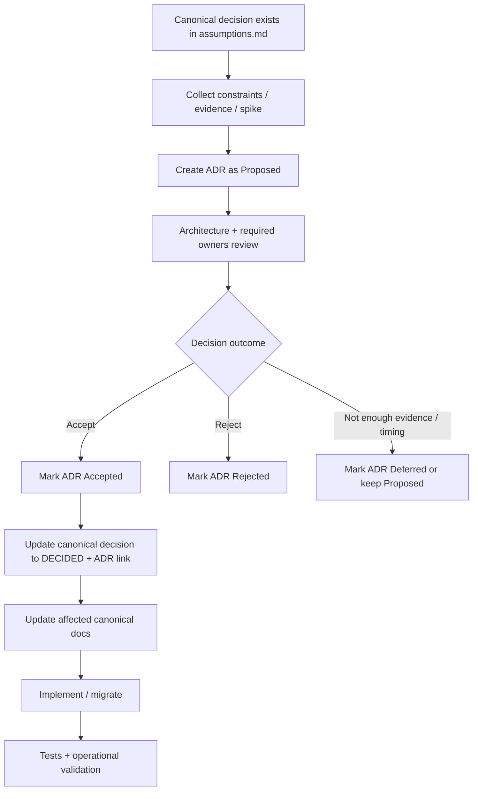

# GymPulse Architecture Decision Records

## Document Control

- Status: `Active governance`
- Scope: architecture, infrastructure, platform, security, data, provider, and engineering decisions with material long-term impact
- Canonical decision register: `../00-overview/assumptions.md`
- Architecture inputs: `../02-architecture/`
- Audience: Architecture, Engineering Leads, Backend, Frontend, Mobile, DevOps, Security, QA, Product/Business decision owners

## 1. Purpose

This directory is the canonical Architecture Decision Record (ADR) store for GymPulse.

An ADR explains **one material technical decision**, the problem that required the decision, the evidence and constraints considered, the alternatives evaluated, the selected outcome when accepted, and the consequences of that outcome.

ADRs exist so future contributors can answer questions such as:

- Why is GymPulse using this architecture or technology?
- Which alternatives were considered?
- Which requirements and risks drove the choice?
- Is the choice actually accepted, or only proposed?
- What would have to change to revisit the decision?
- Which documents and implementation areas depend on the decision?

An ADR is not a generic design document, vendor note, or implementation checklist. Detailed architecture belongs under `docs/02-architecture/`; detailed domain/API/database/security behavior belongs in their canonical folders. ADRs record the decisions that shape those designs.

## 2. Source-of-Truth Relationship

GymPulse separates **decision tracking** from **decision rationale**.

### Canonical decision register

`../00-overview/assumptions.md` owns:

- canonical decision IDs such as `D-ARCH-001`,
- current decision priority,
- current decision status,
- decision owner where known,
- unresolved questions and assumptions,
- legacy decision-ID migration aliases.

### ADR store

`docs/adr/` owns:

- decision context,
- decision drivers,
- evidence,
- alternatives,
- tradeoffs,
- final accepted/rejected/deferred rationale,
- consequences,
- supersession history.

### Consistency rule

The decision register and ADR MUST agree.

Example after an accepted architecture decision:

```text
assumptions.md
D-ARCH-001 | DECIDED | Use monorepo | ADR-0001

ADR-0001-use-monorepo.md
Status: Accepted
Decision ID: D-ARCH-001
```

If they disagree, the inconsistency is a documentation defect and must be corrected before downstream documentation treats the decision as final.

Legacy numeric IDs from `../16-open-decisions.md` MUST NOT be used in new ADRs.

## 3. When an ADR Is Required

Create an ADR when a decision is expensive to reverse, affects multiple parts of the system, changes security/operational risk, or materially constrains future implementation.

Typical ADR-required decisions include:

- repository/monorepo strategy,
- primary database technology,
- API architecture or deployment topology,
- authentication/session architecture,
- managed backend/platform responsibilities,
- background-job infrastructure,
- tenant isolation/RLS strategy,
- hosting/deployment platform,
- major provider selections such as payments or messaging,
- canonical membership-renewal representation,
- event/broker architecture if introduced,
- cache/Redis as a required architectural dependency,
- AI model/runtime architecture when AI enters active scope,
- a major change that supersedes an existing accepted architecture decision.

An ADR is usually **not** required for:

- routine library upgrades that do not change architecture,
- small refactors,
- local code organization within an already accepted boundary,
- reversible UI-component choices,
- low-impact development tooling where no meaningful architectural constraint exists.

When uncertain, prefer an ADR if the decision will otherwise require future engineers to ask, "Why was this done this way?"

## 4. Decision Status Model

ADR status is independent from implementation progress.

| Status | Meaning |
|---|---|
| `Proposed` | A concrete option is documented for review but is not yet authoritative. |
| `Accepted` | The authorized decision owner/review process explicitly approved the decision. |
| `Rejected` | The proposed option was explicitly declined. The underlying canonical decision may remain `OPEN` if no replacement was selected. |
| `Deferred` | Decision intentionally postponed; temporary behavior must remain an explicit assumption if implementation proceeds. |
| `Superseded` | A later Accepted ADR replaced this decision. Historical rationale remains preserved. |
| `Deprecated` | The decision is no longer applicable because the capability/architecture was retired, without necessarily being replaced by another decision. |

### Status rules

- New ADRs normally begin as `Proposed`.
- A file being merged does **not** make it `Accepted`.
- Code being implemented does **not** make it `Accepted`.
- A prototype using a technology does **not** make it `Accepted`.
- `Accepted` requires explicit approval evidence recorded in the ADR.
- `Superseded` ADRs are not deleted.
- Rejected proposals remain in the repository when their rationale is useful for avoiding repeated evaluation.

## 5. Numbering and Filename Convention

ADRs use monotonically increasing four-digit numbers.

```text
ADR-0001-use-monorepo.md
ADR-0002-database-selection.md
ADR-0003-api-architecture.md
```

Rules:

1. Never reuse an ADR number.
2. Number indicates creation order, not priority.
3. Filename uses lower-case kebab-case after the numeric prefix.
4. Title uses the same ADR number.
5. A renamed ADR keeps its number.
6. A superseding decision receives a new ADR number.
7. Do not reserve large blocks of unused ADR numbers for speculative future decisions.

Recommended title format:

```markdown
# ADR-0001: Use a Monorepo
```

## 6. Canonical Decision-ID Linkage

Every ADR MUST reference at least one canonical decision ID from `../00-overview/assumptions.md`.

Preferred rule: **one ADR resolves one primary canonical decision**.

Example:

```text
Primary Decision ID: D-ARCH-001
```

If multiple decision IDs are inseparable, the ADR may reference related IDs, but it must state which decision is primary and why the concerns cannot be reviewed independently.

Do not use an ADR to hide unrelated bundled decisions.

Example of a boundary that should normally remain separate:

```text
D-ARCH-003 JSON HTTP API style
D-ARCH-006 API deployment topology
```

Selecting JSON HTTP contracts does not automatically decide whether the API deploys inside the web runtime or as an independent application.

## 7. Requirement and Architecture Traceability

An ADR should reference the `FR-*` and `NFR-*` requirements that materially drive the choice.

Example:

```text
NFR-SECURITY-001 Tenant isolation
NFR-RELIABILITY-001 Idempotent critical mutations
NFR-SCALABILITY-002 Modular boundaries
NFR-MAINTAINABILITY-002 Typed contracts
```

It should also link the architecture documents affected by the decision, such as:

- `../02-architecture/architecture-overview.md`
- `../02-architecture/container-architecture.md`
- `../02-architecture/component-architecture.md`
- `../02-architecture/data-flow.md`
- `../02-architecture/technology-stack.md`

Target traceability is:

```text
Requirement
  -> Architecture constraint
  -> Canonical decision ID
  -> ADR
  -> Implementation
  -> Tests / Operations
```

## 8. Mandatory ADR Metadata

Every ADR MUST contain, near the top:

```markdown
## Status

Proposed

## Decision Metadata

- ADR: ADR-XXXX
- Primary Decision ID: D-...
- Related Decision IDs: D-... or None
- Decision Owner: ...
- Technical Owner: ...
- Date Proposed: YYYY-MM-DD
- Date Accepted: Not accepted
- Supersedes: None
- Superseded By: None
```

Unknown owners must be marked `Open`, not invented.

Dates should reflect actual decision workflow dates. Do not backfill fictional acceptance dates.

## 9. Standard ADR Structure

Use the following template unless a section is genuinely irrelevant.

```markdown
# ADR-XXXX: Decision Title

## Status

Proposed

## Decision Metadata

- ADR: ADR-XXXX
- Primary Decision ID: D-...
- Related Decision IDs: None
- Decision Owner: Open
- Technical Owner: Architecture
- Date Proposed: YYYY-MM-DD
- Date Accepted: Not accepted
- Supersedes: None
- Superseded By: None

## 1. Context

What problem or architectural uncertainty requires a decision?

## 2. Requirements and Decision Drivers

Which FR/NFR, product, security, operational, team, cost, or delivery constraints matter?

## 3. Constraints and Assumptions

Which facts are confirmed, proposed, assumed, or still open?

## 4. Options Considered

### Option A

Description, benefits, costs, risks.

### Option B

Description, benefits, costs, risks.

## 5. Evaluation

Compare options against explicit criteria. Use a table where useful.

## 6. Proposed Decision / Decision

For `Proposed`, state the recommended option without claiming acceptance.
For `Accepted`, state the authoritative decision precisely.

## 7. Consequences

### Positive

### Negative

### Neutral / operational

## 8. Security and Privacy Impact

## 9. Reliability, Performance, and Scalability Impact

## 10. Operations and Observability Impact

## 11. Testing and Validation

What spike, benchmark, integration test, failure test, or production validation is required?

## 12. Migration and Rollout

How is the decision introduced safely? Include rollback/forward-fix considerations when relevant.

## 13. Reversibility

How expensive is reversal and what would trigger reconsideration?

## 14. Risks and Mitigations

## 15. Open Questions

## 16. Decision Evidence

Approval/review evidence. `None - Proposed` until explicit decision.

## 17. Related Documents

Links to canonical requirements, architecture, security, implementation, and superseded ADRs.
```

Do not fill a section with vague boilerplate merely to satisfy the template. Remove a genuinely irrelevant section only when doing so does not hide an important tradeoff.

## 10. Evidence Expectations

An ADR should use evidence proportional to the decision risk.

Possible evidence includes:

- repository constraints,
- architecture requirements,
- prototype/spike results,
- latency/throughput measurements,
- provider sandbox behavior,
- security review,
- deployment/platform limitations,
- cost estimates,
- team operational experience,
- migration complexity,
- failure-mode testing,
- product launch constraints.

### Evidence rule

Do not manufacture benchmark numbers, vendor guarantees, cost estimates, or legal requirements.

If evidence is unavailable, state:

```text
Evidence Gap: ...
Decision Required Before: ...
```

A recommendation may remain `Proposed` until the missing evidence is available.

## 11. Alternatives and Tradeoff Rules

Every material ADR should include at least two plausible alternatives unless the environment truly leaves only one viable option.

For each option evaluate relevant criteria such as:

- correctness,
- tenant isolation,
- security,
- transactional behavior,
- retry/idempotency support,
- delivery speed,
- operational complexity,
- local-development complexity,
- mobile/web compatibility,
- provider lock-in,
- migration/reversibility,
- observability,
- cost model,
- team familiarity,
- future scalability.

Do not reject an alternative using generic claims such as "less scalable" without explaining the concrete GymPulse implication.

## 12. Proposal and Review Workflow

The normal ADR lifecycle is:



### Required acceptance conditions

Before an ADR becomes `Accepted`:

1. the ADR has a primary canonical decision ID,
2. decision drivers and relevant requirements are linked,
3. meaningful alternatives are documented,
4. material security/operations consequences are reviewed,
5. required evidence gaps are resolved or explicitly accepted as risk,
6. the authorized decision owner is identified,
7. explicit approval evidence is recorded,
8. the canonical decision register is updated in the same change set or immediately coordinated change.

## 13. Who Reviews an ADR

Reviewers depend on impact.

Minimum architecture decisions normally require:

- technical/architecture owner,
- implementation owner(s) for affected runtime,
- security review for auth, tenancy, secrets, data, or provider boundaries,
- DevOps/operations review for hosting, jobs, persistence, deployment, or observability,
- product/business owner when the decision constrains product behavior, cost, legal policy, or pilot operation.

The ADR must not invent a named approver if one has not been assigned.

## 14. Rejected and Deferred Decisions

### Rejected

A Rejected ADR preserves:

- what was proposed,
- why it was rejected,
- evidence used,
- whether the canonical decision is still Open or resolved by another ADR.

A rejected option does not automatically choose its alternative.

### Deferred

A Deferred ADR states:

- why the decision is postponed,
- what temporary assumption is safe,
- what cannot ship before the decision is revisited,
- review trigger/date if known.

If temporary implementation exists, the canonical register must continue to label it as `ASSUMED`, `PROPOSED`, or `DEFERRED` rather than `DECIDED`.

## 15. Supersession and Deprecation

Accepted ADRs are historical records. Do not rewrite their decision rationale when architecture changes later.

To change an accepted decision materially:

1. create a new ADR,
2. reference the old ADR under `Supersedes`,
3. accept the new ADR through the normal review process,
4. change the old ADR status to `Superseded`,
5. add `Superseded By: ADR-XXXX`,
6. update the canonical decision register,
7. update affected architecture/implementation documentation,
8. define migration/rollback implications.

Use `Deprecated` when the capability/decision is retired without a direct replacement.

Minor corrections such as spelling, broken links, or factual clarification may be applied to an accepted ADR as long as they do not change the meaning of the accepted decision.

## 16. Implementation Does Not Confer Acceptance

This is a strict GymPulse governance rule.

The following are **not** acceptance evidence by themselves:

- package present in `package.json`,
- provider credentials configured,
- code deployed to staging or production,
- a framework used by an early prototype,
- a database already provisioned,
- a developer saying "we already built it this way."

If implementation exists before an ADR is accepted, document reality accurately:

```text
Current Implementation: X
Architecture Decision Status: Proposed/Open
Migration Risk: ...
```

Then resolve the decision explicitly rather than retroactively declaring it accepted.

## 17. Post-Acceptance Responsibilities

When an ADR is accepted, the same decision change must identify every affected canonical document.

Typical updates include:

- `../00-overview/assumptions.md`
- architecture documents under `../02-architecture/`
- future application/backend/database/API/security/infrastructure docs,
- `.ai/` continuity state,
- implementation repository structure/configuration,
- tests and operational runbooks where applicable.

If the decision changes a public or mobile-consumed API, include compatibility and rollout implications.

If it changes data storage or schema, include migration and rollback/forward-fix implications.

If it changes tenant/security boundaries, include negative authorization/security testing implications.

## 18. ADR Review Checklist

Before requesting acceptance, reviewers should be able to answer:

- What canonical decision is being resolved?
- Why does this decision need an ADR?
- Which requirements drive it?
- Which assumptions remain unresolved?
- What alternatives were genuinely evaluated?
- What are the security/privacy consequences?
- What are the operational/failure consequences?
- What does it cost to reverse?
- Is implementation migration required?
- Is there enough evidence to accept now?
- Are the canonical decision register and affected docs ready to be synchronized?

## 19. Initial ADR Index

The following ADRs are the initial architecture backlog. Their presence in this index does **not** mean the decisions are accepted.

| ADR | Primary decision | Priority | Canonical status | Purpose |
|---|---|---:|---|---|
| `ADR-0001-use-monorepo.md` | `D-ARCH-001` | P0 | `PROPOSED` | Decide repository strategy and monorepo boundary rationale. |
| `ADR-0002-database-selection.md` | `D-ARCH-002` | P0 | `PROPOSED` | Decide canonical relational database technology. |
| `ADR-0003-api-architecture.md` | `D-ARCH-003` | P0 | `PROPOSED` | Decide primary client/server contract architecture; do not silently resolve deployment topology. |
| `ADR-0004-authentication-strategy.md` | `D-ARCH-004` | P0 | `OPEN` | Decide web/mobile authentication and session architecture; coordinate with `D-SEC-002`. |
| `ADR-0005-managed-backend-platform.md` | `D-ARCH-013` | P0 | `OPEN` | Decide managed backend responsibilities and resulting auth/storage/RLS implications. |
| `ADR-0006-background-job-runner.md` | `D-ARCH-007` | P1 | `OPEN` | Decide durable scheduler/job execution technology. |

### Related decisions that may require later ADRs

Do not allocate an ADR number until the ADR is actually created.

```text
D-ARCH-005  Modular monolith architecture style
D-ARCH-006  API deployment topology
D-ARCH-008  Redis requirement
D-ARCH-009  Hosting platform
D-ARCH-010  Object storage
D-ARCH-011  Owner/Staff web framework
D-ARCH-012  Member mobile framework
D-ARCH-014  Package manager/tooling
D-SEC-008   RLS strategy
D-DATA-007  Membership renewal representation
D-PROVIDER-001 Payment provider
D-PROVIDER-002 Messaging provider
D-PROVIDER-005 Product analytics provider
D-PROVIDER-006 Observability provider
```

Some provider choices may be recorded through provider-specific decision records after the pilot requirements and provider evidence are known.

## 20. Current Next ADR Task

The first bounded ADR drafting task is:

```text
TASK-DOC-ADR-002
ADR-0001-use-monorepo.md
Primary Decision: D-ARCH-001
Initial ADR Status: Proposed
```

The task must evaluate the monorepo decision using existing architecture and technology-stack evidence. It must **not** mark the ADR Accepted unless an explicit acceptance decision is separately authorized and recorded.

## 21. Related Documents

- `../README.md`
- `../00-overview/assumptions.md`
- `../01-product/functional-requirements.md`
- `../01-product/non-functional-requirements.md`
- `../02-architecture/architecture-principles.md`
- `../02-architecture/architecture-overview.md`
- `../02-architecture/container-architecture.md`
- `../02-architecture/component-architecture.md`
- `../02-architecture/data-flow.md`
- `../02-architecture/technology-stack.md`
- legacy migration source: `../15-engineering-workflow.md`
- legacy migration source: `../16-open-decisions.md`
